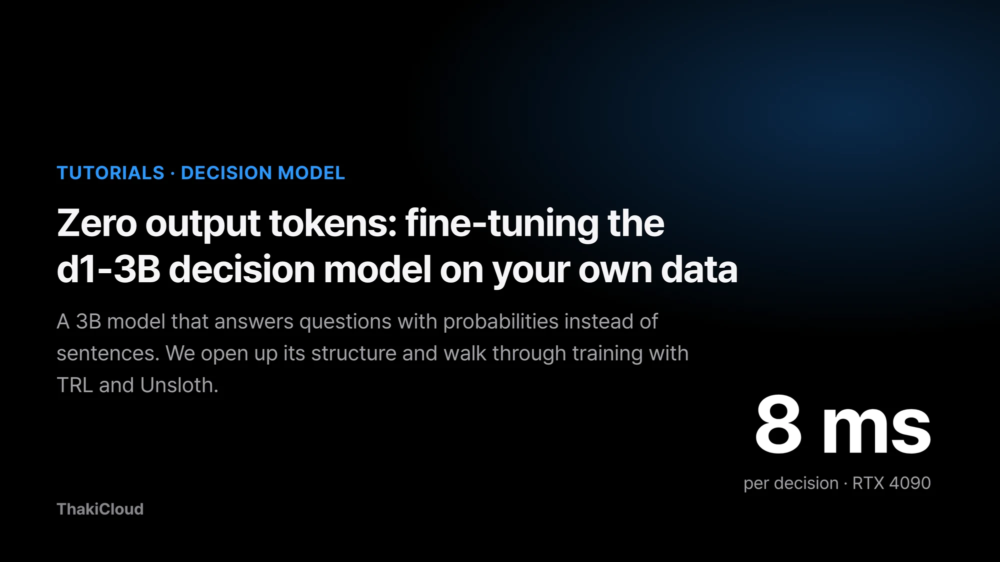
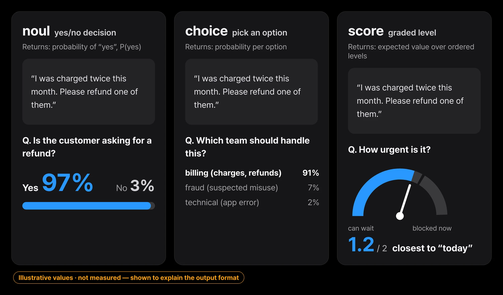
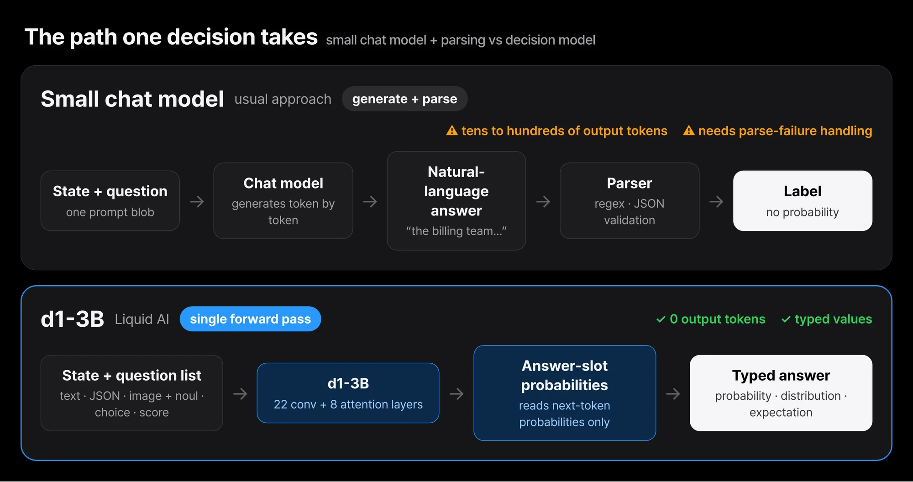
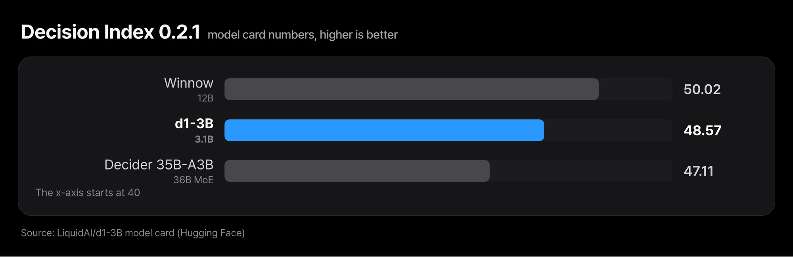

Routing a customer message to the right team, picking the next tool an agent should call, checking that a payment API call is safe before it goes out. Inside a product there are many places that need a short decision rather than a long answer. Until now we filled those places with a small chat model and parsed the sentence it wrote to pull a label out.

Liquid AI's d1-3B is built for exactly those places. It does not write a sentence; it returns a probability for each question. It produces zero output tokens and takes 8 ms per decision on an RTX 4090. Training is light too. Because the answer is a single token, you can fine-tune it on your own labels in about 30 minutes on a free GPU.

This post starts with the shape of the values d1-3B returns, opens up the model, and then walks through fine-tuning it along two paths, TRL and Unsloth.

## Three question types that return probabilities instead of sentences

You give d1-3B two inputs: the **state** you want judged (text, JSON and images can be mixed) and a **list of questions**. Each question uses one of three types.


*You can ask all three questions about the same message at once. The values in the figure illustrate the format and are not measurements.*

A noul question is yes/no and returns the probability of "yes". A choice question picks among options and returns a probability for each option. A score question places the input on an ordered scale such as "can wait → today → blocking now" and returns the expected position.

Since the values arrive as numbers, you can wire them straight into service code. Send the ticket to the billing team when the billing probability is above 0.9, and hand it to a person when it hovers around 0.5. No parser, and no parse-failure handling.

Here is the example from the model card, unchanged.

```python
import torch
from transformers import AutoModel

model = AutoModel.from_pretrained(
    "LiquidAI/d1-3B", trust_remote_code=True, dtype=torch.bfloat16
).to("cuda")

questions = {
    "refund": {"type": "noul", "instructions": "Is the customer asking for a refund?"},
    "team": {
        "type": "choice",
        "instructions": "Which team should handle this?",
        "criteria": {
            "billing": "Charges, refunds, invoices",
            "technical": "App or site faults",
            "fraud": "Suspected unauthorised use",
        },
    },
    "urgency": {
        "type": "score",
        "instructions": "How urgent is this?",
        "criteria": ["Can wait", "Today", "Blocking the customer now"],
    },
}

print(model.system_one(
    "I was charged twice this month, please refund one of them.", questions
))
```

The descriptions you write in `criteria` are the options. When you fine-tune later, this same schema becomes the shape of your training data.

## No sentence to write means no parser to maintain

Doing the same decision with a chat model takes a longer path. The model writes a sentence like "This belongs to the billing team…" one token at a time, and then a regex or JSON validator reads that sentence back to extract a label. The extracted label carries no probability, so you cannot tell how confident the model was.


*Top: a chat model writes its answer as a sentence and the sentence is parsed again. Bottom: d1-3B passes through the model once and reads only the probabilities at the answer slot.*

d1-3B runs the model exactly once (a single forward pass). At the position where the answer goes, it reads the probability of each possible next token, renormalizes over the option tokens, and uses that as the answer. There is no generation loop, so there are zero output tokens, which is where the 8 ms comes from.

The architecture leans toward speed as well. We downloaded the weights and read `config.json` ourselves: the text stack has 30 layers, 22 of which are convolution (conv) layers that look at a short window, and only 8 are attention layers that see the whole context. Attention cost grows quadratically with input length; conv layers do not. That is why it stays fast while accepting a 32,768-token context.

| Item | d1-3B |
|---|---|
| Base model | LFM2.5-VL-3B (3.1B, vision-language) |
| Layers | 30 = 22 conv + 8 attention |
| Image encoder | SigLIP2 NaFlex 400M (one image → 64–256 tokens) |
| Context length | 32,768 tokens |
| Languages | 16 (including Korean) |
| License | lfm1.0 (custom, not Apache-family) |

## A 3B model that out-decides a 36B MoE

Decision quality is measured with the Decision Index. On the 0.2.1 scores published in the model card, d1-3B gets 48.57. That is 1.5 points below the 12B Winnow (50.02) and above the 36B MoE Decider 35B-A3B (47.11).


*Decision Index 0.2.1, numbers from the model card. The x-axis starts at 40.*

Speed depends on the device. Replaying the per-decision latency from the model card at real speed makes the gap easy to see.

<figure class="fig-video"><video src="/assets/images/d1-3b-decision-model-finetune-fig-race-en.mp4" poster="/assets/images/d1-3b-decision-model-finetune-fig-race-en.webp" autoplay muted loop playsinline preload="metadata" aria-label="Animation replaying per-decision latency on four devices at real speed"></video><figcaption>RTX 4090 8 ms, Jetson AGX Thor 16 ms, Apple M5 Pro 30 ms and Jetson Orin Nano 50 ms (model card numbers), replayed at real speed for 8 seconds. These are one-request-at-a-time values; batching 64 requests together reaches 475 decisions per second on the 4090.</figcaption></figure>

What stands out is that even an edge board finishes one decision within 50 ms. You can attach a decision model directly to devices outside the datacenter, such as factory cameras or store terminals.

## Four steps to fine-tune on your own data

Liquid AI published two notebooks (`finetuning/notebooks/` in `Liquid4All/cookbook`), one for the TRL path and one for the Unsloth path. The procedure is the same; only the install stack and memory use differ.

**Step 1, prepare the data.** Each training row is (state, question schema, correct label). The quality of the option descriptions matters more than volume. If you only write "billing: charges and refunds", a message like "the in-app payment screen goes blank" splits its probability between billing and technical. Adding a sentence or two about which phrasings belong where, and mixing such borderline cases into the data, decides most of the quality.

**Step 2, train with TRL.** After `pip install "transformers>=5.14" torch torchvision pillow`, the notebook puts LoRA on top of d1-3B and runs SFT. The bf16 weights are a little over 6GB, so they fit comfortably on a 24GB GPU, and the notebook author reports that a run takes about 30 minutes. The model ships its own chat template in code, so you do not need a separate data-conversion script.

**Step 3, or train with Unsloth.** It combines 4-bit loading with LoRA to run the same process on a smaller GPU. One point is easy to confuse: the Unsloth doc "Train your own Decision Model" is not about training d1. It is a separate feature that attaches a decision head to another LLM such as Qwen. To train d1-3B, follow the cookbook notebook.

**Step 4, verify.** After training, you still call `system_one` the same way. On your own test set, check whether the probabilities separate. If clear billing tickets gather near 0.9 and clear technical tickets near 0.1, training worked; if many tickets bunch around 0.5, revisit the option descriptions or the data.

We have not run the fine-tune ourselves yet. We uploaded the 15 weight files (6.27GB) to our internal dev S3 and verified the structure; reproducing training on the cluster is running as a separate job.

## In Paxis it slots into the policy gate

ThakiCloud's agent platform, Paxis, sends an agent through a policy gate before it calls an external tool. If a chat model makes that call, every invocation pays for sentence generation and carries parse-failure risk. With d1-3B, "Does this payment call comply with policy?" becomes a single noul question, and its probability is compared directly with the gate threshold. Because the verdict is a number, it can go straight into the audit log.

On the serving side, 3.1B in bf16 uses little GPU memory, so it can run as a customer-dedicated gateway on the Telox GPU cloud or be pushed down to edge devices at the customer site. Before deployment, though, check the commercial redistribution terms of the lfm1.0 license in the original text.

## Four things to know before you use it

First, the license is a separate agreement called lfm1.0. When you distribute a fine-tuned model, confirm whether the original license terms carry over. Second, not writing sentences is both the strength and the limit: it cannot do work that produces text, such as summaries or conversation. Third, the context is 32K, so judging a long document as a whole needs splitting or retrieval in front. Fourth, the claim that its probabilities are well calibrated rests on the official benchmark. Re-check it on a test set from your own domain.

## Closing

Swapping the chat model in a decision slot for d1-3B removes the parser, brings latency down to milliseconds, and leaves every decision as a probability. The cheapest first experiment: pick one decision slot, write a one-sentence description for each option, label 50 to 100 borderline cases, train once with the cookbook's TRL notebook, and see whether the probabilities separate. It takes a day.

### Sources

- [LiquidAI/d1-3B model card (Hugging Face)](https://huggingface.co/LiquidAI/d1-3B)
- [Open d1 blog (Liquid AI)](https://www.liquid.ai/blog/open-d1)
- [sft_for_decision_models_with_trl.ipynb (Liquid4All cookbook)](https://github.com/Liquid4All/cookbook/blob/main/finetuning/notebooks/sft_for_decision_models_with_trl.ipynb)
- [Train your own Decision Model with Unsloth (Unsloth docs)](https://unsloth.ai/docs/new/train-your-own-decision-model-with-unsloth)
- [AGI Hunt tutorial write-up](https://agihunt.info/en/p/1a1439b1e278d5f049ff1a6d4d6)
