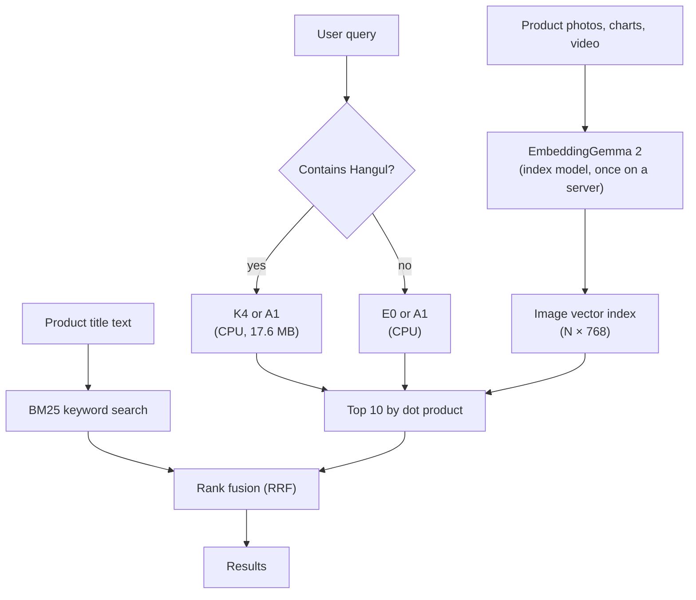

## Why read this

This is for you if you are building text-to-image or text-to-video search and the original EmbeddingGemma 2 (about 1.5 GB) is too heavy to ship. The short answer is to split the work in two. Build the image index once on a server with EmbeddingGemma 2, and let a 17.6 MB query encoder turn each user query into a vector on CPU. If you only need a smaller download for the index model, use one of the 550 MB quantized models.


*Index big, once. Search small, many times.*

ThakiCloud published four Hugging Face repositories for this setup. Below we cover which one to pick, how to run it, what has been measured and what has not. There is no new training or benchmarking here. Every number comes from the published model cards.

## Overview: what the four repositories do

[EmbeddingGemma 2](/en/owm/embeddinggemma-2-multimodal-embedding/) maps text, images, audio and video into one 768-dimensional space. Text-to-image search needs two things: an **index model** that turns images into vectors, and a **query model** that turns search text into vectors in the same space. The four repositories split along those two roles.

| Repository | Role | Size | Use it when |
|---|---|---|---|
| [`eg2-w6-text-w4-media`](https://huggingface.co/ThakiCloud/eg2-w6-text-w4-media) | Index (6-bit text, 4-bit image/audio) | 550,244,021 B | you need image/video embeddings with a smaller download |
| [`eg2-mixed-bit-550mb`](https://huggingface.co/ThakiCloud/eg2-mixed-bit-550mb) | Index (4/6/8 bits per matrix) | 549,949,165 B | same use, different bit allocation |
| [`eg2-tiny-query-a1`](https://huggingface.co/ThakiCloud/eg2-tiny-query-a1) | Query, Korean + English | 17,597,714 B | searching chart or app-screen image indexes |
| [`eg2-tiny-query-commerce-ko`](https://huggingface.co/ThakiCloud/eg2-tiny-query-commerce-ko) | Query, Korean K4 + English E0 | 32,971,443 B (two encoders) | searching product-image indexes in Korean |

The recommended Commerce version is **K4**. `main` is K4; earlier versions remain as the `k3` and `k2` revisions. All four repositories and the related papers are in the [EmbeddingGemma 2 Edge collection](https://huggingface.co/collections/ThakiCloud/embeddinggemma-2-edge-quantization-6ac5ffaa9257f8357645fff2).

## What this setup is

In a search system the image index rarely changes. Product photos and charts are embedded once. Queries, on the other hand, arrive with every request. So the heavy model belongs on the index side and a small model on the query side.



A1 and K4 are a TinyCLIP Text-3M text tower plus a 256→768 linear layer, distilled to imitate EmbeddingGemma 2's query and image vectors, with row-wise INT8 weights. Because their output lands in EmbeddingGemma 2's image space, they **search an existing EmbeddingGemma 2 image index without re-indexing**.

The two 550 MB models shrink the other side, the EmbeddingGemma 2 model that builds the index. They are 36% of the upstream BF16 repository (1,525,810,123 B). Only disk and download shrink, though. The loader dequantizes every matrix back to BF16, so memory and speed match the original.

## Installation and usage

### Step 1: build the image index once

If you plan to use a small query encoder, build the index with **the original `google/embeddinggemma-2`**. A1 and K4 were trained against its image vectors; pairing them with vectors from a quantized model was not tested. Each repository's `example_search.py` builds the index for you.

```bash
pip install "sentence-transformers[image]>=6.1.0" huggingface_hub
python example_search.py build --images ./products --index index.npz
```

`sentence-transformers[image]` is needed only to build the index, not to search it. Encode each image on its own (`{"image": PIL.Image}`) and L2-normalize.

### Step 2: search with a small query encoder

Searching a product-image index in Korean looks like this. CPU is enough. You need `torch`, `transformers`, `safetensors`, `huggingface_hub` and `numpy`.

```python
import sys
import numpy as np
from huggingface_hub import snapshot_download

repo = snapshot_download("ThakiCloud/eg2-tiny-query-commerce-ko")  # main = K4
sys.path.insert(0, repo)
from commerce_query import CommerceQueryEncoder

enc = CommerceQueryEncoder.from_pretrained(repo)   # Hangul -> K4, otherwise E0
q = enc.encode(["무선 블루투스 이어폰 화이트", "stainless steel water bottle"])

image_vectors = np.load("image_vectors.npy")       # (N, 768) L2-normalized EG2 image vectors
top10 = np.argsort(-(q @ image_vectors.T), axis=1)[:, :10]
```

By default a query containing Hangul goes to K4 and anything else to E0. Pass `route="ko"` or `route="en"` to force one encoder. For a chart or app-screen index, switch the repository to `eg2-tiny-query-a1` and use `A1QueryEncoder`; A1 is a single encoder for both Korean and English.

### Step 3: BM25 for exact product names, the model for descriptions

The Commerce example can also fuse the model's top 10 with a BM25 index over your own product titles. Put one line per image in `catalog.jsonl` with the image path and its title, brand and attributes.

```bash
python example_search.py search --index index.npz --query "여성 겨울 롱패딩 블랙"
python example_search.py search --index index.npz --catalog catalog.jsonl --query "나이키 러닝화"
```

Which one to use depends on the query. When users type the product name itself, BM25 is already close to perfect: on 889 Korean product-name queries, BM25 alone reached R@1 0.911 and R@10 0.993. Fusing K4 in left R@10 unchanged and lowered R@1 to 0.724. On descriptive queries that do not use the product's name, BM25 reached only R@10 0.290 while K4 alone reached 0.652. If your catalog has product-name text, leave name search to BM25 and use the model for descriptive queries and for images without text.

## Measured results

All numbers come from the model cards. Intervals are 95% cluster-bootstrap intervals over paired per-query differences. Each version was trained once, so the intervals reflect query sampling only.

**550 MB index models.** Measured on a sealed set opened once: 2,113 text-to-image and 1,252 text-to-video queries. With BF16 at R@1 0.3213 (image) and 0.2732 (video), the uniform 6-bit model scored 0.3218 and 0.2676, and the mixed-bit model 0.3204 and 0.2636. Both were judged non-inferior within the pre-registered margin (10% of BF16 R@1). Neither can be called better than the other: no test between the two 550 MB models was registered, and the mixed-bit model's video lead on development data did not replicate on the sealed set. Without a specific reason, start with the simpler uniform 6-bit model.

**A1, chart search.** Tested once on a group of chart publishers held out of training and model selection. OCR + BM25 alone reached R@10 0.9473; fusing A1 in raised it to 0.9727 (+0.025, interval [+0.015, +0.033]). A1 alone, however, scored 0.7617, below OCR + BM25, and fusion lowered R@1 from 0.733 to 0.705. Use A1 to widen a keyword search's top 10 on Korean charts, not as the only retriever or for screens that show a single top result. On English app screens (RICO, 2,364 queries) A1 matched its English-only predecessor in R@10 (0.4522 vs 0.4492), so adding Korean did not cost English.

**K4, Korean product search.** On a pool of 27,309 ABO development product images, Korean product-name R@10 rose from 0.368 with E0 to 0.711 with K4 (+0.343). On synthetic descriptive queries K4 reached 0.652, close to the teacher's 0.663. Those synthetic queries come from the same generator as part of the training data, so they are not evidence about real user queries. English queries go to E0 under default routing, so English results are unchanged.

We also ran an install check: downloading the published files in a clean environment, indexing 200 ABO products and searching with their Korean names gave R@1 0.68 and R@10 0.955. The pool is tiny, so this shows the files load and search correctly, not quality.

## What this means for ThakiCloud

This split matches how the ThakiCloud AI platform serves search on-premises and at the edge. Index building runs once as a batch job on a GPU server, and query encoding runs on CPU without a GPU. No GPU has to stay resident for queries, which lowers serving cost, and a 17.6 MB encoder is easy to carry into air-gapped environments. Serving the 4-bit EmbeddingGemma 2 on standard vLLM is covered in [an earlier post](/en/llmops/eg2q-vllm-plugin-serving/).

We trained these models on our in-house GPU queue, fixed the evaluation rules before looking at scores, and opened sealed sets only once. That is also why the "not claimed" sections of the cards are long: a customer re-measuring on their own data should reach the same conclusions.

## Limitations

- **Mixing index and query models.** A1 and K4 were checked only against original EmbeddingGemma 2 image vectors, not against an index built with a 550 MB model. Do not mix serving stacks either: serving BF16 through vLLM changed the rank-1 result on 17.5% of image queries compared with sentence-transformers.
- **What the 550 MB models do not cover.** Audio was not evaluated because the sealed audio set failed its independence audit. Text-to-text retrieval was not measured. There are no memory savings or speed-ups.
- **Scope of the K4 evidence.** It has not been evaluated on human-written Korean shopping queries. On 35 very short product names (16 tokens or fewer) it did not improve. Forcing K4 on English lowers English keyword R@10 slightly (−0.010).
- **First-result accuracy.** Both query encoders are built to put the right item in the top 10. If your screen shows one result, BM25 or the teacher model does better.
- **Training repeats.** Each version was trained once, so seed variation is unknown. Latency and memory on devices were not measured.

## Summary

For image and video search with EmbeddingGemma 2, start by separating indexing from querying. Build the index once on a server, using a 550 MB model (uniform 6-bit first) if download size matters. If that index must be searched in Korean, put a small encoder on the query side: A1 together with OCR + BM25 for charts and app screens, K4 for product images. If you use a small encoder, though, build the index with the original EmbeddingGemma 2. Leave exact product-name search to BM25 and use the model for descriptive queries and images without text.

To start, run the Commerce repository's `example_search.py` on a few hundred of your own images and try some real queries. The numbers are on each repository card and the model list is in the [collection](https://huggingface.co/collections/ThakiCloud/embeddinggemma-2-edge-quantization-6ac5ffaa9257f8357645fff2).
