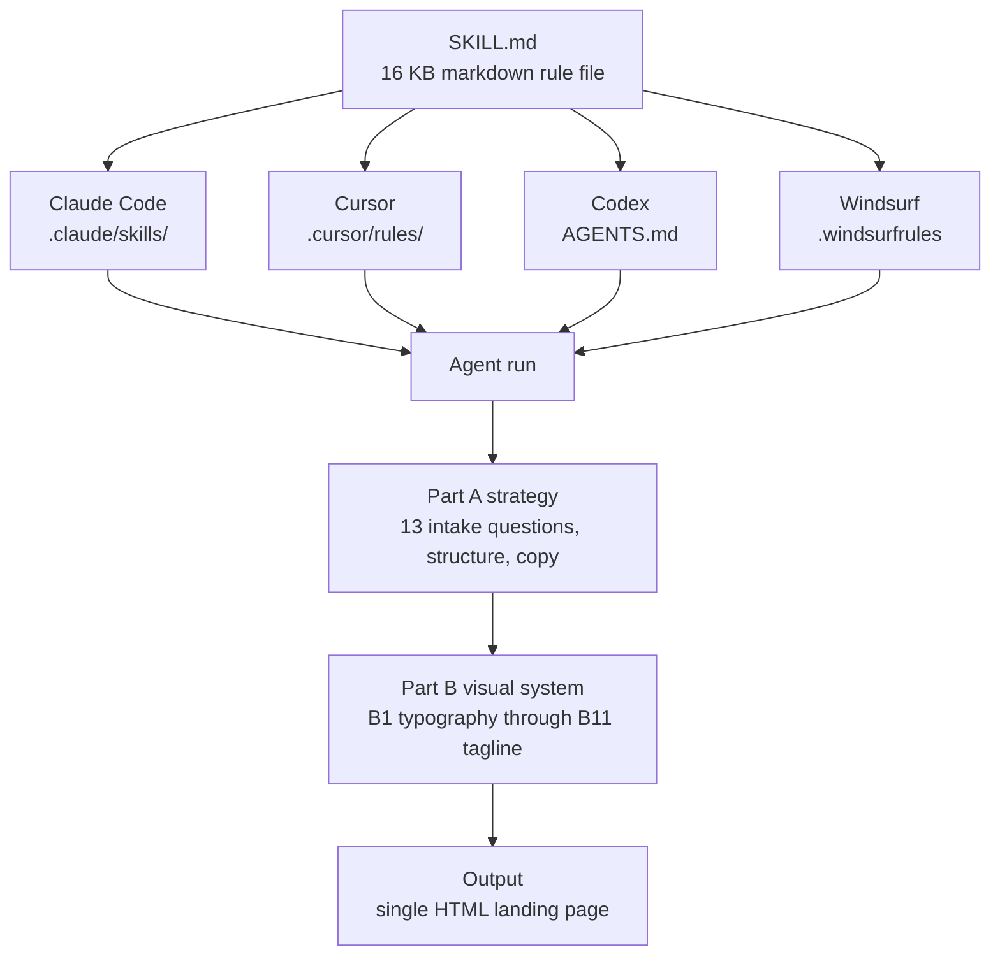

## Why read this

If you generate landing pages with Claude Code or Cursor and the output always looks like a template someone else's algorithm picked, or if you are a designer who wants to turn your team's visual standards into a file an agent will actually follow, read this. The result first: a 16 KB markdown file published by an 8-year product designer pinned all six design determinants of the landing page an agent built (easing curve, heading gradient, 680 px hero cap, button padding, type scale, spacing tokens), while the arm without the skill produced 10 gate violations, including the placeholder brand "Acme", six font sizes off the scale, and two title-case headings.


*What the skill file pins is values, not mechanisms.*

## Overview

On October 24, product designer Elaya (@elayadesigns) posted that she had designed all of her landing pages over the last two months using Higgsfield, Claude, and Cursor together with a custom AI designer skill, and open-sourced the skill. The video attached to the tweet shows the results. Elaya is an 8-year product designer and the developer of slopscan.co; her move was to stop deciding the direction of each design and start writing the rules of design into a file that agents follow. Higgsfield is a video-generation creative platform; in this stack it supplies the visual assets, Claude and Cursor supply the code, and the custom skill supplies the design rules in between.

The repository is [elayadesign/ai-design-skills](https://github.com/elayadesign/ai-design-skills). It is MIT-licensed and contains two skills: `landing-page-design` (16.5 KB), which builds the page, and `design-to-motion` (39.1 KB), which turns a static design into a showcase animation. The repo was created at the end of July 2026, and `design-to-motion` was added the day of this announcement, October 25.

## What this skill system is

The file format is plain. One markdown file with a frontmatter (name and description) and a body. It drops unchanged into `.claude/skills/` for Claude Code, `.cursor/rules/` for Cursor, `AGENTS.md` for Codex, `.windsurfrules` for Windsurf, and `.clinerules` for Cline. All install paths at once:

| Tool | Install path |
|---|---|
| Claude Code | `.claude/skills/<skill-name>/` |
| Cursor | `.cursor/rules/<skill-name>.md` |
| Codex | `AGENTS.md` |
| Windsurf | `.windsurfrules` |
| Cline | `.clinerules` |
| Claude.ai (no terminal) | Upload the file to a Project |

Inside `landing-page-design`, **Part A is strategy** and **Part B is the "non negotiable" visual system**. Part A starts with 13 intake questions (the one primary action, the audience, what counts as conversion, the ICP, the top three objections, proof points, brand voice, and so on), then fixes the page structure and the copy. A2 pins the page to 12 sections: above the fold, a headline (outcome plus audience), a subheadline, the primary CTA, one proof signal, and a hero visual; mid page, problem-to-solution, three to five outcome-driven benefits, a three-step how-it-works, social proof, and the B11 tagline; at the bottom, a 6 to 12 question FAQ, risk reversal, and a final CTA identical to the top. A3 offers four layout types, A (classic hero) through D (comparison page), and requires the builder to pick one and say why. Part B has 11 sections, B1 through B11, each with concrete values that code can check.

- **B1 Typography**: four allowed fonts (Geist, Manrope, Geist Mono, Poppins), five banned fonts (Inter, Roboto, Arial, Open Sans, Helvetica), one typeface family per site, and font sizes only on Tailwind's default scale (12 to 128 px).
- **B2 Spacing**: thirteen allowed values (0, 2, 4, 8, 12, 16, 24, 32, 40, 48, 64, 80, 96 px). Nothing between them, nothing outside them.
- **B3 Corner radius**: Tailwind values only. Nested rule: when the gap between an inner and outer shape is under 32 px, inner radius = outer radius minus gap, and if that result is 2 or less, the inner shape stays square.
- **B5 Hero**: on a light theme, a heading text gradient from `#000000` to `#666666` (the only place a gradient may appear), and a 680 px max width for heading and subheading.
- **B6 Icons**: Phosphor, Solar, or Iconamoon only. Material Icons/Symbols banned.
- **B7 Motion**: one easing curve, `cubic-bezier(0.32, 0.72, 0, 1)`. `window.addEventListener('scroll')` banned.
- **B8 Content realism**: a banned-word list (Lorem Ipsum, John Doe, Acme, Nexus, SmartFlow, 99.99%, Elevate, Seamless, Unleash, Next Gen, Game changer, Delve, Tapestry, In the world of), no round fake numbers, sentence-case headings, active voice.
- **B10 Ship requirements**: skip link, 404, favicon, og tags, semantic HTML, form validation, and so on.
- **B11 Tagline reveal**: a large-type tagline section as its own moment lower on the page, activated word by word via IntersectionObserver in reading order, starting at 25 to 35 percent of the base text opacity.

The skill fixes the working order too. Before any code, the agent must present seven things: page outline, hero copy, benefits, how it works, FAQ, SEO, and the layout recommendation. Only then does the section-by-section build start.


*One rule file fans out to five tool install paths and feeds a common visual system into every agent run.*

The second skill, `design-to-motion`, turns a Figma frame or a screenshot into a pixel-exact HTML replica that loads from an empty state, acts out what every visual does in a seamless loop, and exports MP4 and GIF. Part 1 is worth noting: before anything moves, the rebuilt still must be indistinguishable from the source. "A showcase animation is not a redesign. The viewer must see the exact design, and they must see that it is alive," the file opens. The background layer is marked sacred, and nothing may be encoded before the still passes its A7 check. The landing page videos in the tweet are the output of this skill. Some of the motion rules are adapted from three MIT-licensed repositories, credited by name. A companion skill for redesigning existing sites (`redesign-existing-projects`) is published separately.

## Installation

For Claude Code, the real commands are:

```bash
git clone https://github.com/elayadesign/ai-design-skills.git /tmp/ai-design-skills
cp -r /tmp/ai-design-skills/skills/landing-page-design .claude/skills/
```

Then you ask for a landing page in plain language. The frontmatter description at the top of the file states the trigger conditions, so the agent consults it the moment a design decision comes up. In Cursor, you download the single SKILL.md into `.cursor/rules/`.

The README's "Make it yours" section states the philosophy. Every skill's design values (fonts, colors, spacing, motion) live in one section near the bottom of the file. Fork the repo, edit that section, and the rest of the skill follows automatically. The file is not a design system; it is the default values of a design system, and yours is the one where you change them.

## Experiment and results

"Does an agent follow a markdown rule file?" is a claim that needs a check. So we ran two arms with the same brief: a landing page for Metis, our serverless inference endpoint product. English, single-file HTML, no external requests. One arm read the skill file first and applied it; the other was forbidden from the skill, from any rules document, and from any external source, and built purely from judgment.

The brief was the skill's 13 intake questions pre-answered: the primary action (start a free trial), the ICP (ML engineers and platform teams who do not want to run their own GPU fleet), the top three objections (serving latency, where the data lives, per-token price), and the proof points (public demo, endpoint in under 10 minutes, multi-tenant Kubernetes). Per the skill's rule to make a stated assumption and continue when an answer is missing, neither arm stalled on intake. Both arms wrote a seven-step plan.md first, then the HTML. Each ran as a sonnet subagent; wall-clock was 12.1 minutes (727 s) for the skill arm and 9.5 minutes (568 s) for the control.

The outputs: 44,440 bytes, 900 lines, 8 h2 sections for the skill arm; 30,627 bytes, 649 lines, 7 h2 for the control. Both are single files with zero external requests, a skip link, footer links, og tags, and email validation. The difference is below.

**Quality gate (code verdicts)**: banned-word hits, off-scale font size count, title-case heading count, exclamation marks in copy. The skill arm scored 0-0-0-0. The control scored 2-6-2-0. "Acme" appeared twice (a placeholder brand B8 bans by name), six font sizes sat off the Tailwind scale (22, 28, 34, 40, 44, 56 px), and two headings ran in title case, such as "Stop renting GPUs. Start shipping models."

**Skill signature (the six determinants the designer fixed)**: exact easing curve, heading gradient, 680 px hero cap, button padding 8/12 px, full type-scale adherence, full spacing-token adherence. The skill arm had all six. The control had none.


*Left: without the skill, ten classic slop hits. Right: the designer's six determinants are all present only when the skill is applied.*

Three findings.

**First, the model builds the mechanism on its own.** The control arm, with no skill, built a word-by-word IntersectionObserver tagline reveal. That is B11's structure itself. The difference was in the values. The control started at opacity 0.16 with `ease` and a 70 ms stagger per word; the skill specifies a 25 to 35 percent band, `cubic-bezier(0.32, 0.72, 0, 1)`, and a mid-viewport trigger line. The skill file's job is not "make this effect happen." It is "fix the values as the designer's."

**Second, the skill does not control facts.** The skill arm's page carries numbers like "9m 41s", "$38.42", and "2,411,806 tokens" that were not in the brief. B8 requires organic, non-round data, so where evidence was missing the model filled the gaps with believable-looking fakes. It even inferred a canonical domain (`thakicloud.net`) on its own. A design rules file pins design; facts must be pinned by the brief.

**Third, the skill exits honestly at physical limits.** Two B10 ship items, a branded 404 page and cookie consent, cannot exist in a single-file experiment. The skill arm skipped both and wrote the reason into HTML comments. The B3 nested-radius formula was applied as arithmetic: the hero mockup has a 16 px card with a 24 px gap to its inner panel, and the page's comment records the calculation (16 minus 24 is not greater than 2, so the inner panel is square). The agent substitutes into the rule rather than interpreting it.

Verification note: the skill arm could not read the skill file from the sandbox, so it retrieved the identical main-branch file from raw.githubusercontent.com. Every applied rule value (scale, spacing, easing, the B3 formula, the B5 gradient, the B6 icon set) was cross-checked against our local clone item by item, and all matched. One transparency note: the experiment brief itself was derived from the skill's output format, so planning-stage rules such as "pick layout A through D and say why" reached both arms. The A/B difference is in the HTML's design values, not in the plan.

## What this means for ThakiCloud

Two things, from the Paxis side.

First, **a design system becomes a first-class agent resource when it is a 16 KB markdown file.** Paxis, ThakiCloud's Agent-Native Cloud, treats skills as first-class resources: 960+ skills are selected by BM25, executed in an isolated sandbox, and every action passes a policy gate plus an audit log. Once a file like `landing-page-design` sits in that harness, "this is what our landing pages look like" stops being a personal folder of rules on one laptop and becomes an organizational asset applied consistently to every agent run.

Second, **the compliance verdict belongs to code, not to an LLM.** Every gate in this experiment was a regex or an HTML parser: banned-word hits, off-scale font counts, title-case headings, presence of the easing curve. An LLM's answer to "does this page match our design system" wobbles between runs; a code verdict records 0 and 10 as-is. The gate results land as one JSON line per run, and that line accumulates into a design-compliance history, an audit log of which rule the agent broke and when it was fixed. That is the same structure by which Paxis policy gates agent behavior, and visual compliance is a natural extension of its scope. The experiment artifacts (gate script and both pages) are a starting point for a design-skill verification hook inside a team.

## Limitations

This was one experiment, one product (Metis), one language (English). The author's "two months of landing pages" is a case report, and this experiment does not verify it. The skill's aesthetic (light, minimal editorial) is tuned to one direction; a dark glass or playful 3D page needs the "Make it yours" section edited before the rules apply. B8's no-round-numbers rule can push a model to invent organic-looking data where evidence is absent, and that is exactly what we observed. A single landing page is the unit tested; component-library reuse (design tokens, state matrices) is outside its scope. And some of the control arm's "slop" (title-case headings among it) would be a legitimate style choice under any other standard. The gate verdicts are violations of this skill's standard, not a universal definition of bad design.

## Summary

The unit that pins an agent's design is not a prompt. It is a rules file. And what the rules file actually pins is not the mechanism but the values. A model will build a word-by-word reveal without being told; fixing the easing curve, the 680 px hero cap, and the 8/12 px button padding as yours is the rules file's job.

The next step: if your team's AI-generated UI looks like a template, pick the six design determinants you value most (allowed fonts, spacing tokens, radius, easing, banned words, ship checklist), write them into one markdown file, and judge compliance with code, not with an LLM. Sixteen kilobytes was enough.
