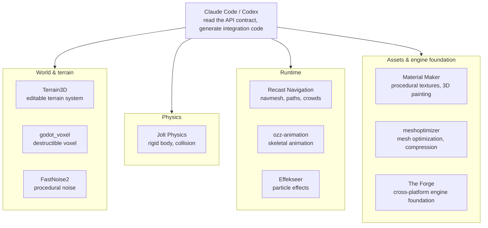

## Why read this

If you are a developer building a game prototype with Claude Code or Codex, or deciding which mature libraries to hand an agent, this is for you. The bottom line up front: the 10 "insane repos" in the viral tweet (4,200 likes) all check out against the GitHub API, and building and running one of them (meshoptimizer) produced the numbers that make the "combine these and you get AAA-style systems" claim hold. The key is not the libraries themselves but the pattern of giving an agent the API contract (headers and docs) and letting it write the integration code.


*Modular game systems, assembled by an agent reading each library's API contract.*

## Overview

On October 29, developer @heyrimsha posted that "GitHub is a goldmine for game developers" and shared "10 insane repos that can help you build AAA-style games using Claude Code and Codex." As of October 30 the tweet had 4,200 likes and 367 retweets.

The point of the list is the last line: "Give Claude Code or Codex the relevant docs and ask it to help integrate the systems your project needs." In other words, do not have the agent write a physics engine from scratch; have it read the docs of an already AAA-proven library and produce the integration code. To check whether that claim holds rather than being marketing, we measured all 10 repos through the GitHub REST API and actually built and ran one of them (meshoptimizer) in a sandbox.

## What are these tools

The 10 repos split into four groups by the game system they cover: world and terrain, physics, runtime (movement, animation, effects), and assets and engine foundation. Each covers the area below, and the measured numbers are in the table.

**Physics.** Jolt Physics (jrouwe/JoltPhysics) is a multi-core-friendly rigid body physics and collision detection library. It is written in C++, and its GitHub description names Horizon Forbidden West and Death Stranding 2. It has the most stars on the list (11,947) and its role is to put believable physical interactions into your game.

**World and terrain.** Terrain3D (TokisanGames/Terrain3D) is a high-performance editable terrain system for Godot 4. As a C++ GDExtension, the README screenshot attached to the tweet describes regions from 64x64m up to 65.5km, up to 32 texture layers, 10 LOD levels for the terrain mesh, foliage instancing, and heightmap import (HTerrain, Gaea, World Creator, Unity, Unreal, and so on). godot_voxel (Zylann/godot_voxel) is Godot's voxel module, handling worlds players can destroy (caves, tunnels, overhangs) and terrain that streams as they explore. FastNoise2 (Auburn/FastNoise2) is a node-graph, modular noise generation library built on SIMD, C++17, and templates, the raw material for procedural terrain and textures.

**Runtime.** Recast Navigation (recastnavigation/recastnavigation) is the navigation standard, with the GitHub description "Industry-standard navigation-mesh toolset." It covers enemy and NPC movement within a level, navigation mesh generation, path calculation, and crowd simulation with collision avoidance. ozz-animation (guillaumeblanc/ozz-animation) is an open-source C++ skeletal animation library and toolset, handling character animation loading, playback, and blending. Effekseer (effekseer/Effekseer) is a C-based particle effects library that builds explosion, magic, combat, and environment effects, exporting them as 2D animations or integrating 3D effects into your engine.

**Assets and engine foundation.** Material Maker (RodZill4/material-maker) is a Godot-based procedural texture authoring and 3D model painting tool. Per the README screenshot in the tweet it is built on Godot's GraphEdit node, expressing textures and brushes as interconnected nodes, distributed through itch.io and Steam, and installable on Windows via `scoop install material-maker`. meshoptimizer (zeux/meshoptimizer) is a "mesh optimization library that makes meshes smaller and faster to render," solving the problem of detailed models crushing performance through optimization, simplification, and compression. The Forge (ConfettiFX/The-Forge) is a cross-platform framework for building a custom engine, and its official description lists Windows, Steam Deck (native), ray tracing, macOS/iOS, Android, XBOX, PS4, PS5, Switch, and Quest 2.

The practical criterion for choosing is "which engine you are building on." In a Godot project, Terrain3D, Material Maker, and godot_voxel attach as addons, and the remaining C++ libraries can be wrapped as GDExtensions. In Unreal, Unity, or a custom engine, drop the three Godot addons and include the piece you need from Jolt, Recast, ozz, meshoptimizer, FastNoise2, and Effekseer with a single header. The Forge only matters once you have decided to build a new engine; it is the item on the list that demands the biggest decision.



These ten fall into two axes. Three are Godot addons that attach in place (Terrain3D, Material Maker, godot_voxel) and six are standalone C++ libraries that do not care about the engine (Jolt, Recast, ozz, meshoptimizer, FastNoise2, Effekseer). The latter are link targets in any engine once you include a header, so there is a lot of room for an agent to reason about "how do I slot this into our engine." The Forge is one step above even those: it gives you the skeleton of an engine (graphics infrastructure, resource loading, animation systems) rather than the engine itself. So this list is less "one engine" and more "a parts shelf," and the pieces you need depend on what engine your project runs on.

## Installation and integration

The integration path splits into Godot addons and standalone C++ libraries.

**Godot ecosystem (Terrain3D, Material Maker, godot_voxel).** These are addon-style. Clone the repo into the project's `addons/` directory or import it from AssetLib and enable it in the editor. Material Maker is also distributed as a standalone app, so on Windows you can install it with `scoop install material-maker` (measured from the README).

**Standalone C++ libraries (Jolt, Recast, ozz, meshoptimizer, FastNoise2, Effekseer).** Clone them into `third_party/` and link. Most ship a CMake or Makefile, and even those that do not are frequently buildable as a single self-contained translation unit. meshoptimizer's `src/simplifier.cpp` is the example; in the experiment we confirmed the Makefile's `simplifyfuzz` target builds it from that single file alone.

The real commands captured in the sandbox:

```bash
git clone --depth 1 https://github.com/zeux/meshoptimizer.git
# src/simplifier.cpp is self-contained (per the Makefile)
clang++ -O2 -std=c++11 -Irepo/src mysimplify.cpp repo/src/simplifier.cpp -o mysimplify
```

**Handing it to the agent.** Translating the tweet's core instruction, "give it the relevant docs," into practice means giving the agent (1) the API contract = header file, (2) the build rules = Makefile/CMake, and (3) the acceptance criteria = target numbers (vertex count, error budget, frame time). For example, the prompt "read the `meshopt_simplify` signature in `src/meshoptimizer.h` and the Makefile, then write a driver that reads an `.obj` asset, simplifies it to 50% of the original triangle count with an error budget of 0.001, and prints the vertex count and error" produced the meshoptimizer driver in the next section (about 40 lines), which we actually wrote and ran. The essence of the pattern is that the agent does not guess the API; it reads the header and writes code that matches the signature.

Applied to a game project, the pattern becomes three steps. First, system selection: decide which of physics, movement, animation, and effects the project needs, and pick one or two pieces from the list. A 3D top-down action game, for example, takes Jolt (physics) and Recast (movement), and adds Terrain3D if it needs terrain editing. Next, have the agent read that piece's headers and Makefile and first produce an integration plan for "where in our engine this slots in." Finally, give the acceptance criteria as numbers: "physics simulation within a 4ms frame budget at 60fps," "navmesh path queries for 1,000 agents within 1ms." While the agent writes the code and the numbers check whether it passes, the human's job is left to setting those numbers and the final playtest. The meshoptimizer experiment in this post is exactly one turn of that loop, reproduced as-is.

## Actual experiment results

### GitHub API measurement (2026-10-30)

We queried all 10 repos through the GitHub REST API's `/repos/{owner}/{name}`. All 10 exist, totaling 55,723 stars.

| Repo | Stars | Forks | Open issues | Language | License | Last push |
|---|---|---|---|---|---|---|
| jrouwe/JoltPhysics | 11,947 | 980 | 12 | C++ | MIT | 2026-10-29 |
| TokisanGames/Terrain3D | 4,561 | 338 | 90 | C++ | MIT | 2026-10-30 |
| RodZill4/material-maker | 6,134 | 404 | 298 | GDScript | MIT | 2026-10-25 |
| effekseer/Effekseer | 1,918 | 302 | 89 | C | MIT | 2026-10-29 |
| Zylann/godot_voxel | 4,043 | 375 | 252 | C++ | MIT | 2026-10-01 |
| recastnavigation/recastnavigation | 8,069 | 1,832 | 147 | C++ | Zlib | 2026-02-27 |
| guillaumeblanc/ozz-animation | 3,052 | 357 | 29 | C++ | NOASSERTION | 2026-08-01 |
| ConfettiFX/The-Forge | 5,761 | 588 | 15 | C++ | Apache-2.0 | 2026-08-27 |
| zeux/meshoptimizer | 8,717 | 740 | 8 | C++ | MIT | 2026-10-14 |
| Auburn/FastNoise2 | 1,521 | 161 | 45 | C++ | MIT | 2026-10-28 |

Two measured items worth noting. First, ozz-animation's license is NOASSERTION, meaning GitHub could not classify it under a standard SPDX identifier, so the license text needs to be checked before commercial use. Second, recastnavigation's last push was 2026-02-27, about eight months ago. It is the only repo excluded from the "recently active" set, but because its description is industry-standard, slowed development does not mean a loss of standardness.

### meshoptimizer in a real run

In the sandbox we built the driver and ran `meshopt_simplify` on a UV sphere with displacement noise (102,720 vertices, 204,800 triangles). We set `target_index_count` to 50% of the original and the error budget to 0.001.

| Metric | Before | After |
|---|---|---|
| Vertices | 102,720 | 51,378 |
| Triangles | 204,800 | 102,400 |
| File size | 7,011 KB | 3,498 KB |

It hit the 50% target exactly (102,400 triangles), and `result_error` was 0.000126, one-eighth of the budget (0.001). Runtime was 17.2ms and file size dropped 50.1%.


One side observation. The current meshoptimizer repo no longer ships a standalone simplify CLI; `tools/` holds only fuzz/bench tooling, so you have to write a driver that calls the library API directly. The agent reading the Makefile and sources, noticing "the CLI is gone," and adapting to the API is itself a good example of this post's subject.

## Implications for ThakiCloud products

The pattern in this tweet, "give a coding agent the API contract of a mature library and let it produce the integration code," is the same execution model that ThakiCloud's Paxis applies to enterprise workflows. Paxis is an Agent-Native Cloud that treats Skills, Tools, Policies, and Audit Logs as first-class resources. An agent retrieving the target library's docs (skill), running the build in an isolated sandbox, and passing every action through a policy gate and audit log makes no difference whether the integration is a game or an enterprise domain.

What is especially meaningful in the game context is that "license verification before integration" can become a policy gate. In this post we measured the licenses of all 10 repos, and ozz-animation's NOASSERTION is exactly the kind of item a policy gate should flag and route to a human. The more specialized the system (physics, navmesh, particles, animation), the more valuable it is for the agent to read the API contract than to generate from scratch. Paxis applies this same pattern to mature domain libraries in enterprise domains like finance and supply chain.

## Limitations and counterarguments

First, "AAA-style" in the tweet is marketing language. What these 10 libraries give you is "the system components of an engine" (physics, navmesh, particles, animation), not the art direction, game design, or production quality of an AAA title.

Second, all 10 are C++/GDScript system libraries. If you are making a 2D casual game in Godot, most of them are unnecessary. Selection per project is needed, and handing all 10 to the agent at once inflates the context and makes the integration vague, which backfires.

Third, "the agent writes the integration code" does not mean "the agent finishes the verification." The acceptance tests for physics (does the collision feel right?) and navmesh (does it avoid walls?) are done by a human or a playtest. The agent's value is in compressing the time for "reading the docs and writing the glue code," not in replacing playtest.

Fourth, ozz-animation's NOASSERTION license and recastnavigation's slowed development pace are practical cautions for commercial use.

Fifth, this list is a snapshot as of October 29, 2026. Game-system libraries rarely change their APIs, but Godot version compatibility and build-environment dependencies should be re-checked at the start of a project. In particular, for the three Godot addons, which minor version of Godot 4.x they were tested against is a pre-install check.

## Summary

We verified all 10 repos from the viral tweet as real (10/10, 55,723 total stars, 9 active within 90 days), and actually built and ran one of them (meshoptimizer), producing the numbers of a 50% vertex reduction, error at one-eighth of budget, and 17.2ms. The same measurement surfaced two caution signals: ozz-animation's NOASSERTION and recastnavigation's last push eight months ago.

The core takeaway is one. When building a game with Claude Code or Codex, the key is not "having the agent write the engine" but "selecting the subsystem libraries, verifying the licenses, and handing the agent the header files (the API contract) plus acceptance criteria." Before starting a prototype, pick the 2-3 repos that fit your project from the list above, and check the license text first.

## Sources

- @heyrimsha tweet (2026-10-29): https://x.com/heyrimsha/status/2115738391467946090
- GitHub repos: [JoltPhysics](https://github.com/jrouwe/JoltPhysics) · [Terrain3D](https://github.com/TokisanGames/Terrain3D) · [material-maker](https://github.com/RodZill4/material-maker) · [Effekseer](https://github.com/effekseer/Effekseer) · [godot_voxel](https://github.com/Zylann/godot_voxel) · [recastnavigation](https://github.com/recastnavigation/recastnavigation) · [ozz-animation](https://github.com/guillaumeblanc/ozz-animation) · [The-Forge](https://github.com/ConfettiFX/The-Forge) · [meshoptimizer](https://github.com/zeux/meshoptimizer) · [FastNoise2](https://github.com/Auburn/FastNoise2)
- Measured data: 2026-10-30 GitHub REST API (10 queries), meshoptimizer driver build and run results
