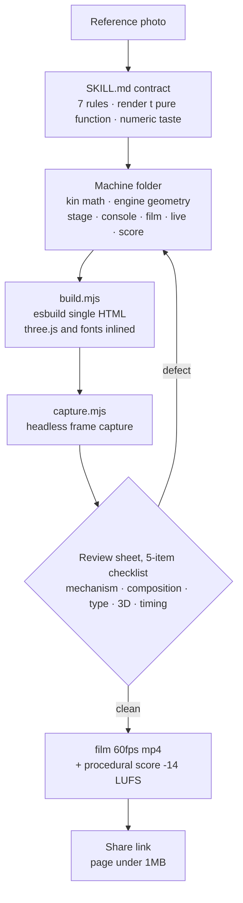

## Why read this

If you build visual deliverables with Claude Code or other coding agents, or you design the skill contracts (SKILL.md) that agents read, this post is for you. The bottom line up front: the value of Elvar's 'teardown' is not the 3D simulator itself, but the pattern of compressing the "reference photo to simulator to video" workflow into one executable contract, and enforcing a review loop that says "you cannot watch the video, you can look at frames." That pattern transfers to production domains that have nothing to do with 3D.


*The worker (Claude) assembling the engine from the manual (SKILL.md).*

## In plain terms

teardown is the service manual for the process of building machine 3D simulators.

Until now, a single web page that shows "how this engine works" was split across a 3D artist (modeling), a programmer (interaction), a motion designer (camera) and a sound designer (score). teardown bundles that four-person job into one manual. SKILL.md is the manual, and Claude is the worker who follows it. What is in the manual? From the role each file plays per machine (math, geometry, render, sound) all the way to the inspection procedure: you must read the frame sheets before declaring anything done.

We will keep that analogy until the end. The install section is where you hand the manual to the worker, the experiment section is what the worker actually did, and the limitations section is the manual's assumptions.

## Overview

On October 30, 2026, AI video and vibe-coding creator Elvar (@elvar_official, roughly 37k followers) posted "I just packed my whole 3D workflow into one Claude skill." The same tweet contains the line "i gave opus 5.5 one reference picture and said: build me a full teardown of this, every part in code." The claim: one reference picture handed to Opus 5.5, plus a single instruction to build every part in code, was enough.

As of October 31 the tweet had 2,519 likes, 283 retweets, 163,225 views and 2,835 bookmarks (live-changing numbers, a snapshot at the time of writing). The tweet also carries a 24-second video of the V8 simulator running. This post is about the workflow that made that video, not the video itself. The guide attached to the tweet (titled "How I Turn Any Machine Into a 3D Simulator You Can Take Apart") names the skill 'teardown', says it is free and MIT-licensed. The same guide claims "a V8 simulator like this pulled 3,790,000 views on X."

The output catalog is live at visual-learning.app. The tagline is "40 machines, opened up": 7 runnable simulators (a robotic jellyfish, a hexapod robot, a sandworm boring machine, a strandbeest, a V8 engine, Cessna 337 landing gear, a robotic bee) plus 40 step-click machines (DJI drone, Apple Watch, espresso machine, and more). Note that the tweet says "7 built in 2 days" while the guide says "all 6": six at the time the guide was written, seven now. A timing difference.

In this post we actually took the skill, ran the bundle builds and the review-loop capture in a sandbox, and write down the numbers exactly as they came out.

## What this tool is

teardown is a Claude Code skill. A skill is one SKILL.md plus the execution files, and the description field in SKILL.md's frontmatter acts as the trigger. teardown's description starts by saying to build an interactive 3D simulator of a real machine or mechanism (an engine, a landing gear, a walking linkage, a pump, a gearbox) as one offline HTML page, and ends with the condition: use it when someone asks how a machine works, or wants a simulator, a cutaway or an exploded view.

The repo ships with three example machines.

- **v8**: a cross-plane V8 with glass liners. You watch the charge burn inside the cylinder you track; the valves lift on their cams. Eight pistons move from the exact slider-crank math, and the firing order 1-8-4-3-6-5-7-2 is a cylinder picker.
- **cessna**: the Cessna 337 main landing gear. One degree of freedom (stroke 0..1) poses the whole mechanism: a 201mm rack turns a 32-tooth pinion (module 4mm) through exactly 180 degrees.
- **strandbeest**: Theo Jansen's strandbeest. Twenty legs walk on one crankshaft. Every joint is solved by circle intersection from Jansen's 11 link lengths. The solver is 67 lines.

Each machine gets three folders: `-shared` (the machine itself), `-film` (the recorded tour), `-live` (the page you drive). The files inside are split by job.

| File | Job |
|---|---|
| `kin.js` family | The math. Real dimensions, one input (crank angle, stroke, wind) and every pose and readout. three.js forbidden |
| `engine.js` family | The geometry, built from code: lathed parts, tubes, instanced links. `update(input)` poses it |
| `stage.js` | Studio, lights, shadows, post (GTAO, bloom). `frame(state, cam)` draws one frame |
| `console.js` | The overlay: 1600x900 CSS layout of panels, charts, callouts. Redrawn from the frame state |
| `film.js` | The operator's move script (SCRIPT) + `render(t)`. A pure function of time |
| `live.js` | Buttons, sliders, orbit, keys. With no input, an auto tour with a cursor takes over after 25s of quiet |
| `score.py` | The sound on the film's timeline |

The core of SKILL.md is its 7 "rules that decide whether it works."

1. **Start from a reference.** Never from imagination. A photo, a cutaway drawing from a manual, a clip of the real thing. "Machines invented from a sentence come out generic every time."
2. **Real numbers, one source.** Get the bore, stroke and dimensions first. Every gauge on screen must read from the same function that poses the parts, so the screen cannot disagree with the motion.
3. **One input drives everything.** No keyframes. film, live and sound can never drift.
4. **The part doing the work opens up.** Isolate it, cut it, x-ray it. A camera that goes inside is worth more than ten orbits.
5. **Light studio, one accent.** Pale backgrounds read in a feed; the accent marks the part that is changing.
6. **Pick the camera for the mechanism.** A planar linkage seen face-on collapses into a lattice.
7. **Fix collisions with a number.** Scale or move it in the parameter block. Never hide it with the camera.

SKILL.md shows these rules with a hand calculation. For the Cessna, 32 teeth times a 4mm module is a 128mm pitch diameter, and half of its circumference is exactly the 201mm gear stroke. The point: verify the source function by hand before the screen is allowed to trust it.

The `render(t)` contract is explicit too. It must be a pure function that draws frame t from scratch. No `Math.random` (only the seeded rng), no `Date`, no state carried between frames. Frame 0 is the thumbnail, so the machine must already be visible. Every beat (event timestamp) lands in `timeline.json` in seconds, and the score reads the same file.

The review loop is the most distinctive part of the skill. The original line: "You cannot watch the video; you can look at frames. Never report a machine as done without reading sheets of the current render." The procedure has 5 steps. Pull one tile per timeline beat with `--stills beats` (0.3s after it, labelled `t=`) and read them all against the checklist. If something shows, zoom into the transition with `--stills every:0.2`, fix, rebuild, and go back to step 1. Stop when a full pass finds nothing. Finally, pull a sheet of what the encoder actually wrote and read that too. The checklist has five items: the mechanism (every part that should touch touches, and the numbers match the pose), composition (one focal point per frame, nothing important within 60px of an edge), type (nothing clipped, the key readout reads at phone width), 3D (bloom eats detail, near-white surfaces blow out), and timing (each state holds long enough to read: 1s for a short phrase plus 0.25s per word beyond three).

The sound is code too. `sfx/` synthesises every sound in pure Python (48kHz, standard library only) and reads the film's timeline.json, so the score can never drift out of sync. Mastering is automatic: -14 LUFS, true peak at or below -2 dBFS. The principle is "Accent, never narrate": continuous motion stays silent, and each tonal sound gets one key.

Taste is fixed with numbers as well. Entrance easing `cubic-bezier(0.16, 1, 0.3, 1)`, exits at half the entrance's length with `cubic-bezier(0.6, 0, 0.9, 0.35)`, the machine fills 60-70% of its viewport, and labels never go under 34px on a 1080 canvas.

The live-page rules are bundled as a separate section. The representative clause: test on an integrated GPU. A page that runs at 60fps on a desktop card can drop to 15fps on a laptop's built-in graphics. The examples carry quality tiers (TIERS) built in: they turn off AO, lower the pixel ratio and shadow map sizes, and redraw the panels on every other frame. There is also an instruction to find the expensive shader first. A single displacement computed 5 times per vertex can cost more than every tier together. The kit uses `kit/warm.js` to compile every shader program in parallel before the first frame, so the page never freezes on its first draw.

At the end of SKILL.md, "three.js traps the examples already hit" lists five concrete traps that were actually run into. `smoothstep(a, b, x)` returns 0 on Windows (ANGLE/D3D) when a > b. A ShadowMaterial a fraction of a millimetre above the floor loses the depth test inside a post-processing render target, so it needs a polygonOffset. A quad laid into the ground with a mirrored mapping gets culled as a back face, so it needs DoubleSide. A single NaN pixel blacks out the whole frame through bloom, so every pow() base must be clamped. And GTAO on a clipped (cutaway) model needs the same clipping planes on `gtao.normalMaterial`, or the cut half comes back as a pale ghost.

The build and capture flow looks like this.



The kit, frame capture, sfx engine and review rules come from whaleyxbt/claude-motion (MIT). The recorded samples are CC0 from Freesound.

## Install and integration

The install is the one line from the attached guide.

```bash
npx skills add elvarofficial/teardown -g -a claude-code
```

By hand, it is a clone plus two setup steps. Requirements: Node.js 20+ (our measurement ran on v22.22.3), ffmpeg for the video, and Python 3 (standard library only) for the sound.

```bash
git clone https://github.com/elvarofficial/teardown
cd teardown
npm install              # measured 2.4s, 0 vulnerabilities
npx playwright install chromium
```

The build is esbuild-based and produces one offline HTML per machine.

```bash
node sims/build.mjs v8-live   # -> teardown-out/dist/v8-live.html
node sims/build.mjs           # all 6 examples
```

For a new machine, copy the closest example. A machine outside SKILL_DIR gets a folder with a `main.js` and imports the kit by name.

```js
import {runSim} from 'teardown-kit/runtime.js';
```

## Actual experiment results

Every number below was captured in the sandbox. The experiment had three stages: the bundle build, the review-sheet capture, and the film capture (not run).

**Stage 1, bundle build.** Building `v8-live` alone took 56ms and produced 825,413 bytes (about 806KB). Building all 6 examples in one pass took 295ms total.

| Bundle | Bytes | KB |
|---|---:|---:|
| cessna-live | 818,256 | 799 |
| strandbeest-live | 817,798 | 799 |
| v8-live | 825,413 | 806 |
| cessna-film | 824,056 | 805 |
| strandbeest-film | 823,262 | 804 |
| v8-film | 830,650 | 811 |

All 6 came in under 1MB. SKILL.md warns that link crawlers (X, Slack) read the share card from the HTML and give up on a 15MB page. The 1MB rule holds, as-is, on the examples.

**Stage 2, review-sheet capture.** The first attempt failed. The headless Chromium could not create a WebGL context. The error text pointed at the ANGLE Vulkan fallback (SwiftShader) with `BindToCurrentSequence failed`. The three.js renderer failed to create its context, so `SIM.ready` hit the 60-second timeout and the run ended rc=1. The default GPU flags in paths.mjs (`--force_high_performance_gpu` and friends) did not take in this environment.

The second attempt pointed the `CHROMIUM` environment variable (the path-override point) at a wrapper script with `--enable-unsafe-swiftshader` added. It succeeded. The GPU the capture reported was ANGLE (SwiftShader), software rendering. One sheet took 15.8 seconds. The artifacts: a sheet at 115,705 bytes and one full frame at 479,237 bytes.


*The v8-live page pulled as a review sheet. Every gauge reading straight from the crank-angle function is the "real numbers, one source" rule, made visible (measured capture).*

**Stage 3, the film (mp4) capture was not run.** The v8 film's timeline.json is `{"duration": 26}`. 26 seconds at 60fps is 1,560 frames, and under SwiftShader software rendering we estimated that would run past 10 minutes, so we did not run it locally. The SKILL.md command chain is `capture.mjs` -> `run_sfx.py` -> `ffmpeg` mix -> `wave.mjs` verification. `run_sfx.py` runs `score.py`, which reads only the timestamps in timeline.json and synthesises the score, and `wave.mjs` cross-checks the final mp4's waveform against the same timeline. It is a chain built on the premise that the picture and the sound read the same file, so they cannot drift. The stages we actually walked: up to stage 2.

The experiment left one practical conclusion. This skill's capture assumes a machine with a GPU. In a software-rendering environment, the WebGL context does not come up at all without an explicit flag. SKILL.md itself warns: if the capture reports a software renderer, the GPU flags in paths.mjs did not take.

## ThakiCloud product implications

From the Paxis lens, teardown is a good case study in skill harness design. Three things stand out.

First, single-skill compression of a multi-tool workflow. Math (pure JS, no libraries), geometry (three.js), rendering, headless capture (Playwright), sound (Python) and QA (the checklist): six domains, split by role into files inside one skill. The deliverable contract ("one machine, one page") holds the front end, and the per-file role table holds the back end. It is the same structure as Paxis treating skills, tools and policies as first-class resources.

Second, SKILL.md is an executable contract, not a reference document. With taste pinned to numbers ("labels never under 34px", "exit easing is `cubic-bezier(0.6, 0, 0.9, 0.35)`", "each state holds 1s plus 0.25s per extra word"), the agent does not judge on every pass: it applies rules. The same principle as a policy gate making the call.

Third, the review loop. It replaces "the agent reports that it made it" with evidence (frame sheets). Instead of the agent saying "done", it reads the 5-item checklist on the sheets and keeps looping until a full pass finds nothing. In the sense of not trusting self-reports over artifacts, it points the same direction as Paxis's audit-log perspective.

From the ai-platform lens, headless rendering plus 60fps film export is a batch workload that concentrates in the browser and the CPU. Our measurement is the evidence. Under software rendering, one sheet took 15.8 seconds and the film was estimated past 10 minutes, so we gave up on the local workstation. This kind of workload belongs on a compute queue (GPU nodes), not on a workstation. It fits the structure of running it as a Kueue job, as-is.

## Limitations and counterarguments

The quality of the 3-round render-vs-photo comparison and the review loop is proportional to the capability of the model doing the judging. Elvar used Opus 5.5. The work of reading a checklist and finding defects misses more as the model tier drops. The verification cost scales the same way.

These simulators are not physics simulations. As visual-learning.app describes, "every number on screen comes from the same formulas that move the parts." The dimensions and formulas are real, but this model is a kinematic code model: it does not include rigid-body dynamics or force analysis. If you need real physics, you need a different engine.

Portability is a limit too. The default flags failing to create a WebGL context in a software-rendering environment is exactly what our machine proved. The skill is meant for GPU machines, and using it without a GPU requires an explicit workaround (our SwiftShader wrapper). The film capture is a time problem even on top of that workaround.

The 1MB ceiling squeezes machine complexity. Heavy models have to be moved to files next to the page. That is a clause that relaxes the skill's own premise of everything on one page.

The project is young. One commit, 128 stars (as of October 31), three examples. The tweet metrics and the "7 vs 6" numbers are point-in-time snapshots that change in real time.

## Summary

What you take from teardown is not three.js. Let us close the service-manual analogy. What this skill showed is that a production process becomes delegable to a single agent once it is bound as (1) a contract defined by per-file roles and numbers, (2) an inspection procedure for that contract, and (3) a loop that demands evidence instead of self-reports.

You can ask the same questions of your team's repeat processes. Where is our process's "manual"? Is the "inspection procedure" inside the manual? And is the call of "done" a self-report or evidence? The team where the three answers are sharp can take teardown's structure as-is.

The next action is simple. Install it with `npx skills add elvarofficial/teardown`, pick one machine you want to explain, and hand over a reference photo with it.

The workflow is not in the model. It is in the skill.

## Sources

- Elvar, [original tweet](https://x.com/elvar_official/status/2116192984299344372) (2026-10-30)
- Attached guide (X Article): "How I Turn Any Machine Into a 3D Simulator You Can Take Apart"
- [elvarofficial/teardown](https://github.com/elvarofficial/teardown) (MIT, 128 stars / 22 forks, as of October 31)
- [visual-learning.app](https://visual-learning.app) (tagline "40 machines, opened up")
- Base kit: [whaleyxbt/claude-motion](https://github.com/whaleyxbt/claude-motion) (MIT)
