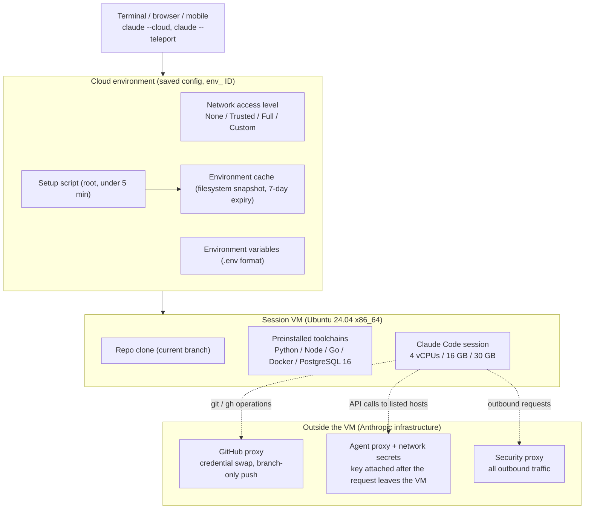

## Why read this

If you run Claude Code locally and are considering handing long-running work to the cloud, or you are a team lead standardizing on an agent execution environment, this post is for that decision. The bottom line up front: in early November 2026, Anthropic turned "getting a repo running in a cloud session" into an auto-setup in which the agent figures out the dependencies, network access, and API keys it needs and saves them as an environment. The design underneath matters more than the feature. The execution environment becomes a first-class resource, credentials never enter the VM, and the cache is a filesystem snapshot that expires after roughly seven days. It is worth reading even if you never use it.

*The cloud session's VM, its environment, and the proxies that keep credentials outside the VM, rendered abstractly.*

## Overview

On November 6, Anthropic's developer account ClaudeDevs announced that getting a repo running in Claude Code cloud sessions on Pro, Max, and Ultra plans is now easier ([retweet of the announcement](https://x.com/hjguyhan/status/2118845765242265845)). The core of the tweet: Claude figures out the dependencies, network access, and API keys the repo needs, then saves the environment. Cloud sessions themselves are not new. They are generally available for Pro, Max, Ultra, and Team, plus Enterprise premium seats, and a session is a Claude Code session running on Anthropic-managed infrastructure instead of your machine. It keeps running after you close your laptop, and you can inspect or steer it from the browser, mobile, desktop, or terminal. There is no separate charge for the cloud VM; it counts against the same usage limits as the rest of your plan.

What changed this time is the "environment" layer beneath the session. A cloud environment is the saved configuration that governs a session's network access, environment variables, and setup script, and the announced feature is Claude filling that configuration in on its own. A previous post, [Building AAA-style games with Claude Code](https://thakicloud.com/tech-blog/en/tutorials/claude-code-aaa-game-repos/), covered the pattern of an agent reading API contracts and writing integration code. This time the subject is the agent's own execution environment.

## What this feature is

### The execution sandbox

Each cloud session gets a fresh virtual machine: Ubuntu 24.04 on x86_64, regardless of your host OS or architecture. The resource ceiling is approximately 4 vCPUs, 16 GB of RAM, and 30 GB of disk, and the docs note that the numbers "may change over time." Large builds or memory-intensive tests can be stopped by the VM. Common toolchains come pre-installed: Python 3.x with pip, poetry, uv, black, mypy, pytest, and ruff; Node.js 20, 21, and 22 with npm, yarn, pnpm, bun, eslint, and prettier; Ruby 3.1 through 3.3; PHP 8.3; OpenJDK 21 with Maven and Gradle; Go; Rust; C/C++ with GCC, Clang, cmake, ninja, and conan; Docker; PostgreSQL 16; Redis 7.0; Chrome for Testing; plus git, gh, jq, yq, ripgrep, and tmux. Inside a session you can ask Claude to run the `check-tools` command to see most versions.

### What carries over

The VM is a fresh clone of your repository. Anything committed to the repo is there; anything installed or configured only on your machine is not. The repo's `CLAUDE.md`, `.claude/settings.json`, `.mcp.json`, `.claude/rules/`, and the skills, agents, and commands under `.claude/` all come along because they are part of the clone. The user-level `~/.claude/CLAUDE.md`, user-scoped MCP servers, and plugins enabled in user settings do not. Plugins declared via `enabledPlugins` in repo settings are not installed in cloud sessions either, and interactive authentication such as AWS SSO is not supported, since browser-based login cannot run there. Organizational policy arrives separately through server-managed settings.

### Networking: four levels and two proxies

Each environment sets one of four network access levels. `None` allows no outbound connections at all. `Trusted` is the default and passes only an allowlist covering package registries, GitHub, and cloud SDKs. `Full` allows any domain, and `Custom` takes your own list. At any level, all outbound traffic passes through a security proxy for abuse prevention, and GitHub operations go through a separate GitHub proxy.

The GitHub proxy is where the credential design really shows. Real GitHub credentials stay encrypted on Anthropic's servers and never enter the session VM. The git client inside the VM uses a scoped credential that the proxy verifies and swaps for your actual token. Pushes are limited to branches: tag pushes and branch deletions are rejected. Requests to the GraphQL endpoint get a 403 that names the REST fallback, so `gh pr` and `gh issue` do not work while `gh api repos/{owner}/{repo}/...` does. Repository scope is limited to the repos attached to the session.

Network secrets are the second mechanism for keeping credentials outside the VM. You register an API key or token on the environment and list the hosts it applies to; the agent proxy attaches the key to requests for those hosts after the requests leave the session VM. The key never appears in the session's environment variables or in any file. The docs list the requests that never get a secret: GitHub (handled by the GitHub proxy), the Anthropic API, public package registries, setup-script requests, and Claude Code telemetry. Environment variables, by contrast, are readable by anyone who uses the environment, and the docs explicitly warn against putting secrets there.

### Setup scripts and the environment cache

A setup script is a Bash script that runs as root before Claude Code launches when a new session starts, for installing dependencies or fetching anything that is not pre-installed. It has four constraints: it must exit zero; it should finish within roughly five minutes; package installs need registry reachability, so they fail at the `None` level; and the environment's variables are not set yet when it runs.

The cache is the center of this announcement. When setup finishes within five minutes, Anthropic snapshots the filesystem and reuses that snapshot as the starting point for later sessions. New sessions begin with dependencies, tools, and Docker images already on disk and skip setup. The snapshot keeps only what is on disk: packages, images, and files carry over, but running processes such as a database or a compose stack do not, so you start them per session. Changing the setup script or the allowed hosts rebuilds the cache, and it expires after roughly seven days. "Claude figures out the dependencies, network access, and API keys, then saves the environment" reads as automating the whole cycle of writing the script, choosing the allowlist, and registering secrets, and turning the result into a cacheable environment.

## Setup in practice

From the terminal, the flag is `claude --cloud`. The task runs in the cloud while you keep working locally. The cloud VM clones the current branch of the GitHub remote of your current directory, not your local checkout, so push first if you have local commits. The older `--remote` spelling still works as a deprecated alias.

If the repository has no git remote, or the Claude GitHub App is not installed, the local repository is bundled and uploaded instead. The bundle must be under 100 MB, excludes untracked files, and includes uncommitted changes to tracked files. There is a platform difference here. On macOS, Linux, and WSL, uncommitted changes to files that look like credentials or keys (`.env`, Terraform `*.tfvars`, `id_rsa`, `*.pem`, and the like) are left behind, and a `Left on this machine:` notice names what was excluded. On native Windows, the changes upload as-is regardless of file name. On Windows, stash or revert anything you do not want to send before you start.

The way back is teleport. `claude --teleport`, `/teleport` (or `/tp`) inside a session, or the `t` key in `/tasks` pulls a cloud session into your terminal. Four requirements: a clean git state, a checkout of the same repository, the session's branch already pushed, and the same account. The terminal receives its own copy, and new work there stays local. From any machine you can also queue a follow-up message into a running session: `claude -p "message" --cloud <session-id>`.

The pattern the docs recommend is "plan locally, execute in the cloud." Start Claude in plan mode (`claude --permission-mode plan`), work out the approach together, save the plan to the repo, and commit and push it. Then hand autonomous execution to the cloud with `claude --cloud "Execute the migration plan in docs/migration-plan.md"`. Multiple `--cloud` commands are independent sessions, so you can run several tasks in parallel. With the Claude GitHub App installed on the repo you can also turn on Auto-fix: Claude subscribes to the PR's GitHub events and, when a CI check fails or a reviewer comments, investigates and pushes a fix when one is clear. The catch: in repos that use comment-triggered automation such as Atlantis or Terraform Cloud, Claude's replies are posted under your GitHub username and can start those workflows.

When a session goes idle, the VM pauses with its files saved, and if it stays paused long enough it is reclaimed. That state is called "environment expired." Reopening provisions a fresh VM: the conversation history comes back, but shell commands that were running, subagents, and session-scoped scheduled tasks or a `/loop` do not. The docs tell Claude which of these stopped, so re-running them is on you.

## Actual replication results

This post does not provision a paid cloud session. Instead, we replicated the dependency-install pattern the docs recommend, locally, and recorded its behavior. The pattern is a SessionStart hook that installs dependencies only in cloud sessions. The script is the docs' `install_pkgs.sh` as-is: it exits immediately unless the `CLAUDE_CODE_REMOTE` environment variable is `true`, and it skips `npm install` when the hashes of `package.json`, `package-lock.json`, and the script itself are unchanged.

The first run in a local environment (`CLAUDE_CODE_REMOTE` unset) was a no-op in 0.008 seconds with return code 0: it exits before doing anything. That is the gate, and it separates local from cloud execution with a single variable. In a cloud simulation (the variable set to `true`), the first run reported "added 2 packages, and audited 3 packages in 560ms" and 0 vulnerabilities, and wrote the sha256 hash file under `node_modules/`. A second run with unchanged inputs produced no npm output at all, only the pip notice: the hash gate skipped the install, which is the idempotency the docs describe.

There was one finding the docs do not mention. With a zero-dependency `package.json`, `npm install` does not create the `node_modules/` directory at all, so the hash-file redirect fails with `No such file or directory` and no hash file is written. The gate then degrades to re-auditing every session ("up to date, audited 1 package in 232ms"). A few hundred milliseconds is harmless, but the documented behavior of skipping on unchanged inputs holds only when `node_modules` exists. For a project with dependencies there is no problem; for a docs-only repo, create the directory explicitly.

## Implications for ThakiCloud products

**Paxis lens.** The cloud environment is the first-class-resource treatment of the "execution environment" itself. ThakiCloud's Paxis treats Skills, Tools, Policies, and Audit Logs as first-class resources of the execution environment, as an Agent-Native Cloud. What Anthropic's cloud sessions add is another first-class resource in that list: the environment (an `env_` ID), with per-surface routing (browser, mobile, desktop, CLI, routines, Claude Tag), organization-shared environments, and a CLI default (`remote.defaultEnvironmentId`). The control plane for "which agent runs in which environment" takes the same shape as Paxis's policy gates. Second, credentials: the design of "never entering the VM, attached by a proxy after the request leaves" is on the same line as Paxis's secret injection. The agent process sees policy, not keys. Third, audit: the `Claude-Session: <url>` trailer on every commit and the session URL in PR bodies make the execution record itself a traceable link, a first-class audit pattern.

**Metis/on-prem lens.** Self-hosted environments route cloud sessions to runners you operate (`ccpool_` IDs), with default-deny egress. But the docs are blunt about the constraints. With IP allowlisting enabled, every Anthropic-hosted cloud session fails with an authentication error, because sessions call the Anthropic API from Anthropic's infrastructure. Organizations under Zero Data Retention, HIPAA configuration, or customer-managed encryption keys (CMEK) cannot use cloud sessions at all. The condition that "API calls must originate inside our network boundary" is exactly the condition that Metis, serving models on on-prem Kubernetes, exists to satisfy. The 4 vCPU and 16 GB ceiling is the same context: workloads beyond it belong in a queued job, not a cloud session, and the queue that owns such workloads is run by our platform.

## Limitations and counterarguments

First, rate limits. Cloud sessions share the usage limits of the account with all other Claude and Claude Code usage, and parallel tasks consume proportionally. There is no separate charge, but the quota is the same one. Second, time ceilings. Foreground commands default to two minutes and can be asked for up to ten; background commands run up to thirty more minutes; SessionStart hooks have 600 seconds. `BASH_DEFAULT_TIMEOUT_MS` changes that, but long-running jobs are simply not this layer's job. Third, environment expiry. The pause-and-restore structure is convenient, but background work running at reclaim time is gone. Without checkpoint discipline, work restarts from scratch every time. Fourth, platform restrictions. Cloning and PR creation require GitHub; GitLab and Bitbucket can only be uploaded as bundles and cannot be pushed back to; GraphQL is closed off.

The counterarguments have a structure too. If you need full control of the execution environment, the answer is self-hosted runners. If you need interactive authentication, browser-based login (SSO) does not work. If your organization's policy is ZDR, HIPAA, or CMEK, you cannot use it at all. So this feature is not "use the cloud or do not"; it is a configuration question of which layer you leave with Anthropic and which layer you take back.

## Summary

The auto-setup announcement turns "getting a repo running" from a setup-script-writing task into the agent's own task. What will last from the announcement, though, is the design underneath: the execution environment as a first-class resource, credentials that never enter the VM, a cache that is a seven-day filesystem snapshot, and session records that are links. The direction in which Paxis treats skills, tools, policies, and audit as first-class resources runs parallel to Anthropic's environment-ification, and in environments where data cannot leave, Metis's on-prem Kubernetes is the other half of the same problem. If you actually plan to use it, decide three things before you start: push your branch before `--cloud`, exclude credential files from the bundle (especially on Windows), and keep the setup script under five minutes so the cache works.

## Sources

- [Configure cloud environments, Claude Code docs](https://code.claude.com/docs/en/cloud-environments)
- [Use Claude Code in the cloud, Claude Code docs](https://code.claude.com/docs/en/claude-code-on-the-web)
- [Claude Code on the web, Anthropic resources](https://claude.com/resources/articles/claude-code-on-the-web)
- [Retweet of the ClaudeDevs announcement](https://x.com/hjguyhan/status/2118845765242265845)
