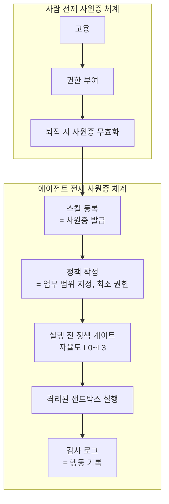

## 칼럼이 먼저 그린 시나리오

오늘 뉴스1 데스크 칼럼은 시나리오부터 꺼내 놓았습니다. 내부 시스템을 잘 아는 직원이 더 이상 밤에 파일을 외장 드라이브로 복사하지 않아도 된다는 겁니다. 복잡한 해킹 프로그램은 만들 필요가 없습니다. 권한이 있는 AI에게 자료를 정리하고 옮기라고만 하면 기밀 자료 수십 GB가 회사 밖으로 나가는 것입니다.

칼럼이 짚은 지점은 단순합니다. "내부자 권한만 있으면 AI로 데이터 유출이 쉬워진다"는 말입니다. 보안을 오래 설계해 온 업계의 눈에는 낯설 수밖에 없는 문장입니다. 수년간 보안 체계의 전제는 적이 밖에서 온다는 것이었고 벽만 견고하면 안은 안전하다는 식으로 시스템이 짜여 왔습니다. 그런데 이 시나리오에는 벽이 등장하지 않습니다. 사람은 이미 안에 있고 사원증은 유효하며 행동은 부여된 권한 범위 안에서 일어나는 셈입니다.

사람과 다른 것은 속도와 양입니다. AI가 권한 있는 계정의 일을 대량으로, 고속으로 수행하기 시작하면 하나의 자격증명이 쓸 수 있는 피해는 기하급수적으로 커집니다. 칼럼이 "보안은 준비됐나"라고 물은 이유가 여기에 있고 금융권은 이미 AI 활용 확대로 인한 데이터 유출과 권한 남용 리스크를 우려하며 보안 고삐를 죄기 시작했습니다.

<!-- nlm-visual -->

*NotebookLM이 소스를 종합해 생성한 인포그래픽입니다.*

## 벽이 무너진 게 아니라, 권한이면 됐던 순간

데이터 유출의 경제학은 두 단계로 나눠 볼 수 있습니다. 먼저 권한을 얻고 다음에 자료를 옮기는 거죠. 과거에는 두 단계 모두 노력이 필요했습니다. 특히 두 번째 단계, 대량의 자료를 남지 않게 뽑아 들고 나가는 것 자체가 숙련된 작업이었습니다. AI가 압축한 것은 바로 이 단계의 비용입니다. 내부자 권한만 있으면 유출이 쉬워졌다는 말은, 권한 그 자체가 유일한 비용이 됐다는 뜻과 같습니다.

그러면 보안의 무게중심이 한 칸 움직입니다. "누가 들어왔느냐"보다 "얼마나 많은 권한을 줬느냐"가 더 중요한 질문이 됩니다. 그런데 지금의 권한 체계에는 구멍이 있는 셈입니다. 사람이라는 전제 위에서 설계됐기 때문. 사람을 고용하고 퇴직하면 사원증을 무효화하며 일시적으로 권한을 늘려 주는 것까지 알고 있습니다. 하지만 내 이름으로 로그인하고 하루에 수백 개의 파일을 다루고 쉬지 않는 새로운 주체에 대해서는 모릅니다.

사원증 시스템이 새로 배워야 할 것은 이것입니다. 비인간에게 사원증을 내주는 법. 핵심은 최소 권한입니다. 사람이 직무에 필요한 권한만 받는 것처럼, 에이전트마다, 스킬마다 자신만의 사원증과 업무 범위가 있어야 하는 것이다. "전사 접근 가능"인 하나의 공통 ID는, 칼럼이 그린 시나리오의 시작인가. 그리고 그 ID가 쓰인 모든 순간에는 기록이 남아야 하는 셈이다. 권한, 행동, 기록. 이 셋이 에이전트 시대 사원증 체계의 최소 요건입니다.

그리고 이 최소 요건이 무너지는 지점이 곧 사고입니다. 칼럼의 분석대로라면, 자격증명이 도용되거나 과대 권한을 가진 에이전트가 조직 안에 존재하는 순간, 하나의 ID로 쓸 수 있는 피해는 기하급수적으로 커집니다. 과거에는 권한을 얻는 쪽이 기술적으로 어려웠지만 이제는 권한을 가진 쪽의 '행동'이 통제 불가능해집니다. 보안의 전장은 침투 방어보다 권한 운영으로 이동했습니다.

## 특허가 나왔습니다. 에이전트의 행동을 정책으로 막는 게이트웨이

오늘 뉴스에서 이 구멍을 산업이 직접 메우기 시작했다는 신호가 있었습니다. 벤처스퀘어 보도에 따르면 API 관리와 보안 업체 소프트프릭이 특허 2건을 취득했습니다. 하나는 멀티모달 AI 모델의 프라이버시 취약점 진단 기술입니다. 텍스트와 이미지를 섞은 결합 공격 시나리오에서 민감정보 노출을 사전에 점검하는 방식으로, 회사가 지난해 출원한 AI 프라이버시 취약점 진단 특허 5건 가운데 1건으로 정리됐습니다.

나머지 1건이 이번 글의 핵심입니다. AI 게이트웨이가 프롬프트와 시스템 행위를 보안정책에 따라 통제하는 기술입니다. 에이전트가 모델을 호출하거나 기업 시스템에 손을 뻗을 때, 그 요청을 그대로 통과시키는 게 아니라 게이트웨이가 중간에서 정책과 대조하고 허용 여부를 결정하는 구조입니다. 소프트프릭은 이 특허 기술을 기존 취약점 진단 솔루션 파바타(F-Avata)와 개발 중인 LLM, AI 게이트웨이에 단계적으로 적용할 방침입니다.

보도의 맥락은 한 겹 더 얹습니다. 공격자 역시 AI를 이용해 취약점을 발견하고 공격을 자동화하고 있어서, 사람 중심의 대응만으로는 속도와 규모를 따라갈 수 없다는 겁니다. AI를 활용한 방어와 모델 검증이 병행돼야 하는 국면에서 AI 보안 시장은 빠르게 형성되고 있습니다. 그래서 소프트프릭이 취득한 특허 두 건은 한 업체의 제품 로드맵을 넘어, 산업 전체가 향하는 방향의 단면으로 읽힙니다. "에이전트를 위한 보안"이 회의 테이블의 논쟁에서 제품과 표준으로 이동하고 있다는 신호입니다.

의의는 어떤 문제가 특허로 잡혔느냐에 있습니다. 새 암호화 알고리즘도, 더 두꺼운 방화벽도 아니라 "에이전트 접근 통제"입니다. 에이전트에게 어떤 권한을 줄지, 행위를 어떻게 통제할지, 누가 기록할지를 제품과 표준으로 묶으려는 시도가 산업 전반에서 시작됐다는 뜻입니다. 마이크로소프트 CEO가 "AI에는 비상 브레이크가 필수이며 내부자 위험처럼 통제해야 한다"고 주장한 것도 같은 맥락이고, 에이전트 접근 제어와 최소 권한, 감사가 보안 컨퍼런스의 핵심 의제로 부상하는 흐름 역시 같은 방향입니다.

## 에이전트는 이미 사무실에 있습니다

한편 에이전트가 업무 현장에 들어오는 속도는 별개입니다. 연합뉴스 보도를 보면 오픈AI와 앤트로픽의 기업용 AI 에이전트 공세가 본격화됐습니다. 앤트로픽의 클로드 코워크와 오픈AI의 챗GPT 워크는 데스크톱, 웹, 모바일로 확산되며 업무 전체를 직접 수행하는 주체로 자리잡고 있습니다. 질문에 답하는 어시스턴트라는 이름이 붙은 것이 아니라, 파일과 이메일, 캘린더를 넘나드는 에이전트입니다.

국내 숫자는 더 빠릅니다. 같은 보도에 따르면 오픈AI의 국내 챗GPT 엔터프라이즈 이용자가 전년 동기 대비 28배 늘었고, 챗GPT 워크의 주간 활성은 6개월 만에 14배 증가했습니다. 시장 규모도 같은 방향입니다. 글로벌 기업용 AI 시장은 올해 386억8천만 달러에서 2033년까지 연평균 34.3% 성장할 전망이며(글로벌인포메이션), 에이전트형 AI 시장만 해도 24억2천만 달러에서 2035년 1천57억 달러로 커질 전망입니다(어스튜트).

경쟁의 형태도 함께 바뀝니다. 같은 연합뉴스 보도는 특정 AI 모델이나 사업자에 종속되지 않는 개방형 에이전트 협업 환경을 시도하는 블록의 '버즈'도 언급합니다. 경쟁이 기능 대결을 넘어 데이터 활용, 업무 실행력, 플랫폼 종속 여부로 확대되고 있다는 점입니다. 기업 입장에서 "어떤 에이전트를 쓰느냐"의 선택이 곧 "어떤 플랫폼의 규칙으로 에이전트의 권한과 기록이 다뤄지느냐"의 선택이 되는 순간입니다.

도입은 지수함수로 늘고 있습니다. 반면 권한을 부여하고 행위를 검증하고 기록을 남기는 정체성 시스템은 여전히 사람 전제입니다. 준비 여부라기보다, 에이전트는 이미 일하고 있는데 사원증이 아직 나오지 않은 상태로 몇 분기를 버텨야 하느냐의 시간차 문제입니다.

## 한 공공기관의 답. 사원증을 안 주는 것

같은 아침 뉴스에는 대비되는 사례도 있었습니다. 서울경제 보도에 따르면 인천교통공사가 2026년 인천시 AI 활용 아이디어 공모전 최우수상을 받은 정비 AI를 선보였습니다. 전동차 고장 시 정비 매뉴얼 탐색 시간을 기존 대비 최대 90% 단축한 챗봇형 솔루션입니다.

관심스러운 것은 만드는 방식입니다. 외부 통신망과 단절된 폐쇄형 온디바이스 AI에 AES-256 암호화를 결합했습니다. 에이전트를 사무실에 들이지 않은 것이 아니라, 네트워크도, 사원증도, 외부 데이터에 닿을 기회도 주지 않은 겁니다. 외부 용역 없이 사내 직원이 자체 개발해 약 2억 8700만 원의 예산을 아꼈다는 점도 함께 보고됐습니다.

이것은 한 기관만의 고립된 사례가 아닙니다. 국내 철도와 도시철도 정비 분야 전반으로 AI 전환이 확산되는 흐름 속에 코레일은 AI 디지털트윈 정비 플랫폼으로 정책대상 최우수상을 받았고, 광주교통공사도 지하철 유지보수에 AI 접목을 논의 중입니다. 반복적이고 전문 인력에 의존하던 공공 현장의 정비 작업이 AI로 대체되기 시작하며, 사내 자체 개발 경쟁도 치열해지고 있습니다. 인천교통공사가 보여준 '출근을 하지 않는 직원'의 범위가 이렇게 넓어지는 상황에서, 오늘 이 글이 제기하는 정체성과 감사의 질문은 더 시급해집니다.

한 용례에는 작동하는 답입니다. 기계에게 권한을, 네트워크를, 사원증을 주지 않으면 내부자 문제는 애초에 발생하지 않으니까요. 하지만 기업이 업무 항목마다 폐쇄 정원을 짓는 것은 현실적이지 않다. "안 하게 하는 법"보다, "할 수밖에 없다면 어떤 권한으로, 어디에서, 어떤 기록을 남기며 일하게 하느냐"가 더 일반적인 질문이다.

## 새로운 직원을 위한 인사 시스템은 어떤 모습일까

에이전트를 새로운 직원으로 본다면, 기업에 필요한 것은 한 칸 더 두꺼운 벽이 아니라 그 직원을 위한 인사 시스템인 셈이다. 네 가지 질문이 핵심이다. 이 직원은 무엇을 할 수 있는가. 어디까지 닿을 수 있는가. 어디서 일하는가. 무엇을 했는지를 누가 기록하고 책임지는가.

ThakiCloud의 에이전트 네이티브 클라우드 Paxis는 이 네 가지 질문이 시스템 기능으로 처리되는 것을 전제로 설계된 정식 제품(v1.1 GA)입니다. Paxis에서는 스킬(Skills), 도구(Tools), 정책(Policies), 감사 로그(Audit Logs)가 일급 리소스로 관리됩니다. 자율도는 L0부터 L3까지 단계별로 거버넌스가 적용되고, 실행 전에 정책 게이트가 권한을 점검합니다. 에이전트의 모든 행위는 격리된 샌드박스 안에서 실행되며 감사 로그로 남습니다.

사람 전제의 사원증 체계에서 에이전트 전제로의 이동은 한 장의 지도로 정리할 수 있습니다.

오늘 아침 뉴스와 대응 관계도 구체적입니다. 소프트프릭이 게이트웨이 특허로 묶은 "정책에 따른 에이전트 행위 통제"는 Paxis에서 별도 장치가 아니라 정책 게이트와 감사 로그에 내장된 기본 동작입니다. 인천교통공사가 폐쇄망에서 증명했던 권한 없는 실행 모델은 Paxis의 소버린·온프렘 K8s(ai-platform) 환경 위에 감사 기록을 붙인 형태로 확장됩니다. 어떤 모델을 어떤 작업에 쓰느냐는 질문은 작업별 모델 선택 CostRouter가 담당합니다. 에이전트가 늘수록 모델 호출 비용도 함께 불어나기 때문에, 이 직원의 사원증 관리와 같은 테이블에 오르는 비용 거버넌스 기능입니다. MCP 커넥터와 스킬 마켓은 이 직원을 외부 시스템과 연결하는 부분입니다.

한 줄로 정리하면, Paxis에서 사원증 발급은 스킬 등록이고 업무 범위 지정은 정책 작성이며 행동 기록 조회는 감사 로그 검색입니다. 인사 절차가 시스템 기능으로 바뀌는 것입니다.

28배와 14배의 도입 속도가 사람 전제의 사원증 시스템과 부딪히는 지금, 칼럼이 그린 피해 시나리오는 더 이상 가정이 아닙니다. 에이전트에게 유효한 사원증이 나고 업무 범위가 정해져 있고 일할 자리가 격리되어 있고 행동 기록이 존재하는 그날이 바로 내부자 위협이 관리 가능해지기 시작하는 날입니다.

## 마무리

칼럼의 질문 "보안은 준비됐나"는 여전히 유효합니다. 다만 준비의 정의가 바뀐 것이죠. 벽을 두껍게 하는 준비가 아니라, 사원증을 관리하는 준비입니다. 에이전트에게 사원증을 내주는 일이 끝났고 그 행동마다 기록이 남아 있는 기업이 먼저 답을 내놓을 수 있습니다.

## 참고 자료

이 글은 아래 뉴스를 종합해 작성했습니다.

- 연합뉴스, [[AI프리즘] AI가 업무까지 척척…챗GPT·클로드, 협업툴 넘본다](https://www.yna.co.kr/view/AKR20261012160700017?input=1195m)
- 서울경제, ["정비 매뉴얼 탐색 90% 단축"…인천교통공사 AI 공모전 1위](https://www.sedaily.com/article/20100750?ref=naver)
- 벤처스퀘어, [소프트프릭, AI 민감정보 노출 진단·에이전트 접근 통제 기술 특허 2건 취득](https://www.venturesquare.net/1119206/)
- 뉴스1, [[데스크칼럼]AI에 맡긴 내부자 권한…보안은 준비됐나](https://www.news1.kr/it-science/security-hacking/6317531)

<!-- nlm-visual -->

*NotebookLM이 소스를 종합해 생성한 인포그래픽입니다.*
