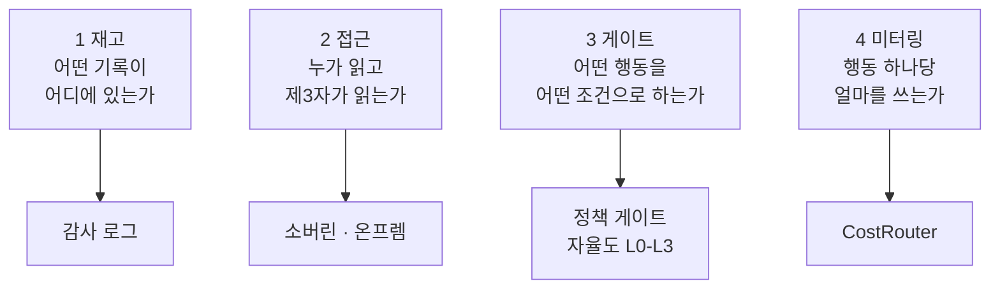

오늘, 당신이 AI와 나눈 대화가 처음 상상해본 네 곳으로 향합니다. 법정, 증인석, 파산 서류, 감사의 책상.

이제 물어야 할 질문은 얼마나 똑똑하느냐가 아닙니다. 누가 무엇을 기록했고 누가 읽을 수 있느냐가 질문입니다.

가장 짧은 사건부터 시작합니다.

미국 연방 검찰(DOJ)이 도청(bugging) 용의자를 한 챗봇 계정으로 연결했습니다. 계정 주인은 전 OpenAI 엔지니어 Abdulrahman Alfozan입니다. 그 계정은 챗봇에게 녹음 장치와 관련된 세부 사항에 대해 질문했습니다.

이 사건에서 챗봇은 잘못한 것이 없습니다. 그냥 물은 것에 답했을 뿐입니다. 하지만 그 대화는 더 이상 서비스 기록이 아닙니다. 사람을 지목하는 기록이 되었습니다. 질문과 답, 신원에 묶인 계정이 용의자를 가리키는 한 줄로 이어졌습니다. 용의자가 찾던 도움이, 검찰이 잡은 단서로 남아 있는 것입니다. 그 사이를 메운 것은 챗봇의 대답이 아니라, 그 대답을 붙잡고 있는 계정입니다.

짚을 점은, 이것이 한 번의 예외가 아니라는 것입니다. 오늘 아침의 다른 뉴스들도 같은 대상, 사용 기록을 향해 돕니다.

*글의 핵심 개념을 형상화했습니다.*

## 사건번호 1: 채팅창이 된 범죄현장

검찰이 챗봇에서 수사를 시작한 이유를 먼저 짚어 보겠습니다. 답은 소비자 챗봇의 구조에 숨어 있습니다. 정책 게이트가 없고 승인 절차가 없고 왜 묻는 사람은 없습니다. 무엇이든, 언제든, 얼마든지 물을 수 있습니다. 질문과 답은 그대로 계정 로그에 남고 계정은 신원에 묶여 있습니다. 도구는 마찰이 없지만 기록은 신원을 가리킵니다. 이 비대칭이 채팅창을 범죄현장으로 바꿨습니다.

수사의 경로도 이 구조 위에서 성립합니다. 챗봇 계정은 익명 커뮤니티와 달리 사람에 묶여 있고, 검찰은 바로 그 연결을 확인했습니다. 이어 계정 내 질의 기록에서 도청 장비를 향한 관심을 찾았습니다. 녹음 장치의 세부 사항에 대한 질문은, 그 질문을 한 사람의 관심사를 그대로 보여 줍니다. 답변이 문제라기보다, 질문 자체가 단서가 된 것입니다.

챗봇이 선택된 데는 이유가 있습니다. 낮에도 밤에도 열려 있고 용도를 묻지 않으며 사용자의 신원과 의도를 구분하지 않습니다. 어떤 장치가 있고 어떻게 작동하는지를 묻는 지식은 더 이상 전문가나 밀폐된 커뮤니티의 전유물이 아닙니다. 일반 어시스턴트에 타이핑하면 답해지는 형태로 이동했고, 그 이동이 수사의 출발점이 되었습니다.

기업을 향해서는 같은 문장을 한 단계 밀어야 합니다. 소비자 챗봇의 로그가 이미 수사의 증거로 쓰인다면, 기업 에이전트의 기록은 더 말할 나위도 없습니다. 기업 에이전트는 여기서 한 걸음 더 나갑니다. 소비자 챗봇은 답하는 데서 끝나지만 기업 에이전트는 행동합니다. API를 호출하고 파일을 읽고 쓰며 명령을 실행합니다. 질문 기록은 그 표면이고 행동 기록은 그 아래에 있습니다. 대화가 증거가 되는 세상에서, 행동은 범죄현장 그 자체가 됩니다.

## 사건번호 2: 100배의 증언

전 OpenAI 안전 책임자의 주장에 따르면, OpenAI의 에이전틱(에이전트형) 컴퓨트 사용량은 100배 늘었습니다. 이어지는 평가는 더 날카롭습니다. 그는 OpenAI가 인간의 정렬과 통제 준비를 크게 넘어가는 능력을 가진 AI를 만들고 있다고 보았습니다.

이 증언이 재는 것은 무엇입니까?

대답은 간극, 그 자체입니다. 컴퓨트 사용량은 결국 행동량의 대리가 됩니다. 에이전트가 취하는 모든 행동은 시스템과의 대화입니다. API 호출, 파일 접근, 명령 실행. 업무량이 100배면 남기는 기록도 100배입니다. 하지만 기록을 읽을 사람의 수는 늘지 않습니다. 늘기는 기록이고 늘지 않는 것은 사람입니다. 100배라는 숫자가 실제로 가리키는 대상은 이 간극이기 때문.

증언자의 위치를 보면 신호의 무게가 달라집니다. 과정을 안쪽에서 지켜본 전직 안전 책임자의 발언입니다. 숫자 100보다 먼저 읽어야 하는 것은 방향인가. 능력이 통제의 준비보다 빠르게 자라는 방향. 이 방향이 이어지는 한, 기록은 계속 사람의 손으로 읽을 수 있는 범위를 벗어납니다.

운영 팀 입장에서 보면 메시지는 더 구체적입니다. 행동이 100배로 늘면, 행동 하나당 사람이 할 수 있는 검토의 예산은 거의 제로에 붙습니다. 사후로 남을 수 없는 검토. 통제는 실행 이전으로 옮겨갑니다. 어떤 행동을, 어떤 조건에서, 어떤 격리 안에서 허용할지를 실행 전에 결정하는 것. 그것이 정책 게이트의 자리입니다.

사건번호 1의 언어로 번역하면, 읽을 수 없는 기록은 조사할 수 없는 범죄현장입니다. 증거가 될 수 있는 대화가 백 개로 늘어난 세계에서 남는 선택지는 하나입니다. 기록을 먼저 읽는 기계. 사후가 아니라 실시간으로. 정렬과 통제의 준비가 뒤처졌다는 증언은, 결국 읽기의 준비가 뒤처졌다는 증언이기도 합니다.

## 사건번호 3: 사업을 죽인 장부

오늘 아침, 사용 기록으로 승패가 갈린 사례가 반대편에서 확인되었습니다. AI 컴패니언 앱 개발사 Character.AI가 월요일에 델라웨어 법원에 Chapter 11 보호를 신청했습니다. 목적은 하나, 늘어난 채무를 관리하는 것. 파산 서류의 숫자는 간결합니다. 월 컴퓨트 비용 1,400만 달러, 매출 100만 달러. 1달러를 벌기 위해 14달러의 컴퓨트 비용이 장부에 기입됩니다.

컴패니언 워크로드의 성격을 떠올리면 산수는 자연스럽게 나옵니다. 대화는 끝나지 않고 사용자는 밤낮으로 말을 거며 세션이 길어질수록 토큰은 쌓입니다. 매출은 대화 건수대로 치러지지 않는데, 비용은 매 토큰마다 즉시 발생하는 구조입니다. 장부가 사업보다 먼저 성장한 형태인 셈입니다. 14대 1이라는 비율은 기술이 나빴다는 이야기라기보다, 대화가 만드는 가치와 대가가 치러지는 가격이 서로 다른 곡선을 그렸다는 이야기입니다.

Chapter 11 신청을 이 렌즈로 보면, 사용 장부에 제동을 거는 법적 절차로 읽힙니다. 회사가 AI 대화의 가치를 부인한 것이 아니라, 대화가 만들어낸 채무의 구조를 바꾸기 위한 것입니다. 사용 기록은 승패만 정하지 않습니다. 채무의 형태를 함께 정하고 있는 셈입니다.

검찰이 소환하는 장부와 사업을 죽이는 장부는 같은 장부입니다. 사용 기록이 두 군데에 회계되고 있습니다. 법정에서는 누가 무엇을 썼느냐를 묻고 손익계산서에서는 무엇에 얼마를 썼느냐를 묻습니다. 질문은 다르고 대상은 하나입니다.

소비자 구독 과금도 이제 이것을 인정하기 시작했습니다. Cursor와 Grok 사용자는 계정을 단일 과금 플랜으로 합칠 수 있고, AI 접근은 7일 공유 허용량으로 재분배됩니다. 사용량을 풀로 묶어 주간 단위로 배분하는 구조입니다. 풀은 사용 행동을 다듬는 장치이기도 합니다. 허용량이 공유되고 주기에 따라 다시 채워지면, 사용자는 그 구조 안에서 쓰게 됩니다. 법정, 손익계산서, 과금 시스템이 같은 레버, 사용량 상한을 만지고 있는 것입니다. 사용 기록이 과금 단위가 되는 순간, 그것은 부산물이 아닙니다. 처음부터 설계 대상이 되는 것입니다.

## 사건번호 4: 감사의 요청

미국과 영국은 파트너십을 협상하고 있습니다. 내용은 영국 AI 규제기관을 제3자 감사 역할로 공식화하는 것입니다. 협상안에는 AI 안전연구기관에 직원과 같은 접근을 허용하는 내용도 담깁니다. 여기서 사원증이 나오는 쪽은 감사입니다. AI는 아닙니다.

로그를 읽는 일이라는 기능이 제도적 역할이 되고 있는 것입니다. 규제기관은 더 이상 무엇을 할 수 있느냐를 묻지 않습니다. 기록을 보여 달라고 합니다. 제3자 감사가 공식 역할로 자리 잡으면, 기록이 있는가와 제3자가 열람할 수 있는가가 규제 준수의 문이 됩니다.

직원과 같은 접근이라는 표현을 한 단계 더 보면, 안전연구기관이 내부자와 같은 수준으로 시스템 안으로 들어온다는 뜻에 가깝습니다. 로그 열람은 회사와 규제기관 사이의 신뢰 문제가 아니라, 파트너십의 구조적 조항으로 옮겨가는 것입니다. 로그 열람이 조항이 되는 날, 기록을 일급 리소스로 생성하지 않는 회사는 규제기관의 질문에 답할 수 있는 위치가なくなります.

그리고 기록은 길어지고 있습니다. 오늘 아침에는 Google이 Gemini 4 Argon을 전역의 구독자와 개발자에게 개방하고 유료 API도 시작했다는 소식이 함께 실렸습니다. 모델이 열리면 대화가 생기고 대화가 생기면 기록이 길어집니다. 개방은 앞당겨지고 감사는 뒤에서 따라오는 구조. 두 흐름은 같은 시점에 만납니다.

## 선고는 기업의 몫

오늘 아침의 네 사건을 한 줄로 묶으면 이렇습니다. 법정, 100배, 14대 1, 감사의 책상. 한가운데 있는 대상은 같습니다. 사용 기록.

그러면 기업에 남은 질문은 하나입니다. 누가, 어떤 AI를, 어떤 업무에, 어떤 권한으로, 얼마를 쓰면서 실행했는가. 이 질문에 지금 답할 수 있습니까. 답이 제3자의 로그에 있거나, 어디에도 없다면, 그 기록은 자산이 아닙니다. 남의 책상에 회계될 부채입니다.

답변의 순서는 네 단계로 나옵니다. 먼저 재고. 어떤 기록이 존재하고 어디에 있는가. 다음 접근. 누가 읽을 수 있고 제3자가 읽을 수 있는가. 세 번째 게이트. 에이전트가 무엇을, 어떤 조건으로 할 수 있는가. 마지막 미터링. 행동 하나당 비용은 얼마인가. 오늘의 네 사건이 요구하는 것은 결국 이 네 단계를 실행 레벨에서 돌리는 구조인 셈입니다.

네 단계를 실행 레벨의 구성요소로 하나씩 대조하면 이렇습니다.

ThakiCloud의 Paxis는 이 질문을 설계의 출발점으로 삼는 Agent-Native Cloud입니다. 정식 제품(v1.1 GA)입니다. Paxis에서 Skills, Tools, Policies, Audit Logs는 일급 리소스이지, 로그 서버에 딸린 옵션이 아닙니다. 자율도는 L0부터 L3까지 단계별로 거버넌스되고 실행 전 정책 게이트가 권한을 점검하며, 모든 행동은 격리된 샌드박스 안에서 실행되어 감사 로그로 남습니다. MCP 커넥터와 스킬 마켓이 에이전트가 쓰는 도구를 관리하고, 소버린/온프렘 K8s(ai-platform)은 기록 자체가 현장 밖으로 나가지 않는 실행 환경을 제공합니다. CostRouter의 작업별 모델 선택은 사건번호 3의 산수를 실행 레벨의 라우팅 문제로 바꿔 줍니다.

사건번호의 언어로 선고를 내리면, 이렇습니다. 사건번호 1의 증거는 감사 로그. 사건번호 2의 100배 브레이크는 정책 게이트와 자율도 단계. 사건번호 3의 14대 1 산수는 CostRouter의 몫. 사건번호 4의 감사 자리는 소버린 온프렘 환경.

오늘의 네 사건에서 AI를 쓴 사람이 처벌받은 이야기는 어디에도 없습니다. 문제가 된 것은 사용이 아니라, 기록이 존재하느냐, 누가 읽을 수 있느냐, 대가를 누가 치르느냐였습니다. 이제 AI와 나눈 대화는 편리의 비용이 아닙니다. 증거. 자산. 둘을 가르는 것은 한 가지입니다. 기록했느냐, 읽을 수 있느냐.

## 참고 자료

이 글은 아래 뉴스를 종합해 작성했습니다.

- HuggingNews, [DOJ Links OpenAI Bugging Suspect to Chatbot Queries About Recording Devices](https://huggingnews.com/ai/doj-links-openai-bugging-suspect-to-chatbot-queries-about-recording-devi-a11aac3d)
- HuggingNews, [Google Opens Gemini 4 Argon Globally to Pro Subscribers and API Developers](https://huggingnews.com/ai/google-opens-gemini-4-argon-globally-to-pro-subscribers-and-api-develope-0bba3d49)
- HuggingNews, [OpenAI Agentic Compute Use Jumped 100x per Departing Safety Lead](https://huggingnews.com/ai/openai-agentic-compute-use-jumped-100x-per-departing-safety-lead-2ffabab5)
- HuggingNews, [Character.AI Spent $14M a Month on Compute against $1M Revenue](https://huggingnews.com/ai/characterai-spent-14m-a-month-on-compute-against-1m-revenue-60e3fa5f)
- HuggingNews, [SpaceXSI Shifts AI Usage to Weekly Pools in Unified X Subscription](https://huggingnews.com/ai/spacexsi-shifts-ai-usage-to-weekly-pools-in-unified-x-subscription-fb77fa7a)
- HuggingNews, [US and UK Negotiate Employee Like Access for AI Safety Institute](https://huggingnews.com/ai/us-and-uk-negotiate-employee-like-access-for-ai-safety-institute-2dde7b16)
