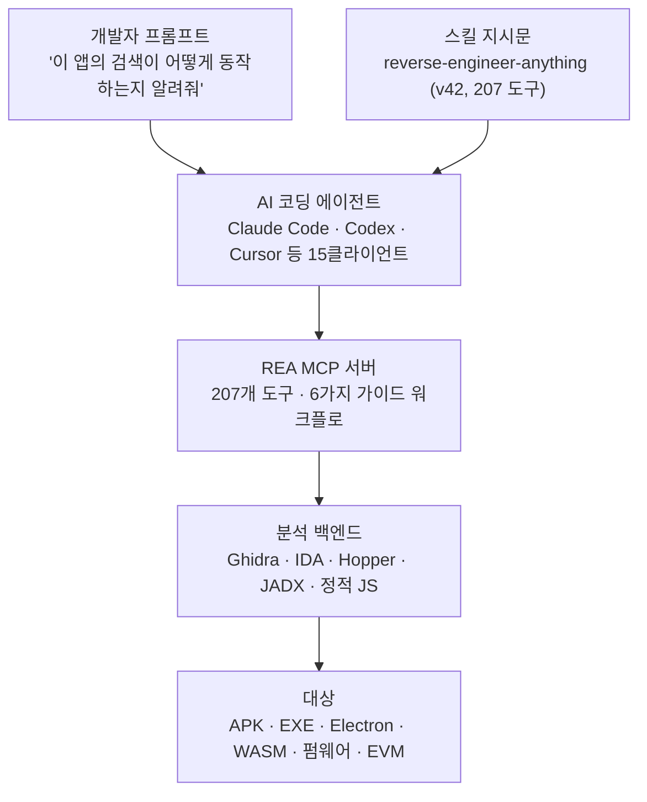

이번 주 AI 개발 커뮤니티에서 '역공학을 AI 에이전트에게 시키는 도구'가 화제가 되었습니다. 안드로이드 APK든, 윈도우 EXE든, Electron 앱이든 펌웨어든, 에이전트에게 물어보면 소스 코드 없이 앱이 어떻게 동작하는지 증거와 함께 설명해 주는 구조입니다.

저는 화제의 도구 REA의 실제 배포 패키지를 받아 내용물을 검증했습니다. 공식 npm 저장소의 최신 패키지, GitHub API의 저장소 메타데이터, 패키지에 번들된 스킬 매니페스트와 문서까지 교차 확인했고 그 결과 207개 도구, 6가지 가이드 조사 워크플로, 15개 에이전트 클라이언트 연결, 그리고 '샌드박스가 아니다'라는 명시적 경고가 확인되었습니다. 역공학을 실행한 결과는 이 글에 없습니다. 대신 에이전트 실행 환경을 만드는 사람에게 이 도구가 어떤 설계이고 어떤 위험을 동반하는지를 정리했습니다.


*에이전트가 MCP를 통해 역공학 도구를 호출하고 백엔드가 로컬에서 바이너리를 분석하는 REA의 구조를 형상화했습니다.*


*하나의 프롬프트가 207개 도구를 여는 구조와, 기업 인프라 관점의 위험 분석을 요약한 슬라이드입니다.*

## 왜 읽어야 하나

에이전트 도구를 설계하거나, 에이전트를 검증 없는 대상으로 돌리는 위험을 평가하는 분께 이 글은 두 가지를 줍니다. 첫째, 도구 카탈로그와 가이드 워크플로, 증거 모델을 한 패키지에 올린 MCP 서버의 실제 설계 사례입니다. 둘째, '로컬 실행'이 안전을 뜻하지 않는다는 경고의 구체적인 형상입니다.

<!-- nlm-visual -->

*NotebookLM이 소스를 종합해 생성한 인포그래픽입니다.*

## 개요

REA(Reverse Engineer Anything)는 morluto가 개발한 오픈소스 프로젝트입니다. MIT 라이선스, TypeScript로 작성되었으며, 공식 저장소는 github.com/morluto/rea이고 사이트는 rea.tools입니다. GitHub API 기준 2026-10-15 현재 스타 257,191개, 포크 64,641개이며 저장소 생성은 2026-04-14입니다.

배포 방식은 npm 패키지 하나입니다. 최신 버전 6.5.0의 bin은 rea와 rea-agents 두 개이고 둘 다 scripts/rea.mjs로 들어갑니다. 릴리스 속도가 빠른 편입니다. npm 저장소 기록 기준 v4.0.0이 10월 5일이고, 같은 달 14일에 v6.5.0까지 7번의 메이저·마이너 릴리스가 나왔습니다.


*검증 시점 기준 207개 지원 도구, 6가지 가이드 조사 워크플로, 15개 에이전트 클라이언트, 스타 257,191개입니다.*

## 이 도구는 무엇인가

### 207개 도구, 6가지 가이드 워크플로

에이전트가 보는 표면은 MCP(모델 컨텍스트 프로토콜) 서버입니다. 패키지에 번들된 스킬 매니페스트(reverse-engineer-anything, v42)에 기록된 도구 수는 207개입니다. 지원 대상은 네이티브 바이너리(PE/ELF), Go·Rust 바이너리, .NET 어셈블리, EVM 바이트코드, Electron/JavaScript 앱, 안드로이드 APK, Flutter 앱, WASM, 펌웨어, macOS 번들, 웹사이트, 프로세스 동작까지입니다.

원문 분석은 별도 백엔드를 사용합니다. Hopper, Ghidra, IDA 중 기존에 설치한 것을 쓰고, Ghidra와 IDA 브리지는 패키지에 Java 소스(ReaGhidraBridge.java 등)로 번들되어 있습니다. 안드로이드는 JADX와 Java가 필요하고 정적 JavaScript 분석은 네이티브 엔진이 전혀 필요 없습니다.

여섯 가지 가이드 조사 워크플로는 MCP의 prompts 기능으로 열립니다. investigate_feature(기능을 발견부터 함수 증거까지 추적), compare_application_versions(배포된 두 아티팩트 비교), verify_reconstruction(재구현 명세 검증), trace_crash(크래시 증상 상관 분석), audit_residual_unknowns(미확인 사항 감사), prepare_bounded_process_capture(유한 프로세스 실험 설계)입니다. 이 프롬프트는 도구를 추가하거나 제거하지 않습니다. 조사의 흐름을 제안하는 역할이며 에이전트가 도구를 직접 호출할 수 있습니다.


*207개 도구는 에이전트가 단독으로 탐색하기엔 너무 넓은 표면이고, 6개 워크플로가 조사의 인지를 제시합니다.*

### 증거 모델

REA의 문서가 반복적으로 쓰는 개념은 Evidence입니다. 도구 결과는 인라인으로 증거를 포함하고 증거는 세션 장부에 보관된 ID로 참조됩니다. 문서의 말은 이렇습니다. 관찰(observation), 추론(inference), 모름(unknown)을 구분하라는 것. 미확인 사항(residual unknowns)은 감사가 가능한 1급 대상이 되어 audit_residual_unknowns 워크플로가 그것만 짚습니다.


*관찰, 추론, 미확인 사항을 구분하고, 모름을 독립 감사 대상인 1급 산출물로 올리는 구조입니다.*

README의 대표 예시는 이렇게 시작합니다. "Notes 앱의 검색이 어떻게 동작하는지 이해하고, 증거를 보여주고, 내 프로젝트에 비슷한 기능을 만들어 줘."



*개발자 한 줄의 프롬프트가 에이전트를 거쳐 MCP 도구와 분석 백엔드를 타고 대상 바이너리까지 내려가는 경로입니다.*

## 설치 및 통합

Node.js가 있으면 한 줄입니다. 공식 README의 명령을 그대로 옮깁니다.

```bash
# 에이전트 등록 (MCP 서버 + 스킬 설치, 기존 설정 백업)
npx rea-agents setup

# CLI 상시 설치
npm install --global rea-agents
rea --help

# 정적 JS/Electron 분석 (네이티브 엔진 불요)
npx -y rea-agents@latest analyze-javascript-application /absolute/path/to/app --json

# 상태 진단 (클라이언트별)
npx -y rea-agents@6.5.0 doctor --client codex --json
```

setup은 지원 에이전트를 고르게 하고, 제안 변경을 검토한 뒤 승인하면 MCP 서버 등록과 매칭 스킬 설치를 합니다. 기존 설정은 백업됩니다. 스킬 매니페스트에 기록된 지원 클라이언트는 15개입니다. claude_code, claude_desktop, codex, cursor, gemini_cli, windsurf, devin, opencode, antigravity, copilot_cli, commandcode, vscode, grok_build, omp, grok_bot. Node 요구 버전은 22.19 이상 또는 24.11 이상, 26 이상입니다(검증에 쓴 로컬 Node는 22.22.3으로 충족).

## 실제 실험 결과

### 검증 설계

이 글의 검증은 역공학 실행이 아니라 배포 패키지 해부입니다. 환경이 받은 제3자 코드 실행은 사용자 승인을 요구하며 승인을 구하지 않았기 때문에 실행 수치는 이 글에 없습니다. 대신 아래는 전부 실제 확인한 것입니다.

### 실제로 본 것

- npm 공식 저장소에서 최신 패키지(tarball 5.6MB, 파일 1,650개)를 받아 직접 추출·검토했습니다.
- package.json의 런타임 의존성은 39개입니다. playwright-core(브라우저 관찰), evmole(EVM 바이트코드), xterm 계열(터미널 세션), modelcontextprotocol client/server SDK가 포함됩니다.
- bridge/ 디렉터리에는 Ghidra용 Java 소스(ReaGhidraBridge.java, ReaGhidraAnalysisOptions.java 등)와 안드로이드용 JADX 브리지가 번들되어 있습니다.
- scripts/에는 Electron 앱의 런타임 관찰을 위한 훅 스크립트(electron-active-hook.cjs 등)가 있습니다.
- 스킬 매니페스트의 tool_count=207, version=42, 지원 클라이언트 15개는 위와 동일하게 확인했습니다.
- GitHub API로 저장소 메타데이터를 교차 확인했습니다. 스타 257,191, 포크 64,641, MIT, 생성 2026-04-14, 마지막 푸시 2026-10-15(확인 당일).


*단일 5.6MB tarball 안에 코어 의존성 39개와 Ghidra·JADX 브리지, Electron 런타임 관찰 훅이 완비되어 있습니다.*

### 못 본 것

바이너리를 실제로 열어 분석한 수치는 없습니다. 분석 품질, 지연, 크래시 추적 성공률은 실행해야 나오는 값이라 이 글에서 주장하지 않습니다. 스타 수치는 확인 시점(2026-10-15)의 API 값이며 그 주에 여러 매체에서 보도된 수치(11만에서 25만)보다 큰 편입니다.

## ThakiCloud 제품 적용 시사점

첫째, Paxis의 MCP 커넥터 설계에서 재사용할 패턴이 세 개 있습니다. 도구를 카탈로그로 만들고(207개), 카탈로그 위에 가이드 워크플로를 얹고(6개 prompts), 산출물에 증거 ID를 부여해 관찰과 추론을 분리하는 것(Evidence 모델). Paxis의 스킬 하니스가 도메인 도구를 묶을 때 '도구만 주는 것과 워크플로를 함께 주는 것'은 에이전트의 성공률에서 갈립니다.


*도구보다 워크플로가 성공을, 증거의 1급 격체화가 환각을, 격리의 케이지가 안전을 결정합니다.*

둘째, 이 도구가 보여주는 위험이 Paxis 샌드박스의 이유입니다. REA의 문서와 면책 조항은 명확합니다. 샌드박스가 아니며 신뢰하지 않는 바이너리를 열면 사용자의 권한으로 로컬 디컴파일러가 그 파일을 파싱합니다. 악의로 만든 파일에 명령어처럼 보이는 문자열이 있으면 에이전트가 그것에 반응할 수 있습니다. 로컬 기계에서 이것이 일어난다면, 에이전트 실행 인프라에서는 격리 샌드박스와 정책 게이트, 감사 로그가 그 자리를 채웁니다. Paxis가 에이전트 실행을 격리 환경에서 돌리고 모든 행동을 정책 게이트로 통과시키는 구조인 이유입니다.


*REA의 로컬 실행은 사용자 권한 파싱과 프롬프트 인젝션 노출을 갖고, 기업형 패러다임은 격리 샌드박스와 정책 게이트, 감사 로그로 같은 위험을 통제합니다.*

셋째, 로컬 실행 자체는 온프레미스 환경의 요구와 같습니다. 분석 대상이 외부로 나가지 않는 것은 Aegis가 폐쇄망에서 제공하는 것과 같은 성질입니다. 데이터 주권이 역공학 도구의 제원으로 들어온 사례로 볼 수 있습니다.

## 한계 및 반론

207개 도구는 장점이자 위험입니다. 에이전트가 움직일 수 있는 표면이 크면, 에이전트 동작에 대한 신뢰도 그만큼 커야 합니다. 릴리스가 일주일 사이 7번이면, 설치한 스킬과 실제 서버의 기능이 어긋날 수 있습니다. REA의 스킬 문서 자체가 '레포 main의 스킬은 npm 릴리스에 없는 기능을 설명할 수 있다'고 경고합니다. 법적 경계도 명확히 긋고 있습니다. DRM 우회, 치트 제작, 미인가 시스템 접근, 프롭리터터리 소프트웨어 복제는 지원하지 않는다고 명시되어 있고 역공학의 법적 효력은 관할권에 따라 다릅니다. 마지막으로 이 글은 패키지 해부에 기반하며 실행 품질의 평가는 아닙니다.

## 정리

에이전트의 역공학 능력이 '설치하면 되는' 단계에 왔습니다. 대상은 자신이 소유하거나 검사 권한이 있는 소프트웨어로 한정하고 README의 예시처럼 한 줄로 시작해 볼 가치가 있습니다. 에이전트 실행 인프라를 만드는 입장에서 가져갈 것은 세 가지입니다. 도구 카탈로그 위에 워크플로를 얹는 설계, 증거를 1급 산출물로 만드는 모델, 그리고 로컬 실행이 안전이 아니라는 경고. 역공학을 에이전트에게 시킬 때, 그것을 담는 환경이 개발자 기계가 아니라 격리 실행 환경이어야 한다는 것이 이 도구가 스스로 증명한 교훈입니다.

<!-- nlm-visual -->

*NotebookLM이 소스를 종합해 생성한 인포그래픽입니다.*

## 참고 자료

- REA 공식 저장소, [morluto/rea](https://github.com/morluto/rea)
- REA 공식 사이트, [rea.tools](https://rea.tools)
- npm 패키지, [rea-agents](https://www.npmjs.com/package/rea-agents)

스타·포크·릴리스 수치는 2026-10-15 GitHub API와 npm 저장소 기록 기준입니다.
