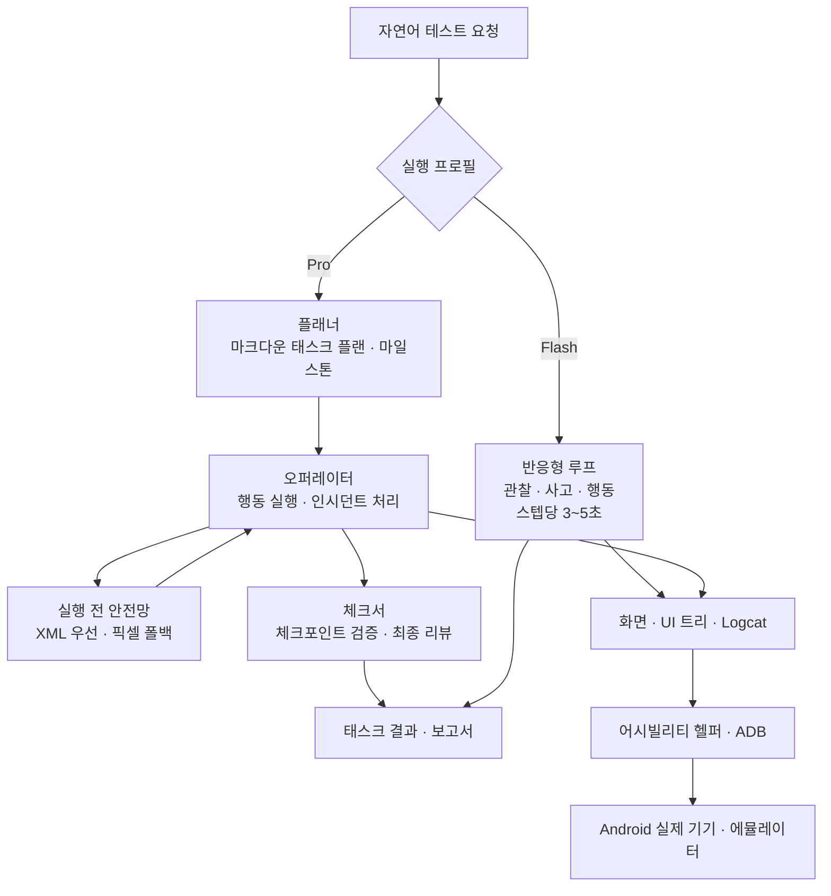

*코딩 에이전트와 실제 기기 사이를 MCP로 잇는 ARTEMIS. 폰 화면이 프로그래밍 가능한 도구가 되는 순간을 추상적으로 표현했습니다.*

## 왜 읽어야 하나

모바일 QA 엔지니어, 에이전트를 운영하는 플랫폼 엔지니어, AI 테스트의 방향을 보는 사람에게 이 글이 필요합니다. 핵심 결론을 먼저 씁니다. 구글이 오픈소스한 ARTEMIS가 제공하는 것은 화면 자동화 스크립트가 아니라, 스마트폰 화면을 에이전트의 도구로 만드는 계약입니다. USB 디버깅이 켜진 폰이나 에뮬레이터가 MCP 도구 5개로 Claude Code나 Codex 같은 코딩 에이전트에 연결되고, 테스트 엔지니어의 일은 클릭 스크립트를 작성하는 것에서 에이전트의 테스트 플랜을 검토하는 것으로 이동합니다.

## 개요

ARTEMIS는 구글이 2026년 10월 말 GitHub `google` 조직 아래 오픈소스로 내놓은 프로젝트입니다. 라이선스는 Apache 2.0, 런타임은 Python 3.12 이상입니다. README의 자기 설명은 "Autonomous Multimodal Android Agent & Testing Framework"입니다. 한 문장으로 줄이면, 자연어 지시를 신뢰할 수 있는 Android 자동화로 바꾸는 시스템입니다.

데모는 여러 앱을 오가는 워크플로입니다. Google Maps에서 경로 세트를 만들고 총 소요 시간을 계산한 뒤, YouTube를 열어 Coldplay 노래를 재생합니다. 벤치마크는 구글 리서치가 운영 중인 AndroidWorld입니다. 20개 이상의 앱과 100개 이상의 멀티스텝 태스크를 다루며 ARTEMIS는 99%+ 완료율을 보고하고 README는 SOTA라고 적고 있습니다.

사용 인터페이스는 네 개입니다. 웹 시각 테스트 콘솔, MCP 서버, 개발자 CLI, Python SDK입니다. 콘솔은 localhost:8000에서 돌아가며 실시간 화면 미러링, 프롬프트 샌드박스, 실행 재연을 제공합니다. SDK의 `artemis-client`는 런타임 의존성이 제로이고 ADB와 에이전트와 모델 처리는 기기 호스트 쪽에 남습니다.

## 이 기술은 무엇인가

설계의 중심은 실행 프로필의 이원화입니다. Flash와 Pro가 그 둘입니다.

Flash는 반응형 observe-and-act 루프입니다. 모델 하나로 라이브 화면을 보고 생각하고 행동합니다. README는 스텝당 3~5초를 적고 있습니다. 그래프 오케스트레이션이 없습니다. 히스토리는 버리지 않고 압축합니다. 오래된 스크린샷은 시각 요약으로 접히고 완료된 스텝은 검색 가능한 청크로 나뉘어 `search_history`와 `replay_steps`로 필요할 때 돌아옵니다. 토스트처럼 금세 사라지는 UI는 탭을 하나로 이어 붙이는 `click_sequence`로 처리합니다. 한계도 명시적입니다. 태스크 플랜이 없고 노트가 없고 실행 전 안전망이 없고 체크포인트 검증과 최종 보고서가 없으며 ADB 셸도 없습니다.

Pro는 그 반대편입니다. 플래너가 마일스톤과 verify, assert 항목을 가진 살아 있는 마크다운 태스크 플랜을 유지합니다. 오퍼레이터가 풀 툴셋으로 실행합니다. 각 행동 전에 안전망이 라이브 UI 트리와 픽셀에 대조해 타깃을 확인합니다. XML이 우선이고 픽셀이 폴백입니다. 막히거나 실패한 행동은 실행 인시던트를 열고 그 인시던트는 이후 행동이 성공할 때까지 오퍼레이터 컨텍스트에 남습니다. 별도 복구 에이전트가 없습니다. 읽기 전용 체크서가 플랜 체크포인트를 검증하고 종료 시 원래 목표에 대한 최종 리뷰를 실행합니다. 검증 수준은 off에서 final, checkpoints, strict로 조절됩니다. Pro의 스텝 시간은 15~40초로 적혀 있고 100스텝 이상의 장기 워크플로와 `[Loop:continuous]` 모니터링을 지원합니다.

| 구분 | Flash | Pro |
|---|---|---|
| 루프 | 반응형 observe-and-act | 플래너·오퍼레이터·체크서 그래프 |
| 스텝 시간 | 약 3~5초 | 약 15~40초 |
| 실행 전 안전망 | 없음 | XML 우선, 픽셀 폴백 |
| 검증 | 없음 | checkpoints, final 리뷰 |
| ADB 셸 | 없음 | 사용 가능 |

엘리먼트 위치잡기는 멀티모달입니다. 어시빌리티 히어라키와 OCR을 먼저 쓰고 Canvas나 Compose, Flutter 같은 커스텀 UI는 시각 모델로 폴백합니다. 기기 안에는 Artemis Accessibility Helper라는 어시빌리티 서비스가 들어갑니다. UiAutomation 연결을 차지하지 않으면서 화면 레이아웃을 읽는 것이 특징입니다. README는 이 헬퍼가 폰 안에서만 동작하며 아무것도 바깥으로 보내지 않는다고 적고 있습니다. 태스크 중간에 헬퍼가 실패하면 UIAutomator2로 폴백하고 그 사실은 태스크 타임라인에 남습니다.



MCP 서버가 폰을 코딩 에이전트에 연결하는 지점입니다. stdio와 SSE 트랜스포트를 지원하는 네이티브 서버이고 도구는 5개입니다. `mobile_run_task`가 태스크를 비동기로 시작하고 `mobile_manage_task`가 수명주기를 다룹니다. status, stop, 지시 주입이 그것입니다. `mobile_get_device_state`가 스크린샷이나 OCR·XML 히어라키로 실시간 관찰을 줍니다. `mobile_inspect_trace`가 트레이스를 자세히 파고 `mobile_diagnose`가 환경 doctor 역할을 합니다. ready, degraded, blocked 판정을 쓰고 순서 붙인 수정 목록을 돌려줍니다. `attempt_fix=true`면 깨진 ADB 키를 재생성하거나 ADB 서버를 재시작하는 안전한 자동 복구까지 실행합니다.

지원 IDE는 넓습니다. Antigravity, Cursor, Claude Code, Codex, Windsurf, VS Code, Cline/Roo, OpenClaw까지입니다. `uv run artemis mcp --install all` 하나로 MCP 설정과 룰 파일을 마운트합니다. 룰 파일 `rules.md`의 이름은 Mobile Testing Mindset입니다. 에이전트가 먼저 라이브 앱을 탐색하고 나서 테스트 스크립트를 쓰도록 하는 runnable code 원칙, Flash와 Pro 라우팅 전략, 지연과 타이밍 보상, 동적 UI 로케이터를 먼저 쓰고 좌표로 폴백하는 패턴을 가르칩니다.

README가 가장 앞세우는 사용법은 Antigravity와 함께 하는 자율 테스트 워크플로입니다. 테스트 시나리오를 프롬프트로 넣으면, ARTEMIS가 스텝별 테스트 플랜으로 바꿔 검토를 요청합니다. 실제 기기를 조종하고 UI를 탐색하고 성능을 프로파일한 뒤, 감사 발견과 지표 테이블과 원데이터를 담은 구조화 보고서를 넘깁니다. 예시 프롬프트가 하나 있습니다. 최신 변경을 APK로 빌드해서 연결된 기기에 설치하고 테스트 계정으로 로그인 화면을 열어, 로그인 직후 예기치 않은 팝업이 없는지 확인하고, 최종 페이지 스크린샷을 돌려달라는 것입니다.

Python SDK 경로도 있습니다. `artemis-client`를 개발 머신에 넣고 기기 호스트 주소와 기본 프로필을 지정하면 태스크를 보냅니다. 결과는 Pydantic 구조화 출력으로 돌아오고 succeeded와 error와 trace_id를 assert할 수 있습니다. pytest 같은 기존 자동화 프레임워크나 CI/CD 파이프라인에 표준 라이브러리처럼 들어가는 형태입니다.

## 설치 및 통합

저장소를 클론합니다.

```sh
git clone https://github.com/google/artemis.git && cd artemis
```

macOS와 Linux는 `./start.sh`, Windows PowerShell은 `.\start.bat`로 시작합니다. 시작 스크립트가 ADB와 scrcpy, FFmpeg, Python 의존성을 `uv`로 자동 설치하고 localhost:8000에서 웹 콘솔을 엽니다. 기기 연결 위자드와 실시간 화면 미러링, 프롬프트 샌드박스, 실행 재연이 나옵니다.

MCP 설치 명령은 따로 있습니다. 한 번의 명령이면 됩니다.

```sh
uv run artemis mcp --install claude
```

Claude Code 글로벌 룰은 `~/.claude/rules/artemis.md`에 설치됩니다. 모든 IDE 대상은 아래 명령입니다.

```sh
uv run artemis mcp --install all
```

`artemis` 명령을 전역으로 쓰고 싶으면 `uv tool install -e .` 한 번이면 됩니다. 웹 콘솔과 서버 수명주기는 어떤 터미널에서나 다룹니다.

```sh
uv run artemis ui
uv run artemis status
uv run artemis restart
uv run artemis stop
```

CLI 실행은 프로필을 지정합니다.

```sh
uv run artemis run "Open Settings, find Battery and tell me current level" --profile flash
```

모델 설정은 `config/artemis.jsonc`에 있습니다. 기본값은 `gemini-3.8-flash`이고 thinking 수준은 medium, 폴백은 `gemini-3.7-flash`입니다. 프리셋은 gemini-flagship, gemini-flash(2.5에서 2.0), openai-gpt4o(gpt-4o에서 4o-mini), cost-saving(flash-lite 쌍), local-ollama(llama3.2-vision)입니다. 로컬 Ollama 스택까지 지원 범위 안에 있습니다.

ARTEMIS는 첫 태스크에 기기 안 헬퍼 APK를 설치합니다. 미리 설치하면 첫 태스크의 약 3초 지연을 피할 수 있고 상태는 doctor로 볼 수 있으며 삭제도 언제든 가능합니다.

```sh
uv run artemis helper install
uv run artemis helper status
uv run artemis helper uninstall
```

히어라키 백엔드를 UIAutomator2로 쓰고 싶으면 .env에 `ARTEMIS_HIERARCHY_BACKEND=uiautomator`를, 헬퍼 자동 설치를 막으려면 `ARTEMIS_HELPER_AUTO_INSTALL=false`를 둡니다.

## 실제 실험 결과

ThakiCloud 환경에서 재현을 시도했습니다. 실행 환경은 macOS ARM(MacBook), Python 3.12.8, Android 기기는 연결되어 있지 않았습니다. 그래서 전체 자동화 루프는 검증 범위 밖이었습니다.

1. **venv 준비**: 첫 `uv run artemis --help`에서 `artemis`와 `artemis-client` 패키지가 로컬 소스에서 빌드되었습니다. 191개 패키지가 477ms에 설치됐습니다. opencv-python(46.1 MiB), pyarrow(32.6 MiB), imageio-ffmpeg(20.1 MiB), scipy(19.5 MiB) 같은 대형 의존성이 들어갔고 로컬 ADB 서버 엔드포인트 127.0.0.1:5037이 활성화되었습니다.
2. **CLI 표면**: 배너는 "Autonomous Multimodal Android Agent & Testing Framework"입니다. 명령 12개가 나옵니다. ui, restart, stop, status, run, init, doctor, batch, mcp, server, trace, helper. `server` 명령은 Cloud Run 프록시와 웹 대시보드 서버입니다.
3. **doctor**: Python 런타임, 시스템 구성, MCP/IDE 통합 호스트가 모두 OK로 떴습니다. 시스템 구성 줄에서 기본 플래너 모델이 `gemini-3.8-flash`임을 확인했습니다. 막는 문제는 두 개였습니다. 멀티모달 LLM API 키가 없고 (GEMINI_API_KEY, OPENAI_API_KEY 등), Android ADB 프로브가 30초에 타임아웃났습니다. doctor의 권고는 `artemis init`으로 키와 기기를 채우고 다시 doctor를 돌리라는 것입니다.
4. **MCP 설정 생성**: `uv run artemis mcp --generate-config claude`가 실제 JSON을 냈습니다. `command`가 프로젝트의 `.venv` python을 가리키고 `args`는 `-m mcp_server`, `env`에는 PYTHONUNBUFFERED와 PYTHONPATH와 ARTEMIS_DESKTOP_NOTIFY, `type`은 stdio입니다.
5. **전체 자동화**: 실행하지 못했습니다. Android 기기와 API 키가 없어서 태스크 실행 루프를 검증할 수 없었습니다. AndroidWorld 99%+ 수치는 구글이 스스로 측정한 결과이며 독립 재현은 아직 안 된 상태입니다.
6. **소스 구조**: 저장소에는 mcp_server, apps, packages, playground, scripts, tests 디렉터리가 있고, third_party 폴더에 Minitap의 mobile-use 일부 코드가 원출처 Apache 2.0 라이선스와 함께 들어 있습니다.

## ThakiCloud 제품 적용 시사점

Paxis 관점에서 보면, ARTEMIS의 MCP 서버는 커넥터 설계의 참고물입니다. 먼저 도구 표면이 적습니다. 다섯 개 도구로 태스크 수명주기, 관찰, 트레이스, 진단을 다룹니다. 둘째, `mobile_diagnose` 계약이 빌려올 가치가 있습니다. 판정과 순서 붙인 수정 목록을 돌려주고 에이전트가 Run 줄은 혼자 실행하고 Guidance 줄은 사람에게 넘깁니다. 안전한 범위 안에서 에이전트가 스스로 고치고 그 범위는 정책 게이트와 감사 로그가 지킵니다. 이 방식은 Paxis의 기기와 자원 진단에 그대로 옮길 수 있는 패턴입니다. 셋째, 비동기 실행과 알림 채널입니다. `mobile_run_task`는 백그라운드(detached) 프로세스로 돌아가고 완료가 되면 AgentAPI 리액티브 웨이크업과 데스크톱 토스트와 웹훅과 스크립트 훅으로 나뉘어 알림을 보냅니다. Paxis의 긴 에이전트 태스크에서 에이전트가 대기하지 않고도 사람에게 확실히 알릴 수 있는 알림 계약의 참고점입니다.

ai-platform 관점에서 보면, ARTEMIS는 기기를 도구로 쓰는 패턴을 K8s AI/ML 플랫폼 위에 올린 사례입니다. `server` 명령은 Cloud Run 프록시로 돌아가고 SDK는 의존성 제로 클라이언트를 기기 호스트와 분리합니다. 이런 구조 뒤에 테스트 기기 팜을 두면, 에이전트의 모바일 테스트는 플랫폼 워크로드로서 관리 가능해집니다. 쿼터와 관측성과 멀티테넌트 격리는 GPU 워크로드와 같은 계통의 문제입니다. Flash/Pro 분리는 추론 서빙 경제학과도 맞닿아 있습니다. 3~5초 반응형 루프는 싼 추론이고 15~40초 플래닝 그래프는 비싼 추론입니다. 태스크마다 프로필을 고르는 것은 큐 우선순위와 모델 티어 라우팅과 같은 축의 문제입니다.

## 한계 및 반론

첫째, 99%+ 수치는 자기 보고입니다. AndroidWorld도 구글 리서치가 운영하는 벤치마크이고 태스크 집합은 공개되어 있습니다. 수치를 신뢰하기 전에는 우리 기기와 태스크 집합에서 독립 재현이 필요합니다.

둘째, 기기 안 헬퍼는 어시빌리티 서비스 허용을 전제로 합니다. 첫 태스크에 테스트 기기에 APK를 설치합니다. 기업 환경에서는 기기 정책의 범위입니다. 공유 기기나 개인 폰에서는 `ARTEMIS_HELPER_AUTO_INSTALL=false`를 먼저 설정해야 합니다.

셋째, 의존성 크기가 큽니다. opencv와 pyarrow와 scipy와 matplotlib까지 191개 패키지를 쓰는 것은, 핵심이 UI 자동화인 도구 치고 무겁습니다. 기기 위 영상 분석과 화면 미러링, 웹 콘솔을 위한 대가입니다.

넷째, 중심이 구글 스택입니다. 기본 모델이 `gemini-3.8-flash`이고 GPT-4o와 cost-saving와 local-ollama 프리셋이 있지만 각각 얼마나 깊이 테스트됐는지는 공개 문서에 없습니다. README 배지가 Gemini, Claude, GPT-4o, Qwen-VL를 나열하는 것은 지원 선언이지 동등성 선언이 아닙니다.

다섯째, Android 전용입니다. iOS는 로드맵에 있고 Android Studio 통합과 온디바이스 경량 VLM과 실시간 이중음성도 모두 미래형입니다.

## 정리

ARTEMIS는 에이전트가 실제 기기에 어떻게 닿느냐는 질문을 MCP 도구 다섯 개와 실행 프로필 두 개로 압축했습니다. 폰 화면이 코딩 에이전트의 도구가 되는 것은 데모가 아니라 계약입니다. ThakiCloud가 참고할 지점은 두 개입니다. 안전한 범위 안에서 스스로 고치는 진단 계약, 그리고 반응형 루프와 플래닝 그래프를 분리한 프로필 라우팅입니다. 다음 단계는 명확합니다. 실제 기기를 연결하고 API 키를 채우고 AndroidWorld 서브셋을 독립 재현하는 것입니다. 그 전까지 99%+ 수치는 사실로 취급하지 않고 주장으로 두겠습니다.

## 출처

- GitHub 저장소: [google/artemis](https://github.com/google/artemis) (Apache 2.0, README, mcp_server/README.md, config/artemis.jsonc)
- AndroidWorld 벤치마크: [google-research/android_world](https://github.com/google-research/android_world)
- Model Context Protocol: [modelcontextprotocol.io](https://modelcontextprotocol.io)
