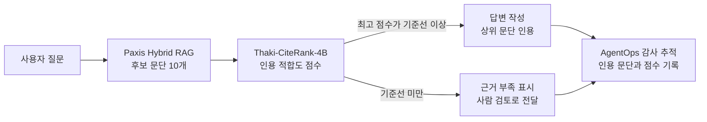

사내 문서로 답하는 RAG 에이전트를 만든다면 검색이 문서를 못 찾는 것보다 **엉뚱한 문서를 근거로 붙이는 것**이 더 자주 신뢰를 깎는다는 것을 아실 겁니다. Thaki-CiteRank-4B는 바로 그 단계, 후보 문서 중 무엇을 인용할지 고르는 일만 맡는 4B 리랭커이고, 학습에 한 번도 쓰지 않은 계약서 데이터에서도 원본 Qwen3-Reranker-4B보다 순위가 좋아졌습니다.

이 글은 모델 성적보다 쓰는 법에 무게를 둡니다. Paxis의 Hybrid RAG 뒤에 이 모델을 어떻게 끼우고, 어디서 사람에게 넘기며 무엇은 맡기면 안 되는지를 정리했습니다.


*글의 핵심 개념을 형상화했습니다.*

## 쉽게 말하면

에이전트가 "파드의 기본 재시작 정책은 무엇인가"라는 질문을 받았다고 해 보겠습니다. 검색기는 관련 있어 보이는 문단 열 개를 가져옵니다. 그중에는 답이 적힌 문단도 있고, 주제만 같은 문단도 있고, 옛 버전이라 값이 다른 문단도 있습니다. 검색기 입장에서는 모두 "관련 있음"입니다.

CiteRank는 이 열 개를 다시 읽고 "이 문단을 근거로 인용해도 되는가"라는 기준으로 점수를 매깁니다. 주제만 겹치는 문단, 주장의 일부만 뒷받침하는 문단, 주장과 반대되는 문단은 점수를 낮게 받도록 학습했습니다. 가장 높은 점수도 기준선을 넘지 못하면 "인용할 근거가 없다"고 판단할 수 있습니다.

## 숫자로 본 결과


*왼쪽은 순위 품질(세로축 0.75부터), 오른쪽은 모델이 인용한 문서가 실제 근거가 아니었던 비율입니다.*

평가는 세 종류의 데이터로 했습니다. 학술 논문 질의응답(QASPER)에서 nDCG@10은 원본 0.863에서 0.919로 올랐습니다. 더 중요한 숫자는 계약서 조항 데이터(CUAD)입니다. 이 데이터는 학습에도, 모델 선택에도 쓰지 않았는데 0.838에서 0.905로 올랐습니다. 95% 신뢰구간이 +0.058에서 +0.078이라 우연으로 보기 어렵습니다. 논문에서만 잘하는 모델이 아니라 다른 종류의 문서로 옮겨 가도 순위 능력이 유지된다는 근거입니다.

모델이 인용한 문서가 정답 근거가 아니었던 비율도 줄었습니다. QASPER에서 23.6%가 12.6%로, CUAD에서 50.9%가 33.1%로 내려갔습니다. 판정 기준 다섯 가지는 평가 데이터를 열기 전에 미리 정해 두었고, 다섯 개 모두 통과했습니다. 학습은 B200 한 장으로 3시간 정도 한 번 했고, 추론은 후보 하나당 11.1ms로 원본과 거의 같습니다.

## Paxis에 붙이면 어떤 모습이 되나

Paxis는 사내 데이터를 외부 API 없이 다루는 멀티에이전트 워크플로 플랫폼이며 Hybrid RAG와 MCP Tool Hub, AgentOps 감사 추적을 함께 제공합니다. CiteRank는 이 중 Hybrid RAG가 후보를 모은 직후, 답변을 쓰기 직전에 들어가는 것이 가장 자연스럽습니다.


*Paxis 워크플로 안에서 CiteRank가 맡는 위치입니다. 검색은 그대로 두고 인용 결정만 바꿉니다.*

이 배치를 권하는 이유는 세 가지입니다. 첫째, 검색기를 바꾸지 않아도 됩니다. 이미 쓰는 키워드 검색과 벡터 검색은 그대로 두고 그 결과의 순서만 다시 매깁니다. 둘째, 기준선이 "모르겠다"는 출구가 됩니다. 계약서 데이터에서 근거 없는 인용이 여전히 33.1% 남아 있다는 점을 생각하면, 점수가 낮은 질문을 사람 검토로 돌리는 경로는 선택이 아니라 필수입니다. 셋째, 점수가 감사 기록이 됩니다. 어떤 문단을 왜 인용했는지 숫자로 남기면 나중에 잘못된 답변을 추적할 때 검색 단계의 문제인지 인용 단계의 문제인지 가를 수 있습니다.

4B 모델이라 Paxis가 도는 같은 온프레미스 환경에서 함께 돌릴 수 있다는 점도 실무에서는 중요합니다. 평가 때 최대 메모리는 12.3GiB였습니다. 문서가 외부로 나가지 않는다는 Paxis의 전제를 깨지 않고 인용 품질을 올릴 수 있습니다.

다만 **Paxis 안에서 이 모델의 효과를 잰 적은 아직 없습니다.** 위 숫자는 공개 데이터셋에서 나온 것입니다. 고객 문서에서 같은 개선이 나온다는 보장은 없습니다. 도입한다면 실제 질문 몇백 개로 원본 리랭커와 나란히 비교하고, 기준선도 그 데이터에 맞춰 다시 정하는 것이 순서입니다.

## 이 모델은 사실 검사기가 아닙니다

CiteRank에는 문단을 SUPPORTS, PARTIAL, CONTRADICTS, IRRELEVANT 넷 중 하나로 나누는 보조 출력이 붙어 있습니다. 기술 문서 평가에서 Macro-F1 0.976이 나왔지만, 이 숫자를 "모순을 잘 잡는 모델"로 읽으면 안 됩니다.

기술 문서 데이터는 사내 언어모델로 주장과 라벨을 만들었습니다. 학습 데이터와 평가 데이터가 같은 생성기에서 나왔습니다. 특히 PARTIAL 예시는 두 주장을 ", and"로 이어 붙여 만들었기 때문에 주장 문장만 봐도 유형이 드러납니다. 학습에 쓰지 않은 계약서 데이터에는 관련 있음과 없음 라벨만 있어서, 모순 판별이 다른 도메인으로 옮겨 가는지는 확인하지 못했습니다. 네 가지 출력값도 확률로 보정하지 않은 점수입니다.

저장소에 넣은 예제에서도 이 한계가 그대로 보입니다. "기본값은 Always"라는 주장에 대해 정답 문단은 +3.500, 값을 Never로 바꾼 문단은 -1.562를 받았습니다. 순위는 맞게 매겼지만 반대 문단의 점수가 기준선 -1.6875를 아주 조금 넘어서, 기준선만 보면 이 문단도 인용 대상이 됩니다. 보조 분류는 이 문단을 CONTRADICTS(0.90)로 표시했습니다.

그래서 Paxis 워크플로에 넣는다면 CONTRADICTS 출력은 "사람이 한 번 더 볼 문단"이라는 표시로만 쓰고 그 자체를 사실 판정으로 답변에 노출하지 않기를 권합니다.

## 쓰기 전에 알아 둘 한계

계약서 데이터의 근거 없는 인용률 33.1%는 원본보다 낮지만 자동 인용을 믿고 맡길 수준은 아닙니다. 논문 데이터는 정답 문장과 질문의 단어가 많이 겹쳐 비교적 쉬운 검색 과제입니다. 영어로만 학습했고, 프롬프트를 포함해 1,024토큰을 넘는 문단은 잘립니다. 그리고 ChatGPT나 Perplexity 같은 실제 AI 검색 서비스에서 인용이 늘어난다는 근거는 전혀 없습니다. 이 모델은 우리 에이전트가 근거를 고르는 일을 돕는 모델이지, 남의 검색 엔진에 노출되게 해 주는 모델이 아닙니다.

## 직접 실행해 보기

저장소에 들어 있는 `example_inference.py`를 그대로 쓰면 됩니다. 질문과 주장, 후보 문단 목록을 넘기면 문단마다 인용 점수와 보조 분류 점수를 돌려줍니다.

```python
from example_inference import load, score

model, tok, head = load("ThakiCloud/Thaki-CiteRank-4B")
relevance, head_scores = score(
    model, tok, head,
    question="What is the default restart policy of a Pod?",
    claim="The default restartPolicy of a Pod is Always.",
    docs=["...문단 1...", "...문단 2...", "...문단 3..."],
)
```

`relevance`는 순위를 매기는 점수이고 확률이 아닙니다. 평가에서 쓴 기준선 -1.6875는 개발 데이터로 정한 값이라, 자기 데이터로 다시 맞추는 것이 좋습니다. 지시문을 바꾸면 점수 분포가 달라지므로 예제에 들어 있는 지시문을 그대로 쓰시기 바랍니다.

## 공개한 것

Hugging Face [Thaki-CiteRank-4B](https://huggingface.co/ThakiCloud/Thaki-CiteRank-4B)에 병합 가중치, 보조 분류 헤드, 토크나이저, 평가 매니페스트, 예제 코드를 Apache-2.0으로 올렸습니다. 학습과 평가에 쓴 원문 데이터는 포함하지 않았습니다. 학습 데이터는 QASPER(CC BY 4.0), Kubernetes 문서(CC BY 4.0), Python 문서(PSF License v2)이고, 평가에만 CUAD(CC BY 4.0)를 썼습니다.

ThakiCloud가 공개한 문서 순위 모델은 이제 역할이 나뉩니다. EditRank 계열([EditRank-0.6B](https://huggingface.co/ThakiCloud/EditRank-0.6B), [EditRank-Multidomain-4B](https://huggingface.co/ThakiCloud/EditRank-Multidomain-4B))은 문서를 어떻게 고쳐 쓸지 고르는 모델입니다. CiteRank는 이미 있는 문서 중 무엇을 근거로 인용할지 고르는 모델입니다. 둘 다 Paxis 에이전트가 사내 지식을 다룰 때 사람이 마지막 확인을 하기 쉽게 만드는 쪽으로 설계했습니다.
