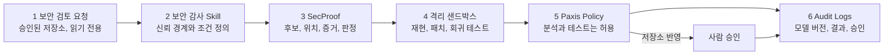

코드 보안 검토에 언어 모델을 붙이려는 개발팀과 보안팀을 위한 글입니다. 우리가 만든 코드 보안 판단 모델 네 가지를 학습에 쓰지 않은 문제로 한 번씩 시험했더니, 두 모델은 미리 정한 기준을 모두 넘었고 두 모델은 하나씩 넘지 못했습니다. 그 결과에 따라 사내 개발 환경의 보안 분석 도구는 기준을 넘은 중간 크기 모델을 기본으로 씁니다. 그래도 모델의 답은 여전히 검증할 대상이고, 실행 권한은 격리된 시험 환경과 정책, 사람 승인이 쥡니다. 아래에서는 그 시험 결과와, 실제 보안 분석 도구에 네 모델을 붙여 봤을 때 무엇이 달라졌는지를 차례로 다룹니다.

모델 이름은 SecProof입니다. 4B와 27B가 기준을 모두 넘었고 2B와 8B는 하나씩 넘지 못했습니다. 그래서 Paxis의 보안 분석 도구는 내부 개발 환경에서 기본 모델을 2B에서 4B로 바꿉니다. 공개한 모델은 다음과 같고, 모두 Qwen 계열 기반 모델 위에 올린 LoRA 어댑터입니다.

- [Thaki-SecProof-2B-Preview](https://huggingface.co/ThakiCloud/Thaki-SecProof-2B-Preview)
- [Thaki-SecProof-4B-Preview](https://huggingface.co/ThakiCloud/Thaki-SecProof-4B-Preview)
- [Thaki-SecProof-8B-Preview](https://huggingface.co/ThakiCloud/Thaki-SecProof-8B-Preview)
- 27B는 같은 평가를 통과해 공개를 준비하고 있습니다.

## 쉽게 말하면

공항 보안 검색대를 떠올리면 쉽습니다. SecProof는 X선 화면을 읽는 판독 요원입니다. 화면을 보고 "이 가방은 열어 봐야 합니다", "문제없습니다"를 말하고 어느 칸을 봤는지도 짚어 줍니다. 그런데 판독 요원이 "문제없다"고 해도 가방이 바로 비행기에 실리지는 않습니다. 의심스러우면 직원이 가방을 직접 열어 보고(샌드박스 테스트), 통과시킬지는 검색대 규정과 책임자가 정합니다(Paxis 정책과 사람 승인).

이번 평가는 판독 요원을 처음 보는 종류의 가방으로 시험한 것과 같습니다. 4B와 27B는 시험을 모두 통과했고 2B와 8B는 한 항목씩 떨어졌습니다. 다만 시험 가방도 같은 공장에서 만든 모형이라, 실제 공항의 낯선 가방에서도 같은 성적이 나온다는 보장은 없습니다.

## 이 모델이 하는 일과 하지 않는 일

SecProof는 SQL 인젝션이나 일반 CVE를 찾는 도구가 아닙니다. 작은 합성 Python AI 에이전트 런타임 저장소에서 이름 붙은 12개 경계만 판단하도록 학습했습니다.

- approval_single_use, approval_tool_binding, tool_action_approval_binding (승인 토큰이 한 번만, 그 도구와 그 동작에만 쓰이는가)
- cache_tenant_isolation, rag_tenant_isolation, rag_write_tenant_binding, tool_tenant_binding (테넌트 경계가 캐시, 검색, 쓰기, 도구 호출에서 지켜지는가)
- memory_trust_promotion, principal_confusion, tool_identity, tool_authorization_scope (신뢰 승격, 주체 혼동, 도구 신원과 권한 범위)
- secret_exposure_output (비밀값이 출력으로 새는가)

출력은 정해진 JSON 하나입니다. 판정은 `confirmed`, `needs_validation`, `rejected` 셋 중 하나이고 파일과 줄 번호 근거가 붙습니다. "안전함"이라는 출력은 없습니다. 이 글에서 "오확정"은 안전한 코드를 `confirmed`로 답한 경우를 뜻합니다.

## 봉인 평가: 4B·27B 통과, 2B·8B 미달

개발용 평가 세트(DEV)는 학습 데이터와 같은 템플릿에서 나와서, 거기서 높은 점수는 "이 과제를 익혔다"는 뜻일 뿐입니다. 그래서 생성기의 템플릿 family 60개 중 6개를 처음부터 학습과 DEV에서 빼 두고 모델 선택이 모두 끝난 뒤 한 번만 열었습니다. 통과 기준(G1~G7)도 결과를 보기 전에 정해 두었습니다. 시험에는 취약한 코드, 이미 고친 코드, 판단할 근거가 없는 코드, 그리고 decoy가 섞여 있습니다. decoy는 위험해 보이지만 실제로는 방어 코드가 들어 있는 안전한 코드입니다.

| 모델 | 판정 | 걸린 게이트 |
|---|---|---|
| 2B | 미달 | G4a: decoy 오확정 5/239건(2.1%)으로 낮지만, 같은 크기 원본 모델보다 낫다는 통계적 근거가 부족했습니다 |
| 4B | 통과 | 없음 |
| 8B | 미달 | G4b: 이미 고친 코드 39건 중 4건을 취약하다고 답해 허용치 3건을 넘었습니다 |
| 27B | 통과 | 없음 |
*모든 결과는 학습 한 번, 채점 한 번의 단일 실행입니다.*

2B가 떨어진 이유는 오확정이 많아서가 아닙니다. 원본 Qwen3.5-2B 자체가 decoy를 거의 확정하지 않아서, 학습한 모델이 원본보다 확실히 낫다는 것을 보이지 못했습니다. 8B는 DEV에서도 안전한 코드를 취약하다고 답한 사례가 141건 중 4건 있었는데, 학습에 없던 family에서 같은 약점이 더 크게 나왔습니다. 두 모델은 다시 학습하지 않고 Research Preview로 남기며 실패 사실은 모델 카드에 그대로 적었습니다.

4B와 27B는 모든 게이트에서 만점이었습니다. 그만큼 이 시험으로는 둘의 차이를 가릴 수 없다는 뜻이기도 합니다. 27B는 DEV에서도 체크포인트 6개 중 5개가 만점이라, 미리 정한 "동점이면 이른 step" 규칙으로 step 300을 골랐습니다.

## Paxis에서 써 보니: 놓친 취약점과 과한 확정

평가 점수와 별개로, Paxis의 보안 분석 도구(secproof_analyze)에 세 모델을 똑같은 조건으로 붙여 봤습니다. 같은 입력, 같은 프롬프트, 같은 Docker 샌드박스(네트워크 차단), 같은 판정 대조표를 쓰고 모델당 세 번씩 돌렸습니다. 세 번의 판정은 모두 같았습니다.

| 사례 | 2B | 4B | 8B |
|---|---|---|---|
| 검색이 테넌트로 거르지 않는 코드 | 놓침 → 샌드박스가 충돌로 잡음 | 발견, 샌드박스로 확인 | 발견, 샌드박스로 확인 |
| 근거 파일이 없어 판단할 수 없는 코드 | 과하게 확정 → 검증 안 됨으로 멈춤 | 같음 | 같음 |
*정상 코드 사례에서는 세 모델 모두 재현되지 않음으로 끝났고 출력이 깨진 사례는 모두 무효로 처리됐습니다.*

첫 번째 사례에서 2B는 취약한 코드를 `rejected`로 답했습니다. 그래도 그 답이 그대로 통과하지는 않았습니다. 샌드박스의 보안 테스트가 실패했고 Paxis는 "모델이 놓친 것 같다"는 충돌 상태로 기록했습니다. 판독 요원이 놓친 가방을 직원이 열어 보고 찾아낸 셈입니다.

두 번째 사례는 세 모델 모두 틀렸습니다. 판단에 필요한 파일이 없는데도 `confirmed`라고 답했습니다. 테스트를 돌릴 수 없는 상황이라 Paxis는 "모델 판단만 있고 검증되지 않음"에서 멈췄고 어떤 경로도 "안전하다"로 끝나지 않았습니다. 4B도 이 약점을 그대로 갖고 있으므로, 이 처리와 코드 변경 승인 절차는 기본 모델을 바꿔도 그대로 둡니다.

모델 호출 지연의 중앙값은 2B 약 250ms, 4B 약 480ms, 8B 약 610ms였습니다. 세 모델이 GPU 한 장을 나눠 쓴 상태에서 잰 값이라 서비스 성능 수치로 읽으면 안 됩니다. Web Chat 한 번이 수십 초 걸리는 것과 비교하면, 230ms 늘어나는 대가로 놓친 취약점을 찾는 쪽이 낫다고 판단했습니다.

## Paxis의 다음 단계

*SecProof는 3단계 한 곳이고 나머지 다섯 단계는 모두 모델 밖의 통제입니다.*

내부 개발 환경에서 secproof_analyze의 기본 모델을 2B에서 4B로 바꿉니다. 바꾸는 것은 이 보안 분석 도구의 모델뿐이고 Paxis 에이전트 전체의 LLM은 그대로입니다. 전환 뒤에는 실제 Web Chat 경로로 회귀 테스트를 다시 돌립니다. 27B가 공개되면 같은 입력으로 4B와 비교하고 실제로 나아진 것이 확인될 때만 상위 후보로 씁니다.

운영 환경 배포는 아직 하지 않습니다. 이 도구는 검토 대상 코드의 테스트를 샌드박스에서 직접 실행합니다. 공유 샌드박스의 격리 설정을 더 강화하기 전까지는 내부 검증에만 씁니다.

모델과 플랫폼을 나눠 둔 덕분에 이번 전환은 모델 설정 하나를 바꾸는 일로 끝납니다. Skills, Tools, Policy, 샌드박스, Audit Logs는 2B를 쓸 때와 같은 것을 그대로 씁니다. 더 넓은 배경은 [에이전트 통제 평면 글](https://www.thakicloud.com/tech-blog/ko/agentops/enterprise-agents-need-control-plane/)과 [Paxis 문서](https://docs.thakicloud.com/ko/paxis/)에 있습니다.

## 이 숫자를 믿으면 안 되는 부분

- **봉인 평가도 합성 코드입니다.** 학습에 없던 template family를 썼지만 생성기는 같습니다. 4B와 27B의 통과는 미리 정한 수치 기준을 넘었다는 뜻이고 실제 기업 코드에서 어떤 성능을 내는지, 운영에서 안전한지는 보여 주지 않습니다.
- **모두 단일 실행입니다.** 학습도 한 번, 봉인 채점도 모델당 한 번입니다. seed에 따른 편차는 재지 않았습니다.
- **사전등록과 어긋난 점이 하나 있습니다.** 평가 생성 잡이 처음 두 번 인프라 문제로 끝나지 못해 다시 돌렸는데, 다시 돌린 출력이 이전 출력과 바이트 단위로 같지 않았습니다. 사전등록은 같은 산출물을 재현하도록 정해 두었으므로 이 조건은 충족하지 못했습니다(retry_output_sha_mismatch). 2B 학습 모델의 판정은 두 실행에서 366건 모두 같았고 완료된 실행 하나만 채점했습니다. 이 이탈은 기록으로 남겼고 그대로 받아들이기로 했습니다.
- **Paxis 비교는 두 사례뿐입니다.** 크기별 우열이나 실서비스 안전성을 정할 근거로 쓰기에는 부족합니다.

## 정리

SecProof 4종 가운데 4B와 27B는 학습에 없던 템플릿에서도 미리 정한 기준을 넘었고 2B와 8B는 각자 한 항목에서 떨어졌습니다. Paxis에서는 4B가 2B가 놓친 테넌트 격리 취약점을 찾아서 기본 모델로 바꿉니다. 그래도 세 모델 모두 판단할 수 없는 코드를 과하게 확정했습니다. 판독 요원이 바뀌어도 가방을 열어 보는 직원과 통과 규정은 그대로 둡니다.

이제 남은 일은 모델을 더 만드는 것이 아니라, 이미 만든 모델이 실제 기업 보안 코드 리뷰에서 얼마나 쓸모 있는지 보여 주는 것입니다.

*이 글은 2026-10-25에 SecProof-2B 공개와 함께 처음 썼고, 2026-10-27에 모델 4종의 봉인 평가와 Paxis 비교 결과로 고쳐 썼습니다.*
