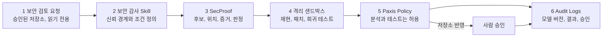
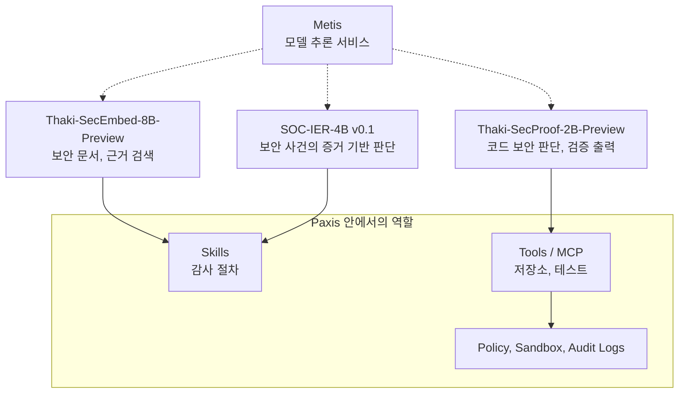

코드 보안 검토에 LLM을 붙여 보려는 개발팀과 보안팀이라면, 모델이 취약점을 그럴듯하게 설명하는 것보다 **그 판단을 믿고 어디까지 실행해도 되는지**가 더 어려운 문제라는 것을 아실 겁니다. Thaki-SecProof-2B는 에이전트 런타임 코드의 권한 경계를 구조화된 형식으로 판단하는 2B 모델이고, 이 글의 결론은 모델이 아무리 좋아져도 그 답은 검증 대상이며 실행 권한은 Paxis 같은 통제 계층이 따로 쥐어야 한다는 것입니다.

모델은 Hugging Face에 공개했습니다: [ThakiCloud/Thaki-SecProof-2B-Preview](https://huggingface.co/ThakiCloud/Thaki-SecProof-2B-Preview). Qwen3.5-2B 위에 올린 LoRA 어댑터이고, 시드 20261025의 step 750 체크포인트입니다. Research Preview이며 운영 환경에서 쓸 수 있는 모델이 아닙니다.

## 이 모델이 하는 일과 하지 않는 일

먼저 범위를 분명히 해 둡니다. SecProof는 SQL 인젝션이나 일반 CVE를 찾는 도구가 아닙니다. 작은 합성 Python AI 에이전트 런타임 저장소에서, 이름 붙은 12개 경계만 판단하도록 학습했습니다.

- approval_single_use, approval_tool_binding, tool_action_approval_binding (승인 토큰이 한 번만, 그 도구와 그 동작에만 쓰이는가)
- cache_tenant_isolation, rag_tenant_isolation, rag_write_tenant_binding, tool_tenant_binding (테넌트 경계가 캐시, 검색, 쓰기, 도구 호출에서 지켜지는가)
- memory_trust_promotion, principal_confusion, tool_identity, tool_authorization_scope (신뢰 승격, 주체 혼동, 도구 신원과 권한 범위)
- secret_exposure_output (비밀값이 출력으로 새는가)

과제는 네 가지입니다. T1은 저장소에서 결함 후보를 찾고, T2는 후보 하나가 진짜인지 검증하며, T4는 파일 전체를 고친 패치를 쓰고, T5는 후보 패치가 회귀를 일으키는지 판정합니다. 출력 판정은 `confirmed`, `needs_validation`, `rejected` 세 가지이고 파일과 줄 번호 근거가 붙습니다. "안전함"이라는 출력은 없습니다. 이 글에서 "오확정"은 안전한 코드를 `confirmed`로 답한 경우를 뜻합니다.

## 1. 형식은 맞았고 판단은 틀린 답

모델을 만든 뒤 가장 먼저 해 본 것은 학습 분포 밖의 예제 하나였습니다. 직접 쓴 4개 파일짜리 저장소에서 `search.find(tenant, query)`가 테넌트로 거르지 않고 문서를 그대로 돌려줍니다(`app/search.py` 10번째 줄). 정답은 `confirmed`입니다.

Preview 모델은 `rejected`라고 답했습니다. 줄 번호는 정확히 그 10번째 줄을 가리켰고 JSON 형식도 유효했습니다. 그런데 근거 문장은 "검색이 테넌트로 거른다"고 말했는데, 코드는 그렇게 하지 않습니다.

이 한 건이 이 글의 논지를 가장 짧게 보여 줍니다. 형식이 유효하고, 위치가 맞고, 말투가 자신 있는데도 결론은 틀릴 수 있습니다. 한 건으로 모델의 일반 성능을 말할 수는 없지만, 에이전트 설계에서는 한 건이면 충분합니다. 이 답이 "취약점 없음, 검사 생략"으로 이어지는 순간 테넌트 경계가 뚫린 코드가 그대로 통과하기 때문입니다.

판단, 검증, 통제는 서로 다른 일입니다.

- 판단: 실제로 권한 경계가 깨졌는지 구별합니다. SecProof가 맡는 부분입니다.
- 검증: 실행 가능한 테스트로 확인합니다. 격리된 샌드박스가 맡습니다.
- 통제: 검증 결과로 무엇을 실행할지 정하고 기록합니다. Paxis의 정책과 감사 로그가 맡습니다.

취약하다는 판단이 수정 권한을 자동으로 주면 안 되고, `rejected`가 보안 검사를 건너뛸 근거가 되어도 안 됩니다.

## 2. 900 step 학습으로 확인한 것

학습은 구조화된 보안 감사 과제와 샌드박스에서 확인된 결과를 정답으로 하는 SFT입니다. H200 1장에서 900 step을 마쳤고, 미리 정한 규칙으로 step 750을 골랐습니다. 학습 1.195 GPU-시간과 DEV 생성 1.354 GPU-시간을 합쳐 약 2.55 GPU-시간이 들었습니다.

DEV는 356건(T1 124, T2 92, T4 68, T5 72)입니다. 원본 Qwen3.5-2B와 비교한 결과는 다음과 같습니다.

| 지표 (DEV 356건) | 원본 | SecProof-2B |
|---|---|---|
| T1 발견 균형 정확도 | 0.258 | 0.992 |
| T2 검증 균형 정확도 | 0.806 | 1.000 |
| T4 샌드박스 both-pass (보안 테스트와 기능 테스트 모두 통과) | 0.000 | 1.000 (68/68) |
| 안전한 코드를 confirmed로 답한 오확정률 | 0.078 | 0.000 |
| 위치 정확도 | 0.000 | 0.975 |
| 종합 점수 S | 0.355 | 0.997 |

형식 일치율은 두 모델 모두 1.000이라 위 격차는 형식 때문이 아니라 판단과 위치 식별에서 나옵니다. 에이전트의 하위 구성요소로 쓰려면 다음 도구가 해석할 수 있는 구조화 출력이 안정적이어야 하는데, 이 점은 학습 모델에서 유지됐습니다.

### 이 숫자를 읽을 때 조심할 점

0.997은 **같은 분포의 DEV**에서 나온 값입니다. 학습과 DEV의 생성된 저장소(world)는 겹치지 않습니다(학습 487, DEV 44, 공유 0). 완전 중복과 뼈대 중복도 0입니다. 그러나 버그 템플릿 14개와 경계 12개는 전부 공유하므로, DEV는 분포 안의 시험입니다. 게다가 T4의 정답은 항상 `confirmed`, T5의 정답은 항상 `rejected`여서 과제 종류 자체가 단서가 됩니다.

봉인된 held-out 테스트는 아직 돌리지 않았습니다. 시드도 하나뿐입니다. 시드 2와 3은 지금 학습 중이고, 27B Format-v2 확인 작업이 돌고 있으며, 4B와 8B는 진행 중입니다.

그래서 확인했다고 말할 수 있는 것은 "2B가 구조화된 판단과 검증용 출력을 학습할 수 있다"까지입니다. 앞의 분포 밖 예제가 보여 주듯, 실전 성능은 아직 모릅니다.

## 3. Paxis에서 쓴다면: 목표 아키텍처

기업 환경에서 보안 에이전트가 일하려면 저장소 접근 권한, 안전한 검증 실행 환경, 승인 절차가 필요합니다. Paxis는 Skills, Tools, Policies, Audit Logs를 플랫폼이 직접 다루는 자원으로 보고, MCP 도구 연결과 자율도 정책, 격리 샌드박스, 온프레미스 운영을 함께 제공합니다. 같은 문제의식은 [에이전트 통제 평면 글](https://www.thakicloud.com/tech-blog/ko/agentops/enterprise-agents-need-control-plane/)에 더 길게 썼고, 제품 소개는 [Paxis 문서](https://docs.thakicloud.com/ko/paxis/)에 있습니다.

*SecProof가 들어가는 6단계 목표 흐름입니다. 모델은 3단계 한 곳이고 나머지 다섯 단계는 모두 모델 밖의 통제입니다.*

1. 개발자가 PR이나 변경의 보안 검토를 요청하면, 에이전트는 승인된 저장소와 변경 범위만 확인하고 읽기부터 시작합니다.
2. 보안 감사 Skill이 신뢰 경계와 보안 조건을 정의합니다. SecProof의 데이터 생성 코드는 Cloudflare의 공개 [security-audit-skill](https://github.com/cloudflare/security-audit-skill)을 고정 커밋으로 참조해, 합성 저장소를 그 절차의 hunter와 verifier 역할에 맞춰 연결하는 어댑터를 둡니다. 저장소 기록이 보여 주는 것은 거기까지이고, 학습 레코드 형식은 Cloudflare의 보고서 스키마와 별개입니다. Paxis에서는 이런 절차를 재사용 가능한 Skill로 관리합니다.
3. SecProof가 결함 후보, 코드 위치, 증거, 추가 검증 필요 여부를 구조화해 내놓습니다. 이 출력만으로 최종 판정을 하지 않고, 근거가 부족하거나 검증이 실패하면 사람 검토로 보냅니다.
4. 격리 샌드박스에서 허용된 테스트만 실행합니다. 재현이 되는지, 패치가 통과하는지, 기존 기능에 회귀가 없는지를 보고, 실패는 숨기지 않습니다.
5. Paxis Policy가 실행 범위를 정합니다. 읽기 전용 분석과 격리 테스트는 허용하고 저장소 반영은 사람 승인을 요구합니다. 모델의 자신감은 권한을 넓히는 근거가 아닙니다.
6. 저장소와 커밋, 모델 버전, 코드 위치, 샌드박스 결과, 정책 판단, 승인 여부를 Audit Logs로 연결해 나중에 과정을 재구성할 수 있게 합니다.

앞의 분포 밖 예제를 이 흐름에 넣어 보겠습니다. 모델이 `rejected`를 내면 4단계에서 테넌트 A로 검색해 테넌트 B 문서가 돌아오는지 보는 격리 테스트를 돌립니다. 문서가 돌아오면 모델의 판단과 샌드박스 결과가 충돌한 것이고, 이 충돌 자체가 사람이 봐야 할 신호가 되며 6단계에 기록됩니다. 모델이 틀려도 틀린 채로 통과하지 않게 하는 것이 이 구조의 목적입니다.

이 6단계는 **목표 아키텍처**입니다. Paxis와 SecProof를 실제로 연결한 결과, 지연 시간, 비용 절감, 에이전트 성공률은 아직 측정하지 않았고 이 글에서도 주장하지 않습니다.

## 4. 하나의 큰 모델 대신 역할별 모델

보안 업무는 문서 검색, 사건 판단, 코드 판단이 서로 다른 일입니다. ThakiCloud는 역할마다 다른 모델을 두는 쪽을 택했습니다.

*세 모델은 역할별로 호출되고, 추론은 Metis가 맡으며, 실행 통제는 모델이 아니라 Paxis 쪽에 있습니다.*

세 모델은 [Thaki-SecEmbed-8B-Preview](https://huggingface.co/ThakiCloud/Thaki-SecEmbed-8B-Preview), [SOC-IER-4B v0.1](https://huggingface.co/ThakiCloud/SOC-IER-4B-v0.1), [Thaki-SecProof-2B-Preview](https://huggingface.co/ThakiCloud/Thaki-SecProof-2B-Preview)입니다. SecProof는 2B 다음으로 4B, 8B, 27B 패밀리를 준비하고 있고(4B와 8B는 학습 진행 중, 27B는 형식 확인 중), 장기적으로는 작업 크기에 따른 라우팅도 검토합니다. 다만 속도, 비용, 성공률을 모델 크기별로 비교한 결과는 아직 없어서 비용 절감률 같은 주장은 하지 않습니다.

## 5. 모델을 바꿔도 남는 것

모델 하나가 아니라 업무가 돌아가려면 모델 밖에 필요한 것이 많습니다.

| 구성요소 | 맡는 일 |
|---|---|
| SecProof 모델 | 코드 보안 판단과 구조화된 검증 결과 |
| Paxis Skills | 감사 절차와 업무 단계 |
| Paxis Tools, MCP | 저장소와 테스트 도구 연결 |
| Paxis Policy | 분석, 수정, 승인 권한 |
| Paxis Sandbox | 격리된 테스트 실행 |
| Paxis Audit Logs | 판단과 실행 이력 |
| Metis | 모델 추론 서비스 |

이 구조의 장점은 특정 모델에 묶이지 않는다는 점입니다. SecProof를 다시 학습하거나 4B로 바꿔도 정책, 도구, 평가 체계는 그대로 재사용합니다. 모델을 만드는 일과 운영하는 플랫폼을 분리해 둔 이유입니다.

## 6. 다음으로 확인할 것

앞으로 할 일은 순서가 정해져 있습니다. 먼저 봉인된 held-out 테스트를 돌리고, 시드 2와 3의 결과로 분산을 봅니다. 그다음 Paxis에 읽기 전용 보안 코드 리뷰 에이전트를 구성해 정상 코드의 오탐률, 결함 누락률, 검증되지 않은 패치를 성공으로 처리하는 비율, 개발자의 검토 시간을 잽니다. 정책 게이트가 허가되지 않은 실행을 실제로 막는지, 감사 로그로 과정을 재구성할 수 있는지도 함께 봅니다. 분포 밖에서 실패한 사례, 이 글의 테넌트 필터 예제 같은 것은 다음 학습 데이터로 모읍니다.

## 정리

설명을 검증으로 바꾸고, 검증을 통제된 실행으로 이어 붙이는 것이 이 글의 요점입니다. SecProof는 코드 보안 판단에 특화된 모델이고, Paxis는 그 판단이 어떤 행동으로 이어질지를 관리합니다. 좋은 보안 에이전트는 확인된 것과 확인되지 않은 것을 구분하고, 허용된 범위 안에서 검증 가능한 결과를 남깁니다.
