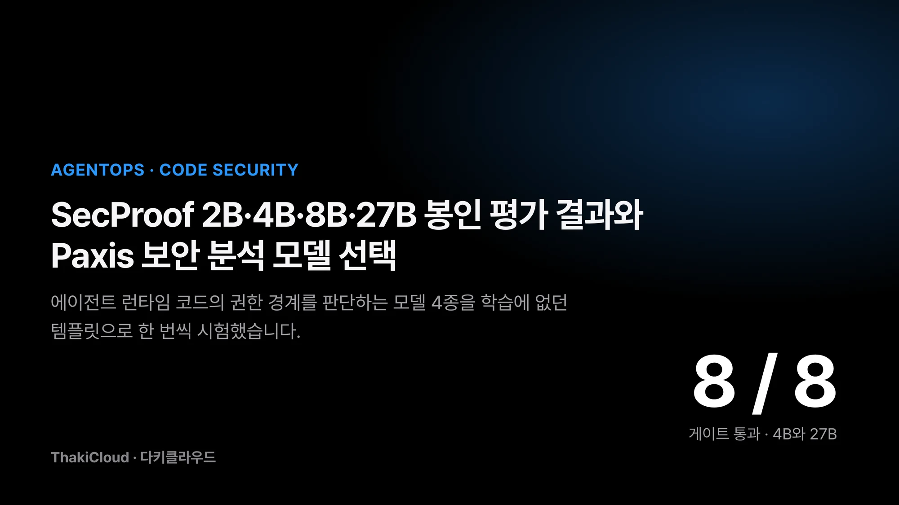
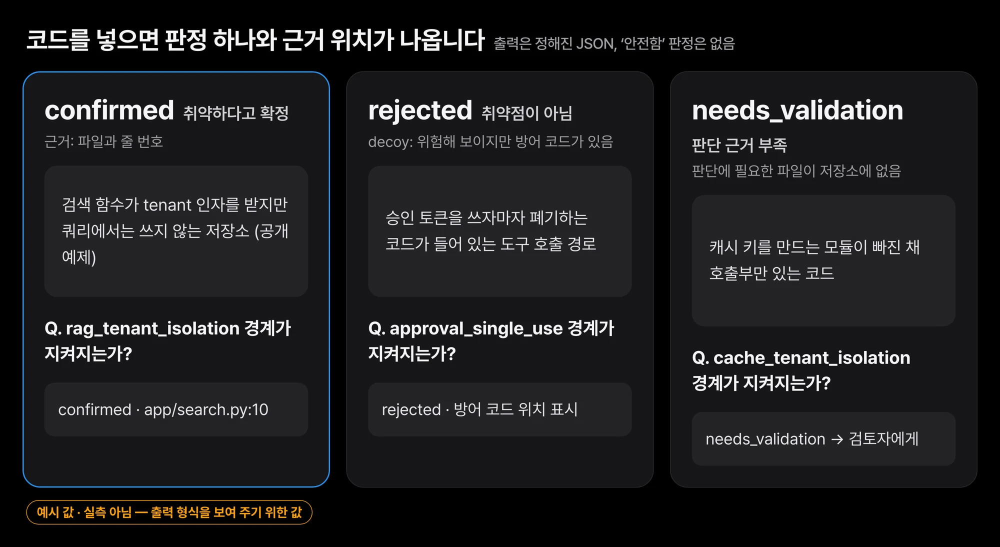
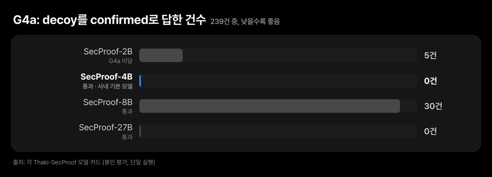
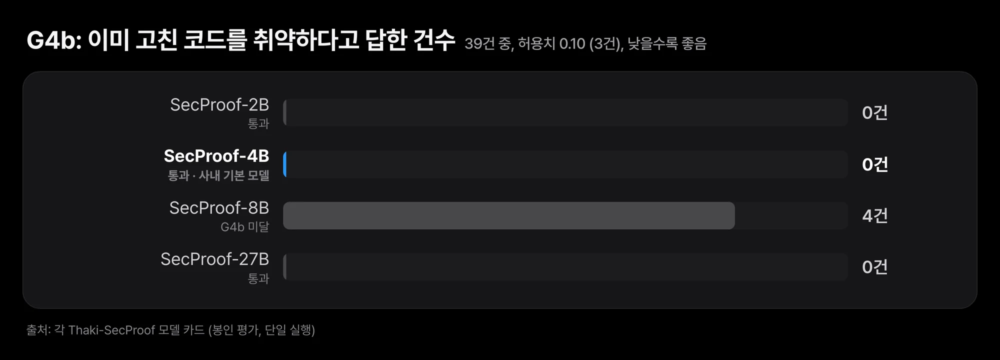
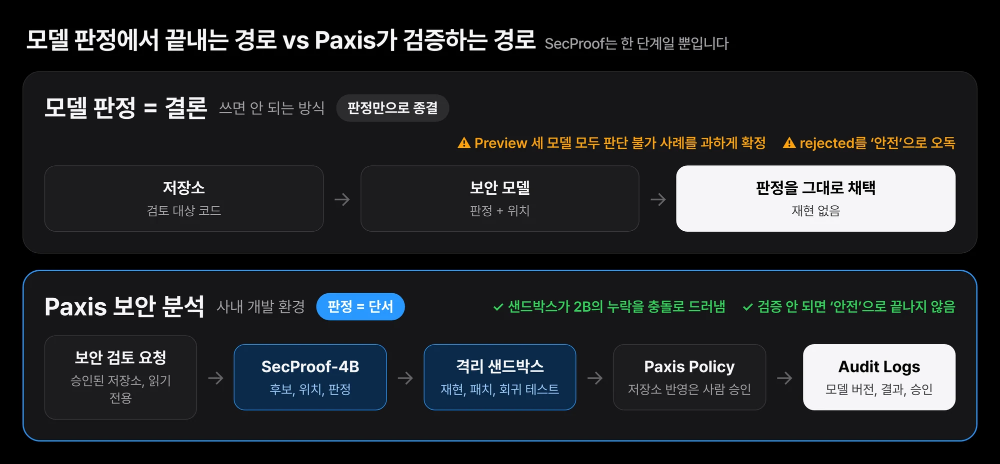
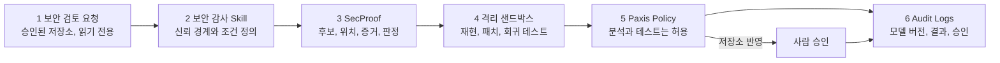

에이전트가 도구를 부르는 코드에는 사람이 놓치기 쉬운 경계가 많습니다. 승인 토큰이 한 번 쓰이고 버려지는지, 검색 결과가 다른 테넌트의 문서를 섞어 오지 않는지, 비밀값이 응답에 새지 않는지 같은 것들입니다. 이런 검토에 언어 모델을 붙이려는 개발팀과 보안팀을 위한 글입니다.

우리가 만든 코드 보안 판단 모델 SecProof 네 가지를 학습에 쓰지 않은 문제로 한 번씩 시험했습니다. 4B와 27B는 미리 정한 게이트 8개를 모두 넘었고 2B와 8B는 하나씩 넘지 못했습니다. 이 결과와 작은 Paxis 시험을 근거로, 사내 개발 환경에서 Paxis 보안 분석 도구의 기본 모델을 4B로 하기로 정했습니다.

어디까지나 사내 환경에 대한 결정이고 제품 출시는 아닙니다. 끝난 일과 아직 계획인 일은 뒤에서 나눠 적었습니다. 어느 쪽이든 모델의 답은 검증할 대상이고, 실행 권한은 Paxis의 샌드박스와 정책, 사람 승인이 쥡니다.

네 모델 모두 Qwen 계열 기반 모델 위에 올린 LoRA 어댑터이고 공개돼 있습니다.

- [Thaki-SecProof-2B-Preview](https://huggingface.co/ThakiCloud/Thaki-SecProof-2B-Preview) (Research Preview, 기반 Qwen3.5-2B)
- [Thaki-SecProof-4B-Preview](https://huggingface.co/ThakiCloud/Thaki-SecProof-4B-Preview) (이름은 Preview로 두었고 V1 통과, 기반 Qwen3.5-4B)
- [Thaki-SecProof-8B-Preview](https://huggingface.co/ThakiCloud/Thaki-SecProof-8B-Preview) (Research Preview, 기반 Qwen3-8B)
- [Thaki-SecProof-27B-V1](https://huggingface.co/ThakiCloud/Thaki-SecProof-27B-V1) (V1 통과, 기반 Qwen3.8-27B, 2026-10-26부터 공개)

4B, 8B, 27B 저장소에는 한국어 카드(`MODEL_CARD.ko.md`)가 있고, 2B 저장소에는 영어 카드만 있습니다.

## 판독 요원은 말하고, 가방은 직원이 엽니다

공항 보안 검색대를 떠올리면 쉽습니다. SecProof는 X선 화면을 읽는 판독 요원입니다. 화면을 보고 "이 가방은 열어 봐야 합니다", "문제없습니다"를 말하고 어느 칸을 봤는지도 짚어 줍니다. 그런데 판독 요원이 "문제없다"고 해도 가방이 바로 비행기에 실리지는 않습니다. 의심스러우면 직원이 가방을 직접 열어 보고(샌드박스 테스트), 통과시킬지는 검색대 규정과 책임자가 정합니다(Paxis 정책과 사람 승인).

이번 평가는 판독 요원을 처음 보는 종류의 가방으로 시험한 것과 같습니다. 다만 시험 가방도 같은 공장에서 만든 모형이라, 실제 공항의 진짜 가방에서도 같은 성적이 나온다는 보장은 없습니다.

## 이름 붙은 12개 경계만 보고, "안전함"이라고는 답하지 않습니다

SecProof는 SQL 인젝션이나 일반 CVE를 찾는 도구가 아닙니다. 작은 합성 Python AI 에이전트 런타임 저장소에서 이름 붙은 12개 경계만 판단하도록 학습했습니다.

- approval_single_use, approval_tool_binding, tool_action_approval_binding (승인 토큰이 한 번만, 그 도구와 그 동작에만 쓰이는가)
- cache_tenant_isolation, rag_tenant_isolation, rag_write_tenant_binding, tool_tenant_binding (테넌트 경계가 캐시, 검색, 쓰기, 도구 호출에서 지켜지는가)
- memory_trust_promotion, principal_confusion, tool_identity, tool_authorization_scope (신뢰 승격, 주체 혼동, 도구 신원과 권한 범위)
- secret_exposure_output (비밀값이 출력으로 새는가)

출력은 정해진 JSON 하나입니다. 판정은 `confirmed`, `needs_validation`, `rejected` 셋 중 하나이고 파일과 줄 번호 근거가 붙습니다. "안전함"이라는 출력은 없습니다. 이 글에서 "오확정"은 안전한 코드를 `confirmed`로 답한 경우를 뜻합니다. 일반 CVE 탐색, 메모리 안전성 버그, Python 이외 코드, 큰 실제 저장소, 목록에 없는 경계는 카드에 범위 밖으로 적혀 있습니다.


*왼쪽은 모든 공개 저장소에 들어 있는 수작업 예제의 기대 답입니다. 가운데와 오른쪽 입력은 형식을 보여 주려고 지어낸 예시이고 실측이 아닙니다.*

## 학습에 없던 템플릿에서 4B·27B는 게이트 8개를 모두 넘었습니다

개발용 평가 세트(DEV)는 학습 데이터와 같은 템플릿에서 나와서, 거기서 높은 점수는 "이 과제를 익혔다"는 뜻일 뿐입니다. 봉인 평가는 결과를 보기 전까지 열지 않고 묶어 둔 시험지로 한 번만 채점하는 평가입니다. 그래서 생성기의 템플릿 family 60개 중 6개를 처음부터 학습과 DEV에서 빼 두고, 모델 선택이 모두 끝난 뒤인 2026-10-26에 한 번만 열었습니다. 통과 기준도 결과를 보기 전에 정해 두었습니다. 게이트는 G1부터 G7까지이고 G4가 G4a와 G4b로 나뉘어 모두 8개입니다. 시험에는 취약한 코드, 이미 고친 코드, 판단할 근거가 없는 코드, 그리고 decoy가 섞여 있습니다. decoy는 위험해 보이지만 실제로는 방어 코드가 들어 있는 안전한 코드입니다.

| 게이트 | 보는 것 | 2B | 4B | 8B | 27B |
|---|---|---|---|---|---|
| G1 | T1 판정 balanced accuracy, 원본 모델보다 나은가 | 통과 (0.966) | 통과 (1.000) | 통과 (0.957) | 통과 (1.000) |
| G2 | 취약점 위치 (39건) | 통과 (0.923) | 통과 (1.000) | 통과 (1.000) | 통과 (1.000) |
| G3 | 없는 코드를 가리킨 근거 | 통과 (0.000) | 통과 (0.000) | 통과 (0.002) | 통과 (0.000) |
| G4a | decoy를 `confirmed`로 답한 비율 (239건), 원본 모델보다 낮은가 | **미달** (5/239) | 통과 (0/239) | 통과 (30/239) | 통과 (0/239) |
| G4b | 이미 고친 코드를 취약하다고 답한 비율 (39건, 허용치 0.10) | 통과 (0/39) | 통과 (0/39) | **미달** (4/39) | 통과 (0/39) |
| G5 | 판단 불가 사례를 `needs_validation`으로 답함 (10건) | 통과 (10/10) | 통과 (10/10) | 통과 (10/10) | 통과 (10/10) |
| G6 | patch가 샌드박스 보안·기능 테스트를 통과 (39건) | 통과 (1.000) | 통과 (1.000) | 통과 (1.000) | 통과 (1.000) |
| G7 | 출력 형식 (봉인 T1 / T4) | 통과 (1.0 / 1.0) | 통과 (1.0 / 1.0) | 통과 (1.0 / 1.0) | 통과 (1.0 / 1.0) |
*모든 결과는 학습 한 번, 채점 한 번의 단일 실행입니다. 수치는 각 모델 카드에서 가져왔습니다.*


*8B는 decoy 30건을 확정했지만 원본 모델보다 낮아 G4a를 통과했습니다. 2B는 5건으로 낮았는데도 원본보다 낫다는 조건을 채우지 못해 떨어졌습니다. 게이트는 건수 하나가 아니라 원본 모델과의 비교까지 봅니다.*

### 두 Preview가 넘지 못한 것

2B는 게이트 8개 중 7개를 넘었고 G4a의 조건 하나에서 떨어졌습니다. decoy 오확정은 239건 중 5건(0.021, Wilson 상한 0.048)으로 낮았고 절대 기준 안에 들었습니다. 그런데 원본 Qwen3.5-2B 자체가 decoy를 거의 확정하지 않았고(0.050), 이 게이트는 어댑터가 원본보다 낫다는 것까지 요구합니다. 차이의 신뢰구간 상단이 +0.004로 0을 넘어서 그 조건을 채우지 못했습니다. 2B는 모든 저장소에 들어 있는 수작업 예제에서도 정답인 `confirmed` 대신 `rejected`라고 답했습니다. 근거 설명은 검색이 tenant로 거른다고 했지만 코드는 그렇게 하지 않습니다.


*허용치 0.10은 39건 중 3건입니다. 8B만 4건으로 넘었습니다.*

8B도 게이트 7개를 넘었고 G4b에서 떨어졌습니다. 이미 고친 코드 39건 중 4건(0.103)을 취약하다고 답해 허용치 0.10, 즉 3건을 넘었습니다. DEV에서도 안전한 코드를 취약하다고 답한 사례가 141건 중 4건 있었는데, 학습에 없던 family에서 같은 약점이 더 크게 나왔습니다. 8B는 기반 모델 계열도 다릅니다. 8B는 dense attention인 Qwen3-8B이고, 2B·4B·27B는 Qwen3.5 계열 hybrid 구조입니다. 그러니 8B를 "4B를 키운 모델"로 읽으면 안 되고, 이 결과로 크기 효과를 말할 수도 없습니다.

두 모델은 다시 학습하지 않습니다. 둘 다 Research Preview로 남기며, 운영 준비가 된 모델이 아니고 실제 보안 운영 용도로 검증하지 않았습니다. 실패 사실은 모델 카드에 그대로 적었습니다. 써 보더라도 기본 모델이 아니라 연구용 산출물로 다뤄 주십시오.

### 통과한 두 모델이 말해 주는 것과 아닌 것

4B와 27B는 게이트 8개를 모두 넘었습니다. 봉인과 DEV 지표 거의 전부에서 천장에 닿아 있어서, 이 시험으로는 둘의 차이를 가릴 수 없습니다. 27B 카드도 둘 중 하나는 여러분의 코드로 고르라고 적고 있습니다. 27B는 DEV에서도 체크포인트 6개 중 5개가 만점이라, 미리 정한 "동점이면 이른 step" 규칙으로 step 300을 골랐습니다. 통과는 합성 코드에서 미리 정한 수치 기준을 넘었다는 뜻일 뿐입니다.

## Paxis에서 써 보니 2B는 취약점을 놓쳤고, 세 모델 모두 과하게 확정했습니다

평가 점수와 별개로, Paxis의 보안 분석 도구에 Preview 세 모델을 똑같은 조건으로 붙여 봤습니다. 같은 입력, 같은 프롬프트, 같은 Docker 샌드박스(네트워크 차단), 같은 판정 대조표를 쓰고 모델당 세 번씩 돌렸습니다. 세 번의 판정은 모두 같았습니다. 27B는 이 시험에 들어가지 않았습니다.

| 사례 | 2B | 4B | 8B |
|---|---|---|---|
| 검색이 테넌트로 거르지 않는 코드 | 놓침 → 샌드박스가 충돌로 잡음 | 발견, 샌드박스로 확인 | 발견, 샌드박스로 확인 |
| 근거 파일이 없어 판단할 수 없는 코드 | 과하게 확정 → 검증 안 됨으로 멈춤 | 같음 | 같음 |
*정상 코드 사례에서는 세 모델 모두 재현되지 않음으로 끝났고 출력이 깨진 사례는 모두 무효로 처리됐습니다.*

첫 번째 사례에서 2B는 취약한 코드를 `rejected`로 답했습니다. 그래도 그 답이 그대로 통과하지는 않았습니다. 샌드박스의 보안 테스트가 실패했고 Paxis는 "모델이 놓친 것 같다"는 충돌 상태로 기록했습니다. 판독 요원이 놓친 가방을 직원이 열어 보고 찾아낸 셈입니다.

두 번째 사례는 세 모델 모두 틀렸습니다. 판단에 필요한 파일이 없는데도 `confirmed`라고 답했습니다. 테스트를 돌릴 수 없는 상황이라 Paxis는 "모델 판단만 있고 검증되지 않음"에서 멈췄고 어떤 경로도 "안전하다"로 끝나지 않았습니다. 4B도 이 약점을 그대로 갖고 있으므로, 이 처리와 코드 변경 승인 절차는 기본 모델이 무엇이든 그대로 둡니다. 이 사례에서 27B가 어떻게 답하는지는 아직 보고된 결과가 없습니다.

이 글의 이전 판에는 Preview 세 모델의 호출 지연 대략값도 있었습니다. 세 모델이 GPU 한 장을 나눠 쓰는 상태에서 잰 값이고 다시 잴 수 있을 만큼 조건을 남기지 않았으며 어느 모델 카드에도 지연 수치가 없어서 뺐습니다. 지연 시간은 실제로 쓸 하드웨어에서 재십시오.

## 카드와 같은 결과를 내려면 세 가지를 지키십시오

[4B 카드](https://huggingface.co/ThakiCloud/Thaki-SecProof-4B-Preview)의 Quick start입니다. 2B, 8B, 27B 카드에도 저장소 이름만 다른 같은 명령이 있습니다.

```bash
pip install "transformers>=5.0" "peft>=0.19" torch accelerate
git clone https://huggingface.co/ThakiCloud/Thaki-SecProof-4B-Preview && cd Thaki-SecProof-4B-Preview
python inference.py examples/t1_rag_tenant_isolation.json
```

27B 카드는 linear-attention 층에서 훨씬 빠른 선택 설치(`pip install flash-linear-attention causal-conv1d`)를 덧붙입니다. 27B의 bf16 기반 모델은 GPU 메모리가 약 55GB 필요하고(배치 4 생성 때 최대 59.8GiB), 8B bf16 가중치는 약 17GB입니다. 2B와 4B 카드에는 서빙 메모리 수치가 없습니다.

결과가 카드와 같게 나오려면 세 가지를 지키십시오.

1. 프롬프트는 같이 들어 있는 `secproof_prompt.py`(format v2)로 만듭니다. 어댑터는 이 형식으로만 학습했고, 이 파일은 네 공개본에서 바이트 단위로 같습니다.
2. 디코딩은 카드와 같게 맞춥니다. greedy, thinking off, `max_new_tokens=2048`입니다.
3. JSON을 고치지 않습니다. 카드는 스키마가 깨진 출력을 오답으로 채점하고 생성 뒤에 키를 고치지 않습니다.

같이 들어 있는 예제는 사람이 직접 쓴 저장소이고, 검색이 tenant 인자를 무시합니다. 기대하는 답은 `app/search.py:10`을 근거로 한 `confirmed`입니다. 카드의 공개 전 확인에서 4B, 8B, 27B는 이 답을 냈고 2B는 `rejected`라고 답했습니다. 모델을 올린 직후의 스모크 테스트로 쓰고, 여러분 코드에서 잘 동작한다는 증거로 읽지는 마십시오.

## SecProof는 Paxis 보안 분석 여섯 단계 중 한 단계입니다


*위는 모델 판정에서 끝내는 경로, 아래는 Paxis가 판정을 단서로 받아 검증하는 경로입니다. 샌드박스는 외부와 격리된 실행 환경으로, 모델이 지목한 취약점을 실제로 재현하고 패치를 시험합니다.*


*SecProof는 3단계 한 곳이고 나머지 다섯 단계는 모두 모델 밖의 통제입니다.*

모델이 내놓는 답의 각 부분은 이 통제 가운데 하나로 이어집니다.

| 모델 출력 | 다음 단계가 하는 일 |
|---|---|
| 스키마를 깬 출력 | 무효로 표시하고 고치지 않습니다 |
| `confirmed` | 격리 샌드박스로 보내 재현합니다. 판정만으로는 단서입니다 |
| `rejected` | 여전히 "안전"이 아닙니다. 위 시험에서 샌드박스가 2B의 누락을 충돌로 드러냈습니다 |
| `needs_validation`, 또는 돌릴 테스트가 없음 | "모델 판단만 있고 검증 안 됨"으로 멈추고 검토자에게 넘깁니다 |
| patch | 샌드박스 보안·기능 테스트를 돌립니다. 저장소 반영은 Paxis Policy를 거쳐 사람이 승인합니다 |
| 모든 단계 | 모델 버전, 결과, 승인을 Audit Logs에 남깁니다 |

2026-11-01 기준으로 일의 상태는 이렇습니다.

- **끝난 일:** 네 모델의 봉인 평가, 네 모델 공개, 그리고 위에 적은 Paxis 보안 분석 도구에서의 Preview 세 모델 비교입니다. 비교는 사내 개발 환경에서 했습니다.
- **정했지만 완료를 아직 보고하지 않은 일:** 사내 개발 환경에서 이 도구의 기본 모델을 2B에서 4B로 바꾸고, 실제 채팅 경로로 회귀 테스트를 다시 돌리는 일입니다. 바뀌는 것은 분석 도구의 모델 설정 하나이고 Paxis 에이전트 뒤의 LLM, Skills, Tools, Policy, 샌드박스, Audit Logs는 그대로입니다. 재실행이 끝나면 결과를 이 글에 덧붙이겠습니다.
- **계획한 일:** 같은 입력으로 27B와 4B를 비교하는 일입니다. 그 전까지는 4B를 쓰고, 27B는 실제로 나아진 것이 확인될 때만 씁니다.
- **하지 않은 일:** 운영 환경 배포입니다. 이 도구는 검토 대상 코드의 테스트를 샌드박스에서 직접 실행하므로, 공유 샌드박스의 격리 설정을 더 강화하기 전까지는 내부 검증에만 씁니다. 지금 Paxis나 우리 추론 플랫폼 Metis의 기능으로 들어가 있는 SecProof 모델은 없습니다. Metis에서 어댑터를 서빙하려면 그 어댑터의 기반 모델을 올려야 하므로, 게이트를 넘은 가장 작은 크기부터 시작하는 것이 맞습니다. 이것은 나중에 할 수 있는 일이지 이미 갖춘 구성이 아닙니다.

더 넓은 배경은 [에이전트 통제 평면 글](https://www.thakicloud.com/tech-blog/ko/agentops/enterprise-agents-need-control-plane/)과 [Paxis 문서](https://docs.thakicloud.com/ko/paxis/)에 있습니다.

## 이 숫자를 믿으면 안 되는 다섯 가지

- **봉인 평가도 합성 코드입니다.** 학습에 없던 template family를 썼지만 생성기는 같습니다. 4B와 27B의 통과는 미리 정한 수치 기준을 넘었다는 뜻이고 실제 기업 코드에서 어떤 성능을 내는지, 운영에서 안전한지는 보여 주지 않습니다.
- **모두 단일 실행입니다.** 학습도 한 번, 봉인 채점도 모델당 한 번입니다. seed에 따른 편차는 재지 않았습니다.
- **사전등록과 어긋난 점이 하나 있습니다.** 모든 모델의 첫 봉인 평가 제출이 우리 잡의 버그로 출력을 하나도 쓰지 못하고 멈췄습니다. 그 뒤 2B 잡만 한 번 더 다시 돌려야 했는데, 그 재실행 출력이 중단된 실행과 바이트 단위로 같지 않았습니다. 사전등록은 재실행이 같은 출력을 재현하도록 정해 두었으므로 이 조건은 충족하지 못했습니다(`retry_output_sha_mismatch`). 2B 학습 모델의 판정은 366건 모두 같았고 원본 모델 실행은 더 많이 달랐습니다. 끝까지 완료된 실행만 한 번씩 채점했습니다. 이 이탈은 2026-10-27에 받아들였고, 원래 규칙은 적힌 그대로 두되 충족했다고 표시하지 않았습니다.
- **T4와 T5 판정에는 과제 종류 단서가 있습니다.** T4의 정답 판정은 모두 `confirmed`이고 T5는 모두 `rejected`라서, patch는 샌드박스 통과율로 봐야 합니다.
- **Paxis 비교는 세 모델, 두 사례뿐입니다.** 크기별 우열이나 실서비스 안전성을 정할 근거로 쓰기에는 부족합니다.

## 데이터는 공개하지 않고, 어댑터는 Apache-2.0입니다

학습·평가 데이터는 공개하지 않습니다. 저장소는 사내 결정론적 생성기로 만들었고 제3자 소스 코드와 개인정보는 들어 있지 않으며, 비밀값처럼 보이는 값은 모두 가짜 `FAKE-TENANT-*` 토큰입니다. 라벨은 모델이 아니라 생성기의 정답과 샌드박스 실행에서 나왔습니다. 어댑터와 코드는 Apache-2.0이고 기반 모델도 Apache-2.0입니다.

## 끝으로

SecProof 4종 가운데 4B와 27B는 학습에 없던 템플릿에서 미리 정한 게이트 8개를 모두 넘었습니다. 2B와 8B는 각자 게이트 하나에서 떨어졌고 Research Preview로 남습니다. Paxis 시험에서 4B가 2B가 놓친 테넌트 격리 취약점을 찾아서, 사내 분석 도구의 기본 모델로 쓰기로 정했습니다. 그래도 Preview 세 모델 모두 판단할 수 없는 코드를 과하게 확정했기 때문에 샌드박스, 정책, 사람 승인은 그대로 둡니다.

직접 써 보려면 4B부터 시작하십시오. 위의 Quick start를 돌리고 예제가 `app/search.py:10`의 `confirmed`로 돌아오는지 확인한 다음, 판정에 기대기 전에 여러분 코드 표본으로 먼저 채점해 보십시오.

*이 글은 2026-10-25에 SecProof-2B 공개와 함께 처음 썼고, 2026-10-27에 모델 4종의 봉인 평가와 Paxis 비교 결과로 고쳐 썼습니다.*

## 업데이트 내역

- **2026-11-09:** 판정 형식, 경로 비교, 게이트 G4a·G4b 건수 도표를 더하고 헤딩을 주장형으로 바꿨습니다. 수치는 바꾸지 않았습니다.
- **2026-11-01:** 27B가 Thaki-SecProof-27B-V1로 공개됐습니다(2026-10-26부터). "공개를 준비하고 있다"는 문장을 지우고 링크를 넣었습니다.
- **2026-11-01:** 게이트 수를 8개(G1~G7, G4는 G4a·G4b로 나뉨)로 바로잡고, 네 모델의 게이트별 표를 더했습니다.
- **2026-11-01:** 사전등록 이탈을 모델 카드와 같게 고쳤습니다. 모든 모델의 첫 봉인 제출이 출력 없이 멈췄고, 한 번 더 다시 돌린 것은 2B 잡뿐입니다. 이전 글은 "처음 두 번 끝나지 못했다"고 적었습니다.
- **2026-11-01:** 다시 잴 수 있는 측정 조건이 없고 어느 모델 카드에도 없는 호출 지연 수치를 뺐습니다.
- **2026-11-01:** 2B에서 4B로의 기본 모델 변경을, 완료를 아직 보고하지 않은 사내 개발 환경 결정으로 고쳐 적었습니다. 끝난 일, 계획한 일, 하지 않은 일을 Metis까지 포함해 나눴습니다.
- **2026-11-01:** 27B가 Paxis 시험에 들어가지 않았다는 점, 8B의 기반 모델 계열이 다르다는 점, 2B·8B Preview가 넘지 못한 게이트, 쓰는 법, 데이터와 라이선스 내용을 더했습니다.
