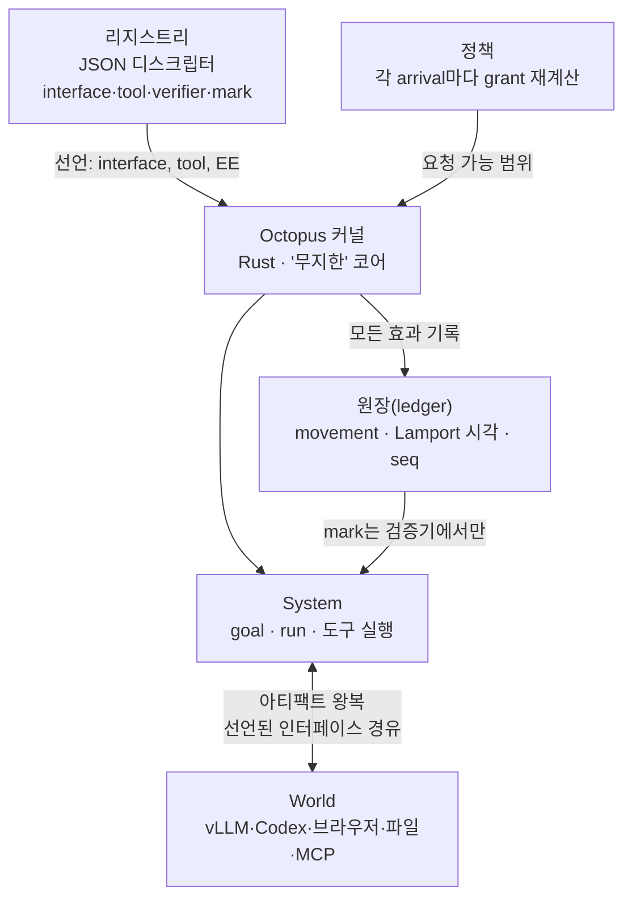

"에이전트 loop에 memory를 붙이고, skill을 붙이고, sub-agent를 붙인다." 지금 대부분의 agent harness가 이 문장으로 설명됩니다. Octopus OS는 전제를 뒤집습니다. 모델도 loop도 중심이 아닙니다. 둘 다 커널 위에 붙는 애플리케이션입니다.


*작은 커널 위에 능력이 디스크립터로 퍼져 나가는 구조를 형상화했습니다.*

## 왜 읽어야 하나

긴 작업을 돌리는 에이전트 플랫폼을 만들고 있거나, 에이전트가 자기 도구를 고치는 "자기 수정(self-modification)" 설계가 어디까지 왔는지를 판단해야 하는 개발자·플랫폼 엔지니어를 대상으로 씁니다.

핵심은 이렇습니다. **Octopus OS의 자기 수정은 에이전트 루프에 붙인 기능이 아닙니다. 커널을 "무지한(blind)" 작은 코어로 두고, 모든 능력을 JSON 디스크립터로 선언합니다. 에이전트는 정책 안에서 그 디스크립터를 다시 쓰는 방식으로 성장하는, 운영체제급 harness입니다.** 이 글은 공식 발표가 아니라 실제 리포를 클론해 주장(커널 45k줄·12개 실행 환경·156개 인터페이스·Codex source)을 하나씩 실측한 검증기입니다.

## 개요

Aleksandr Vechenkov(vechen)의 개인 프로젝트 Octopus OS는 "장기 작업을 위한 운영체제(an operating system for work that outlives the chat)"를 표방합니다. 2026년 2월부터 개발을 시작해 약 8개월, 2026년 10월 10일에 Research Preview 단계로 전환했고 10월 24일 공식 소개 트윗이 나갔습니다. 라이선스는 MIT이며, 작성일 기준으로 스타 482개·포크 53개입니다.

소개 트윗은 "Harness²나 유사 프로젝트와 달리, 자기 개선은 에이전트에 붙인 별도 단계가 아니다. 전체 아키텍처가 에이전트가 일하는 환경 그 자체다"라고 강조합니다. "보통의 agent loop을 통째로 버렸다"는 표현도 같은 맥락입니다. README의 정식 이름은 "Octopus Superintelligence OS"이고 self-evolving agentic OS를 표방합니다.

트윗의 핵심 주장이 넷입니다.

- 45k줄 Rust 커널
- 시스템 상태는 JSON 파일에 산다
- 목표(goal)가 에이전트가 실제로 일하는 환경이 된다. 입력·출력·커스텀 트리거를 응답한다
- Codex source 위에 지었다. 에이전트는 작업 도중 자기 harness를 편집한다

"첫날부터 제품으로 지었다"는 점도 강조됩니다. macOS 14+에서 Electron·React 데스크톱 클라이언트와 터미널 클라이언트를 제공합니다.

이 주장을 그대로 믿기 전에 리포를 열어 봤습니다.

## 이 기술/도구는 무엇인가

가장 중요한 설계 선언은 아키텍처 문서 첫 단락에 있습니다. "일반적인 에이전트는 모델 주위의 loop다. action, observe, context 축적, repeat. memory·skill·sub-agent·스케줄은 그 loop에 붙여진다. Octopus는 반대 방향으로 지었다. 모델도 loop도 중심이 아니다. 작은 커널과 몇 가지 primitive가 있고, loop는 그 primitive가 표현하는 것 중 하나다."

여기서 커널의 '무지'는 의도입니다. 코어 원칙 1을 원문 그대로 옮기면 "커널은 작고 무지하다. crates/에 Rust 약 45,000줄. 어떤 provider·채널·도구·모델·아티팩트도 이름으로 모른다. 작게 유지하는 것이 연구의 목적이다." 능력이 코드로 분기를 만드는 대신 선언되면, 시스템은 자기 자신에 대해 검사·재실행·변경할 수 있는 표면이 하나 더 생깁니다.

구조는 세 계층으로 읽힙니다.

**1) 커널(crates/, 19개 Rust 크레이트).** `octopus-runtime`이 커널 본체이고 `octopus-policy`·`octopus-ledger(-store/-index)`·`octopus-marks`·`octopus-verifiers`·`octopus-interfaces`·`octopus-worker-env` 등이 경계 계약을 지킵니다. 의존성은 tokio·serde·schemars·blake3·ed25519-dalek 같은 표준품목입니다.

**2) 리지스트리(registry/, JSON 디스크립터 수천 개).** interface·tool·verifier·mark·artifact·ee_template·worker_environment_kind 7종 클래스로 나누고 각 능력은 폴더 하나입니다. README의 "에이전트는 JSON 파일 두 개"라는 표현이 정확합니다. 실재하는 `system_worker_coder/` 폴더 안은 `interface.json`과 `policy.json` 두 파일뿐입니다. 모델·역할·접근 가능 범위를 선언하는 것이지, 코드를 쓰지 않는 것입니다.

**3) System/World 경계.** System은 시스템이 작용할 수 있는 모든 환경과 능력의 집합(목표·런·도구 실행)이고 World는 그 프레임워크 밖의 전부입니다. 경계는 위치가 아니라 **통제**로 정의됩니다. World의 달력 이벤트로 메시지를 보내려면, 이벤트를 World에서 System으로 받아 런 안에서 처리한 뒤 메시징 인터페이스로 아티팩트를 내보냅니다. World → System → World. 달력과 메시징 서비스가 Octopus의 worker가 되는 일은 없습니다.



**자기 수정의 실제 경로**도 디스크립터입니다. "정책 안에서 에이전트가 goal을 만들고 고치고, interface(트리거)를 바꾸고, 도구를 추가하고, worker를 조직한다." 이 변경은 task와 run을 넘어 유지됩니다. 대표적 트리거는 `world_file_observer`입니다. inbound sensor 인터페이스로, `life.json`이 python3 프로세스를 선언하고 그 프로세스가 자기 movement를 읽고 단일 intake로 아티팩트를 넘깁니다. "할 수 없는 것은 스스로 쓴다(what it cannot do, it can write)"는 이 아키텍처의 뜻입니다. coding worker가 grant된 도구로 기기 드라이버 패키지를 쓰고, 설치·바인딩하면 이후 작업에서 다시 빌드하지 않고 씁니다.

**보안 모델**도 눈에 띱니다. 신뢰 경계 표에서 모델은 "신뢰하지 않음. 출력은 요청이지 권위가 아니다"이고 World의 아티팩트(웹페이지·메시지·파일·MCP 결과)도 "신뢰하지 않음. 모델에게 향한 명령을 taşı고 있을 수 있다"입니다. 런타임은 "payload를 읽지 않고 모델의 말을 아무것도 믿지 않는다." 정책은 각 arrival마다 worker ceiling·EE 체인·authored bindings에서 grant를 재계산하고 grant 밖 요청은 `DeliveryRefused` movement로 기록됩니다. 모델이 run record에 아무리 적어도 권한이 되지 않는 구조입니다.

**원장(ledger)은 이 구조의 기억장치**입니다. `schemas/movement.schema.json`을 보면 movement의 필수 필드가 `from·kind·lamport·seq·to·trace·recorded_at_unix_ms`로, Lamport 시각과 시퀀스가 함께 들어 있습니다. 분산 시스템에서 사건 순서를 정하는 표준 primitive를 원장에 직접 박아둔 셈입니다. 아키텍처 문서는 "인덱스는 캐시지 두 번째 진실원이 아니다. 커널은 인-메모리 인덱스를 유지한다"고 쓰고, 커널이 보는 것은 route·caller·movement 세 가지만이라고 합니다. payload 자체는 커널이 읽지 않는다는 보안 모델과 같은 문법입니다.

**World의 넓이**도 디스크립터로 확인했습니다. `world_*` 인터페이스에는 MCP 서버(github·firecrawl·unity), slack, terminal, image generation, cron, file observer, 심지어 hand gesture control까지 들어 있고, 모델 프로바이더는 anthropic·openai·gemini·vllm·ollama·codex·claude_cli·huggingface·together·groq 등 30종 안팎으로 열려 있습니다. "어떤 모델이든, 어떤 채널이든 디스크립터 하나로 붙는다"는 설계가 문서에 머무르지 않습니다. 폴더가 실제로 그렇게 나열되어 있습니다.

## 설치 및 통합

리포 루트의 README가 명시하는 요구사항은 macOS 14+, Node 24, stable Rust, ChatGPT 계정입니다. 실제 명령은 이렇습니다.

```bash
git clone https://github.com/miuuyy/Octopus-SI-OS.git
cd Octopus-SI-OS
npm ci --prefix app
```

그다음 앱 패키징(Node 24.15.0 native build header 필요) → 데스크톱 앱 실행 → ChatGPT 로그인 → 내장 터미널에서 Enter로 시스템 시작,입니다.

저는 샌드박스에서 depth-1 클론(4,219개 파일)을 했고, 터미널 클라이언트까지 실행해 봤습니다. 루트의 `octopus`는 152바이트 POSIX sh 스크립트로 `node app/cli/index.cjs`를 exec합니다. node 내장 모듈만으로 돌아가 `npm ci` 없이도 `--help`가 실제로 동작했습니다.

```text
$ node app/cli/index.cjs --help
Octopus — your agentic operating system, in the terminal

  octopus [prompt]                 Open the interactive client
  octopus resume [task|last|home]  Continue an existing task
  octopus exec <prompt>            Start a task and wait for its result
  octopus send <task> <prompt>     Send a follow-up and wait
  octopus watch <task>             Follow work already in progress
  octopus tasks                    Show tasks from this Home
  octopus history <task>           Read its transcript
  octopus inspect <run-id>         Inspect recorded checkpoint and transfer evidence
  octopus projects                 Show Projects and Agents
  ...
```

리포 구조를 보면 클라이언트와 커널의 분리가 또렷합니다. `app/`이 Electron(`main: electron/main.cjs`) + React 19 데스크톱 클라이언트이고, `crates/`가 커널, `registry/`가 능력 목록, `schemas/`가 JSON Schema 8종, `docs/`에 architecture·security-model·contracts·glossary·cli·client 문서가 빠짐없이 들어 있습니다. README의 제품 표면도 6개로 나뉩니다. Home(시스템과의 연속 대화)·Projects(자기 context와 정책이 있는 goal)·Agents(JSON 두 개)·Tasks(나중에 이어받는 작업)·Applications(채널·MCP·프로바이더)·Drivers(실제로 일이 일어나는 곳: 폴더, git worktree, 브라우저, 데스크톱, 컨테이너, 원격 머신).

`cargo`가 없어 Rust 워크스페이스 빌드·테스트 검증은 못 했습니다(127). 데스크톱 앱의 native build도 Node 24.15.0 header가 필요해 샌드박스에서 시도하지 않았습니다. 그래서 실험은 **소스 감사**로 한정합니다.

## 실제 실험 결과

주장을 실측과 대조했습니다.

| 주장 | 출처 | 실측 (HEAD 1b5f7e4, 2026-10-26) |
|---|---|---|
| 커널 "약 45,000줄 Rust" | README·docs·AGENTS.md | `crates/` 전체 .rs **58,749줄**(테스트 포함) |
| "860k+ source snapshot" | 프로젝트 페이지(10-10) | rs+ts+js+json+md+toml **약 999k줄**(테스트·스냅샷·생성파일 포함, .git·target·node_modules 제외) |
| "12개 실행 환경 종류" | 프로젝트 페이지 | `worker_environment_kind/` **12종 일치** |
| "156개 declared interfaces" | 프로젝트 페이지(10-10) | `interface/` 디렉터리 **86개**(10-26 HEAD) |
| "Codex source 위에" | 트윗 | `world_provider_codex/` 패키지(codex-cli·codex-core 등) + vLLM 등 프로바이더의 `interface_driver_ref: codex_app_server` |
| "오픈소스" | 트윗 | **MIT** (LICENSE 파일 확인) |
| "8개월" | 트윗 | 페이지: 2026-02 개발 시작 → 10-10 preview = **8개월 일치** |
| "에이전트 = JSON 두 개" | README | `system_worker_coder/` = interface.json + policy.json **확인** |

네 가지가 눈에 들어옵니다.

**첫째, 숫자가 2주 사이로 커졌습니다.** 10-10 발표의 "커널 43k+줄·860k+ 스냅샷"이 10-26 HEAD에선 58.7k줄·999k줄 실측입니다. docs의 "약 45,000줄" 표현은 tests·크레이트 일부 제외 기준인 것으로 보이고, 어쨌거나 발표 수치보다 커진 방향입니다. "156개 인터페이스"와 실측 86개 디렉터리의 차이는 카운트 기준(인터페이스 디렉터리 vs 선언된 interface 항목) 차이일 수 있으나, 문서화되지 않아 확정할 수 없습니다. 리지스트리 전체는 tool 191·artifact 36·ee_template 9·verifier 13·mark 13으로, 능력 목록이 2주 사이에도 계속 늘어나고 있습니다.

**둘째, 실행 환경 12종은 전부 실제로 존재합니다.** `audio_device_session·browser_session·code_mode·container_session·desktop_session·filesystem_workspace·git_worktree·mcp_stdio_session·process_session·remote_exec_server·system_room·web_search`. "git worktree가 1급 실행 환경"이라는 점은 에이전트 플랫폼 운영에 직접 시사합니다.

**셋째, 활성 개발 상태입니다.** 감사 시점의 HEAD 커밋(1b5f7e4)이 2026-10-26, "Restore verifier launchers after macOS sandbox regression"이라는 메시지입니다. 발표 후 2주도 안 되는 시점에 검증기 launcher를 macOS 샌드박스 회귀 문제로 되살리는 커밋이 들어와 있다는 뜻입니다. Rust 워크스페이스는 rust-version 1.91을 요구하는데, 샌드박스에 cargo가 없어 빌드·테스트는 실행하지 못했고, 테스트 스택의 규모만 확인했습니다(618개 `.snap` 스냅샷 파일).

**넷째, vLLM이 1급 프로바이더 인터페이스입니다.** `world_provider_vllm`의 디스크립터는 `interface_driver_ref: codex_app_server`로 Codex app-server 프로토콜을 재사용하고, 정책 변수는 `max_attempts`(기본 5)·`max_in_flight`(기본 1)·`web_search_modes`(기본 disabled)·`models` 네 가지로 구성됩니다. 여기서 모델 서빙은 프로바이더 중 하나입니다. 커널이 이름으로 아는 대상이 아닙니다. provider 인터페이스는 vllm·ollama·anthropic·openai·gemini·codex·claude_cli·huggingface·together·groq 등 30종 안팎으로, 어떤 모델이든 디스크립터로 붙일 수 있는 것이 설계 목표입니다.

## ThakiCloud 제품 적용 시사점

**Paxis 렌즈.** Paxis가 Skills·Tools·Policies·Audit Logs를 일급 리소스로 다루는 Agent-Native Cloud라면, Octopus는 그 리소스 개념을 **커널 바깥의 데이터**로 밀어내는 한 방향의 극단입니다. Paxis의 Skill Harness가 BM25로 960+ 스킬을 고르는 것에서 한 발 더 가면, 스킬을 고르는 것 자체를 에이전트가 정책 안에서 선언·수정하는 문제가 됩니다. Octopus의 3원칙, "capability는 디스크립터. effect는 movement로 남는다. mark는 검증기에서만 온다"는 Paxis의 정책 게이트·감사로그·검증 단계가 지향하는 것과 같은 방향입니다. 특히 mark를 주는 쪽이 검증기라는 원칙은 우리 verify_fanout·quality gate 철학과 정확히 겹칩니다.

**ai-platform 렌즈.** `world_provider_vllm` 디스크립터가 보여준 것, 모델 서빙을 정책 변수(max_in_flight·max_attempts)와 함께 인터페이스로 받는 형태는, ai-platform이 서빙 엔드포인트를 에이전트 harness에 노출할 때 쓸 계약의 초기 형태입니다. `max_in_flight: 1`처럼 클라이언트 측 동시성 상한을 프로바이더 계약에 쓰는 관점이 인상적이었습니다. 공유 서빙 엔드포인트의 쿼터 문제를 계약 레벨에서 다룰 수 있다는 뜻입니다.

## 한계 및 반론

가장 성실한 한계는 프로젝트 스스로가 README에 적어 둔 것입니다. "지금까지의 런에서, 오늘의 모델들(GPT-6 포함)은 스스로 주도를 잡아 행동하지 않는다. 평범한 코딩 태스크에 대해 Octopus가 Codex CLI가 이미 주는 것보다 더 주는 것은 없다." 즉, **구조는 갖춰졌으나 "자기 주도·자기 개선"이라는 연구 질문의 답은 아직 없습니다.** 자기 수정이 시스템을 더 좋게 만드는지는 "연구 목적"이지 "증명한 능력"이 아닙니다.

그 외 반론은 이렇습니다.

- **표면 면적이 큽니다.** 에이전트가 디스크립터를 다시 쓸 수 있다는 것은, World의 untrusted 아티팩트(웹페이지·MCP 결과)가 그 재작성을 유도할 수 있는 공격 표면이 크다는 것과 동전입니다. 정책·샌드박스·검증기 3층이 그 사이를 막는다는 설계지만, "에이전트가 자기 보안 설정을 고친다"는 구조의 안전증명은 여전히 미해결입니다.
- **채용 장벽이 높습니다.** macOS 14+·Node 24.15.0 native build·ChatGPT 계정. Linux 서버에서 headless로 돌리는 이야기는 README에 없고, 데스크톱 제품이라는 전제가 강합니다.
- **1인 프로젝트입니다.** 8개월·304 커밋 대부분이 저자 1인. MIT라 코드는 가져가 쓸 수 있지만, 운영체제급 harness를 한 사람이 지었다는 점은 채택 판단에서 반드시 빼야 할 무게입니다.
- **"작은 커널"은 상대적이다.** 45k줄(실측 58.7k줄) 커널은 절대 규모로 작지 않습니다. C 언어의 원초적 커널과 비교하면 두 번째 세계의 코드이고, "blind"가 성립하는 근거는 규모 자체가 아니라 "provider·채널·도구·모델·아티팩트 이름이 코드에 안 나온다"는 구조적 약속입니다. 그 약속이 999k줄의 디스크립터·port 코드가 늘어나면서 유지될지는, 지금 이 감사로는 답할 수 없는 질문입니다.
- **성장 속도가 거버넌스 속도를 따라갈까.** 2주 사이 커널 45k→58.7k줄, source 860k→999k줄. 디스크립터를 다시 쓰는 능력의 거버넌스(누가 어떤 interface를 승인하는가)가 시스템 성숙도와 함께 해결돼야 하는 과제로 남습니다.

## 정리

Octopus OS는 "에이전트 loop에 뭐를 붙일 것인가"라는 질문을 "loop를 어디에서 빼낼 것인가"로 바꾼 사례입니다. 검증 결과, 구조는 발표대로 서 있었습니다. 무지한 커널·JSON 리지스트리·12개 실행 환경·movement 원장·검증기 기반 mark, 그리고 프로바이더 인터페이스 중 하나로 붙어 있는 vLLM까지. 다만 그 구조 위에서 에이전트가 실제로 주도를 잡아 자기 장기 발전을 steer하는지는, 저자 자신도 "아직 아니다"라고 적어 두었습니다.

다음 행동은 하나입니다. 이 리포의 `docs/contracts/`(POLICY.md·INTERFACES.md·EXTENSION_SURFACE.md)와 `world_provider_vllm/interface.json`을 직접 읽으십시오. 에이전트 플랫폼에 정책·감사·검증 계층을 설계하고 있다면, "커널은 무지하고 능력은 데이터"라는 경계 계약의 가장 구체적인 공개 구현이 여기 있습니다.

**한 줄로: 자기 수정형 에이전트의 다음 전장은 모델 역량이 아니라, boundary contract입니다.**

## 참고 자료

- [Octopus OS 프로젝트 페이지](https://vechenkov.info/projects/octopus)
- [GitHub: miuuyy/Octopus-SI-OS (MIT)](https://github.com/miuuyy/Octopus-SI-OS)
- [소개 트윗 (@miu21590, 2026-10-24)](https://x.com/miu21590/status/2114095879632375944)
