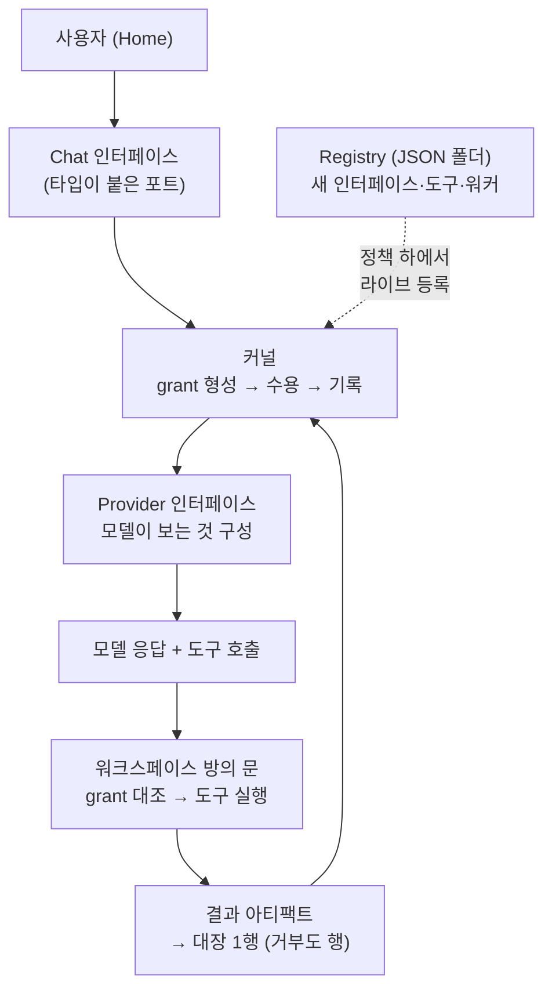

*에이전트가 자기가 도는 지대를 다시 설계한다는 아이디어를 형상화했습니다.*

## 왜 읽어야 하나

에이전트 하네스나 에이전트 플랫폼을 직접 만들어 본 개발자, "스킬 자가진화"를 설계하면서 어디까지 자동화하고 어디는 사람 승인으로 막아야 할지 결정을 앞둔 팀이라면 이 글을 읽어야 합니다. 결론부터 말하겠습니다. Octopus-SI-OS는 "에이전트가 자기 하네스를 수정한다"는 주장을 기능으로 붙인 것이 아니라, 인터페이스·아티팩트·런·정책·마크라는 OS급 원어의 계약으로 설계해 놓았으며, 실제 레포지토리를 받아 커널 58.7k줄과 에이전트 정의 JSON 두 개, 거부를 행으로 쓰는 대장 스키마까지 확인했습니다. 다만 같은 레포의 README가 "오늘의 모델(GPT-6 포함)은 자발적 초기 행동을 하지 않는다"고 스스로 인정하는 연구 프리뷰입니다.

## 개요

miu21590이라는 X 계정은 10월 23일경 "Octopus OS, a reinvented agent harness"라는 트윗으로 이 프로젝트를 알렸습니다. 핵심 문장은 이겁니다. "Agents can edit their own harness in the middle of a task, on their own." 에이전트가 태스크 도중 자기 하네스를 스스로 고친다는 것. 레포지토리는 github.com/miuuyy/Octopus-SI-OS이고, MIT 라이선스, 확인 시점 기준 436스타, 포크 46개, 커밋 294개입니다.

"자기 하네스를 고치는 에이전트"라는 표현은 최근 몇 달 사이 몇 번인가 등장했습니다. 대부분은 학습 단계나 배포 단계에 자기 개선 스테이지를 붙이는 방식이었고, Octopus는 자기 개선이 아키텍처의 전제 자체라고 말합니다. README의 표현을 그대로 쓰면, "자기 진화(self-evolution)란 미래 작업의 조건을 성형하는 것"이고, "자기 개선(self-improvement)이 실제로 성립하는가"가 연구 목표입니다. 두 단어의 차이를 시스템 설계의 축으로 삼은 점이 이 프로젝트의 정체성입니다.

README의 자기소개는 "A self-evolving agentic OS"입니다. 에이전트 실행을 운영체제 원리 위에 다시 쌓는다는 프로젝트로, 프로젝트·권한·태스크·드라이버를 OS 개념으로 옮깁니다. 그리고 Codex를 이 시스템의 첫 인터페이스로 포팅해 두었습니다. ChatGPT 계정으로 로그인하면 Codex CLI가 시스템의 하나의 인터페이스로 동작한다는 설계입니다.

## 이 기술은 무엇인가

Octopus의 아키텍처는 두 개의 단어에서 출발합니다. System(옥토푸스가 행동할 수 있는 모든 것)과 World(나머지 전부). 이 둘은 선언된 인터페이스에서만 만납니다. 그 아래에는 오케스트레이터가 없고 원어 몇 개만 있습니다.

- **Interface(인터페이스)**: 타입이 붙은 포트. 프로바이더, 채널, 센서, 도구방(room), 워커 모두 인터페이스입니다.
- **Artifact(아티팩트)**: 경계를 넘는 유일한 것. 메시지, diff, 도구 호출, 메모리.
- **Run(런)**: 아티팩트 도착에 주차하고 깨우는 영속 실행 기록. 프로세스가 아니라 데이터입니다.
- **Execution environment(실행 환경)**: 목표 + 정책. 환경은 중첩되고 안쪽으로 갈수록 좁아집니다.
- **Worker(워커)**: 우리가 에이전트라고 부르는 것. 여기서 워커는 프로그램이 아니라 설명입니다. 역할과 "영원히 닿을 수 있는 것의 천장(ceiling)"을 담은 정의.
- **Policy(정책)**: 저장되지 않습니다. 아티팩트가 도착할 때마다 워커와 환경과 바인딩으로부터 그때그때 형성됩니다.
- **Mark(마크)**: 무슨 일이 일어났다는 증거. 검증자(verifier)가 통과시킨 뒤에만 기록됩니다.

한 턴의 흐름은 이렇게 됩니다. Home에서 메시지를 입력하면 Chat 인터페이스가 커널에 아티팩트를 넘기고, 커널은 grant를 형성하고 수용하고 기록합니다. 프로바이더 인터페이스가 모델이 보는 것을 구성하고, 워크스페이스 방의 문이 도구를 grant와 대조해 실행합니다. "movement recorded"라는 각 행은 대장(ledger)의 한 행이고, 거절도 행입니다. 타입이 붙은 행이지, 조용히 버려지는 것이 아닙니다.



원어 중 두 개를 조금 더 풀면, 이 설계가 어디를 겨냥하는지 보입니다. Run이 "프로세스가 아니라 데이터"라는 것은, 실행이 머리에 올라간 메모리가 아니라 대장 위에 기록된 상태라는 뜻입니다. 아티팩트가 도착하면 주차(park)하고, 필요하면 깨웁니다. 프로세스가 죽어도 런은 남아 있고, 다음 런은 같은 기록 위에 이어집니다. 정책이 "저장되지 않는다"는 것은 더 강한 선언입니다. 저장된 정책 파일은 언제든 드리프트할 수 있고, 드리프트한 정책으로 실행이 허용되는 순간 감사는 무의미해집니다. Octopus는 정책을 저장 대신에 형성합니다. 아티팩트가 도착하는 그 순간, 그 워커와 그 환경과 그 바인딩으로부터 grant를 만들고, 그 grant로만 문을 엽니다.

확장 방식도 동일합니다. 모든 것은 "JSON 폴더 + 실행이 필요하면 스크립트 또는 바이너리"로 붙습니다. 프로바이더 하나, 채널 하나, 센서 하나, 워커 하나, 도구 하나, 검증자 하나. 전부 커널을 건드리지 않습니다. README의 자기 수정 예시는 이렇습니다. 시스템이 보지 못하는 것(예: 사용자 얼굴)을 보라고 하면, 코더 워커를 위한 런을 만들고, 그 런이 증명해야 할 아티팩트를 걸어줍니다. 코더가 작은 카메라 드라이버를 쓰고 새 인터페이스 폴더를 만들면, 검증자가 통과시키고, 설명자가 라이브로 주워 먹습니다. 첫 번째는 코더의 시간이 걸리고, 두 번째부터는 만들 것이 없습니다.

## 설치 및 통합

공식 요구사항은 macOS 14+, Node 24, stable Rust, ChatGPT 계정입니다. 설치 명령은 README 그대로입니다.

```bash
git clone https://github.com/miuuyy/Octopus-SI-OS.git
cd Octopus-SI-OS
npm ci --prefix app
```

네이티브 빌드는 Node 24.15.0 헤더가 필요합니다. README는 헤더 다운로드와 sha256 검증을 명령으로 제시합니다.

```bash
mkdir -p app/build
curl -fL https://nodejs.org/download/release/v24.15.0/node-v24.15.0-headers.tar.gz \
  -o app/build/node-v24.15.0-headers.tar.gz
printf '%s %s\n' \
  9a9250039fef572d0bcc110ac5e78055faf5604421211d2d5f578ebc5a34e703 \
  app/build/node-v24.15.0-headers.tar.gz | shasum -a 256 -c -
tar -xzf app/build/node-v24.15.0-headers.tar.gz -C app/build
```

그다음 패키징과 실행입니다.

```bash
OCTOPUS_NATIVE_NODE_HEADERS="$PWD/app/build/node-v24.15.0/include/node" \
npm --prefix app run package:mac
open -n ./app/build/Octopus.app
```

최초 실행 순서는 다섯 단계입니다. (1) ChatGPT 로그인. 브라우저로 열리며 터미널 로그인은 없습니다. (2) 이 기계의 클라이언트를 보호하는 로컬 비밀번호 설정. (3) 내장 터미널에서 `octopus up` 명령으로 시스템 시작 후 ready 상태 대기. (4) 'Set up Octopus'로 시작 구조(프로젝트, 이름, 능력) 선택. (5) Home에서 한마디. 답장이 연결을 증명하고, 도구를 쓰는 태스크가 그 태스크의 설치를 증명합니다. 새로운 태스크를 만들려면 먼저 Agent를 만듭니다. Project와 모델을 고르고, 능력을 검토한 뒤 태스크 composer에서 선택하는 흐름입니다. 모델 가용성과 사용 한도는 프로바이더 계정 소속이며, 음성이나 일부 Applications은 자체 자격증명과 macOS 권한을 요구합니다. 터미널 클라이언트는 `npm --prefix app run build:cli` 후 `./octopus`로 씁니다. 패키징은 클라이언트, 릴라이트 런타임, 능력 실행파일, 프로바이더 브릿지를 빌드하고 관리되는 Codex 배포본을 번들합니다. 산출물은 `app/build/Octopus.app`으로, 해당 기계용으로 ad-hoc 서명되어 있고 노타리화는 되어 있지 않습니다.

## 실제 실험 결과

저는 GUI 실행 대신 레포지토리를 실제 받아 구조를 검증했습니다. 실험은 격리 샌드박스(impl_sandbox)에서 수행했고, 모든 출력은 outputs/blog-impl/octopus-os-self-evolving-harness/의 run-N.log에 보존되어 있습니다.

**커널 규모 검증.** README는 "커널이 대략 45,000줄의 Rust"라고 말합니다. 측정했습니다. `crates/` 디렉토리의 Rust 코드는 19개 패키지 합계 58,749줄입니다. 최대 패키지는 octopus-app-server(11,315줄), octopus-app(8,935줄), octopus-interface-transport(7,685줄) 순입니다. 45k라는 수치는 발표 시점의 값이고, 현재 레포는 58.7k까지 자란 것으로 보입니다.

**레지스트리 규모.** `registry/`에는 651,166줄의 Rust가 있습니다. workspace 멤버 구성을 보면 `crates/*` + `registry/interface/*/packages/*`(57개 패키지) + `registry/worker_environment_kind/*/packages/*`(41개 패키지)이며, interface 쪽이 474,412줄, worker_environment_kind 쪽이 176,754줄을 차지합니다. 즉 커널 외에 번들되는 확장 소스가 10배가 넘는 규모로 레포 안에 들어 있고, "관리되는 Codex 배포본"(`registry/interface/world_provider_codex/packages/bin`)만 "분배 입력물"이라며 workspace에서 제외되어 있습니다.

**에이전트 = JSON 두 개 검증.** README는 "에이전트는 프로그램이 아니라 JSON 파일 두 개"라고 말합니다. 실제 `registry/interface/system_worker_coder_max/`를 열면 `interface.json`과 `policy.json` 두 파일뿐입니다.

```json
{
  "id": "system_worker_coder_max",
  "interface_type": "system",
  "role": "worker",
  "direction": "bidirectional",
  "source_names": ["coder_max"]
}
```

policy.json의 핵심은 `ceiling`입니다. 이 워커가 영원히 닿을 수 있는 인터페이스(anthropic·chatgpt·codex·ollama·openai·vllm 등 30여 프로바이더 + terminal + browser + mcp_github 등)와 도구(coder.apply_patch, coder.write_file, coder.build, coder.exec 등)의 목록입니다. "역할과 천장"이라는 README의 문장이 실제로는 이 데이터 구조로 존재합니다.

**도구와 대장 스키마.** `registry/tool/exec.run/tool.json`은 도구 정의입니다. 인터페이스(system_exec_env), 핸들러 설정, 그리고 실제 프로세스(`bin: target/debug/octopus-process-room-tool`, inherit_env에 PATH, authority 정보)까지가 데이터로 선언되어 있습니다. `schemas/movement.schema.json`의 movement는 from·kind·lamport·recorded_at_unix_ms·seq·to·trace가 필수 필드입니다. 람포트 타임스탬프가 대장 행에 들어 있다는 것은, 분산된 인터페이스 프로세스들 사이의 순서를 논리적으로 정렬하겠다는 설계의 흔적입니다. 같은 폴더에 grant_projection, mark, mark_descriptor, run_record, verifier_descriptor, delivery_verdict, required_verified_artifact 스키마가 있습니다.

**컴파일 시도.** `cargo check`로 커널 패키지 10개를 확인했습니다. 재현 시도 중 실패했고, 실패 원인은 두 개로 기록됩니다. 첫째, git 소스 의존(helix-editor/nucleo)을 cargo가 SSH로 가져오려 해 인증에 실패했고, `CARGO_NET_GIT_FETCH_WITH_CLI=true`로 전환해야 했습니다. 둘째, 전환 후에도 워크스페이스가 `rust-version = 1.91`을 요구하는데 이 머신의 rustc는 1.88.0이라 10개 커널 패키지가 전부 "rustc 1.91 required"로 거부되었습니다. 즉, 오늘 이 머신에서는 커널 컴파일을 완료하지 못했습니다. 레포의 구조·스키마·계산 검증은 완료되었고, 컴파일 검증은 1.91 툴체인 환경에서 재시도해야 합니다.

## ThakiCloud 제품 적용 시사점

Paxis(Agent-Native Cloud) 관점에서 Octopus의 설계는 세 곳에서 직접 비교됩니다. 첫째, **정책의 형성 위치**입니다. Paxis는 모든 에이전트 행동을 정책 게이트와 감사로그를 통과시키고, Octopus는 정책을 저장하지 않고 아티팩트 도착 시점에 워커·환경·바인딩으로 형성합니다. "저장된 정책"과 "도착 시 형성되는 grant"는 감사의 어려움과 유연성을 바꾸는 다른 선택지입니다. Octopus는 거절까지 대장 행으로 남기는데, 이 "거부도 로그" 원칙은 Paxis 감사로그가 의도적으로 거부한 행위와 시스템이 처리하지 못한 행위를 구분할 때 그대로 참고할 수 있습니다.

둘째, **에이전트 정의의 데이터화**입니다. 워커가 JSON 두 개(설명 + 천장)인 것은, Paxis가 스킬·도구·정책을 일급 리소스로 다루는 것과 같은 방향입니다. 에이전트를 코드 대신 데이터로 정의하면, "새 에이전트를 만드는 것"이 코드 리뷰가 아니라 스키마 검증 + verifier 통과가 됩니다.

셋째, **자기 수정의 경계**입니다. Octopus의 자기 수정은 무제한이 아니라 policy 하에서 일어납니다. 에이전트가 인터페이스를 만들고 등록해도, verifier가 통과시키고 대장이 기록해야 시스템에 들어옵니다. "스킬 자가진화"를 설계할 때 가장 많이 묻는 질문(에이전트가 자기 능력을 늘릴 수 있게 하면 어디서 막느냐)에 대한 하나의 답변이, 이 레포에서 verifier + mark + lamport 대장 조합으로 실제로 존재합니다.

두 시스템을 나란히 놓으면 차이가 구체적으로 보입니다.

| 설계 결정 | Paxis | Octopus |
|---|---|---|
| 정책의 저장 | 일급 리소스로 저장·게이트 통과 | 저장 불원, 도착 시점 형성(grant) |
| 에이전트 정의 | 스킬·도구·정책 리소스 조합 | JSON 두 개(설명 + ceiling) |
| 감사 단위 | 행위별 정책 게이트 + 감사로그 | movement 행(거부 포함, lamport+seq+trace) |
| 확장 경로 | 스킬 자가진화(검증 루프) | interface 폴더 + verifier 통과 + 라이브 등록 |
| 자기 수정의 위치 | 스킬 계층 | 아키텍처 원어(인터페이스·트리거·워커 조직) |

이 표는 비교의 축이지 정답이 아닙니다. Paxis는 저장된 정책과 일급 리소스로 "어디까지 자동화할지"를 조직이 선언하는 쪽이고, Octopus는 저장 불원의 grant와 데이터화된 워커로 "에이전트가 스스로 어디까지 닿을지"를 천장으로 선언하는 쪽입니다. 둘 다 최종적으로는 verifier/게이트가 자기 수정을 끝장내지만, 선언하는 주체와 위치가 다릅니다.

ai-platform(서빙 인프라) 관점에서는 worker policy ceiling에 world_provider_vllm, world_provider_ollama, world_provider_lmstudio가 열거되어 있다는 점입니다. 멀티 프로바이더 라우팅을 에이전트 정책 데이터의 일부로 둔다는 것은, 서빙 카탈로그가 에이전트 실행 환경의 일급 구성 요소가 될 수 있음을 보여줍니다.

## 한계 및 반론

README 스스로의 한계를 먼저 인용하겠습니다. "오늘의 모델, GPT-6 포함은 자발적으로 초기를 취하지 않는다. 일반적인 코딩 태스크에서 Octopus는 Codex CLI가 이미 주지 않는 것을 아무것도 주지 않는다." 연구 질문은 "에이전트의 실행 환경을 재구성하게 하는 아키텍처가, 에이전트가 초기를 취하고 자기 장기 발전을 조종하는 데 도움이 되는가"입니다. 즉, 이 프로젝트가 증명하는 것은 자기 수정의 "기계"이고, 자기 수정의 "동기"는 아직 모델에게 없는 상태라는 것입니다.

실용적 한계도 있습니다. macOS 14+ 데스크톱 대상이며, 노타리화되지 않은 ad-hoc 서명 앱이고, ChatGPT 계정 로그인과 로컬 비밀번호가 필요합니다. 700k줄에 가까운 레포(커널 58.7k + 레지스트리 651k)는 작은 실험이 아니라 상당한 코드베이스이고, 오늘 이 머신에서는 툴체인(rustc 1.91) 없이 커널 컴파일조차 완료하지 못했습니다. "45,000줄"이라는 발표 수치와 실측 58,749줄의 차이도, 수치가 빠르게 변하고 있다는 뜻으로 읽을 수 있습니다.

## 정리

Octopus-SI-OS는 "에이전트가 자기 하네스를 고친다"는 문장을 아키텍처 계약으로 번역한 사례입니다. 오늘 확인한 것은 세 가지입니다. 커널은 Rust 19개 패키지 58.7k줄이고, 에이전트는 역할과 천장을 담은 JSON 두 개이며, 모든 경계 통과와 거절은 람포트 타임스탬프가 붙은 대장 행으로 기록됩니다. 그리고 이 기계가 완성된 것을, 팀 스스로 "모델이 아직 초기를 취하지 않는다"고 쓰고 있습니다. 다음 행동은 명확합니다. 에이전트 플랫폼을 설계하는 팀은 verifier + policy ceiling + 거부를 행으로 쓰는 대장 구조를 참고해야 하고, "자가진화"를 제품 기능으로 말하기 전에, 진화를 검증하는 기계(verifier, mark)가 먼저 있어야 한다는 점을 Octopus에서 배울 수 있습니다. 1.91 툴체인 환경에서 커널 컴파일과 GUI 첫 실행을 재시도할 때, 그 결과를 이 글에 덧붙이겠습니다.

---

**출처**

- [miuuyy/Octopus-SI-OS (GitHub, MIT)](https://github.com/miuuyy/Octopus-SI-OS)
- [공지 트윗 (@miu21590)](https://x.com/miu21590/status/2114095879632375944)
- [AGI Hunt: Octopus OS, a 45k-line Rust agent harness](https://agihunt.info/en/p/1a171f99b42125c17b7c357dbdc)

*실험 로그: `outputs/blog-impl/octopus-os-self-evolving-harness/run-1.log` ~ `run-40.log` (clone, LoC, 계약, 컴파일 시도 포함)*
