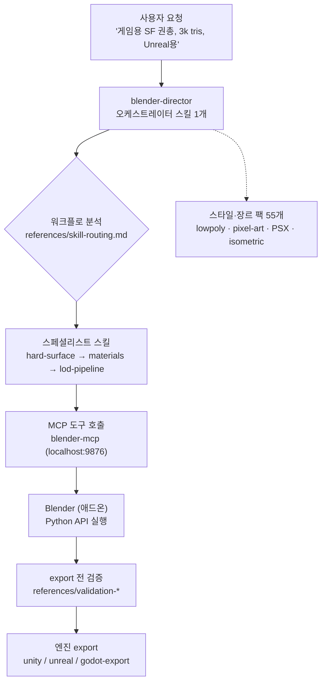

*중앙의 오케스트레이터 스킬과 그것을 둘러싼 스페셜리스트 스킬. Blender Skills의 "1 + 94" 구조를 형상화했습니다.*

## 왜 읽어야 하나

Claude Code 스킬 시스템이나 MCP 연동을 직접 설계해 본 개발자, 코딩 에이전트를 크리에이티브 프로덕션 파이프라인에 도입하는 결정을 앞둔 팀이라면 이 글을 "94스킬 팩을 그대로 쓸 것인가"라는 한 가지 결정을 위해 읽으면 됩니다. 결론부터 말합니다. 스킬 팩 + MCP 브리지라는 패턴은 코드 밖 영역, Blender 같은 DCC 도구에도 그대로 이식되며 구조는 성립합니다. 다만 레포지토리를 클론해 실측한 결과, 바로 도입하기 전에 확인할 구조적 약점이 세 개 있습니다. 플랫한 94개 스킬 분류, blender-mcp 단일 실행 브리지 의존, 그리고 작성 시점 기준 3.5개월의 유지보수 공백입니다.

## 개요

X 계정의 @_guillecasaus가 10월 26일(UTC) 올린 트윗이 출발점입니다. "AI로 Blender를 3D 아티스트 팀으로 바꿨다"는 소개와 함께, Claude Code와 Cursor 같은 에이전트가 Blender를 조종하게 하는 스킬 94개 모음이라는 설명이었습니다. 모델링, 머티리얼, 애니메이션까지 커버하고, 저폴리·픽셀아트·PSX·아이소메트릭 스타일 적용, 게임용 최적화, Unity·Unreal·Godot 직접 export까지 포함된다고 합니다. 전체 과정을 자동 조율하는 blender-director 스킬을 포함하며, 무료 오픈소스라고도 썼습니다.

레포지토리는 [arjun988/blender-skills](https://github.com/arjun988/blender-skills)입니다. MIT 라이선스, version.json 기준 v1.3.0(2026-07-10). 리포지토리 안에는 site/ 디렉토리가 있어, 이 팩의 공식 문서 사이트(blender-skills.vercel.app) 소스까지 같이 둡니다. 작성 시점(2026-10-28)에 GitHub API로 확인한 수치로는 스타 1,177개, 포크 94개, 오픈 이슈 2개. 리포지토리 생성은 2026-07-05, 마지막 push는 2026-07-10입니다. GitHub topics에는 3d-models, agent, agent-skills, blender-mcp, claude-code, cursor-ai, game-development, mcp가 붙어 있습니다. 프로젝트의 주장, "스킬 94개, reference 파일 175개+"를 그대로 믿지 않고 디렉토리를 직접 셜었습니다. `.claude/skills/` 아래 SKILL.md를 포함하는 스킬 디렉토리는 정확히 94개였고, `.cursor/skills/`에 94개 미러가 있어 SKILL.md 합계는 188개였습니다. `.claude/` 하위 마크다운 파일 전체는 269개입니다.

## 이 기술은 무엇인가

Blender Skills의 아키텍처는 두 컴포넌트로 갈립니다. 첫째는 에이전트용 스킬 팩, 둘째는 MCP 기반 실행 파이프라인입니다.



스킬 팩 쪽의 핵심은 blender-director입니다. SKILL.md 하나가 19.7KB로 팩 내 최대이고, 첫 문장은 "Senior Technical Director orchestrating AAA Blender production"입니다. 프론트매터에서 role을 specialist와 orchestrator로 이중 선언하고, related-skills로 blender-modeler, hard-surface, prop-artist, vehicle-artist, environment-artist, character-artist, asset-optimization, export-pipeline, qa-review 아홉 개를 명시합니다. references/skill-routing.md(4.2KB)에 라우팅 규칙을 두고, 복잡한 작업은 이 스킬을 먼저 읽고 전문가 스킬로 분산하는 구조입니다. director 스스로가 자기 호출 지점을 명시합니다.

- 새로운 Blender 자산 요청(props, environment, character, creature)
- 모델링·UV·머티리얼·리깅·export를 가로지르는 멀티 디시플린 작업
- 워크플로 분석이 필요한 모호한 요청
- 폴리카운트 목표, export 포맷 결정이 필요한 프로덕션 플래닝
- 스타일 방향(호러, 로우폴리, 스타일라이즈드, 리얼리스틱) 조율

리포지토리의 CLAUDE.md가 에이전트에게 내리는 지시 여섯 가지가 이 구조를 뒷받침합니다. 복잡한 작업은 blender-director를 먼저 읽으라는 것. 레퍼런스 이미지가 붙으면 MCP 실행 전에 Reference Analysis를 완수하라는 것. MCP가 연결돼 있으면 UI 설명을 나열하지 말고 MCP로 실행하라는 것. MCP 도구 스키마를 읽은 뒤에만 호출하라는 것. references/asset-pipeline.md의 보편 파이프라인을 따르라는 것. export 전에 validation 참조 자료를 확인하라는 것입니다. "도구 스키마를 먼저 읽는다"는 지시가 눈에 띕니다. 스킬 본문에 적힌 도구 목록만 믿지 말고, MCP 서버가 실제로 노출하는 스키마를 호출 근거로 삼도록 막는 작은 거버넌스 장치입니다.

MCP 쪽은 `.mcp.json` 한 파일이 전부입니다. `uvx --python 3.11 blender-mcp`로 서버를 띄우고, BLENDER_HOST=localhost, BLENDER_PORT=9876, DISABLE_TELEMETRY=true를 환경변수로 줍니다. PyPI의 blender-mcp 2.0.0은 사실상 리네임 심으로, 실제 패키지는 ahujasid의 mcp-for-blender입니다(릴리스 38회, 마지막 업로드 2026-09-16, Python 3.10 이상 요구). Blender 안에서는 companion 애드온이 9876 포트를 열고, MCP 서버가 그 애드온을 거쳐 Blender Python API를 조종합니다. 에이전트 입장에선 UI 관찰이 사라지고 Python 작성만 남습니다. 스킬 팩도 이 경계에 맞춰 두 생태계용으로 이중 배치가 돼 있습니다. `.claude/skills/`와 `.cursor/skills/`에 각 94개가 거울처럼 놓여 있고, QUICKSTART.md, docs/BLENDER_MCP_SETUP.md 같은 설치 문서와 ROADMAP.md, CHANGELOG.md, SKILLS_GUIDE.md가 함께 붙어 있습니다.

94개 스킬의 구성비를 실측해 보았습니다.


*스타일·장르 팩이 55개로 절반 이상입니다. 기술 스킬보다 "취향" 스킬이 압도적으로 많다는 점이 이 팩의 정체성입니다.*

스타일·장르 팩 55개(lowpoly-style, pixel-art-style, psx-horror-style, isometric-style, genre-shooter, genre-rpg 등), 모델링·조각 14개, 파이프라인·export 11개(export-pipeline, lod-pipeline, collision-proxy, unity-export, unreal-export, godot-export, qa-review 등), 쉐이딩·렌더링 6개, 애니메이션·시뮬레이션 6개, 기법 1개(geometry-nodes), 오케스트레이터 1개. README의 스킬 표도 이 분류와 서로를 뒷받침합니다. Pipeline 행이 procedural-modeling, scene-assembly, set-dressing, asset-optimization, lod-pipeline, collision-proxy, export-pipeline, unity-export, unreal-export, godot-export, qa-review, archviz 열두 개를 나열하는 것이지요. 스킬 하나 해부학도 단순합니다. export-pipeline은 SKILL.md(4.2KB)와 references/engine-import.md(753B) 두 파일뿐입니다.

## 설치 및 통합

설치 경로는 세 단계입니다.

```bash
# 1. 레포지토리 클론
git clone https://github.com/arjun988/blender-skills.git

# 2. 스킬 팩을 에이전트 스킬 디렉토리로 복사 (Claude Code 기준)
cp -r blender-skills/.claude/skills/* ~/.claude/skills/

# 3. MCP 서버 배선: 리포지토리 .mcp.json 원문은 Windows 형식
#    "command": "cmd", "args": ["/c", "uvx", "--python", "3.11", "blender-mcp"]
#    macOS/Linux에서 쓴다면 command를 "uvx"로 바로 써야 합니다
```

macOS/Linux에서 바로 쓸 수 있는 `.mcp.json`은 아래처럼 됩니다(실측 원문을 OS에 맞게 고친 것).

```json
{
  "mcpServers": {
    "blender": {
      "command": "uvx",
      "args": ["--python", "3.11", "blender-mcp"],
      "env": {
        "BLENDER_HOST": "localhost",
        "BLENDER_PORT": "9876",
        "DISABLE_TELEMETRY": "true"
      }
    }
  }
}
```

`.mcp.json`이 `--python 3.11`을 고정하는 점도 실측에서 확인했습니다. mcp-for-blender 자체는 Python 3.10 이상을 요구하는데, 팩 쪽이 한 단계를 더 좁혀 3.11을 고정한 셈입니다. uvx가 매번 관리용 Python을 해석해주기 때문에 별도 설치 절차는 없지만, 3.10만 깔린 환경에서는 이 pin이 먼저 부딪힙니다. Kiro, Codex, Cursor 각각의 설치법은 QUICKSTART.md에 따로 두고, blender-skills.vercel.app이라는 커뮤니티 사이트에서 가이드를 제공합니다. `.claude-plugin/`에 plugin.json과 marketplace.json이 있어 Claude Code 플러그인 마켓플레이스 배포 경로도 열어 두었습니다.

재현 범위를 정직하게 적겠습니다. 이 세션의 실행 머신에 Blender가 설치돼 있지 않아 라이브 자산 파이프라인(모델링 → 머티리얼 → 엔진 export)까지 돌리지는 못했습니다. 재현 시도 중 실패: 로컬 Blender 미설치. 그래서 이 글의 실측은 레포지토리 구조, 스킬 개수, 의존성 체인(PyPI shim → mcp-for-blender → 애드온 포트)의 검증에 국한됩니다.

## 실제 실험 결과

캡처한 수치를 한 장에 모았습니다.

| 항목 | README 주장 | 실측 (2026-10-28) |
|---|---|---|
| 스킬 수 | 94 | 94 (`.claude/skills/` SKILL.md 디렉토리 직접 count) |
| reference 파일 | 175+ | 175 (version.json), `.claude/` md 전체 269 |
| 스타 | - | 1,177 (GitHub API) |
| 포크 / 오픈 이슈 | - | 94 / 2 |
| 버전 | - | 1.3.0 (2026-07-10) |
| MCP 서버 | blender-mcp | PyPI shim → mcp-for-blender 2.0.0 (마지막 업로드 2026-09-16) |

의존성 체인 확인이 남습니다. PyPI의 blender-mcp 패키지 페이지를 직접 열면 "Renamed to mcp-for-blender. Installing this package installs it for you."라는 설명이 나옵니다. 심 패키지를 설치하면 실제 패키지를 대신 설치해주는 형태입니다. version.json 원문도 함께 남깁니다.

```json
{
  "version": "1.3.0",
  "date": "2026-07-10",
  "skills": 94,
  "references": 175,
  "changelog": "CHANGELOG.md"
}
```

두 가지 관찰이 남습니다. 첫째, README의 숫자는 정확했습니다. "94"라는 마케팅 수치가 실제 디렉토리 개수와 일치하는 레포지토리는 드뭅니다. 포크 94개까지 겹치는 것은 실측 중 눈에 왔습니다. 우연인지, "94"라는 숫자가 퍼진 것인지 구분할 방법은 없습니다. 둘째, 마지막 push가 7월 10일에 멈춰 있습니다. 트윗이 10월 26일에 날아간 지점에서 프로젝트는 3.5개월 잠잠했고, 오픈 이슈 2개가 그대로입니다. 스타 1,177개는 "관심"의 측정일 뿐, "파이프라인이 동작한다"는 증거가 못 됩니다.

## ThakiCloud 제품 적용 시사점

Paxis 관점에서 이 팩을 읽으면 같은 패턴의 다른 스케일이 보입니다. Paxis의 Skill Harness는 960개 넘는 스킬을 BM25로 검색해 선택하지만, Blender Skills는 94개의 SKILL.md description을 모델이 매 턴 직접 보고 고르는 구조입니다. 스케일이 작아 아직 버티지만, 분류가 플랫하고 라우팅 신호가 description 하나뿐인 한계는 Paxis가 검색 계층을 코드 소유로 두는 이유와 정확히 겹칩니다.

오케스트레이터 단일 진입점(blender-director)의 개념도 Paxis의 진입 스킬 라우팅과 같은 자리이고, 차이는 "누가 라우팅을 하는가"입니다. 이 팩은 모델 판단, Paxis는 결정론 코드입니다. role을 specialist와 orchestrator로 이중 선언하는 메타데이터 방식은, Paxis가 스킬의 의도·트리거·경계를 프론트매터에 명시하는 관행과 같은 방향의 설계입니다.

또 한 가지, blender-director의 프롬프트가 "15년 경력 AAA 테크니컬 디렉터" 페르소나를 쓰는 점은 Paxis 관점에서 흥미로운 대비입니다. 역할 메타데이터로 라우팅을 유도하는 쪽과, 페르소나 서사로 품질을 유도하는 쪽. 전자가 결정론적 통제를, 후자가 모델 의존적 품질을 노립니다. references/ 해부학도 주목할 만합니다. 스킬 본문을 짧게 두고 세부 지식은 references/의 파일로 쪼개는 방식은, Paxis의 스킬 본문과 외부 지식을 분리하는 설계와 같습니다. 실행 평면도 마찬가지입니다. MCP를 통해 코드 밖 도구를 조종하는 이 구조는, Paxis가 샌드박스와 MCP 커넥터로 에이전트의 손길을 확장하는 방식의 작은 실례입니다. 취향 레이어(스타일 팩 55개)를 독립 스킬로 쪼개 "기술"과 "취향"을 분리한 점은, 도메인 팩을 설계할 때 참고할 분해 방법입니다.

## 한계 및 반론

약점도 세 군데가 뚜렷합니다.

첫째, 플랫 분류입니다. 94개 스킬이 한 디렉토리에 평탄하게 놓여 있고, 라우팅 신호는 각 SKILL.md의 description뿐입니다. 94개에서 940개로 가면 이 구조는 모델의 선택 품질 문제로 직결됩니다. 이 팩이 증명하는 쪽은 패턴이며, 스케일링은 아직 검증되지 않았습니다.

둘째, 단일 MCP 브리지입니다. 94개 스킬 전체가 blender-mcp 하나를 통과합니다. 애드온이 죽으면 팩 전체가 문서 쪼가리로 변합니다. 실측한 `.mcp.json`이 `cmd /c` Windows 형식인 것도, 다른 OS 사용자는 배선을 다시 써야 한다는 뜻입니다.

셋째, 유지보수 공백입니다. 마지막 push 2026-07-10, 오픈 이슈 2개, 그리고 "15년 경력 AAA 테크니컬 디렉터"라는 프롬프트 페르소나. 페르소나는 마케팅입니다. 출력 품질을 결정하는 것은 모델 역량과 references 품질이며, 그 둘이 3.5개월간 갱신되지 않았다면 스타 수와 무관하게 실제 품질은 모델 업그레이드 속도로 흐느적댑니다.

## 정리

Blender Skills가 보여 주는 것은 "스킬 팩 + MCP 브리지" 패턴이 코드 밖으로 이동할 수 있다는 사실입니다. 오케스트레이터 1개, 스페셜리스트 N개, 스킬별 references/, 그리고 도구를 조종하는 MCP 하나. 구조는 성립했고, 숫자도 README와 일치했습니다. 다만 도입 판단은 세 가지 기준으로 해야 합니다. 라우팅이 스케일되는가(플랫 94개), 실행 브리지가 단일 장애점이 아닌가, 그리고 레포지토리가 살아 있는가. 스킬 시스템을 만드는 개발자에게 이 팩은 "94개"라는 숫자보다 "오케스트레이터와 references의 분리"를 가져가야 할 사례입니다. 코딩 에이전트를 새 도메인 도구로 확장하는 팀에게는 MCP 배선을 먼저 하고, 단일 진입점을 정하고, 지식은 본문이 아닌 references로 쪼개라는 순서가 이 레포지토리가 남긴 실증입니다.

---

*출처: [@_guillecasaus 트윗(2026-10-26)](https://x.com/_guillecasaus/status/2114684358153908569) · [arjun988/blender-skills](https://github.com/arjun988/blender-skills) · [PyPI blender-mcp](https://pypi.org/project/blender-mcp/) · [ahujasid/mcp-for-blender](https://github.com/ahujasid/mcp-for-blender)*
