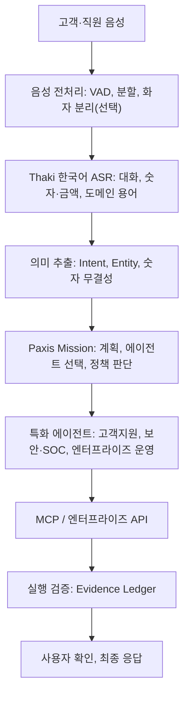

*한국어 음성인식 모델을 직접 학습하고 기업의 업무 판단과 실행으로 연결하는 Sovereign Agentic AI 아키텍처*

## 왜 읽어야 하나

이 글은 기업에서 음성 AI를 업무 자동화의 일부로 쓰고 싶은 엔지니어와 리더를 위해 씁니다. 상담, 금융, 보안처럼 숫자와 근거가 중요한 도메인에서 한국어 음성인식부터 직접 확보하고 싶은 분이라면 특히 그렇습니다. 핵심을 먼저 말씀드리면, Qwen3-ASR-1.7B를 기반으로 한국어 상담과 숫자 인식을 직접 학습한 ASR이 독립 평가에서 사전에 정의한 5개 출시 게이트를 모두 통과했습니다. 이 모델은 단순 전사 도구가 아닌, Paxis의 업무 실행을 시작하는 Perception 계층으로 잇는 Voice-to-Mission 아키텍처의 출발점입니다.

음성인식이 텍스트로 바뀌는 순간, 그 다음 단계가 진짜 질문입니다. 고객이 상담 중 결제 취소를 요청했다면 그 문장을 기록하는 것으로 업무가 끝나지 않습니다. 요청을 파악하고 주문을 확인하고 환불 정책을 검토하고 필요한 승인을 받은 뒤 실제 시스템에서 처리해야 합니다. 이 과정에는 서로 다른 AI 능력이 들어갑니다.

- **Perception:** 음성을 정확하게 인식합니다.
- **Understanding:** 발화의 의도와 핵심 정보를 이해합니다.
- **Decision:** 업무 정책과 근거에 따라 다음 행동을 판단합니다.
- **Action:** 기업 시스템의 API와 도구를 실행합니다.
- **Verification:** 실행 결과를 확인하고 증거를 기록합니다.

Paxis Agent Platform은 이 다섯 능력을 잇는 에이전트 실행 환경을 지향합니다. 우리는 이 사슬의 첫 고리인 한국어 음성인식부터 직접 모델을 개발하고 검증했습니다. 이번 글에서는 실제로 학습한 한국어 ASR의 성능과 개발 과정을 먼저 보여드리고 이어 Paxis의 자율형 에이전트 아키텍처에 잇는 응용 사례까지 살펴봅니다.

## 기업용 한국어 ASR을 직접 학습한 이유

범용 ASR의 성능이 높아졌다고 해서 모든 기업 음성 환경에서 같은 품질을 보장하지는 않습니다. 한국어 상담 환경에서는 문장 인식 정확도 외에도 숫자, 금액, 날짜, 제품명, 구어체 표현을 정확히 처리해야 합니다. "삼십만 원을 환불해 주세요"와 "삼만 원을 환불해 주세요"는 한 글자 차이처럼 보이지만 업무에서는 완전히 다른 의미를 가질 수 있습니다. CER가 낮더라도 금액을 잘못 인식했다면 그 결과를 금융이나 고객지원 에이전트에 그대로 전달할 수 없습니다.

이 문제를 풀기 위해 Qwen3-ASR-1.7B를 기반으로 한국어 상담과 일반 대화에 특화된 모델을 학습했습니다. 세 가지를 중심에 두었습니다.

첫째, 기업의 실제 대화 분포에 맞춰 학습했습니다. 일반적인 음성 데이터에 치우치지 않고 상담 음성, 일상 대화, 일반 한국어 발화를 함께 활용해 학습 분포를 조정했습니다.

둘째, 숫자 의미를 보존하도록 했습니다. "삼십만 원"과 "300,000원"은 표현은 다르지만 같은 값이고 "30만 원"과 "3만 원"은 전혀 다른 값입니다. 이 차이를 재기 위해 단순 문자열 일치가 아닌, 한국어 수사와 단위 표현을 해석하는 숫자 평가기를 별도로 만들었습니다.

셋째, 기존 범용 인식 능력을 유지했습니다. 상담 음성에서만 좋아지고 일반 대화는 나빠진다면 기업용 모델로 쓰기 어렵습니다. 그래서 상담은 물론 일반 대화에서도 원본 대비 회귀가 없는지를 독립적으로 검증했습니다.

## 독립 평가 결과: 상담, 일반 대화, 숫자 인식 모두 개선

최종 평가에서는 원본 Qwen3-ASR-1.7B와 한국어 특화 체크포인트 `ckpt-1200`을 비교했습니다. 기존 평가에 쓰지 않은 새로운 TEST-C/D/E 세트를 구성하고 두 모델에 같은 디코딩 조건을 적용했습니다.

*원본 모델과 한국어 특화 모델의 독립 평가 결과. 모든 수치는 봉인된 TEST-C/D/E 범위에서 측정했습니다.*

| 평가 항목 | 원본 모델 | Thaki 한국어 특화 모델 | 변화 |
|---|---:|---:|---|
| 일반 대화 CER (TEST-C, 456건) | 3.46% | **1.95%** | 상대 약 43.6% 개선 |
| 상담 CER (TEST-D, 900건) | 6.88% | **6.07%** | 상대 약 11.8% 개선 |
| 상담 CER (TEST-E, 250건) | 6.83% | **6.35%** | 상대 약 7.0% 개선 |
| 숫자 Robust 정확도 (981개 항목) | 66.36% | **88.69%** | +22.33%p |
| 그럴듯하지만 잘못된 숫자 | 12건 | **6건** | 50% 감소 |
| Runaway 검출 | 0건 | **0건** | 기준 충족 |

*숫자 Robust 정확도는 TEST-C/E에 포함된 981개 평가 항목에 대한 결과이며 발화 수와 같은 지표가 아닙니다.*

사전 정의한 5개 출시 게이트를 모두 통과했습니다. 단순히 CER 하나를 낮춘 결과가 아닙니다. 상담 인식, 일반 대화, 숫자 의미, 잘못된 숫자 생성, 추론 안정성을 함께 확인한 결과입니다.

### 평가 데이터도 제품 품질의 일부

개발이 처음부터 순조롭지는 않았습니다. 초기 평가에서는 숫자 인식이 악화된 것으로 나왔는데, 오류를 보면 한국어 수사와 숫자 표기가 정확히 비교되지 않는 평가기 문제였습니다. 이후 숫자 값으로 비교하도록 평가기를 고쳤습니다. 다른 평가에서는 실제 음성에 있는 후행 대화가 정답 전사에서 빠져 모델이 정상으로 인식한 문장이 과잉 생성으로 오인되는 경우도 있었습니다.

여기서 중요한 교훈이 하나 있습니다. **모델이 틀린 것인지, 정답 데이터가 틀린 것인지, 평가 지표가 틀린 것인지 구분해야 합니다.** 기존 실패 판정을 소급해서 바꾸지 않고 원인을 기록한 뒤 별도의 독립 평가를 다시 수행했습니다. 이 검증 방식은 ASR은 물론 판단형 모델과 자율형 에이전트 평가에도 그대로 적용할 수 있습니다.

## Paxis와 잇는 Voice-to-Mission 아키텍처

ASR 모델만으로는 고객의 요청을 처리할 수 없습니다. Paxis와 결합할 때 중요한 지점은 음성인식 모델을 단순 입력 API가 아닌, **업무 실행을 시작하는 Perception 계층**으로 쓰는 것입니다. 아래는 이 결합을 위한 참조 아키텍처입니다.

이 아키텍처에서는 하나의 범용 LLM이 모든 일을 할 필요가 없습니다. 음성인식은 ASR이 맡고 업무별 의사결정은 특화 모델이나 정책 엔진이 맡으며 실제 실행은 Paxis의 에이전트와 MCP 도구가 수행합니다. 각 구성요소는 독립적으로 평가하고 개선할 수 있습니다.

특히 **모델의 언어 이해 능력과 실제 업무 수행 권한을 분리**한다는 점이 핵심입니다. 음성인식 결과만으로 결제 취소, 계정 변경, 보안 정책 수정을 즉시 실행해서는 안 됩니다. 이런 작업에는 인증, 정책 검증, 사용자 확인, 실행 결과 검증이 따로 필요합니다.

## 응용 사례

### 고객지원: 환불 요청을 근거로 처리

고객이 "지난주에 결제한 35만 원짜리 서비스가 취소됐는데 환불이 아직 안 됐어요. 확인해 주세요"라고 말하면 일반 챗봇은 환불 정책을 안내하거나 상담원 연결을 제안할 것입니다. Paxis 기반 에이전트는 이 요청을 단계별로 처리합니다.

ASR이 발화를 전사하고 핵심 정보인 `35만 원`, `지난주`, `결제 취소`, `환불 상태 확인`을 추출합니다. 금액은 의미적으로 검증할 숫자 정보로 다룹니다. 이어 Paxis가 요청을 업무 목표로 구조화합니다. 고객 인증 상태 확인, 최근 결제와 취소 내역 조회, 환불 진행 상황, 정책상 지연 여부 판단, 결과 안내까지입니다.

결제 조회 에이전트는 기업의 결제 API를 호출하고 정책 판단 에이전트는 거래 정보와 환불 규정을 비교합니다. 충분한 근거가 없으면 임의로 결론을 내리지 않고 추가 확인을 요청합니다. 마지막에 시스템이 반환한 거래 ID, API 결과, 적용 정책, 처리 시각을 Evidence Ledger에 기록합니다. 고객에게는 확인된 결과만 안내하고 환불 실행처럼 상태를 바꾸는 작업은 별도 권한 검증과 승인을 거칩니다.

기존 방식이 Voice-to-Text-to-Answer라면, Paxis의 목표는 **Voice-to-Mission-to-Verified-Action**입니다.

### 보안 운영: 음성으로 시작하는 SOC 조사

보안 분석가는 "오늘 발생한 인증 이상 탐지 중 위험도가 높은 사건 세 개를 보여주고 관련 IP와 계정의 연관성을 확인해 줘"라고 말할 수 있습니다. Paxis는 이 요청을 여러 단계의 조사로 분해합니다.

MCP를 통해 SIEM과 로그, 이벤트 저장소에서 관련 이벤트를 모으고 탐지 규칙, IP, 계정, 발생 시각을 묶어 증거 집합을 만듭니다. 보안 도메인 특화 판단 모델이 근거의 충분성과 공격 가능성을 평가합니다. 일반 LLM 요약과 달리 판단 결과가 어떤 증거에 기반하는지 추적하도록 설계합니다. 위험도가 높고 근거가 충분한 사건에는 계정 잠금, IP 차단, 추가 조사를 제안하고 실제 차단이나 권한 변경은 정책과 승인 절차를 통과한 경우에만 수행합니다. 원본 이벤트, 분석, 근거, 승인 이력, 실행 결과를 Evidence Ledger에 연결해 남깁니다.

이 구조에서는 분석가가 음성으로 조사 시작은 하지만 AI가 근거 없이 보안 조치를 실행하도록 허용하지 않습니다. 자율성은 높이되 결정의 근거와 실행 권한은 통제합니다.

### 회의: 합의를 실제 업무로

회의 자동화는 통상 녹취, 요약, 액션 아이템 추출에 머물렀습니다. Paxis와 결합하면 회의에서 합의된 내용을 실제 업무 흐름으로 이을 수 있습니다. 회의 중 "다음 주 수요일까지 GPU 비용 분석을 끝내고 기존 추론 서버 대비 절감 효과를 정리해 주세요"라고 말한 경우를 예로 들겠습니다.

ASR이 발화를 전사하고 필요하면 화자 분리 모델이 발화자를 구분한 뒤 일정과 작업 지시를 추출합니다. Paxis가 비용 분석 Mission을 구성하고 인프라 비용과 추론 성능 데이터를 조회해 리포트를 작성하며 담당자가 확인한 뒤 업무 시스템에 반영합니다.

다만 한 가지 짚어야 할 점이 있습니다. 현재 한국어 ASR의 단일 발화 평가 결과가 다화자 회의 전체의 성능을 보장하지는 않습니다. 장시간 음성 분할, 중첩 발화, 화자 식별은 별도 개발과 검증이 필요합니다. 그렇더라도 방향은 분명합니다. 회의 내용을 요약하는 시스템에서, 회의에서 합의된 업무를 실행하고 결과를 확인하는 시스템으로 갈 수 있다는 것입니다.

## 왜 하나의 큰 모델이 아니라 모듈화인가

범용 멀티모달 모델 하나로 음성 이해, 업무 판단, 도구 호출, 결과 생성을 처리할 수도 있습니다. 그런데 기업 환경에서는 모듈화된 특화 모델 아키텍처가 유리한 경우가 많습니다.

**독립적인 성능 개선**이 그 첫 번째 이유입니다. 한국어 상담 ASR의 인식률을 높일 때 보안 판단 모델이나 업무 실행 에이전트를 다시 학습할 필요가 없습니다. 숫자 의미 인식만 문제라면 해당 평가·처리 계층만 분리해 고칠 수 있습니다.

**업무 위험도에 따른 모델 선택**도 가능합니다. 단순 FAQ는 비교적 작은 모델로 처리하고 정책 판단이나 복잡한 사건 분석은 전문 모델에 맡깁니다. 모델 라우팅은 정확도 외에도 비용, 지연, 위험도까지 함께 고려합니다.

**데이터 주권과 배포 유연성**도 한 축입니다. 금융, 공공, 보안처럼 민감한 음성·업무 데이터를 다루면 외부 AI에 원본을 넘기기 어렵습니다. ASR, 특화 모델, 에이전트 실행 환경을 고객이 통제하는 인프라에 두면 데이터 이동과 접근 권한을 더 명확하게 설계할 수 있습니다. 다만 자체 호스팅만으로 데이터 주권이 완성되지는 않습니다. 테넌트 격리, 저장 정책, 접근 감사, 비식별화 같은 운영 통제가 함께 필요합니다.

**근거를 남기는 자동화**가 마지막입니다. 범용 모델이 내는 하나의 최종 응답만으로는 업무가 올바르게 수행됐는지 판단하기 어렵습니다. Paxis의 Evidence Ledger 접근은 입력, 판단, 도구 실행, 검증 결과를 연결하는 것을 목표로 합니다. 최종 답변은 물론 어떤 정보로 판단했고 무엇을 실행했는지를 확인할 수 있습니다.

## 제품화에서 볼 지표

ASR의 CER가 좋아졌다고 에이전트 전체의 업무 성공률이 같은 비율로 오르지는 않습니다. ASR의 독립 성능과 Paxis에 연산 후의 업무 품질을 나눠 평가해야 합니다.

| 평가 계층 | 핵심 지표 |
|---|---|
| ASR | CER, 숫자 의미 정확도, 누락·환각, RTF |
| 의미 이해 | Intent 정확도, Entity 추출 정확도 |
| 판단 모델 | 정책 준수율, 근거 충분성, 잘못된 판단 비율 |
| 에이전트 실행 | Mission 성공률, 도구 호출 정확도 |
| 운영 안전성 | 미승인 실행 건수, 테넌트 격리, 감사 가능성 |
| 사용자 경험 | 전체 완료 시간, 재확인 요청률 |

금액, 계좌번호, 전화번호, 날짜처럼 오인 시 비용이 생기는 정보는 일반 CER보다 더 엄격하게 다룹니다. 필요에 따라 원본 음성 재확인이나 사용자 확인 단계를 넣을 수 있습니다. 추후 Paxis 통합 검증에서는 음성 전사 성능 대신 **음성 요청이 실제 업무 완료로 이어지는 비율과 그 과정의 안전성**을 측정할 계획입니다.

## 앞으로의 방향: Domain Models × Agent Platform

이번 개발에서 확인한 것은 단순히 파인튜닝으로 오류율을 낮춘다는 사실만은 아닙니다. 특정 도메인에 맞는 모델을 직접 만들고 신뢰할 수 있는 평가를 거쳐 그 모델을 실제 업무 수행 시스템의 일부로 쓴다는 것이 더 중요합니다.

지향하는 개발 흐름은 **Domain Data → Model Training → Independent Evaluation → Model Registry → Paxis Agent Integration → Verified Execution**입니다. 각 도메인에서 학습한 전문 모델은 Paxis 에이전트가 쓰는 독립적인 AI 능력이 됩니다. 한국어 ASR은 음성 입력을 담당하고 보안 특화 모델은 사건과 증거를 분석하며 업무 판단 모델은 정책과 실행 조건을 검토합니다. Paxis는 이 기능을 Mission 단위로 잇고 도구 실행과 결과 검증을 관리합니다.

한 가지 분명히 구분할 점은, 이번에 공개 검증을 완료한 것은 ASR 모델이고 본문에서 제안한 Paxis 응용 아키텍처와 고객지원·SOC·회의 시나리오는 통합 제품의 실측 결과가 아닌, 기술적 적용 예시라는 것입니다. 실제 서비스에서는 별도의 엔드투엔드 검증이 필요합니다.

## 정리

음성인식의 다음 단계는 텍스트가 아니라 업무입니다. 한국어 상담과 숫자 인식을 직접 학습한 ASR이 독립 평가에서 5개 게이트를 통과했고 그 모델을 Paxis의 Perception 계층으로 잇는 Voice-to-Mission 아키텍처가 이 사슬을 잇는 참조 설계입니다. 각 도메인의 전문 모델을 직접 확보하고 독립 평가로 신뢰를 확인한 뒤 근거를 남기며 실제 업무를 완수하도록 연결하는 것, 이것이 우리가 보는 AI 플랫폼의 방향입니다.

자신이 다루는 음성 문제도 같은 축으로 한 번 다시 정의해 보시길 권합니다. CER 숫자 하나로 끝내지 말고 숫자 의미와 근거, 그리고 실행 검증까지 하나의 기준으로 보는 것입니다. 우리가 만들고자 하는 것은 말을 잘 알아듣는 AI를 넘어, 사용자의 요청을 이해하고 기업의 업무를 안전하게 완수하는 AI입니다.

---

*ThakiCloud AI Engineering · Korean ASR & Agentic AI*

*ASR 성능 출처: ASR-NG-R2 Step 5b 독립 평가, 2026년 10월 29일. 모델 가중치와 Paxis 통합 서비스의 공개·배포 상태는 별도로 확인해야 합니다.*
