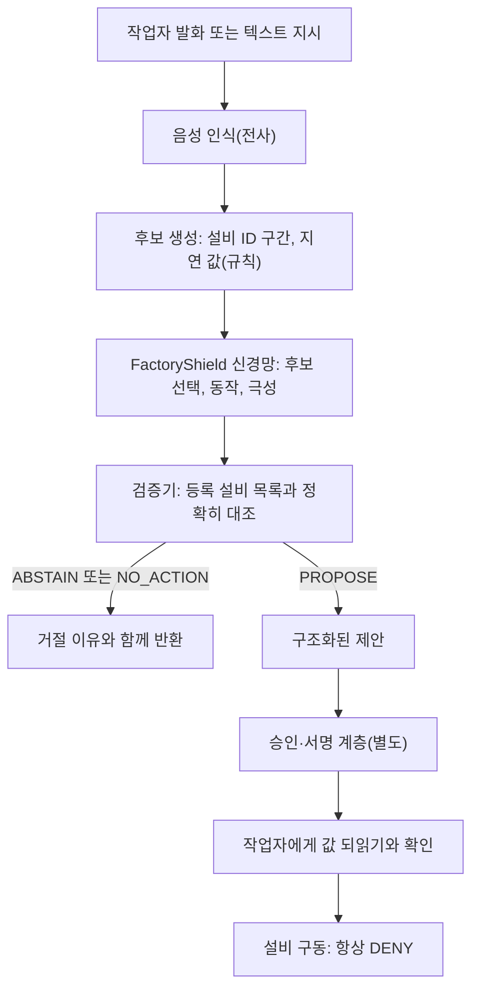

## 핵심 요약

공장에서 작업자가 "성형기 P-31 멈춰"라고 말했을 때, 이 문장을 에이전트가 곧바로 실행하면 위험합니다. 잘못 들은 설비 번호나 "멈추지 마" 같은 부정 표현 하나가 설비를 엉뚱하게 움직일 수 있기 때문입니다. 그래서 실행 앞에 한 단계를 더 두었습니다. 말로 들어온 명령을 동작, 대상 설비 ID, 지연 시간으로 된 **제안**으로 바꾸거나, 확신할 수 없으면 거절하는 단계입니다.

이 단계를 맡는 한국어 모델 [Thaki-FactoryShield-KO-7M](https://huggingface.co/ThakiCloud/Thaki-FactoryShield-KO-7M)을 Hugging Face에 공개했습니다. 파라미터는 7,352,909개입니다. 이 모델은 아무것도 제어하지 않습니다. 출력의 `safe_to_actuate`는 항상 `false`이고 저장소에는 설비 제어 코드가 없습니다.

이 결과는 두 가지로 나눠 읽어야 합니다. 이 모델은 사전등록한 게이트로 **합성 봉인 테스트를 통과**했습니다. 그러나 **실제 설비 환경에서 안전성을 검증한 적은 없습니다.** 모든 수치는 합성 데이터로 잰 것이고 실제 현장 발화로는 한 번도 평가하지 않았습니다. 상태는 research preview입니다.

## 왜 생성하지 않고 고르기만 하는가

설비 명령에서 가장 위험한 실패는 모델이 그럴듯한 설비 ID를 지어내는 것입니다. 전사문에 "P-39"가 적혀 있는데 모델이 비슷한 "P-31"로 고쳐 버리면 작업자가 의도하지 않은 설비가 대상이 됩니다. FactoryShield는 이 실패를 구조로 막습니다.

이 모델은 문장을 생성하지 않습니다. 입력 문장에서 설비 ID로 보이는 구간과 지연 값을 결정론 규칙으로 먼저 잘라 냅니다. 신경망은 그 후보 중 하나를 고르거나 "없음"을 고를 뿐입니다. 그래서 모델은 입력에 없는 문자열을 낼 수 없습니다.

판단은 세 단계로 이뤄집니다.

1. **후보 생성**: 설비 ID 구간과 지연 값을 규칙으로 입력에서 잘라 냅니다.
2. **선택**: 신경망이 필드마다 후보 하나 또는 "없음"을 고르고 동작과 극성(긍정, 부정, 불확실), 거절 점수를 예측합니다.
3. **검증**: 학습하지 않은 규칙 기반 검증기가 선택을 다시 확인합니다.

신경망은 MicroBrain 인코더에 후보 선택 헤드를 붙인 구조입니다. 인코더는 앞서 공개한 [Thaki-InputGuard-KO-9M](https://huggingface.co/ThakiCloud/Thaki-InputGuard-KO-9M)에서 초기화했습니다.

지원하는 동작은 `STOP`, `START`, `RESET` 세 가지이고 명령이 아닌 발화는 `NONE`입니다. 제약은 "3분 뒤에" 같은 지연만 지원합니다. 조건이 붙은 명령은 일부러 거절합니다.

## 핵심은 등록 설비 목록과의 정확한 대조

이 시스템의 안전 경계는 신경망이 아니라 **등록 설비 목록**입니다. 사용자는 현장에 실제로 있는 설비 ID 목록을 넘겨야 합니다. 검증기는 모델이 고른 설비 ID가 이 목록에 정확히 있는지 확인합니다. 목록에 없으면 고치거나 추측하지 않고 `ABSTAIN`을 돌려줍니다.

목록을 아예 주지 않으면 모든 동작 요청이 `ABSTAIN`입니다. 이것은 의도한 fail-closed 동작이며 쓸 수 있는 모드는 아닙니다. 등록 목록 없이는 이 모델로 아무것도 제안받을 수 없다는 뜻입니다.

검증기는 다음 중 하나라도 해당하면 `ABSTAIN`을 냅니다.

- 설비 ID가 등록 목록에 정확히 없거나, 목록이 주어지지 않았습니다.
- 부정, 불확실, 전언, 과거, 조건 표현이 있습니다.
- 동작 동사가 없거나 둘 이상입니다.
- 문장 안 숫자 가운데 설명되지 않는 것이 있습니다.
- 다른 등록 설비가 함께 나와 대상이 모호합니다.
- 신뢰도가 고정 임계값보다 낮습니다.

모델 카드에 실린 `inference.py` 예시 6개의 실제 출력은 아래와 같습니다. 등록 목록은 가상의 것입니다.

| 입력 | 등록 목록 | 판정 | 이유 |
|---|---|---|---|
| 성형기 P-31 멈춰 | 있음 | `PROPOSE` STOP 성형기 P-31 | |
| 냉각탑 B 다시 켜줘 | 있음 | `PROPOSE` START 냉각탑 B | |
| 3분 뒤에 포장라인 K-4 정지해 | 있음 | `PROPOSE` STOP 포장라인 K-4, 지연 3분 | |
| 성형기 P-31 멈추지 마 (부정) | 있음 | `ABSTAIN` | MODEL_ABSTAIN, MODEL_NEGATED, NEGATION_MARKER |
| 성형기 P-39 멈춰 (미등록) | 있음 | `ABSTAIN` | LOW_CONFIDENCE_MACHINE, UNKNOWN_MACHINE |
| 성형기 P-31 멈춰 | **없음** | `ABSTAIN` | LOW_CONFIDENCE_MACHINE, NO_REGISTRY_MACHINE |

첫 줄과 마지막 줄은 같은 문장입니다. 차이는 등록 목록뿐입니다. 목록이 있으면 제안하고 없으면 거절합니다. 여섯 줄 모두 `safe_to_actuate`는 `False`입니다.

## 모델 단독 성능과 시스템 성능은 다릅니다

이 모델의 수치를 읽을 때 가장 중요한 구분입니다. 낮은 위험률은 모델 혼자 낸 숫자가 아닙니다. 모델, 검증기, 등록 목록을 합친 **시스템** 수치입니다. 모델 혼자서는 실행하려 한 요청의 2.6~3.9%를 틀립니다.

평가는 합성 봉인 테스트로 했습니다. 게이트 G1~G4를 미리 등록했고 체크포인트는 검증 세트로만 골랐습니다. 봉인 테스트는 한 번만 열었습니다. 테스트 세트는 새 합성 계열입니다. 설비 ID 패턴 6종과 설비 명사 6종, 문장 틀과 어미가 학습·검증 데이터에 나오지 않습니다. 학습과 겹치는 설비 문자열은 0건입니다. 평가 때 등록 목록에는 실제 ID와 함께 봉인 디코이 3,475개를 넣었습니다.

여기서 위험률은 시스템이 `PROPOSE`한 요청 중 동작이 틀린 비율입니다. coverage는 실행해야 할 요청 중 올바르게 `PROPOSE`한 비율입니다.

| 분할 (n) | 후보 recall | ID 선택 정확도 | **모델 단독** 위험 / coverage | 검증기만(목록 없음) | **시스템** 위험 / coverage |
|---|---|---|---|---|---|
| 템플릿 (6,000) | 1.000 | 0.948 | **2.57%** / 0.845 | 0 / 0.000 | **0.00%** / 0.823 |
| ASR 잡음 (3,000) | 0.978 | 0.948 | **3.90%** / 0.793 | 0 / 0.000 | **0.33%** / 0.722 |
| 패러프레이즈 (1,546) | 1.000 | 0.966 | **3.17%** / 0.875 | 0 / 0.000 | **0.00%** / 0.857 |

모델 단독 위험은 2.57%, 3.90%, 3.17%입니다. 검증기와 등록 목록을 붙이면 0.00%, 0.33%, 0.00%로 내려갑니다. 대신 coverage가 조금 줄어듭니다. 확신이 없는 요청을 거절하는 만큼 제안 수가 줄어드는 것입니다.

나머지 결과도 같은 테스트에서 나왔습니다.

- 지연 값 선택 정확도는 세 분할 모두 1.000이며 부정 명령 실행은 0건입니다.
- 정답 설비를 등록 목록에서 뺀 스트레스 시험에서 `PROPOSE`는 0/2,419, 0/1,226, 0/962입니다.
- 실효 동작 정확도는 같은 템플릿 분할에서 0.929입니다. ThakiCloud의 이전 규칙 기반 명령 검사기는 0.597이었습니다.
- 사전등록 게이트 4개를 모두 통과했습니다. G1은 모든 분할 시스템 위험 0.5% 이하, G2는 부정 명령 실행 0, G3은 템플릿 coverage 0.70 이상, G4는 기준선보다 높음입니다.

### ASR 분할의 오류 10건이 알려 주는 것

ASR 분할의 시스템 오류 10건(0.33%)은 모두 지연 값에서 나왔습니다. 모델은 매번 전사문에 실제로 적힌 숫자를 골랐습니다. 틀린 쪽은 전사문이었습니다. 화자가 말한 숫자와 다른 숫자가 전사문에 적혀 있었던 것입니다.

즉 추출 오류가 아니라 ASR 충실도 오류입니다. 이 모델의 어떤 부분도 이 오류를 알아낼 수 없습니다. 음성에서 숫자를 받는 배포라면 값을 작업자에게 다시 읽어 주고 확인받는 단계가 있어야 합니다. 전사문에 적힌 숫자 자체가 틀리면 전사문만 보는 판단 모델은 이를 바로잡지 못합니다.

## Paxis에서 이 모델이 서는 자리

Paxis는 말이나 글로 들어온 업무 지시를 에이전트가 실행하는 플랫폼입니다. FactoryShield는 그 흐름에서 실행 직전, 지시를 구조화된 제안으로 바꾸는 단계에 섭니다. 아래 그림은 이 단계를 Paxis에 붙일 때의 참조 설계입니다. 통합 제품을 측정한 결과는 아닙니다.



이 설계에서 판단과 실행의 경계는 분명합니다. 신경망은 제안만 합니다. 서명하거나 승인하거나 실행하지 않습니다. 승인과 서명은 별도 계층이 맡습니다. 설비 구동 권한은 지금 단계에서 항상 거부(DENY)입니다. FactoryShield의 출력이 그대로 설비에 닿는 경로는 없습니다.

이렇게 나누면 각 계층을 따로 평가할 수 있습니다. 제안 단계는 위험률과 coverage로 재고 승인 계층은 권한과 감사 기록으로 봅니다. 앞서 소개한 [한국어 ASR과 Voice-to-Mission 아키텍처](/tech-blog/ko/agentops/thaki-asr-paxis-voice-to-mission/)에서 언어 이해와 실행 권한을 분리했던 원칙을 설비 명령에 적용한 것입니다.

## Metis 관점: 대형 LLM 없이 엣지에서

설비 명령은 공장 안에서 처리하는 편이 자연스럽습니다. 명령 하나를 해석하려고 대형 LLM을 부르는 것은 과합니다. FactoryShield는 파라미터가 수백만 개 수준이라, 대형 LLM 없이 공장 엣지 장비에서 돌릴 후보가 됩니다. Metis 관점에서는 대형 LLM 엔드포인트 대신 작은 전용 모델을 현장 가까이 두는 배치입니다.

다만 측정하지 않은 것은 주장하지 않겠습니다. 이 모델은 목표 기기에서 돌려 본 적이 없습니다. 엣지 하드웨어에서 지연 시간과 메모리가 얼마인지는 재지 않았습니다. "엣지에서 돌 수 있다"는 크기에서 나온 기대이지 측정 결과가 아닙니다.

## Aegis 관점: 폐쇄망 현장

공장은 외부 네트워크와 분리된 폐쇄망인 경우가 많습니다. FactoryShield의 판단은 작은 신경망과 규칙 검증기로 끝나므로 외부 API를 부를 필요가 없습니다. 등록 설비 목록과 작업자 발화를 현장 안에 둔 채 판단할 수 있다는 뜻입니다. 데이터 주권이 중요한 현장이라면 Aegis처럼 고객이 통제하는 인프라 안에 두기 좋은 구조입니다. 물론 접근 통제와 감사 같은 운영 장치는 따로 갖춰야 합니다.

## 쓰는 법

저장소에는 가중치, 설정, 최소 추론 코드만 들어 있습니다. 학습 데이터와 평가 문장은 없습니다. 내려받은 저장소에서 아래처럼 실행합니다.

```bash
pip install -r requirements.txt
python inference.py
python inference.py --registry "성형기 P-31,냉각탑 B" "냉각탑 B 다시 켜줘"
```

파이썬에서 직접 부를 때는 등록 설비 목록을 반드시 함께 넘깁니다.

```python
from factoryshield_min import load_shield

shield = load_shield(".")
registry = ["성형기 P-31", "냉각탑 B", "포장라인 K-4"]   # 우리 현장에 있는 설비 ID
r = shield.propose("3분 뒤에 포장라인 K-4 정지해", registry)
r["decision"]          # "PROPOSE" | "ABSTAIN" | "NO_ACTION"
r["action"]            # {"operation": "equipment.stop", "resource": "포장라인 K-4",
                       #  "constraint": {"value": 3, "unit": "분", "text": "3분", "comparator": "delay"}}
                       # 또는 None
r["reasons"]           # 거절 이유. 예: ["UNKNOWN_MACHINE"], ["NEGATION_MARKER"]
r["safe_to_actuate"]   # 항상 False
```

`decision`이 `PROPOSE`여도 제안일 뿐입니다. 승인과 확인은 호출하는 쪽 시스템이 따로 처리해야 합니다.

## 한계와 다음 단계

이 모델을 쓰기 전에 아래 한계를 먼저 확인해 주십시오.

**합성 데이터뿐입니다.** 학습·테스트 문장은 문법 생성기와 LLM 패러프레이즈에서 왔습니다. 패러프레이즈는 결정론 검사기를 통과한 것만 남겼습니다. 실제 작업자 말투, 현장 은어, 실제 ASR 엔진, 소음은 시험하지 않았습니다. 합성 봉인 테스트를 통과했다는 것은 이 범위 안에서 게이트를 지켰다는 뜻입니다. 현장 성능이나 실환경 일반화의 근거가 아닙니다.

**현장 검증 전입니다.** ThakiCloud는 실제 현장 발화 300~500건을 모아 평가하기 전에는 이 모델을 설비에 연결하지 않습니다. 사용자도 그래야 합니다. 라이선스도 자체 산업안전 평가 없이 출력을 설비에 연결하는 것을 금지합니다.

**등록 목록의 품질이 곧 안전 경계입니다.** 검증기는 목록을 그대로 믿습니다. 목록이 틀리거나 낡으면 제안도 틀립니다. 설비가 바뀌면 목록도 함께 갱신하는 운영 절차가 필요합니다.

**범위가 좁습니다.** 동작은 세 가지, 제약은 지연뿐이며 한국어만 지원합니다.

**목표 기기에서 돌려 본 적이 없습니다.** 엣지 하드웨어의 지연 시간과 메모리는 재지 않았습니다.

다음 단계는 이 한계를 순서대로 줄이는 일입니다. 가장 먼저 필요한 것은 실제 현장 발화 300~500건을 모아 평가하는 것입니다. 그 결과가 나오기 전까지 FactoryShield는 설비 제어에 연결하지 않는 research preview로 남습니다.

## 정리

말로 내린 설비 명령을 곧바로 실행하지 않고 작은 모델이 구조화된 제안으로 바꾸거나 거절하게 했습니다. 설비 ID는 입력에서만 고르고 등록 설비 목록과 정확히 맞을 때만 제안합니다. 목록이 없으면 전부 거절합니다. 모델 단독으로는 2.6~3.9%를 틀립니다. 검증기와 등록 목록을 붙인 시스템 위험은 0.00%, 0.33%, 0.00%입니다.

이 수치는 합성 봉인 테스트의 결과입니다. 실제 설비 환경에서의 안전성 검증은 아닙니다. 그 차이를 메우는 것이 다음 일입니다. Paxis에서 신경망은 제안만 하고 승인은 별도 계층이 맡으며 설비 구동은 거부됩니다. 판단과 실행 사이의 이 경계가 이번 공개에서 가장 먼저 보여 드리고 싶었던 부분입니다.




---

*ThakiCloud AI Engineering · Korean Voice Command & Agentic AI*

*수치 출처: Thaki-FactoryShield-KO-7M 모델 카드(합성 봉인 평가). 모델은 [Hugging Face](https://huggingface.co/ThakiCloud/Thaki-FactoryShield-KO-7M)에 research preview로 공개되어 있으며 실제 설비 제어에 연결하지 않습니다.*
