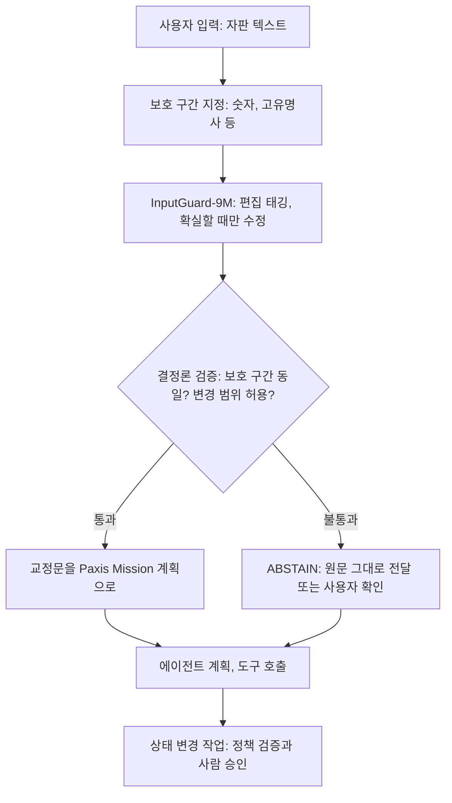

에이전트에게 일을 맡기는 문장은 대개 휴대폰 자판으로 급하게 친 문장입니다. 오타가 섞이고 띄어쓰기가 빠지며 그 문장이 그대로 계획과 도구 호출로 넘어갑니다. 우리는 이 입력단을 맡을 작은 모델을 [Hugging Face](https://huggingface.co/ThakiCloud/Thaki-InputGuard-KO-9M)에 공개했습니다. **Thaki-InputGuard-KO-9M**은 파라미터 822만 개(8,219,115)짜리 한국어 입력 교정 모델입니다. 사전등록된 봉인 테스트(13,605행)에서 Edit F0.5 0.692891을 기록했고 띄어쓰기 baseline보다 높았습니다. 다만 강한 영역은 자판 오타와 띄어쓰기로 좁고 음성인식 의미 오류에는 약합니다. 그래서 이 모델을 Paxis 에이전트의 판단자로 쓰지 않습니다. 입력을 조심스럽게 다듬는 앞단으로만 두고 경계는 결정론 검증과 ABSTAIN이 지키게 합니다.

## 에이전트 입력단에서 생기는 문제

사람끼리라면 "회의는 오후 세시에 시작합니가"를 읽고도 뜻을 압니다. 에이전트 파이프라인은 사정이 다릅니다. 오타 하나가 의도 분류를 흔들고 검색 질의를 바꾸고 대형 LLM에 되묻는 왕복을 한 번 더 만듭니다.

그렇다고 입력을 마음껏 고치게 두면 더 위험합니다. 교정기가 멀쩡한 문장을 바꾸거나 고유명사 사이에 공백을 끼우거나 숫자를 건드리면 에이전트는 사용자가 말하지 않은 일을 하게 됩니다. 입력 교정에서는 놓친 오타보다 잘못 고친 글자가 더 비쌉니다.

그래서 입력단 모델에 두 가지를 요구했습니다. 확실할 때만 고칠 것, 그리고 지정한 구간은 절대 건드리지 않을 것입니다.

## 생성 모델이 아니라 편집 태거

InputGuard는 문장을 새로 쓰는 생성 모델이 아닙니다. 글자마다 편집 라벨(base + append)을 예측하는 **편집 태거**이고 이 라벨을 N번 반복 적용해 교정문을 만듭니다. 고정된 1,659자 어휘 안에서 치환·삭제·추가만 할 수 있으므로 없는 절을 지어내거나 주제를 벗어나지 않습니다. 보호하라고 지정한 구간은 손대지 않고 통과시킵니다.

| 항목 | 값 |
|---|---|
| 파라미터 | 8,219,115 |
| 구조 | `MicroBrain-multihead`: 글자·자모 임베딩, 인코더 스택, 편집 헤드 |
| 출력 | 글자별 편집 라벨(base + append)을 N패스 적용 |
| 입력 길이 | 최대 192자 |
| 출력 어휘 | 1,659자 |
| 측정 환경 | CPU·단일 GPU(서버), 휴대폰 아님 |

이 설계에는 대가가 있습니다. 1,659자 어휘 밖에 있는 정답 글자는 구조적으로 만들 수 없습니다. 테스트 행의 0.037%가 여기에 해당합니다. 우리는 이 상한을 받아들이고 환각이 없는 쪽을 골랐습니다.

학습은 AI-Hub의 **인터페이스(자판/음성)별 고빈도 오류 교정 데이터**(dataSetSn 71560)로 했습니다. 이 데이터셋은 한국지능정보사회진흥원(NIA)의 사업결과입니다. 저장소에는 가중치와 설정, 최소 추론 코드만 들어 있고 학습·평가 문장은 없습니다.

## 봉인 평가 결과

임계값과 기준 baseline은 validation에서 확정해 커밋했고 그 **뒤에** 테스트 split을 열었습니다. 판정은 CORRECTION_GO입니다. 지표는 글자 단위 편집 집합의 Edit F0.5입니다. F0.5는 precision에 recall의 두 배 가중을 두므로 "잘못 고친 것이 놓친 것보다 나쁘다"는 입력 교정의 원칙과 맞습니다.

| 시스템 (봉인 테스트 13,605행 / 7,198 family) | Precision | Recall | Edit F0.5 | 문장 EM |
|---|---:|---:|---:|---:|
| **InputGuard-9M** | 0.870502 | 0.381521 | **0.692891** | 0.150092 |
| kiwi 0.24.1 (띄어쓰기 전용) | 0.579450 | 0.388719 | 0.527668 | 0.063359 |

두 시스템의 차이는 +0.165223입니다. family 단위로 묶은 paired bootstrap(2000 draws)의 CI95는 [0.140917, 0.189578]이고 하한이 0보다 큽니다. family는 한 실제 문장에서 나온 유사 변형 묶음입니다. 같은 family 안의 행은 독립 표본이 아니므로 재표집 단위를 family로 잡았습니다. 보호 구간 위반은 13,605행 전체에서 0건이었습니다.

이 결과를 넓게 해석하면 안 됩니다. kiwi는 띄어쓰기 전용 baseline이고 한국어 문법 교정의 최고 수준이 아닙니다. 이것을 이겼다는 사실은 바닥선 결과일 뿐 분야 전체의 순위가 아닙니다. 문장 EM 0.150은 대부분의 문장이 완벽해지지 않고 나아지기만 했다는 뜻입니다.

## 잘하는 것과 못하는 것

노이즈 종류별로 나누면 모델의 성격이 드러납니다.

| 서브셋 | 행 | Recall | Edit F0.5 | 문장 EM |
|---|---:|---:|---:|---:|
| TYPO (자판) | 12,280 | 0.422356 | **0.721246** | 0.166287 |
| ASR (음성) | 1,325 | 0.041173 | **0.158871** | 0.0 |

자판 노이즈에서는 띄어쓰기 baseline을 크게 앞섭니다. 음성인식 오류에서는 recall이 0.041이고 완전히 맞춘 문장이 하나도 없습니다. 같은 데이터로 학습한 1,233만 파라미터 형제 모델도 이 서브셋에서 더 낫지 않았습니다(차이의 paired CI95가 0을 포함). 모델을 키워서 풀리는 문제가 아니라 데이터와 지도신호의 문제로 봅니다. **이 모델을 ASR 후처리 교정기로 배치하지 마십시오.**

학습에 쓰지 않은 독립 말뭉치 AI-Hub 71477(한국어 문서 교정)에서도 따로 쟀습니다. 이 말뭉치는 학습·임계값 선택·디코딩 어디에도 쓰지 않았습니다. 고칠 필요가 없는 정상 문장을 바꾼 비율은 하위셋별로 13.0~19.4%였습니다. 비교한 신경망 교정 모델보다 훨씬 낮지만 입력 대부분이 이미 올바른 타이핑 경로에서는 무시할 수 없는 비율입니다. 필요한 편집은 6~17%만 찾아냈고 Edit F0.5는 kogrammar 계열보다 한참 낮았습니다. 학습한 오류 분포 안에서는 강하고 그 밖에서는 약합니다.

직접 만든 문장으로도 확인했습니다. 일상 문장 20개를 쓰고 오타를 하나씩 넣은 변형 84개를 만들었습니다. 84개 중 15개를 고쳤고 잘못 바꾼 것은 없었으며 깨끗한 문장 20개는 하나도 건드리지 않았습니다. 띄어쓰기 누락은 20개 중 11개를 고쳤지만 옆 자판 자음 오타는 20개 중 하나도 고치지 못했습니다. 모르는 오타는 그냥 지나치는 모델이라고 보시면 됩니다.

## Paxis 입력단에서 맡는 일

Paxis는 기업의 디지털 업무를 에이전트로 자동화하는 플랫폼입니다. 사용자의 요청은 Mission이 되고 에이전트가 계획을 세우고 도구를 호출하며 상태를 바꾸는 작업은 정책과 승인을 거칩니다. InputGuard가 들어갈 자리는 이 사슬의 맨 앞, 요청 텍스트가 계획 단계로 넘어가기 직전입니다. 아래는 우리가 생각하는 참조 구조입니다.



이 구조에서 역할 분담은 분명합니다.

**신경망은 제안만 합니다.** InputGuard는 "이 글자를 이렇게 바꾸면 좋겠다"는 편집안을 낼 뿐이고 승인하거나 서명하지 않습니다. 결제나 권한 변경처럼 되돌리기 어려운 행동의 근거가 되지도 않습니다. 이런 판단은 뒤쪽의 정책 검증과 사람 승인이 맡습니다.

**경계는 결정론 코드가 지킵니다.** 교정 전후를 비교해 보호 구간이 한 글자라도 달라졌는지, 허용하지 않은 종류의 변경이 있는지를 코드로 확인합니다. 모델 확률 대신 문자열 비교로 판정하므로 같은 입력에는 늘 같은 결과가 나옵니다. 봉인 테스트에서 보호 구간 위반이 0건이었지만 그 결과에 기대지 않고 매번 다시 확인하는 것이 이 층의 목적입니다.

**확신이 없으면 ABSTAIN합니다.** 모델 자체가 이미 보수적으로 설계됐습니다. 기본 디코딩 셀(0.98 / 0.0 / 3)은 봉인 테스트 전에 validation에서 고정한 값이고 이 설정에서 모델은 모르는 오타를 그대로 둡니다. 결정론 검증을 통과하지 못하면 교정문을 버리고 원문을 넘기거나 사용자에게 되묻습니다. 고치지 못한 오타는 다음 단계의 LLM이 감당할 수 있지만 잘못 고친 숫자는 감당할 수 없기 때문입니다.

부정 표현과 숫자는 특히 조심해야 합니다. 모델 구조에는 Intent·Entity·Negation 헤드가 있지만 학습 말뭉치에 해당 라벨이 없어 학습하지 않았습니다. 이 헤드들은 모델의 기능이 아니며 출력을 읽으면 안 됩니다. 그러니 "취소하지 마세요"의 부정이나 금액의 자릿수를 InputGuard가 이해한다고 기대해서는 안 됩니다. 숫자는 보호 구간으로 묶어 모델이 건드리지 못하게 하고 부정과 금액의 의미 해석은 뒤쪽의 결정론 규칙과 정책 검증에 맡기는 것이 맞습니다. 음성 입력도 같은 원칙을 따릅니다. 현재 수치로는 ASR 결과를 이 모델로 교정할 근거가 없으므로 음성 경로에서는 교정 없이 통과시키는 설계가 안전합니다.

## Metis 관점: 대형 LLM 호출 앞에 놓는 작은 모델

Metis는 모델 서빙과 토큰 경제성을 다루는 추론 계층입니다. 에이전트가 쓰는 대형 LLM은 Metis 엔드포인트에서 돌고 그 앞에서 수백만 파라미터급 모델이 입력을 먼저 다듬으면 무거운 모델은 판단에만 집중할 수 있습니다.

크기와 지연 차이는 큽니다. 아래는 같은 validation(10,789행)에서 우리가 직접 돌린 **탐색적 비교**입니다. 9M의 디코딩 셀을 이 split에서 골랐으므로 9M에 유리하게 치우쳐 있고 다른 모델은 이 데이터에 맞춘 적이 없습니다. 지연은 서버 CPU 4스레드, 배치 1 기준이며 휴대폰 수치가 아닙니다.

| 시스템 | Edit F0.5 | 정답 문장 변경률 | 파라미터 / 가중치 | CPU 지연 p50 / p95 |
|---|---:|---:|---|---|
| **InputGuard-9M** | **0.732** | **7.5%** | 8.2M / 32.9 MB | 6.6 / 10.1 ms |
| `theSOL1/kogrammar-distil` | 0.661 | 29.5% | 95.5M / 382 MB | 183 / 267 ms |
| `theSOL1/kogrammar-base` | 0.632 | 20.7% | 124M / 496 MB | 303 / 445 ms |
| `j5ng/et5-typos-corrector` | 0.622 | 63.4% | 324M / 1.30 GB | 570 / 958 ms |

이 표에서도 음성인식 행(1,345)만 보면 9M은 0.169로 et5(0.301)와 kogrammar-distil(0.262)보다 낮습니다. 작고 빠른 대신 맡을 수 있는 범위가 좁습니다.

토큰 경제성의 논리는 이렇습니다. 입력단에서 오타를 미리 걸러 내면 대형 LLM이 의도를 다시 묻거나 잘못된 검색으로 한 바퀴를 더 도는 일이 줄어들 수 있습니다. 가중치가 32.9 MB이므로 크기만 보면 사용자 기기나 엣지 노드 쪽에 두고 원문이 서버로 가기 전에 처리하는 구성도 검토할 만합니다. 다만 이것은 설계 방향이고 측정한 결과가 아닙니다. 토큰 절감률이나 비용 절감 수치는 아직 재지 않았습니다.

온디바이스 성능도 미측정입니다. Android·iOS 기기에서 이 모델을 돌린 적이 없고 서버 CPU 수치가 그 자리를 대신할 수 없습니다. INT8 동적 양자화 변형은 서버 CPU에서 Edit F0.5 0.731338(FP32 0.731709, 차이의 paired CI95 [−0.001381, +0.000612])을 기록했지만 이 저장소에는 아직 없습니다. 런타임 호환성, 모델 export, 연산자 지원, 실제 기기 실행은 각각 별개의 확인이고 넷 다 하지 않았습니다.

## 쓰는 법

공개 카드의 예시를 그대로 옮깁니다.

```bash
pip install -r requirements.txt
python inference.py "회의실 예약은 제가 미리 해 두겟습니다."
# out: 회의실 예약은 제가 미리 해 두겠습니다.
```

```python
from inputguard_min import load_guard

guard = load_guard(".")                  # 고정 셀: 0.98 / 0.0 / 3패스
print(guard.correct("비가 많이 와서 우산을 챙겨야 할 것 가아요.")["corrected"])
# 비가 많이 와서 우산을 챙겨야 할 것 같아요.
print(guard.correct("오늘 회의는 오후 세시에 시작합니가.")["corrected"])
# 오늘 회의는 오후 세시에 시작합니가.   <- 그대로 둔다
```

두 번째 예시는 오타가 있는데도 그대로 둔 경우입니다. 확신이 없는 편집은 하지 않는다는 설계가 그대로 보입니다. `load_guard`는 `min_prob`, `min_margin`, `passes`를 받습니다. 기본값이 공개된 모든 수치를 잰 고정 셀입니다. `min_prob`를 낮추면 더 많이 고치는 대신 더 많이 틀리고 이 글의 수치도 더 이상 그 설정을 설명하지 못합니다.

입력단에 붙일 때는 결정론 검증으로 한 번 감싸는 것을 권합니다. 아래는 숫자가 하나라도 달라지면 교정을 버리고 원문을 쓰는 최소 예시입니다. 실제 서비스에서는 보호할 구간을 업무에 맞게 정해야 합니다.

```python
import re

def guarded_correct(guard, text: str) -> str:
    corrected = guard.correct(text)["corrected"]
    if re.findall(r"\d+", corrected) != re.findall(r"\d+", text):
        return text  # ABSTAIN: 숫자가 바뀌면 원문을 그대로 넘긴다
    return corrected
```

## 자매 모델

같은 계열의 [Thaki-FactoryShield-KO-7M](https://huggingface.co/ThakiCloud/Thaki-FactoryShield-KO-7M)은 이 모델의 인코더에서 초기화했습니다.

## 한계와 다음 단계

카드에 적은 한계를 그대로 옮깁니다.

- **ASR 의미 오류에 약합니다.** 테스트 F0.5 0.159, recall 0.041, 문장 EM 0.0입니다.
- **정상 문장 과교정이 작지 않습니다.** 독립 말뭉치 71477에서 정상 문장의 13.0~19.4%를 바꿨습니다. 학습 분포 안에서도 정답 문장의 7.5%를 바꿨고 그중에는 고유명사 사이에 공백이 끼거나 글자가 틀리게 바뀌는 실제 훼손이 섞여 있습니다.
- **일반화가 약합니다.** 71477에서 교정 재현율이 6~17%로 떨어집니다.
- **온디바이스 성능은 미측정입니다.** 휴대폰에서 돌려 본 적이 없습니다.
- **Intent·Entity·Negation 헤드는 학습하지 않았습니다.** 출력을 읽지 마십시오.
- **도메인이 좁습니다.** 인터페이스 입력과 음성 인터페이스 한국어만 다뤘고 법률·의료·코드 텍스트나 방언은 평가하지 않았습니다.

이 모델은 연구와 평가용 체크포인트이며 제품으로 승인되지 않았습니다. 정상 문장 과교정은 측정했지만 면제할 만큼 낮지 않고 온디바이스 게이트도 열려 있습니다. 본문의 Paxis 입력단 구조와 Metis 앞단 배치는 기술적 적용 방향이고 통합 제품에서 잰 결과가 아닙니다.

다음으로 풀어야 할 과제도 카드의 한계에서 나옵니다. 정상 문장 과교정을 더 낮춰야 하고 실제 기기에서 런타임 호환성부터 실행까지 네 가지 확인을 차례로 거쳐야 합니다. 음성 경로는 모델 크기보다 데이터와 지도신호를 다시 봐야 하는 문제입니다.

## 정리

InputGuard는 작고 보수적인 입력 교정기입니다. 자판 오타와 띄어쓰기는 띄어쓰기 baseline보다 잘 고치고 모르는 것은 건드리지 않으며 보호 구간은 봉인 테스트에서 한 번도 깨지 않았습니다. 음성인식 오류와 처음 보는 문서에는 약합니다.

Paxis 입력단에서 이런 모델이 할 일은 판단이 아니라 제안입니다. 신경망이 편집을 제안하고 결정론 코드가 경계를 확인하고 확신이 없으면 원문으로 물러납니다. 행동의 승인은 끝까지 정책과 사람의 몫으로 남깁니다. 작은 모델을 에이전트 앞에 둘 때 우리가 지키려는 원칙이 바로 이것입니다.

---

*ThakiCloud AI Engineering · Korean Input Correction & Agentic AI*

*성능 출처: [Thaki-InputGuard-KO-9M 모델 카드](https://huggingface.co/ThakiCloud/Thaki-InputGuard-KO-9M)의 봉인 사전등록 평가(AI-Hub 71560 테스트 split, 13,605행)와 탐색적 비교. 학습 데이터: AI-Hub 인터페이스(자판/음성)별 고빈도 오류 교정 데이터(dataSetSn 71560), 한국지능정보사회진흥원(NIA) 사업결과.*
