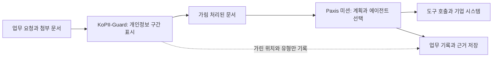

## 왜 읽어야 하나

에이전트에게 고객 문서나 상담 기록을 맡기려는 분이라면 개인정보가 어디로 흘러가는지부터 걱정하실 것입니다. 이 글은 그 걱정을 줄이는 첫 단계로, 한국어 개인정보 위치를 찾아 가리는 작은 모델을 소개합니다.

결론부터 말씀드리면, 이번에 공개한 모델은 합성 시험 문서에서 개인정보 100개 중 99개를 찾았고 찾은 것의 97%가 맞았습니다. 다만 실제 문서에서 검증한 모델은 아니며, 개인정보를 완전히 막아 준다는 보장도 아닙니다. 이 모델은 Paxis 에이전트가 일을 시작하기 전에 먼저 거치는 가림 단계로 쓰도록 설계했습니다.

## 쉽게 말하면

회사 서류를 외부로 내보내기 전에 검은 펜으로 개인정보를 지우는 반출 창구 담당자를 떠올리시면 됩니다. 담당자는 서류 내용을 판단하지 않습니다. 이름, 연락처, 주소 같은 칸을 찾아서 가리는 일만 합니다.

KoPII-Guard가 바로 이 담당자입니다. 에이전트가 문서를 읽고 도구를 부르기 전에 문장을 한 번 훑고, 개인정보로 보이는 글자 구간에 표시를 붙입니다. 그러면 뒤에 오는 시스템이 그 구간을 가린 채로 일을 이어 갑니다.

좋은 담당자는 빠뜨리지 않으면서도 지나치게 많이 가리지 않습니다. 아래 결과도 이 두 기준으로 읽으시면 됩니다.

## 무엇을 만들었나

[KoPII-Guard v1](https://huggingface.co/ThakiCloud/Thaki-KoPII-Guard-v1)은 한국어 문장에서 개인정보 18종의 위치를 글자 단위로 찾는 모델입니다. 한국어 기반 모델인 KLUE RoBERTa(klue/roberta-base)를 개인정보 찾기 용도로 추가 학습했습니다.

찾는 대상은 크게 세 묶음입니다. 사람 이름과 사용자 아이디처럼 사람을 가리키는 것, 전화번호와 주민등록번호와 계좌번호처럼 형식이 정해진 번호, 그리고 주소와 기관명처럼 문맥을 봐야 하는 것입니다. 형식이 뚜렷한 몇 가지 번호는 정해진 규칙이 한 번 더 잡아 주도록 모델과 규칙을 함께 씁니다.

학습과 평가에는 공개된 합성 데이터셋인 K-PII-Bench만 썼습니다. 실존 인물의 기록은 학습 데이터에 들어 있지 않습니다. 모델은 이 데이터를 따라 CC-BY-SA-4.0 라이선스로 공개했고, 로그인하지 않은 상태에서 내려받은 파일이 우리가 가진 원본과 같은지 지문 값으로 확인했습니다.

## 나온 결과

평가 방식은 엄격합니다. 시작 위치, 끝 위치, 유형이 모두 맞아야 정답으로 칩니다. 개발용 데이터로 설정을 고른 뒤, 봉인해 둔 시험용 문서 약 2만 8천 건에 한 번만 적용했습니다.

| 지표 (K-PII-Bench 시험 세트) | 정규식 규칙만 쓸 때 | KoPII-Guard v1 |
|---|---:|---:|
| 찾아낸 개인정보 비율 (재현율) | 19.3% | **99.4%** |
| 찾은 것 중 맞은 비율 (정밀도) | 99.95% | 97.5% |
| 종합 점수 (F1) | 0.3232 | **0.9840** |
| 하나라도 놓친 문서 비율 | 100% | **2.7%** |
| 하나라도 잘못 가린 문서 비율 | 0.04% | 10.9% |

*수치는 모두 합성 벤치마크 결과입니다. 시험 세트로 다시 조정하지 않았고, 개발 세트 F1은 0.9853이었습니다.*

규칙만 쓰면 확실한 번호는 거의 틀리지 않지만, 개인정보 다섯 개 중 네 개를 놓칩니다. KoPII-Guard는 거의 다 찾는 대신 열 문서 중 한 문서꼴로 개인정보가 아닌 곳까지 가립니다. 즉, 사람 말로는 빠뜨리는 쪽보다 조금 더 가리는 쪽으로 기운 담당자입니다.

유형별로 보면 차이가 더 분명합니다. 주민등록번호, 카드번호, 이메일처럼 형식이 정해진 정보는 시험 세트에서 거의 완벽했습니다. 반면 사람 이름, 기관명, 주소처럼 문맥에 기대는 정보에서 잘못 가린 경우가 몰렸습니다. 놓친 개인정보도 열 개 중 일곱 개 이상이 사람 이름이었습니다.

## 빠른 버전을 공개하지 않은 이유

모델을 Metis에서 서빙할 때는 속도도 중요합니다. 그래서 가중치를 8비트로 줄인 버전과, 일부 층만 원래 정밀도로 남긴 혼합 버전을 함께 시험했습니다. 두 버전 모두 CPU에서 원래 모델보다 두 배 넘게 빨랐습니다.

그런데 공개 기준은 속도가 아니라 가림 품질이었습니다. 경량 버전은 사용자 아이디를 찾고도 끝부분 몇 글자를 덜 가리는 일이 생겼습니다. 짧은 기관명을 놓치거나 주소로 잘못 분류하는 사례도 늘었습니다. 미리 정해 둔 조건은 "어떤 유형에서도 원래 모델보다 나빠지지 않을 것"이었고, 두 버전 모두 이 조건에서 탈락했습니다.

반출 창구 비유로 말씀드리면, 손이 두 배 빠른 신입이 서류 끝줄을 가끔 덜 가린 셈입니다. 개인정보 가림에서는 이런 작은 빈틈이 바로 유출입니다. 그래서 이번에는 원래 정밀도의 모델 하나만 공개했습니다.

## Paxis 업무 앞에 두는 자리

Paxis는 에이전트가 문서를 읽고, 계획을 세우고, 기업 시스템의 도구를 실행하는 업무 플랫폼입니다. 이 흐름에서 개인정보가 새는 지점은 대개 세 곳입니다. 대형 언어 모델에게 넘기는 입력, 외부 도구로 보내는 호출, 그리고 나중에 남는 기록입니다.

KoPII-Guard는 이 세 지점 앞에 반출 창구처럼 놓는 것을 목표로 합니다. 아래 그림은 그 참조 설계입니다.

이 구조의 핵심은 언어 모델이 원문 개인정보를 보지 않아도 일을 진행할 수 있다는 점입니다. 기록에는 무엇을 가렸는지 유형과 위치만 남기고, 원문 값은 남기지 않도록 설계합니다. 원문이 꼭 필요한 업무라면 권한 확인과 승인을 거친 단계에서만 다루면 됩니다.

모델을 어디에 두느냐도 중요합니다. 가림 모델을 외부 서비스로 부르면, 가리기 전의 원문이 먼저 밖으로 나갑니다. 그래서 이 모델은 Metis 위에서 고객이 통제하는 환경에 직접 띄우는 쪽이 자연스럽습니다. 크기가 작아 GPU 없이 CPU에서도 돌릴 수 있다는 점도 이 배치에 유리합니다.

지금 공개한 것은 모델이고, 위 그림은 Paxis와 잇는 참조 설계입니다. Paxis 통합 서비스에서 잰 결과는 아직 없으며, 실제 연동은 별도의 엔드투엔드 검증을 거쳐야 합니다.

## 한계

가장 먼저 말씀드릴 점은 모든 수치가 합성 데이터에서 나왔다는 사실입니다. 스캔 문서의 인식 잡음, 한글과 영문이 섞인 표기, 드문 이름 형태, 아주 긴 문서에서는 점수가 더 낮을 수 있습니다.

공개 뒤 짧은 점검에서도 이런 한계가 보였습니다. 합성 문장 속 흔한 한국 이름 하나를 모델이 개인정보로 표시하지 못했습니다. 같은 문장의 주소, 전화번호, 이메일은 제대로 잡았습니다. 이름 놓침이 벤치마크 밖에서도 가장 먼저 확인해야 할 약점이라는 뜻입니다.

반대 방향의 문제도 있습니다. 열 문서 중 한 문서꼴로 개인정보가 아닌 곳을 가리기 때문에, 가림 외의 용도로 결과를 쓰려면 사람이 한 번 더 살펴봐야 합니다. 정규식 규칙과의 차이에 대한 신뢰구간도 계산하지 못했습니다. 다만 맞게 찾은 건수가 약 12만 건 대 2만 3천 건으로 차이가 큽니다.

마지막으로, 이 모델은 개인정보를 학습하지 않았다는 것을 증명하지 않습니다. 학습 데이터는 합성이지만, 모델에서 정보를 꺼내 보는 추출 점검은 아직 하지 않았습니다. KoPII-Guard는 개인정보 보호 체계의 한 겹이며, 접근 권한과 저장 정책과 감사 기록을 대신하지 않습니다.

## 정리

에이전트에게 일을 맡기는 순간, 개인정보는 모델 입력과 도구 호출과 기록을 타고 여러 곳으로 퍼질 수 있습니다. KoPII-Guard v1은 그 앞에서 개인정보 구간을 먼저 표시하는 반출 창구 담당자입니다. 합성 벤치마크에서는 거의 다 찾았고, 이름을 놓치는 경우와 조금 더 가리는 경향이 남은 과제입니다.

여러분의 문서로 먼저 시험해 보시길 권합니다. 특히 사람 이름이 많은 문서에서 무엇을 놓치는지부터 확인하시면 됩니다. 결과와 사례는 [Hugging Face 모델 페이지](https://huggingface.co/ThakiCloud/Thaki-KoPII-Guard-v1)의 토론 탭으로 알려 주시면 다음 버전에 반영하겠습니다.

---

*ThakiCloud AI Engineering · Paxis & Metis*

*성능 출처: K-PII-Bench test_track_a 봉인 평가 1회(2026년 10월), FP32 모델 기준. 모델과 평가 요약은 [Hugging Face](https://huggingface.co/ThakiCloud/Thaki-KoPII-Guard-v1)에 공개되어 있습니다.*
