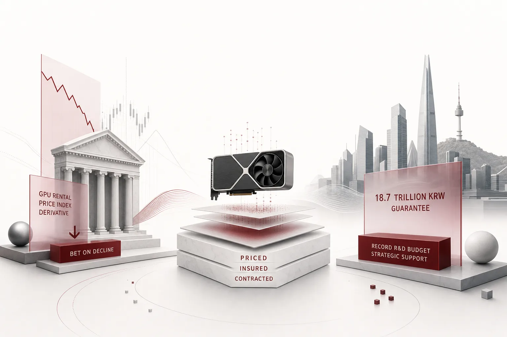

*글의 핵심 개념을 형상화했습니다.*

## 파생상품 시장에 생긴 신종 상품

11월 초, 미국 금융시장에서 보기 드문 일이 일어났습니다. 점프 트레이딩과 서스쿼해나라는 두 대형 파생상품 업체가 조용히 신상품 주문을 받기 시작했다는 보도가 나온 것입니다(SBS Biz). 베팅 대상은 주가가 아니었습니다. 금리도, 원자재도 아니었습니다. 'AI GPU의 임대료'였죠. GPU 사용료가 떨어지면 돈이 되는 파생상품, 그전에 단 한 번도 대상을 가진 적 없던 가격에 만든 상품입니다.

GPU 용량의 임대료는 결국 계산력의 도매가격에 가깝습니다. 도매가격에 파생상품이 붙는다는 것은, 소매 가격, 즉 기업의 토큰 단가가 더 크게 흔들릴 수 있다는 뜻이기도 합니다. 이걸 단발성 이벤트로 보기 어렵게 만드는 숫자가 바로 뒤에 나옵니다.

이건 고립된 움직임이 아닙니다. 같은 보도에 따르면 코어위브의 2028년 만기, 행사가 35달러 풋옵션, 즉 투자자들이 주가 하락에 베팅할 수 있는 상품 거래량이 지난달 사상 최고치를 기록한 뒤 그 수준을 유지하고 있습니다. 당시 주가는 약 55달러 부근이었죠. 행사가가 현 주가보다 3분의 1쯤 아래에 놓인 풋옵션에 돈이 쌓이는 모습, 쉽게 말해 'GPU 가격이 내리면 내가 이긴다'는 게임이 생긴 셈입니다. 아울러 코어위브의 GPU 담보대출 금리가 16%까지 폭등했다는 내용도 함께 실렸습니다. GPU는 사서 쓰는 자산이 아니라, 담보가 되고 보험이 되고 헤지가 되는 자산으로 넘어가는 중입니다.

## 위험이 가격에 붙은 순서

이 숫자들이 나온 순서를 보면, 시장의 위험 인식이 단계적으로 올라가고 있음을 알게 됩니다. 먼저 주가가 움직이는 것입니다. 인텔 주가가 10월 30일 하루 만에 28.6% 폭락했고 알파벳은 31일 12% 이상 하락하며 사상 최대 일일 낙폭을 기록했죠.

그다음은 신용 시장이 반응했습니다. 솔브 데이터에 따르면 아마존, 알파벳, 마이크로소프트, 메타, 오라클 5개사의 CDS, 신용위험 스와프 프리미엄이 2021년 이후 최고 수준으로 동시에 올랐습니다. 솔브의 유진 그린버그 공동창업자의 진단은 직설적이라 할 만합니다. "개별 기업의 특수 문제라기보다 산업 전반에 대한 시장 우려를 시사한다"고. CDS를 풀어서 말하면, 기업이 빌린 돈을 갚지 못했을 때의 가능성을 사고파는 보험이라고 보면 됩니다. AI 관련 기업 5곳의 보험료가 동시에 뛰었다는 것은, 개별 기업의 문제가 아니라 산업의 부채 구조 자체를 시장이 걱정하고 있다는 뜻입니다.

그 5개사는 바로 AI 투자 규모가 가장 큰 회사들이죠. 보도에 따르면 2026년 AI 인프라 자본지출 전망은 구글 최대 2,050억달러, 메타 1,450억달러 수준(뉴시안). 수요가 줄어서가 아니라, 이 수요를 뒷받침하는 부채가 커진 것이 문제의 핵심이라 할 수 있습니다. 참고로 같은 기간 알파벳의 클라우드 매출은 전년 대비 100% 이상 성장한 310억달러로, 성장 자체는 여전합니다. 흔들리는 것은 대차재표 쪽입니다.

그 다음, 자금조달 조건이 굳어 버렸습니다. 코어위브의 GPU 담보대출 금리 16%가 그것입니다. 마지막으로, 상품 그 자체의 가격이 거래 대상이 됐습니다. GPU 임대료 하락에 베팅하는 파생상품이 등장한 것이죠. 다시 말해 시장이 묻는 질문이 'AI가 커지는가'에서 'AI를 돌리는 비용은 누가 부담하는가'로 바뀐 것입니다. 계산력의 연료인 GPU가 보험의 대상 영역에 들어온 주입니다.

## 서울의 장부는 반대 방향으로 써진다

같은 주, 한국의 장부는 정반대 방향으로 채워지고 있습니다. 2027년 국가 R&D 예산안은 39조 5천억원, 전년 대비 4조원(11.2%) 증액으로 역대 최대 규모입니다(머니투데이). 그중 3대 메가프로젝트(피지컬AI, 반도체, AIDC)와 7대 SEED 프로젝트에 9조 5천억원이 배정되고 과기정통부 AI 예산은 9조 4천억원으로 정부 총 AI 예산의 57%를 차지합니다. 2025년 1조 5천억원에서 3년 만에 6배 이상 확대된 것입니다. 이 가운데 프론티어 AI 모델 사업의 GPU 구매 비용으로만 3조 8500억원이 편성되어 있고, 국회는 4일부터 예산 심사에 들어갑니다. 국감에서는 이미 GPU 임대, 임차의 반복적 재정 부담과 낮은 가동률이 도마 위에 올랐습니다.

기업 장부는 더 눈이 갑니다. 엔비디아가 10억달러, 약 1조 4809억원의 제3자 배정 유상증자로 네이버 지분 4.54%를 확보하며 이해진 의장(약 3.84%)을 제치고 3대 주주에 올랐습니다(뉴스후플러스). 납입일은 이번 달 6일입니다. 브룩필드와의 90억달러 규모 AI 컴퓨팅 인프라 계약과 함께입니다. AI팩토리 '각 세종'은 2027년 상반기 55MW 가동을 거쳐 2027년 말 100MW, 2028년 200MW로 늘고 장기적으로는 1GW급을 지향합니다. 그리고 가장 눈이가는 숫자는 네이버클라우드의 GPU 서비스 공급대금 채무보증 18조 7400억원입니다. 2034년까지의 예상 명목총액이며 자기자본의 64.73%에 해당합니다. 운영사가 앞으로 8년의 계산력 대급을 자기 자본의 거의 3분의 2로 담보하는 구조라, 부담의 무게는 스스로 가늠해 보시기 바랍니다. 칩 메이커, 글로벌 자본, 운영사의 3자 분담은 한국형 소버린 AI 모델이라 불립니다.

장부를 닫는 것은 법입니다. 김동아 의원 등 여야 의원 12명이 중소기업진흥법 개정안을 공동발의했습니다. 중기부 장관이 3년마다 중소기업 AI 활용 기본계획을 수립하고 전담기관을 지정하며 시, 도별 AI 확산허브를 지정하는 내용이라고 합니다(이데일리). 2026년 정부 AI 전환 예산이 약 4,230억원 수준에서 시작해, 이제 중소기업까지 제도화 장부로 편입되는 모양새, 제도 장부가 하나 더 생기는 셈입니다. 전담기관이 지정되면 진단, 컨설팅, 실증, 데이터 가공 등의 발주가 본격화될 것으로 보입니다. 국가, 대기업, 중소기업이 같은 주에 각자의 장부를 쓰고 있는 셈입니다.

칩 자체가 전선입니다. 최근 좌담회에서 딥엑스 김녹원 대표는 "피지컬AI의 마지막 방어선은 칩이고, 소버린AI의 마지막 고리도 반도체"라고 했습니다. 공급 쪽도 변수인 셈입니다. 트럼프 대통령이 젠슨 황 엔비디아 CEO 관련 중국 정보 유출 의혹을 "면밀히 확인"하겠다고 발언하면서, GPU 공급망에는 공급 불확실성이라는 또 다른 층이 얹혔습니다(제민일보).

## AI의 전기요금은 더 이상 공인요율이 아니다

두 장부를 나란히 놓고 보면, 같은 주에 같은 재화 '계산력'이 가격되고 보험되고 계약되고 있다는 사실이 선명해집니다. 월가는 가격 하락 쪽에 베팅을 사고 서울은 자산 자체를 사들여 운영 대금까지 보증합니다. '성장 배팅'의 시장이 '자산 관리'의 시장으로 넘어가는 신호입니다.

그렇다면 실제로 AI를 굴리는 기업에서는 무엇을 해야 합니까. 헤지 펀드는 풋옵션을 살 수 있고 국가는 3조 8500억원의 GPU 구매를 편성할 수 있죠. 그러나 재무, 인사, 공급망, 고객서비스 프로세스 속에서 에이전트를 돌리는 기업에게는, 자신의 토큰 비용에 파생상품을 걸 수 있는 시장 자체가 주어지지 않습니다. 그런데도 그 기업의 AI '전기요금'은 더 이상 안정적인 공인요율로 남지 못합니다. 금리와 자금조달 여건, 지정학에 따라 흔들리는 변수가 됐기 때문입니다.

여기서 한 가지 짚어야 할 역설이 있습니다. 월가가 베팅하는 'GPU 임대료 하락'은 기업 입장에서는 반가운 뉴스처럼 들릴 수 있기도 합니다. 계산력이 싸지니까요. 하지만 임대료가 떨어지는 것은, 그 임대료에 베팅한 인프라 기업의 자산 가치와 수익성이 함께 흔들린다는 뜻이기도 합니다. 공급자가 불안정해지면, 공급의 연속성 자체가 질문이 됩니다. 가격이 오든 내든, 변동성 자체를 기업 대차재표가 떠안는 구조에는 변하지 않는 셈입니다. 리스크는 해외에만 머무르지 않습니다. 국내에서도 KB국민은행이 12.6조원 규모의 첫 GPU 파이낸싱을 주선했는데, GPU 자산 가치가 떨어지면 담보가치 재평가 리스크가 국내 금융권으로 전이될 수 있다는 지적이 나옵니다(SBS Biz 보도). 연료값이 움직이면 요금이 따라 움직입니다. 위험은 AI의 가치가 줄어든다는 뜻이 아니라, 실행 비용이 예측 불가능해진다는 뜻이죠.

정답은 금융상품이 아니라 실행 레이어의 설계입니다. 어떤 작업에 어떤 모델을 쓸 것인가, 어떤 환경에서 실행할 것인가, 누가 승인했는가, 어떤 로그가 증명하는가. 이 결정들이 기업 AI 비용의 변동성을 정하는 것이다. 연료값이 흔들리는 시대에 필요한 것은 헤지가 아니라 라우트입니다.

## 렌즈: 실행 리스크를 헤지하는 곳

ThakiCloud의 Paxis는 공식 출시된 에이전트 네이티브 클라우드이며, 정확히 이 질문을 답하도록 설계된 제품입니다. 모델도, GPU 클러스터도 아닙니다. 에이전트가 어디에서, 어떻게 실행되는지를 다루는 레이어입니다.

Paxis 위에서 에이전트를 돌리는 기업의 하루를 상상해 보겠습니다. 매일 아침 밀려오는 데이터 정제, 보고서 요약 같은 작은 일괄 작업은 작고 싼 모델로 라우팅됩니다. 고객 응대와 승인 같은 고강도 판단 작업은 상위 모델이 맡습니다. MCP 커넥터와 스킬 마켓이 기존 업무 시스템과 지식을 연결하고 정책 레이어가 에이전트가 어떤 시스템에 손을 뻗을 수 있는지 정하는 셈입니다. 같은 비용 예산 안에서, 작업의 중요도에 따라 연료를 골라 쓰는 것이죠. 한 달이 끝나면 어떤 작업에 어떤 모델이 쓰였는지가 비용과 함께 남으니, 재무팀이 '전기요금' 질문에 추정이 아니라 숫자로 답하게 됩니다.

두 번째 레이어는 권한과 기록입니다. 누가 무엇을, 어떤 권한으로 실행했는지가 Skills, Tools, Policies, Audit Logs라는 일급 리소스와 함께 남습니다. 자율도 L0부터 L3까지의 거버넌스가 에이전트가 스스로 무엇을 행동할 수 있는지를 구분하고, 정책 게이트는 실행되기 전에 멈춰야 하는 것을 멈춥니다. 에이전트가 권한 밖의 자금 이동을 시도했다면, 실행은 멈추고 멈췄다는 사실 자체가 기록됩니다. AI 실행 비용이 금융의 이슈가 된 순간, "무엇에 썼고 누가 결정했는가"는 컴플라이언스 문항이 아니라 수익성 문항이 됩니다.

세 번째 레이어는 실행 환경입니다. 격리 샌드박스는 에이전트 실행이 사고로 퍼지는 것을 막습니다. 소버린 또는 온프레미스 K8s 배포 옵션은, 기업이 자신의 업무 프로세스를 특정 칩 메이커의 자본 구조, 18.7조원 보증이 필요했던 그런 구조에 묶어둘 필요가 없음을 의미합니다.

앞으로 볼 것은 세 가지입니다. 4일부터 시작된 국회 예산 심사, 그중 3조 8500억원 GPU 구매 항목의 귀결, 엔비디아의 6일 납입이 예정대로 이루어지는지, 그리고 GPU 임대료 파생상품이 표준 상품으로 자리를 잡는지. 이 세 가지가 어디로 움직이는지가, 계산력의 재화화가 얼마나 빠르게 진행될지를 알려 줄 것입니다. 기업의 실행 레이어에도 같은 질문이 그 속도만큼 빠르게 찾아올 테니까요.

월가는 GPU 가격을 파생상품 시장에서 헤지합니다. 그리고 기업 AI의 실행 리스크가 헤지되는 곳은 에이전트 실행 레이어입니다. 이번 주 정반대로 쓰인 두 장부는, 기업의 자리에서 보면 하나의 질문으로 수렴합니다. "내 AI는 누구의 규칙 위에 실행되는가."

## 참고 자료

이 글은 아래 뉴스를 종합해 작성했습니다.

- 머니투데이, ["K-제조업 AI 시대 기회…피지컬AI 마지막 방어선은 반도체"](https://www.mt.co.kr/industry/2026/11/02/2026110109382212444)
- 뉴스후플러스, [네이버 3대 주주에 '엔비디아'…AI팩토리 지급보증 18.7조](https://www.newswhoplus.com/news/articleView.html?idxno=73152)
- 뉴시안, [[AI 패권 전쟁] 챗봇이 가른 '빅테크 광고' 명암…날아오른 메타 vs 쫓기...](https://www.newsian.co.kr/news/articleView.html?idxno=100390)
- 머니투데이, ['40조' 역대 최대 R&D 예산안 써낸 정부…최상위 AI·7대 SEED 심사받는다](https://www.mt.co.kr/tech/2026/11/02/2026110114501590470)
- 이데일리, [중소기업 AI 도입, 3년 단위 기본계획으로 지원…김동아, 법 개정안 발의](https://www.edaily.co.kr/News/Read?newsId=01997526645641784&mediaCodeNo=257)
- SBS Biz, [월가, 빅테크 AI 신용위험 '보험찾기'](https://biz.sbs.co.kr/article_hub/20000343522?division=NAVER)
- 제민일보, [트럼프, 젠슨 황 관련 중국 정보 유출 의혹 주시…엔비디아 기술 안보 논란 부상](https://www.jemin.com/news/articleView.html?idxno=845891)

