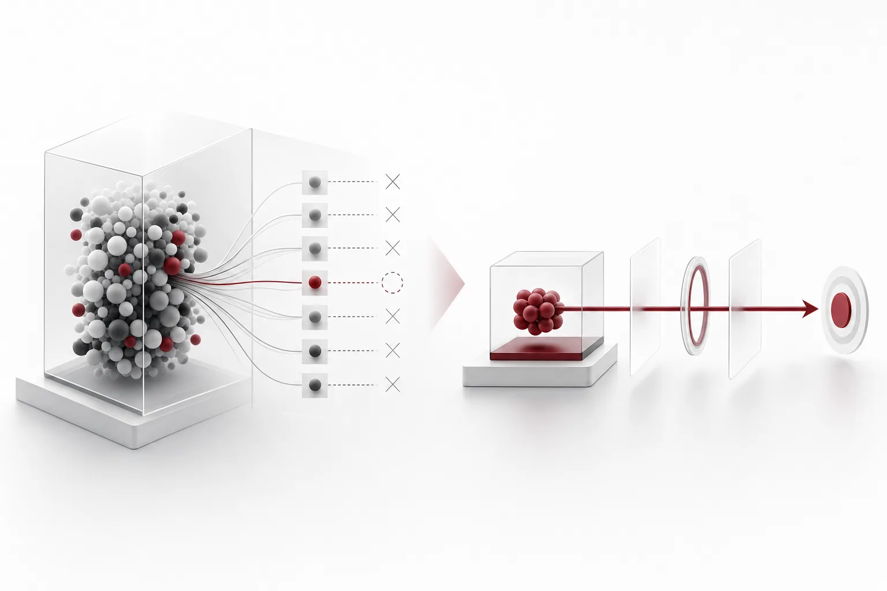
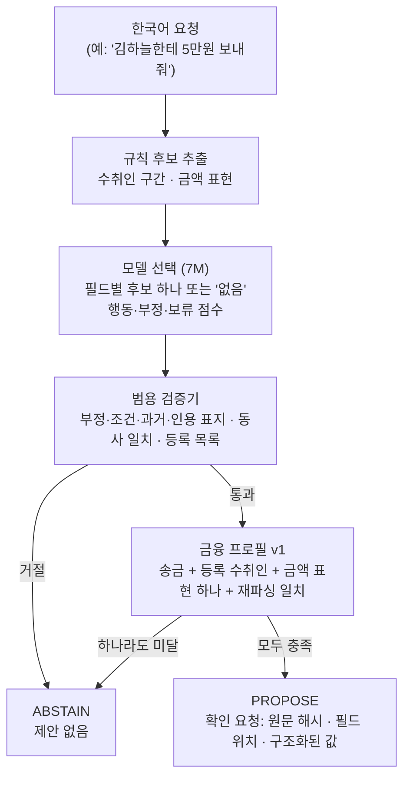

*글의 핵심 개념을 형상화했습니다.*

## 핵심 요약

"김하늘한테 5만원 보내줘"는 사람에게 단순한 요청입니다. 시스템이 이 문장을 처리하려면 여러 질문에 한꺼번에 답해야 합니다. 받는 사람은 누구인지, 금액은 얼마인지, 지금 보내라는 말인지, 아니면 어제 보낸 일을 말하거나 보내지 말라는 뜻인지입니다.

이 질문에 답하는 한국어 모델 [Thaki-IntentAction-Finance-KO-7M](https://huggingface.co/ThakiCloud/Thaki-IntentAction-Finance-KO-7M)을 Hugging Face에 공개했습니다. 파라미터는 7,402,003개입니다. 송금 요청을 수취인·금액·통화로 된 제안으로 바꾸거나, 확신할 수 없으면 거절합니다. 결제나 은행 코드는 들어 있지 않고 출력의 `safe_to_actuate`는 언제나 `false`입니다.

이 모델은 원래 송금 전용이 아니었습니다. 구매, 예약, 삭제, 조회까지 뽑는 범용 모델로 만들었고 그 목표에는 실패했습니다. 이 글은 무엇이 실패했고, 왜 같은 모델을 송금 하나로 좁혀 내놓았는지에 대한 기록입니다. 모든 수치는 합성 데이터로 쟀습니다. 상태는 research preview입니다.

## 범용 목표는 열 번 시도해 통과하지 못했습니다

처음 목표는 에이전트용 범용 행동 추출기였습니다. 한 모델이 송금, 구매, 예약, 삭제, 조회 요청을 모두 구조화하는 것입니다. 판정 기준은 시도 전에 정해 두었습니다. 모든 평가 분할에서 틀린 제안이 0.5% 이하이고, 부정 명령을 실행하는 비율이 0.1% 이하이며, 정답 제안 중 70% 이상을 실제로 제안해야 했습니다.

R2부터 S9까지 열 번 시도해 한 번도 통과하지 못했습니다. 위험을 낮추면 coverage가 0.70 아래로 내려갔고, coverage를 맞추면 처음 보는 문형에서 틀린 제안이 늘었습니다. S8 평가에서 통과한 틀린 제안 43건을 뜯어 보면 작업 종류 오류가 24건, 대상(RESOURCE) 오류가 19건이었습니다. 수취인, 금액, 통화 필드의 오류는 0건이었습니다.

이 분포가 다음 결정을 정했습니다. 약점은 "무슨 일을 하라는 것인가"와 "어떤 물건이나 파일인가"에 몰려 있었고, 송금에 필요한 세 필드는 이미 안정적이었습니다. 그래서 모델을 더 키우거나 학습을 늘리는 대신, 이미 강한 범위만 남기기로 했습니다. 범용 목표가 성공했다는 뜻이 아닙니다. 실패를 인정하고 검증된 부분만 따로 떼어 낸 것입니다. 송금 말고 다른 행동은 고친 것이 아니라 꺼 둔 것입니다.

## 모델은 고르고, 규칙이 확정합니다

모델은 문장을 생성하지 않습니다. 입력에서 수취인 구간, 금액 표현 같은 후보를 규칙으로 먼저 잘라 내고, 신경망은 필드마다 후보 하나나 "없음"을 고릅니다. 그래서 입력에 없는 이름이나 숫자를 지어낼 수 없습니다.



금융 프로필이 마지막 관문입니다. 행동이 송금이고, 수취인이 사용자가 넘긴 목록에 글자 그대로 있고, 문장 속 금액 표현이 하나뿐이며, 다시 읽어도 같은 값이 나올 때만 제안합니다. 나머지는 전부 거절합니다. "5만원 이하로", "월급 들어오면", "보내지 마", "어제 보냈어" 같은 표현이 들어가면 제안하지 않습니다. 이 계층은 값을 고치거나 다시 고르지 않습니다. 목록에 없는 사람에게는 어떤 경우에도 송금 제안을 만들지 않고, 목록 자체가 없으면 모든 요청을 거절합니다.

금액 경계도 이 계층이 확정합니다. 같은 시리즈의 [SlotGrounder 글](/tech-blog/ko/agentops/thaki-slotgrounder-ko-7m-paxis/)에서 "5만원"을 "5"로 자른 제안을 신경망이 놓친 사례를 다뤘습니다. 금융 프로필은 금액 구간이 문장 속 금액 표현 전체와 정확히 같아야 통과시키므로 그 제안을 거절합니다.

## 좁힌 뒤의 결과

평가에는 테스트용으로 따로 만든 합성 계열을 썼습니다. 학습과 겹치는 이름이나 상호가 하나도 없고 문형과 어미도 새로 만든 계열입니다. 수취인 목록에는 정답 수취인에 미끼 이름 5,000개를 섞었습니다. 체크포인트, 임계값, 정책은 이 평가 전에 고정했습니다. 아래는 이번 공개를 위해 한 번 연 sealed8 계열의 결과입니다.

| 분할 | 송금 요청 중 제안 비율 | 제안 중 필드 오류 |
|---|---|---|
| template | 456/456 (100%) | 0 |
| ASR 잡음 | 169/173 (97.7%) | 0 |
| paraphrase | 149/151 (98.7%) | 0 |

제안한 송금은 수취인, 금액, 통화가 모두 정확했습니다. 송금이 아닌 요청이나 부정 명령에 송금을 제안한 경우도 세 분할 모두 0건이었습니다. 개발 과정에서 이미 본 sealed6, sealed7 계열에서도 같은 설정으로 제안 오류는 0건이었고 coverage는 95.0~100%였습니다.

이 수치를 읽을 때 주의할 점이 셋 있습니다. 첫째, 송금 행은 각 분할의 일부입니다. template 분할 5,992행 중 456행이라 ASR 분할에서는 한 건 차이로 비율이 0.6%p쯤 움직입니다. 둘째, ASR 잡음 분할은 실제 음성 인식기 출력이 아니라 군말과 띄어쓰기를 바꾼 합성 텍스트입니다. 셋째, 이 결과를 범용 성능으로 읽으면 안 됩니다. 범용 기준으로 보면 송금 행이 정답 제안의 16%를 넘지 않으므로 coverage 상한이 0.16이고, 범용 게이트는 구조상 통과할 수 없습니다.

## 이해와 실행은 다른 계층입니다

송금 명령에서 문장을 바르게 이해하는 일과 돈을 옮겨도 된다고 승인하는 일은 다른 문제입니다. 이 모델의 `PROPOSE`에는 확인 요청이 붙습니다. 원문 해시, 원문에서 수취인·금액·통화가 나온 위치, 구조화된 값이 들어 있고, 사용자는 신뢰할 수 있는 화면에서 필드를 하나씩 확인해야 합니다. 확인한 값이 보여 준 값과 하나라도 다르면 거절됩니다.

서명은 TrustEdge의 별도 Ed25519 승인 경로가 맡고, 이 공개물에는 들어 있지 않습니다. 모델은 서명하지 않고 승인하지도 않습니다. 이번 학습에서 승인 경로는 건드리지 않았습니다.

## Paxis, Metis, Maxis에서의 자리

아래는 적용 설계입니다. 이 모델은 현재 어느 제품에도 통합돼 있지 않고, 실제 금융 시스템과 연결해 시험한 적도 없습니다.

**Paxis.** Paxis는 말이나 글로 들어온 업무 지시를 에이전트가 실행하는 플랫폼입니다. 송금처럼 되돌리기 어려운 지시에서 이 모델은 "지시를 구조화된 제안으로 바꾸고 확인 화면에 올리는" 단계를 맡을 수 있습니다. 음성 지시라면 [한국어 ASR과 Voice-to-Mission 설계](/tech-blog/ko/agentops/thaki-asr-paxis-voice-to-mission/)의 전사 단계 뒤에 섭니다. 음성 인식이 금액을 잘못 들으면 모델은 그 틀린 숫자를 그대로 뽑습니다. 그래서 확인 화면에서 값을 사용자에게 다시 보여 주는 단계를 생략할 수 없습니다.

**Metis.** 송금 요청 하나를 해석하려고 대형 LLM을 부를 필요는 없습니다. 7M급 전용 모델을 작은 엔드포인트로 두고, 범위 밖 요청은 거절해 상위 에이전트로 넘기는 배치가 가능합니다. 지연과 메모리는 아직 재지 않았습니다.

**Maxis.** 이번 작업에서 남는 교훈은 학습 쪽입니다. 범용 게이트에서 실패했을 때 실패 사례를 필드별로 나눠 보니 모델이 이미 잘하는 범위가 드러났습니다. 모델을 더 키우기 전에 실패를 분해해 보고, 검증된 범위만 제품 범위로 좁히는 판단이 먼저였습니다.

## 쓰는 법

```python
from intentaction_min import load_intentaction

m = load_intentaction(".")
payees = ["김하늘", "해맑은꽃집"]           # 내 주소록, 정확한 이름
r = m.propose("김하늘한테 5만원 보내줘", payees)
r["decision"]               # "PROPOSE" | "ABSTAIN" | "NO_ACTION"
r["action"]                 # {"operation": "send", "payee": "김하늘", "amount_minor": 50000, "currency": "KRW", ...}
r["confirmation_request"]   # PROPOSE일 때 사용자가 확인할 필드와 원문 위치
r["safe_to_actuate"]        # 언제나 False
```

저장소에는 가중치, 설정, 최소 추론 코드만 있고 학습 데이터와 평가 문장은 없습니다.

## 한계

학습과 테스트 문장은 모두 합성입니다. 실제 사용자, 실제 음성 인식기, 은어, 오타, 외국어가 섞인 입력은 시험하지 않았습니다. 수취인 확인은 문자열 정확 일치이므로 목록이 낡았거나 동명이인이 있으면 제안도 틀리고, 모델은 그걸 알아채지 못합니다. 원화식 금액 표현의 한국어 송금만 다룹니다. 단말 하드웨어에서의 지연과 메모리는 재지 않았습니다. 송금이 아닌 행동에는 이 체크포인트를 쓰지 마십시오.

## 정리

초소형 모델이 모든 명령을 이해할 필요는 없습니다. 이번 공개는 범용 목표에서 실패한 모델을 실패 분석에 근거해 좁힌 결과입니다. 모델은 입력에서 후보를 고르고, 규칙이 금액과 수취인을 확정하고, 사용자가 필드를 확인하고, 서명은 별도 경로가 맡습니다. 작은 모델이 실용적인 부품이 되려면 범위를 정확히 정하고 나머지는 거절해야 합니다.
