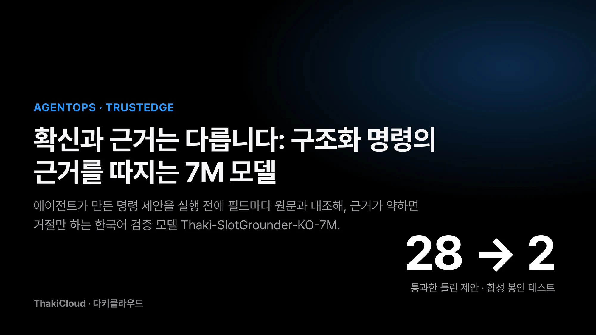
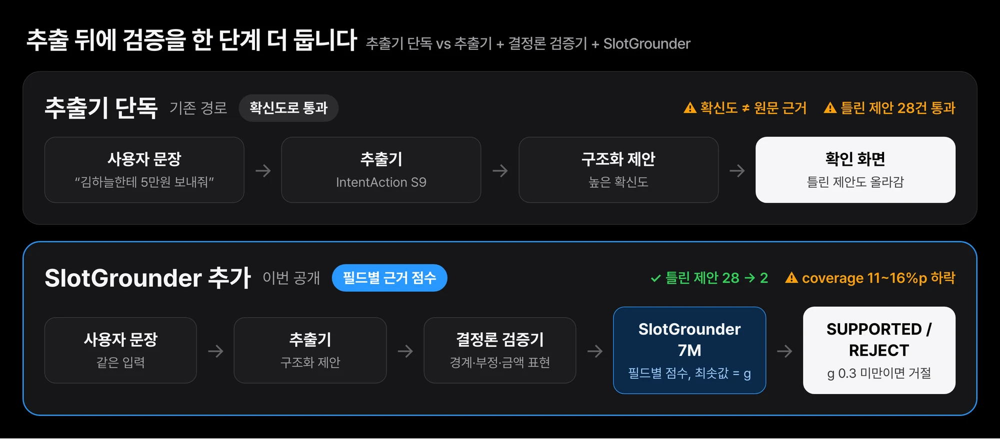
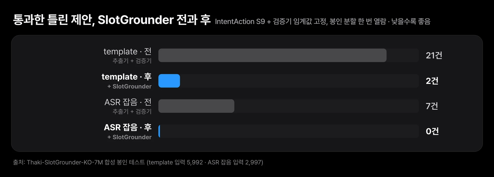
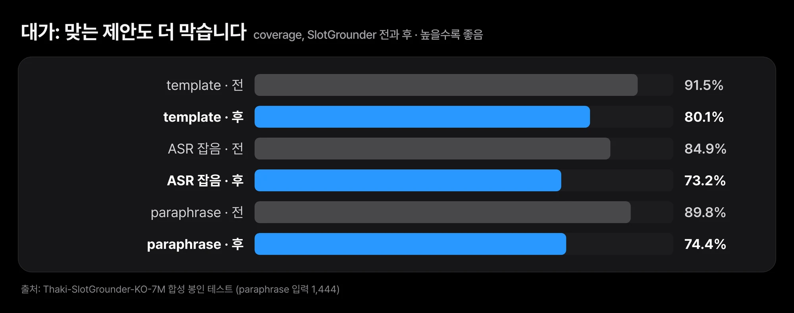

사용자가 "김하늘한테 5만원 보내줘"라고 말하면 에이전트는 이 문장을 `send · 수취인 김하늘 · 금액 5만원` 같은 구조로 바꿉니다. 문제는 이 변환이 틀릴 때입니다. 작업 종류가 `delete`로 바뀌거나 대상 파일이 다른 것으로 잡혀도 추출 모델은 높은 확신도를 낼 수 있습니다. 확신도가 높다는 것과 원문이 그 값을 뒷받침한다는 것은 서로 다른 이야기입니다.

그래서 추출 뒤에 검증 단계를 하나 더 두었습니다. 이 단계를 맡는 한국어 모델 [Thaki-SlotGrounder-KO-7M](https://huggingface.co/ThakiCloud/Thaki-SlotGrounder-KO-7M)을 Hugging Face에 공개했습니다. 파라미터는 7,461,060개입니다. 이 모델은 명령을 만들지도, 승인하지도, 실행하지도 않습니다. 제안된 필드마다 원문의 근거를 점수로 매기고, 근거가 약한 제안을 거절할 뿐입니다.

합성 봉인 테스트에서 기존 추출 모델 뒤에 붙였더니 통과한 틀린 제안이 28건에서 2건으로 줄었습니다. 대신 맞는 제안도 11~16%p 더 막았습니다. 모든 수치는 합성 데이터로 쟀고, 실제 사용자 발화로는 평가하지 않았습니다. 상태는 research preview입니다.

이 글에서는 추출 모델과 검증 모델이 어떻게 역할을 나누는지, 모델이 무엇을 배웠고 시스템 결과가 어떻게 바뀌었는지, 모델이 놓친 금액 경계 오류를 규칙으로 막은 과정을 차례로 봅니다.

## 추출기는 제안을 만들고, 검증기는 거절만 합니다

[TrustEdge 시리즈](/tech-blog/ko/agentops/thaki-inputguard-ko-9m-paxis/)의 IntentAction 계열 모델은 문장에서 작업 종류와 필드를 뽑는 추출기입니다. SlotGrounder는 반대 방향에서 봅니다. 이미 만들어진 제안 하나를 받아서 "이 문장이 정말 이 값을 말하고 있는가"를 필드마다 묻습니다.


*추출기의 확신도만 보면 작업 종류나 대상이 틀린 제안도 확인 화면까지 올라갑니다. SlotGrounder는 제안을 만들지 않고 필드별 근거 점수로 거절만 합니다.*

모델은 작업 종류와 수취인(PAYEE), 대상(RESOURCE), 금액(MONEY) 필드에 각각 뒷받침 확률을 냅니다. 가장 낮은 값이 점수 `g`입니다. 한 필드라도 근거가 약하면 제안 전체가 약하다고 보는 셈입니다. `g`가 0.3보다 작으면 제안을 거절합니다. 통과한 제안의 판정 이름은 `SUPPORTED`입니다. 승인이라는 뜻은 아닙니다. 그 뒤의 사용자 확인과 서명은 별도 계층이 맡습니다.

이렇게 나누면 추출기가 바뀌어도 검증기는 그대로 둘 수 있습니다. 또 검증기는 무언가를 새로 만들 수 없으므로 잘못 동작해도 틀린 명령이 하나 더 늘지는 않습니다. 최악의 경우는 맞는 제안을 막는 것입니다.

## 필드 하나만 바꾼 오답으로 "어긋난 값"을 배웠습니다

인코더는 앞서 공개한 Thaki-InputGuard-KO-9M에서 가져왔습니다. 6층 트랜스포머에 문자와 자모 해시 특징을 쓰는 구조입니다. 제안된 필드 구간을 입력 문장 위에 역할 태그로 표시하고, 작업 종류는 임베딩으로 넣고, 필드마다 작은 판정 헤드를 붙였습니다.

학습 데이터는 41만 3,971쌍입니다. 기존 TrustEdge 합성 명령 코퍼스에서 만들었고 세 종류로 구성됩니다. 정답 제안이 11만 4,569개입니다. 정답에서 필드 하나만 바꾼 교란 제안이 20만 6,274개로, 작업 종류를 바꾸거나 다른 후보 구간을 넣거나 필드를 뺀 것입니다. 나머지 9만 3,128개는 IntentAction 체크포인트가 실제로 낸 제안이고, 이 가운데 657개가 틀린 제안이었습니다. B200 GPU 1장으로 학습했습니다.

이 설계의 요점은 모델에게 "그럴듯한 값"이 아니라 "원문과 어긋난 값"을 구별하게 한 것입니다. 같은 문장에 다른 제안을 넣어 보면 차이가 바로 보입니다.


*같은 문장에 다른 제안을 넣었을 때 돌아온 g와 판정입니다. 공개 파일로 돌린 실제 출력이며 예시 문장은 학습·평가 데이터에 없는 문장으로 새로 썼습니다.*

전체 예시는 아래 표와 같습니다.

| 입력 | 제안 | g | 판정 |
|---|---|---|---|
| 김하늘한테 5만원 보내줘 | send · 김하늘 · 5만원 | 0.974 | SUPPORTED |
| 김하늘한테 5만원 보내줘 | **delete** · 김하늘 · 5만원 | 0.000 | REJECT |
| 김하늘한테 5만원 보내지 마 | send · 김하늘 · 5만원 | 0.000 | REJECT |
| 견적서 말고 계약서 파일 지워줘 | delete · 대상 **견적서** | 0.0003 | REJECT |
| 견적서 말고 계약서 파일 지워줘 | delete · 대상 계약서 파일 | 0.957 | SUPPORTED |

공개 파일로 깨끗한 환경에서 추론을 돌린 실제 출력입니다. 예시 문장은 학습·평가 데이터에 없는 문장으로 새로 썼습니다.

## 틀린 제안은 28건에서 2건으로, 대가는 coverage입니다

모델 하나의 분리 성능은 AUROC로 쟀습니다. AUROC는 틀린 제안 하나와 맞는 제안 하나를 무작위로 뽑았을 때 모델이 틀린 쪽에 더 낮은 점수를 줄 확률로, 1에 가까울수록 잘 가릅니다. IntentAction S9 체크포인트가 낸 제안에서 틀린 것과 맞는 것을 `g`가 얼마나 잘 가르는지 본 값으로, 봉인 template 분할 0.977, ASR 잡음 분할 0.980입니다. 이 숫자는 모델의 분리 능력일 뿐 시스템이 안전하다는 보증은 아닙니다.

시스템 결과는 IntentAction S9과 그 검증기 임계값을 고정한 뒤 SlotGrounder를 붙이기 전과 후로 비교했습니다. 임계값은 개발용 분할에서 한 번 정했고 봉인 분할은 그 뒤 한 번만 열었습니다. 봉인 분할은 설정을 모두 고정할 때까지 아무도 보지 않은 평가용 데이터입니다. coverage는 맞는 제안 가운데 끝까지 통과시킨 비율입니다.

| 분할 | 통과한 틀린 제안 (전 → 후) | coverage (전 → 후) |
|---|---|---|
| template (입력 5,992) | 21 → 2 | 91.5% → 80.1% |
| ASR 잡음 (입력 2,997) | 7 → 0 | 84.9% → 73.2% |
| paraphrase (입력 1,444) | 0 → 0 | 89.8% → 74.4% |


*template 분할에서 21건이 2건으로, ASR 잡음 분할에서 7건이 0건으로 줄었습니다. 합치면 28건에서 2건(92.9% 감소)입니다.*

template과 ASR 잡음 분할을 합치면 통과한 틀린 제안이 28건에서 2건으로 92.9% 줄었습니다. 대가도 분명합니다. coverage가 template과 ASR 잡음에서 11%p 남짓, paraphrase에서 15.5%p 떨어졌습니다. 맞는 명령 일부를 사람에게 다시 묻게 된다는 뜻입니다. 위험한 실행 한 번이 확인 요청 여러 번보다 비싼 업무에서만 이 교환이 의미가 있습니다.


*coverage가 template과 ASR 잡음에서 11%p 남짓, paraphrase에서 15.5%p 떨어졌습니다. 맞는 명령 일부를 사람에게 다시 묻게 됩니다.*

ASR 잡음 분할은 실제 음성 인식기의 출력이 아닙니다. "어", "음" 같은 군말을 넣고 띄어쓰기를 지운 합성 텍스트입니다. 실제 음성 인식 오류에 강하다는 근거로 읽으면 안 됩니다. 남은 2건은 모두 RESOURCE 필드였습니다. 한 문장에 그럴듯한 대상이 둘 있을 때 가장 약합니다.

## 모델이 놓친 금액 경계 오류는 규칙이 막습니다

공개 패키지를 검증하다가 모델이 놓치는 경우를 하나 찾았습니다. "김하늘한테 5만원 보내줘"에서 금액을 `5`로 잘라 넣은 제안이 `g` 0.976으로 SUPPORTED를 받았습니다. 금액 필드 점수는 1.000이었습니다. 학습용 오답이 다른 후보 구간이나 필드 누락뿐이어서 "앞부분만 잘린 금액"을 배우지 못한 것으로 추정합니다.

이 문제는 재학습으로 풀지 않았습니다. 금액과 단위 경계는 신경망이 판단할 일이 아니라 규칙으로 확정할 수 있는 일이기 때문입니다. 송금 전용 검증 계층에는 이미 금액 구간이 입력 속 금액 표현 전체와 정확히 일치해야 통과하는 검사가 있었습니다. 범용 명령 검증기에는 이 검사가 없어서 "15만원"에서 "5만"만 잡은 제안을 5만원으로 통과시키는 구멍이 있었습니다. 같은 검사를 범용 검증기에도 넣었고, 잘린 금액 일곱 가지를 회귀 테스트로 고정했습니다.

이 검사에도 비용이 있습니다. 합성 정답 제안 3,094건 중 5건이 새로 거절됩니다. 숫자로 끝나는 물품 번호 바로 뒤에 금액이 오는 경우입니다. "스터디룸 F-16 900엔"은 사람이 읽어도 16,900엔인지 900엔인지 모호하므로 거절이 맞다고 판단했습니다. 앞 절의 결합 시스템 수치는 이 수정 전 검증기로 잰 값입니다.

여기서 얻은 원칙은 단순합니다. 규칙으로 확정할 수 있는 성질은 규칙에 맡깁니다. 신경망은 규칙으로 쓰기 어려운 의미 판단, 예를 들어 "견적서 말고 계약서"에서 어느 쪽이 대상인지에 씁니다.

## Paxis에서는 사용자 확인 화면 바로 앞에 섭니다

아래는 적용 설계입니다. SlotGrounder는 현재 어느 제품에도 통합돼 있지 않고, 제품 안에서 성능을 잰 적도 없습니다.

**Paxis.** Paxis는 말이나 글로 들어온 업무 지시를 에이전트가 실행하는 플랫폼입니다. SlotGrounder가 들어갈 자리는 도구 호출 인자가 확정된 직후, 사용자 확인 화면 직전입니다. 근거가 약한 제안은 확인 화면에 올리지 않고 다시 묻는 쪽으로 돌립니다. 음성 지시라면 [한국어 ASR과 Voice-to-Mission 설계](/tech-blog/ko/agentops/thaki-asr-paxis-voice-to-mission/)의 전사 단계 뒤에 붙습니다. 다만 이 모델은 전사가 틀렸을 때 원래 발화를 되살리지 못합니다. 전사문이 "15만원"을 "5만원"으로 적었다면 제안은 전사문과 일치하므로 통과합니다.

**Metis.** 모델 파일은 29.9MB이고 추론은 CPU에서 결정론적으로 돕니다. 검증 한 번에 대형 LLM을 부르는 대신, 작은 전용 모델을 추출 엔드포인트 옆에 두는 배치가 가능합니다. CPU 지연과 메모리는 아직 재지 않았습니다.

**Maxis.** 이번 작업에서 재사용할 만한 것은 학습 방식입니다. 이미 있는 인코더에서 시작하고, 정답을 필드 하나씩 교란해 오답을 만들고, 실제 추출기의 오답을 섞었습니다. 큰 모델 하나를 키우지 않고 한 가지 판단만 하는 작은 모델로 줄이는 접근입니다. 다만 위의 금액 사례처럼 교란 방식에 없는 오류는 배우지 못합니다. 교란 목록을 설계하는 일이 곧 모델의 한계를 정하는 일입니다.

## 필드 값을 원문의 부분 문자열로 넘기면 됩니다

```bash
pip install -r requirements.txt
python inference.py --op send --payee 김하늘 --money 5만원 "김하늘한테 5만원 보내줘"
```

```python
from slotgrounder import load_slotgrounder
m = load_slotgrounder(".")
m.check("김하늘한테 5만원 보내줘", "send", payee="김하늘", money="5만원")
# {'scores': {...}, 'verdict': 'SUPPORTED' | 'REJECT', 'weakest_field': ...}
```

필드 값은 입력 문장의 부분 문자열로 넘깁니다. 작업 종류는 `NONE read search draft purchase reserve send delete` 중 하나입니다. 저장소에는 가중치, 설정, 최소 추론 코드만 있고 학습 데이터는 없습니다.

## 쓰기 전에 알아둘 네 가지

모든 수치는 합성 데이터에서 나왔습니다. 실제 사용자 음성과 텍스트, 실제 금융 거래, 현장 운영 환경에서는 평가하지 않았습니다. 지표는 IntentAction S9 하나를 제안기로 두고 쟀으므로 다른 추출기 뒤에 붙이면 오류 구성과 맞는 임계값이 달라집니다. 자기 데이터로 다시 보정해야 합니다. 설비 명령은 학습하지 않았으므로 [FactoryShield](/tech-blog/ko/agentops/thaki-factoryshield-ko-7m-paxis/) 같은 설비 경로에 쓰면 안 됩니다. 금액 값을 바르게 읽었는지는 보지 않습니다. 그 일은 결정론 검증기의 몫입니다.

## 끝으로

확신도를 올리는 것만으로는 믿을 수 있는 에이전트를 만들 수 없습니다. 이번 공개에서 보여 드리고 싶었던 것은 역할을 나누는 설계입니다. 추출기는 제안을 만들고, 결정론 검증기는 규칙으로 확정할 수 있는 것을 확정하고, SlotGrounder는 남은 의미 판단에서 근거가 약한 제안을 거절합니다. 승인과 실행은 그 뒤의 별도 계층이 맡습니다. 이번에 찾은 금액 경계 사례가 이 분리가 왜 필요한지 보여 줍니다.

가장 싼 첫 실험은 이렇습니다. 지금 쓰는 추출기의 제안 기록에서 사람이 고친 사례 몇십 건을 모아 [모델](https://huggingface.co/ThakiCloud/Thaki-SlotGrounder-KO-7M)의 `check`에 넣고, 틀린 제안의 `g`가 0.3 아래로 떨어지는지 보는 것입니다. 임계값은 내 데이터로 다시 보정해야 합니다.
