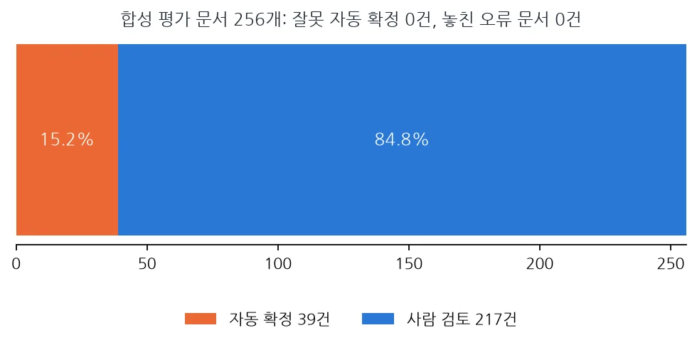
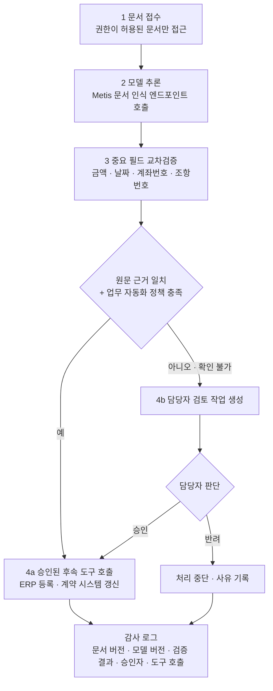

금융 문서에서 글자 하나를 잘못 읽은 결과는 오타로 끝나지 않을 수 있습니다. 원화 기호 ₩가 엔화 기호 ￥로 바뀌거나, 계좌번호를 가리는 `*`가 빠지거나, 계약 조항의 번호가 사라질 수 있습니다. 이런 결과를 에이전트가 그대로 ERP나 계약 관리 시스템에 넣으면 인식 오류가 업무 오류로 커집니다.

이 글은 문서 처리를 에이전트로 자동화하려는 업무 설계자와 엔지니어를 위한 글입니다. ThakiCloud가 OCR 연구에서 실제로 겪은 문제, 그 문제를 막기 위해 실험한 교차검증 계층, 그리고 이를 Paxis 업무 흐름에 연결하는 설계를 설명합니다. 마지막 설계는 제안이며 출시한 기능이 아닙니다.

## 쉽게 말하면

은행 창구의 이중 확인과 비슷합니다. 한 직원이 금액을 입력하면 다른 직원이 원본 전표와 대조합니다. 두 사람의 결과가 다르면 처리를 멈추고 책임자가 확인합니다.

이중 확인을 하면 처리 속도는 느려집니다. 대신 틀린 금액이 장부에 들어가는 일을 막습니다. 이 글은 그 균형을 어디에 둘지에 관한 이야기입니다.

## 정확도가 오른 모델이 기호를 지웠습니다

ThakiDocTrust는 한국어 문서 인식을 개선하려고 범용 문서 VLM인 OvisOCR3를 한국어 문서로 파인튜닝했습니다. 한국어 단어 인식은 좋아졌지만 직접 만든 합성 금융 문서 평가에서는 원본 모델이 지키던 기호를 지웠습니다.

테스트용 25개 시리즈의 문서에서 원문자 조항번호(①, ② 등) 128건을 원본 모델은 모두 보존했지만 파인튜닝 모델은 8건만 보존했습니다. 원화 기호 누락 52건, 날짜 안 공백 누락 38건, 마스킹 기호 `*` 전체 삭제 27건도 함께 나왔습니다. 화면 출력 단계의 문제가 아니라 모델이 생성할 때부터 기호를 쓰지 않은 것이었습니다.

외부 모델인 Xiaomi-OCR-0은 원화 기호를 W나 ￥로 바꿨습니다. 자세한 내용은 [Metis 계층형 추론 글](/tech-blog/ko/llmops/thakiocr-metis-tiered-document-inference/)에 정리했습니다. 평균 정확도만 보면 이런 오류는 잘 드러나지 않습니다.

## VER-001: 확인하지 못한 값은 확정하지 않는다

그래서 중요한 문자를 따로 교차검증하는 VER-001 계층을 만들었습니다. 원화 기호, 원문자 조항번호, 날짜 원문, 마스킹 기호, 금액, 계좌번호, 문서번호, 모양이 비슷한 유니코드 문자를 위험 토큰으로 정하고 서로 다른 OCR 경로의 결과를 비교합니다.

규칙은 단순합니다. 두 결과가 일치하고 원문 이미지에서 해당 줄의 위치 근거가 있을 때만 검증 완료로 표시합니다. 결과가 다르거나 확인할 수 없으면 사람 검토로 보냅니다. 텍스트를 고치지는 않습니다. ￥를 원화로 바꾸거나, 사라진 숫자를 문맥으로 채워 넣지 않습니다.

비교 방식도 둘로 나눴습니다. 원문 그대로 같은지 보는 비교와, ₩와 ￦처럼 모양은 다르지만 같은 통화를 뜻하는지 보는 비교를 따로 기록합니다.

## 결과: 놓친 오류는 0건, 그러나 검토가 85%

합성 평가 문서 256개(깨끗한 문서와 약하게 손상된 문서)에서 결과는 다음과 같았습니다.

| 항목 | 결과 |
|---|---|
| 자동 확정(검증 완료) | 39개, 15.2% |
| 사람 검토 요청 | 217개, 84.8% |
| 오류가 있는 문서 | 168개 |
| 자동 확정 경로로 새어 나간 오류 문서 | 0개 |

오류 문서 168개 가운데 자동 확정으로 넘어간 문서는 없었습니다. 이 표본에서 계산한 누락률의 단측 95% 상한은 약 1.8%입니다.

안전 측면에서는 좋은 결과입니다. 하지만 자동화 측면의 한계도 분명합니다. 오류가 없는 문서 가운데서도 55.7%가 검토로 갔고 한국어 서식 6종은 자동 확정이 0%였습니다. 자동 확정은 영어 서식에서만 나왔습니다. 문서의 85%를 사람이 봐야 한다면 자동 처리의 경제성은 아직 충분하지 않습니다.

이 결과를 실제 고객 문서에서 안전하다는 증거로 읽으면 안 됩니다. 평가 문서는 직접 만든 합성 문서이고 독립된 실문서 검증은 아직 하지 않았습니다. 그래서 VER-001의 판정은 안전성 SAFE, 제품 GO 아님입니다.

## Paxis가 맡는 일: OCR 다음 단계

Paxis는 ThakiCloud의 Agent-Native Cloud로, 에이전트가 기업 내부 시스템과 연결되는 업무 흐름을 설계하고 운영하는 플랫폼입니다. 스킬, 도구, 정책, 감사 로그를 직접 관리하는 리소스로 다루고 도구 실행 전에 정책 게이트를 거치게 합니다.

OCR 검증을 Paxis 업무 에이전트에 연결한다면 다음 흐름을 설계할 수 있습니다.

1단계는 문서 접수입니다. 담당자가 계약서나 증빙 문서를 업무 시스템에 올리면, 에이전트는 권한이 허용된 문서에만 접근합니다.

2단계는 모델 추론입니다. Metis의 문서 인식 엔드포인트나 승인된 OCR 서비스를 호출해 텍스트와 구조 정보를 뽑습니다.

3단계는 중요 필드 검증입니다. 금액, 날짜, 계좌번호, 조항번호를 원문 이미지와 대조합니다. 원문 그대로의 비교와 통화 의미 비교를 나눠 기록하고 값을 임의로 고치지 않습니다.

4단계는 사람 승인 또는 후속 업무입니다. 중요 필드가 원문 근거와 맞고 해당 업무의 자동화 정책을 충족할 때만 다음 단계로 갑니다. 맞지 않거나 확인하지 못한 필드는 담당자의 검토 작업으로 바뀝니다. 검토 결과에 따라 ERP 등록이나 계약 관리 시스템 갱신 같은 승인된 도구를 호출합니다.

모든 단계에서 문서 버전, OCR 모델 버전, 검증 결과, 승인자, 도구 호출 내역을 감사 로그로 남깁니다. 나중에 잘못된 값이 발견됐을 때 어느 단계에서 무엇을 근거로 통과했는지 되짚을 수 있어야 하기 때문입니다.

## 더 똑똑한 에이전트보다 멈출 수 있는 에이전트

문서 AI의 목표를 모든 문서의 자동 처리로만 잡으면, 틀린 결과를 무리하게 통과시키게 됩니다. 금융과 계약 업무에서는 어떤 문서를 자동으로 처리하지 말아야 하는지 판단하는 능력이 그만큼 중요합니다.

Paxis는 OCR을 대신하는 제품이 아닙니다. 문서 인식 결과를 업무 절차와 연결하고 도구 실행 권한과 사람 승인 단계를 통제하는 플랫폼입니다. Maxis에서 문자를 더 잘 보존하는 다음 세대 OCR을 학습하고([학습 글](/tech-blog/ko/research/thakiocr-maxis-same-size-fewer-errors/)), Metis에서 검증된 모델을 추론 서비스로 운영하고 Paxis에서 그 결과를 담당자의 승인·처리 절차에 연결합니다.

세 단계를 함께 보면 모델 정확도 개선의 효과는 벤치마크 숫자에서 끝나지 않습니다. 더 정확한 모델은 검토가 필요한 문서를 줄이고 그 효과는 업무 처리 시간과 검토 부담으로 측정할 수 있습니다.

## 정리

좋은 문서 에이전트는 모든 문서를 자동 처리하는 에이전트가 아니라, 확인하지 못한 값을 업무 시스템에 확정하지 않는 에이전트입니다. ThakiDocTrust의 다음 과제는 오류 누락 0이라는 경계를 지키면서 자동 확정 비율을 높이는 것이고 이를 위해서는 실제 고객 문서와 비슷한 독립 평가가 먼저 필요합니다.

## 참고

- 위 워크플로는 ThakiDocTrust 검증 결과를 Paxis에 적용하는 설계 예시입니다. 256개 문서 검증은 합성 평가 결과이며 금융 업무의 자동 승인 시스템으로 출시하지 않았습니다.
- 공개 모델: [ThakiOCR-KOEN-V1-Dense (A)](https://huggingface.co/ThakiCloud/ThakiOCR-KOEN-V1-Dense), [ThakiOCR-KOEN-G2M-Preview](https://huggingface.co/ThakiCloud/ThakiOCR-KOEN-G2M-Preview)
