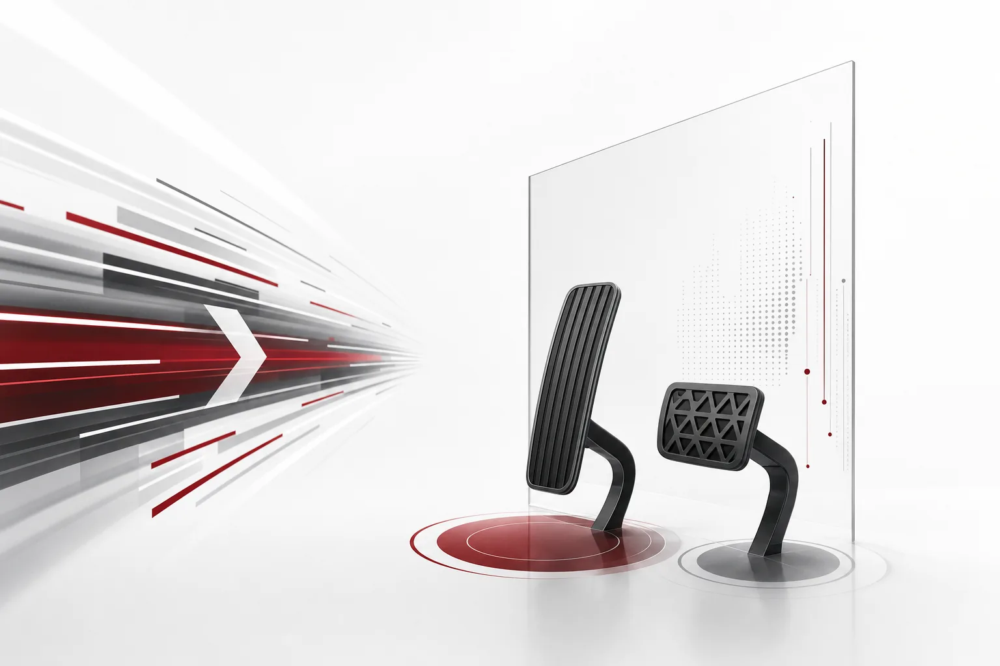

오늘의 핵심을 한 줄로 드리겠습니다. 업계는 스스로 운전하는 에이전트를 만들수록, 브레이크와 운전 규정을 더 진지하게 받아들이는 추세입니다. 이번 주 다이제스트는 그 모순의 기록입니다. 같은 주에 누군가는 속도 기록을 썼고 누군가는 속도 제한을 입법으로 요구하기 시작했습니다. 그래서 이번 주 뉴스를 차 한 대로 읽어보겠습니다. 액셀, 핸들, 브레이크, 연비. 어떤 틀보다 잘 맞습니다. 차의 선택 기준도 달라졌습니다. 최고 시속을 묻던 시대를 지나, 제동이 얼마나 되는지를 묻는 시대입니다.

*글의 핵심 개념을 형상화했습니다.*

## 액셀

먼저 빠른 쪽을 짚어봅니다. 엔비디아가 이번 주 SemiAnalysis AgentX 벤치마크에 새 결과를 내놓았습니다. 700B급 이상 모델에서 사용자당 초당 1,000토큰 이상을 기록했습니다. 눈에 띄는 건 그 숫자를 낸 과정입니다. 처리량을 끌어올린 소프트웨어는 에이전트 스웜이 작성한 코드인 것입니다. 고대역폭메모리(HBM) 칩의 처리량이 표적이었습니다. 기록을 사람이 에이전트용으로 코드를 쓰며 세우는 단계가 아니라, 에이전트가 에이전트를 더 빠르게 만드는 코드를 쓰는 단계까지 온 것입니다.

"사용자당"이라는 표현이 의미 있습니다. 벤치마크는 하나의 에이전트 워크플로가 초당 얼마나 뽑아내는지를 잰 것입니다. 응답 하나를 빨리 내는 능력은 그다지 문제되지 않습니다. 에이전트가 모델을 돌려가며 일하는 구조에서 병목은, 하나의 GPU 풀이 한 사용자에게 공급할 수 있는 서빙 처리량입니다. 엔비디아는 HBM 칩 자체를 초당 1,000토큰 이상으로 밀어올렸습니다. 여기서 더 큰 함의는 소프트웨어를 누가 썼느냐입니다. 에이전트를 빠르게 만드는 코드가 이제는 에이전트 스웜의 산물이면, 속도 상승 루프 자체가 에이전틱해진 것입니다. 서빙 속도는 하드웨어 벤더가 정하는 사양이 아닙니다. 계속 재협상되는 변수가 됩니다.

에이전트 워크로드는 챗과 호출 패턴이 다릅니다. 짧은 요청을 몰아서 반복해서 보냅니다. 그래서 초당 토큰 수는 곧 "몇 개의 에이전트를 동시에 돌릴 수 있는가"의 답이 됩니다. 메모리 칩의 처리량이 병목이면, GPU를 더 사는 것만으로 풀리지 않습니다. 소프트웨어가 칩을 어떻게 쥐느냐의 문제입니다. 이번 제출은 그 방향을 보여줬습니다. 그리고 이 결과가 공개 벤치마크에 오른 제출이라는 점도 함께 봐야 합니다. 실험실의 내부 기록에 그치지 않습니다. 다른 회사가 같은 조건에서 다시 측정하고 비교할 수 있는 숫자입니다. 초당 1,000토큰이라는 표현이 산업 표준의 언어로 이동한 건, 바로 이 때문일 것입니다. 기업에 남은 질문도 여기서 바뀝니다. GPU에서 서빙 스택이 얼마나 많이 뽑아내느냐입니다.

## 핸들

같은 주, 만들어지는 도구도 빨라졌습니다. 앤드레 카파시가 클로드를 활용해 2시간 만에 개인용 유튜브 추천 사이트 하커튜브를 만들었습니다. 이 도구는 수십 년 치 개발자 토론을 분석해 고품질 영상을 정리해 줍니다. 정보 과잉에 대한 개인용 필터이고 주목할 건 제작에 걸린 시간이. 2시간. 작은 팀이 몇 주를 썼을 일을, 한 사람이 에이전트와 함께 2시간에 끝냅니다.

딥시크가 택한 방향은 또 다릅니다. dsh-superagent-prototype이라는 오픈소스 자율 코딩 에이전트를 공개했습니다. 단일 코드 저장소 안에서 태스크를 자율적으로 관리하도록 설계됐고 보도는 이를 클로드 코드의 경쟁자로 꼽았습니다. 범위가 하나의 저장소로 제한된 것처럼 보이지만, 그 제한이 강점입니다. 에이전트가 가장 안정적으로 일하는 영역은, 맥락과 권한이 잘 닫힌 작업장이니까요. 카파시의 이야기는 맞춤형 도구의 비용이 무너진 걸 보여주고, 딥시크의 이야기는 그 능력 자체가 퍼지는 걸 보여줍니다. 둘이 가리키는 곳은 같습니다. 일을 하는 행위 자체가 사람의 손에서 에이전트의 손으로 넘어가는 중입니다. 에이전트가 기업 안에서 도는 숫자는, 할 일이 생기고 도구가 무료가 되는 순간부터 크게 늘어날 것입니다.

기업 관점에서는 계산이 달라집니다. 맞춤형 도구가 2시간이면, 도구를 만드는 시간이 업무의 일부가 됩니다. 사던 도구를 직접 짜는 쪽으로 무게중심이 옮겨갑니다. 필요할 때 짜고 필요 없어지면 버립니다. 에이전트 숫자 증가의 이면에는 이런 도구 경제의 변화가 있습니다.

## 같은 상황에 다른 치료

핸들을 에이전트에 맡기면, 옆으로 빠지는 순간을 어떻게 막느냐가 다음 질문이 됩니다. 이번 주 기록은 토론보다 구체적입니다. AI가 마우스 간질을 치료하는 실험에서, 사용된 모델에 따라 의료 판단이 일치하지 않았습니다. 로봇 뇌수술 시험에서는 GPT-6.1과 Grok 4.7이 서로 다른 치료 목표를 골랐습니다. 같은 상황, 같은 입력, 다른 답입니다.

리더보드 점수는 이 문제를 가립니다. 점수는 평균 능력을 재기 때문에, 같은 상황에서 판단이 얼마나 갈리는지는 잘 드러나지 않습니다. 그런데 실제 업무의 위험은 한 번의 결정에 있습니다. 평균에는 잘 안 보입니다.

임상 전 실험입니다. 그러나 드러난 메커니즘은 기업에 그대로 해당합니다. 모델이 판단 파이프라인의 변수라면, 같은 프롬프트와 같은 데이터가 모델에 따라 다른 의사결정을 낸다는 뜻입니다. 판단이 갈리는 것 자체가 실행 전에 막아야 하는 실패 모드인 업무에는, 이 기록이 경고로 작동합니다. 실무적 질문은 하나입니다. 둘이 갈릴 수 있다는 사실 자체에 대비할 구조를 갖추는가가 그것입니다. 속도가 문제가 아닙니다. 기업이 쫓아가야 할 질문은, 에이전트가 행동하는 그 순간 판단이 기대와 달라진 걸 어떻게 알 수 있느냐입니다.

## 0.1%라는 공급망 구멍

차 자체의 구멍도 하나 더 있습니다. 앤트로픽의 연구는 사전학습 단계의 취약점을 통하면 에이전트 모델에 원격 코드 실행(RCE) 백도어를 심을 수 있다고 보았습니다. 학습 데이터의 0.1%만 오염시켜도 충분했고 백도어는 영구적입니다.

0.1%는 체감하기 어려운 비율입니다. 사전학습 코퍼스의 그 비율을 오염시키면, 모델 전체가 공격 표면으로 바뀝니다. 그리고 RCE는 프롬프트에서 끝나지 않습니다. 호스트에서 코드가 실행됩니다. "영구적"이라는 말도 무겁습니다. 심어진 백도어가 바로 사라지지 않는다는 뜻이니까요. 기업 쪽으로 번역하면 이렇습니다. 돌리려고 하는 에이전트와 실제로 돌게 될 에이전트는 다른 물건입니다. 모델 공급망이 보안 경계의 일부가 되는 순간, 차를 길에 내보내기 전에 어디서 왔고 손이 댔는지 확인하는 게이트는 선택이 아니라 필수입니다.

## 가장 빠른 사람이 요구하는 브레이크

이번 주에서 가장 재미있는 신호가 여기에 있습니다. 오픈AI가 폭넓은 정부 관계 캠페인을 준비하고 있습니다. 목표는 의무적인 AI "속도 제한"을 추진하는 것입니다. 캠페인은 화요일 미국 중간선거 이후 시작되며 새로운 정치적 구도에 맞춰 전략을 조정할 예정입니다.

레이스를 리드하는 회사가 속도 제한을 입법으로 요구합니다. 제한이 없을 때 무슨 일이 나는지를 가장 잘 아는 쪽이, 규정에 가장 먼저 손을 뻗기 때문입니다. 선거 이후라는 타이밍도 같은 맥락에서 봐야 합니다. 새 정치적 구도를 겨냥한 포석입니다.

"속도 제한"이 입법화되면, 능력의 상한이 산업의 규칙이 됩니다. 지금의 벤치마크 경쟁이 "더 빠른 모델"을 골랐다면, 규칙은 "얼마나 빠르게 움직일 수 있는 에이전트"를 골라냅니다. 프런티어 회사들이 규정에 참여하려는 이유는, 그 선이 그어지는 자리에 서 있기 위해서입니다.

다른 쪽에서 xAI는 비가시적 텍스트 워터마크를 준비 중입니다. 11월 7일부터 Grok API 응답이 기계 생성 텍스트임을 식별할 수 있게 됩니다. 워터마크가 붙는 곳은 API 응답입니다. 즉, 다른 시스템이 Grok을 호출하는 모든 경로에서, 그 출력이 기계가 만들었다고 판별 가능해진다는 뜻입니다. EU 법률 준수라는 표기는 붙지만, 방향은 같습니다. 누가 만들었는지, 흔적을 남기라고 말하고 있습니다. 규정의 로비와 생성의 도장은 서로 다른 브레이크지만, 같은 것을 가리킵니다. 속도만으로 팔리는 시절이 끝나고 멈출 수 있는 쪽이 사는 시절입니다.

## 4조 1천억 달러의 배경음악

배경음악을 깔겠습니다. 기술 기업들이 AI 용량 확장에 약속한 부외 커밋먼트가 사상 최대인 4조 1천억 달러에 달했습니다. 보고된 부내 부채를 넘는 수준입니다. 이 숫자는 AI 확장의 돈이 아직 장부에 다 반영되지 않았다고 말합니다. 미래에 지출하겠다는 약속의 형태로 돈이 돌고 있습니다.

투자자들은 이 구조를 부채와 함께 읽기 시작합니다. 부외 커밋먼트가 부내 부채를 넘는 순간, 기업의 미래 현금흐름보다 미래 의무가 더 먼저 보입니다. 한쪽에서는 용량 경쟁이 가격 경쟁으로 떨어질 것도 짐작됩니다. 같은 칩을 더 싸게 서빙하는 쪽이 이기는 게임이 되면, 토큰의 단가는 계속 내려갑니다. 에이전트가 하루 수천 번 모델을 호출하는 구조라면, 단가 하락은 곧 실행 비용의 하락입니다.

이 돈만은 액셀에만 머물지 않습니다. 안전 장비에도 풀립니다. 한편 연료 비용은 움직입니다. FineDNA 데이터셋 제작팀이 내놓은 오픈웨이트 14B 모델 Carbon-X는 DNA 작업에서 GPT-6.1 Sol과 동급의 성능을 더 낮은 비용으로 냅니다. 생물학적 시퀀스 분석, 변이 효과 평가. 도메인 일을 소형 모델이 맡을수록, 기업은 거대한 단일 모델에 예산을 몰빵할 필요가 줄어든다. 4조 1천억 달러가 엔진룸에 쏟아지는 동안, Carbon-X의 이야기는 연료를 더 효율적으로 태우는 법을 알려준다.

## 실제로 사야 하는 층

이번 주 스토리들은 전부 같은 층을 가리킨다. 속도는 더 싸워지고 판단은 더 비싸진다. 엔비디아가 쓴 초당 1,000토큰도 곧 기업의 표준 사양이 되는 것이다. 판단하는 에이전트가 기업 안에서 도는 순간, 필요한 건 네 질문에 답하는 층이다. 얼마나 가도 되는지, 누가 승인하는지, 어떤 모델을 돌리는지, 그다음에 무슨 일이 있었는지.

ThakiCloud의 Paxis는 바로 그 층으로 만들어졌다. v1.1 정식 제품인 Agent-Native Cloud이다. Skills, Tools, Policies, Audit Logs가 일급 리소스로 다뤄진다. 자율도 L0에서 L3까지 레벨별로 거버넌스가 달리 걸리고 정책 게이트를 못 넘으면 에이전트는 움직이지 않는다. 움직여도 격리된 샌드박스 안에서 움직이고 모든 동작은 감사 로그에 쓰인다. 소버린과 온프레미스 K8s 환경이 이를 지탱하고 MCP 커넥터와 스킬 마켓으로 기존 도구를 붙인다. 어떤 태스크에 어떤 모델을 돌릴지라는 물음에는 작업별 모델 선택, CostRouter가 답한다. Carbon-X의 이야기는 이 부분의 힌트다. 모든 작업에 700B급 모델을 돌릴 필요는 없으므로, 비용은 태스크 단위로 결정할 수 있다.

이번 주 신호를 다시 한 번 읽자면, 이런 뜻이다. 브레이크를 요구한 업계가 같은 주에 엔진도 크게 키웠다. 액셀은 늦춰지지 않는다. 더 세게 밟히고 기업이 다음에 사야 할 물건은 브레이크와 계기판이다. 멈춰야 할 때 멈추는 에이전트. 그것이 앞으로의 가치입니다.

## 참고 자료

이 글은 아래 뉴스를 종합해 작성했습니다.

- HuggingNews, [Nvidia Tops 1,000 Tokens a Second per User on 700B+ Models With Agent Swarm Code](https://huggingnews.com/ai/nvidia-tops-1000-tokens-a-second-per-user-on-700b-models-with-agent-swar-17485e8c)
- HuggingNews, [Andrej Karpathy Builds Custom YouTube Recommendation Site in 2 Hours With Claude](https://huggingnews.com/ai/andrej-karpathy-builds-custom-youtube-recommendation-site-in-2-hours-wit-96ac66d0)
- HuggingNews, [GPT-6.1 and Grok 4.7 Select Differing Treatment Targets in Robotic Brain Surgery Tests](https://huggingnews.com/ai/gpt-61-and-grok-47-select-differing-treatment-targets-in-robotic-brain-s-e370fe16)
- HuggingNews, [OpenAI Plans New Washington Lobbying Blitz to Push for Mandatory AI Speed Limits](https://huggingnews.com/ai/openai-plans-new-washington-lobbying-blitz-to-push-for-mandatory-ai-spee-13469f2b)
- HuggingNews, [Anthropic Research Shows 0.1% Data Poisoning Can Plant Persistent Backdoors in AI Agents](https://huggingnews.com/ai/anthropic-research-shows-01percent-data-poisoning-can-plant-persistent-b-c78a60e3)
- HuggingNews, [DeepSeek Open Sources Autonomous Coding Agent to Rival Claude Code](https://huggingnews.com/ai/deepseek-open-sources-autonomous-coding-agent-to-rival-claude-code-ce79c18b)
- HuggingNews, [xAI to Implement Invisible Text Watermarking for Grok API to Comply With EU Law](https://huggingnews.com/ai/xai-to-implement-invisible-text-watermarking-for-grok-api-to-comply-with-e0c94074)
- HuggingNews, [Carbon-X 14B Model Matches GPT-6.1 Sol in DNA Tasks at Lower Cost](https://huggingnews.com/ai/carbon-x-14b-model-matches-gpt-61-sol-in-dna-tasks-at-lower-cost-62bd8550)
- HuggingNews, [Off-Balance-Sheet AI Commitments for Big Tech Hit Record $4.1 Trillion](https://huggingnews.com/ai/off-balance-sheet-ai-commitments-for-big-tech-hit-record-41-trillion-d94705a8)