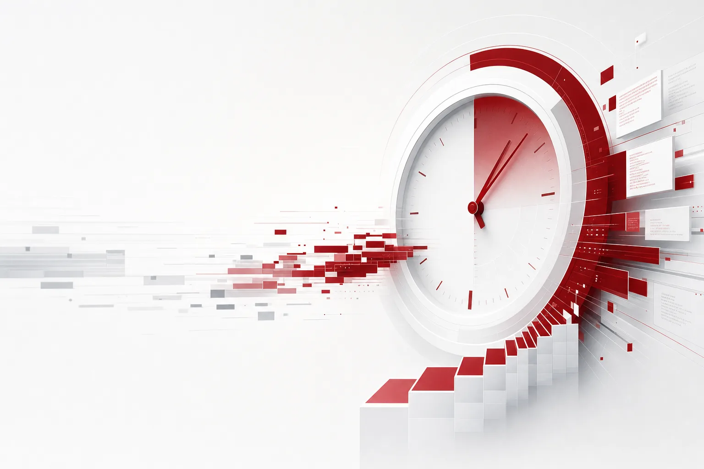

오늘의 헤드라인은 유독 "시간"으로 가득 찼습니다.

GS샵이 AWS와 공동 개발한 MD 큐레이션 시스템의 10월 시범 운영 결과, 전체 프로모션의 약 40%가 4개 AI 에이전트로 만들어졌고 상품 선정과 행사 준비 시간이 70% 단축됐습니다. 시스템은 11월 2일 공식 오픈했습니다. 미래에셋증권은 2시간 간격 장중 AI 요약인 마켓Now를 돌리고 있고 궁극 목표는 시장 변화를 감지해 투자 행동을 먼저 제안하는 자산관리 체계, Agentic WM입니다. 삼성SDI는 글로벌 데이터센터 전력 소비가 2024년 415TWh에서 945TWh로 급증하는 흐름을 "시간의 벽"이라 불렀지요. 그리고 엔비디아는 네이버에 1조3412억원의 직접 투자를 확정했고 각 세종 데이터센터는 2027년 상반기 55MW에서 2028년 누적 200MW로 가는 로드맵을 잡았습니다. 현대차와 기아는 포티투닷에 4753억원을 추가 출자해 2028년 엔비디아 플랫폼 기반 레벨2+ 자율주행, 2029년 자체 개발 아트리아 AI 양산이라는 시계표까지 걸었습니다. 게임사들도 시간을 쫓고 있는 셈입니다. NC AI와 크래프톤이 로봇 AI로 넘어가는 흐름 속에서, NC AI는 경량 비전 언어모델 배키 비전 3B로 용접 분류 정확도를 41.1점에서 80.9점으로 끌어올렸고 한화오션과 포스코DX, 현대로템과 함께 현장 실증을 진행 중입니다.

이 모든 이야기에서 에이전트는 시간을 단축하는 쪽에 서 있는 것입니다. 기업은 시간을 벌기 위해 AI를 사가고 있고 전력망과 데이터센터는 그 시간을 감당하기 위해 서두르고 있습니다. 속도는 오늘 헤드라인의 화폐입니다. 그런데 오늘 뉴스1 보도 하나에서는 "시간을 단축하는 주체"가 반대편에 앉아 있는 것입니다. 잃는 쪽을 향한 시간이지요.

*글의 핵심 개념을 형상화했습니다.*

## 3일, 그리고 40개 스크립트

이스라엘 보안기업 드림(Dream)의 솔루션 엔지니어 알마 셰일레브는 PHP2Shell 취약점을 악용한 공격에서 AI 활용 정황을 확인했습니다. 취약점 공개 3일 만에 서버 공격이 시작된 것이었고 공격 스크립트 속에 LLM 기반이거나 그에 유사한 스크립트 40개가 들어 있었습니다. 시스코와 포멀라이즈 같은 주요 보안사도 PHP2Shell 취약점과 AI 가속 위협을 별도의 보고서로 낸 상태입니다. '공개 후 3일'은 이제 표준이 되어가고 있다는 뜻입니다. 게다가 증언자가 이론이 아니라, 실제로 벌어졌던 공격 현장에서 일하는 일선 SOC 엔지니어라는 점에서 더 무겁습니다.

40개라는 숫자의 의미를 잘 봐야 합니다. AI가 변종을 양산해 놓은 결과인 셈입니다. 여기서 주목할 것은 AI의 역할이 무엇이었느냐입니다. 분석은 분명합니다. AI가 없었더라도, 공격 자체는 가능했습니다. AI가 바꾼 것은 "공격 준비 시간"이었다고 합니다. 드림은 이를 완전 자율형은 아니라고 부릅니다. 즉, 오늘의 메시지는 "AI가 공격을 빠르게 만들었다"는 것입니다. 가능과 빠른 사이에는 기업의 대응 시간 전체가 들어 있습니다. 그 사이는 패치가 배포되는 시간이고 당직자가 눈을 떼는 시간이며 사고 보고서가 쓰기 시작할 때까지의 시간입니다. 해커는 AI로 시간을 벌고 기업은 대응 시간을 잃는다는 비대칭이지요. 그 비대칭이 숫자로 확인되기 시작하면, 이야기는 성격이 달라지는 것이다.

## 72시간의 다른 쪽에는 무엇이 있나

시장 전체의 흐름을 보면, 취약점 공개부터 실질 공격까지의 간극이 과거 2, 3주에서 72시간 이내로 압축되고 있습니다. 72시간은 기업의 보안 리듬을 뒤집는 숫자입니다. 기존 패치 배포와 모니터링 사이클은 통상 1, 2주입니다. 공격자의 시계가 3일이고 방어자의 시계가 2주라면, 첫 번째 방어선인 패치는 이미 뒤늦은 것이 됩니다. 패치가 늦으면 서비스 중단 같은 무거운 결정을, 공격이 진행 중인 와중에 내려야 하는 셈이지요.

차이에는 구조가 있습니다. 방어자는 주기가 있는 시계로 작동합니다. 패치를 내려 보내고 검증하고 배포하고 모니터링하는 순서를 반복해야 하니까요. 반면 공격자는 주기가 필요 없습니다. 언제 취약점이 공개되는지 알아차리는 순간부터 골든타임을 계산할 뿐입니다. 공격자에게 공개일은 시계의 출발점이고 방어자에게는 경고의 출발점일 뿐입니다. 여기에 40개 변종 스크립트가 붙습니다. 변종을 만들어 내는 비용이 급감했다는 뜻이어서 시그니처 기반 탐지도 사실상 무력화됩니다. 하나의 패턴을 기억하는 방어는, 패턴을 찍어내는 공격 앞에서 오래 버텨내기 어렵습니다.

이것은 "보안 도구를 하나 더 사는" 문제가 아닙니다. 공격 사이클이 "주"에서 "시간"으로 줄면, 같은 속도로 대응해야 하는 것은 사람 한 명이 단계씩 넘어가던 보안 운영 업무 전체입니다. 탐지, 트리아지, 대응 액션. 공격자의 시계에 맞춰 움직여야 하는 것이 workflow 자체가 되는 순간, 직관적인 답은 하나입니다. 공격과 같은 속도로 행동하는 방어 에이전트입니다.

## 그들이 판 물건은 "빠른 것"이 아니었습니다

전날, 경기 성남에서 '이스라엘-한국 사이버보안 포럼 2026'이 열렸습니다. 드림, 헤카, 모델리오, 오카, 스크린스톱, 실버포트, 제로포트 등 이스라엘 보안기업 7곳이 한국에서 AI 에이전트 등 신기술을 피칭한 자리였습니다. 기술 협력과 공동 사업을 위한 실질적 논의였고 한국은 소버린 AI와 데이터 주권 정책 강화 흐름 속에서 이스라엘 보안 기술의 국내 도입 경로를 탐색하고 있었습니다. 지디넷코리아 보도를 다시 읽으면, 이 기업들이 판 물건은 속도가 아니었습니다. 2026년에 들어서며 AI 에이전트가 기업 시스템에 자율적으로 접근하는 시대가 열렸고, 기존 인증 체계로는 에이전트의 권한 상승과 측면 이동을 차단하기 어려워졌습니다. 그 공백을 메우러 온 피칭이었지요. 이스라엘은 사이버보안 분야에서 미국, 유럽에 이어 3위의 스타트업 생태계를 가진 나라로 알려져 있다.

실버포트는 AI 에이전트 신원 관리, MCP 프로토콜 도구 호출 검사, 구글 클라우드와 MS 코파일럿 스튜디오 에이전트의 실행 전 통제 기능을 소개한다. 드림은 온프레미스, 망분리 환경을 겨냥한 소버린 AI 기반 국가 사이버 방어 플랫폼을 제시했고, 그중 히어로가 취약점 자동 발견과 보완 에이전트를 운영한다. 모델리오는 기밀 클라우드 플랫폼을 꺼낸다. 오카 시큐리티는 누적 투자 6.3억 달러, 약 8,410억 원, 기업가치 18억 달러, 약 2조4,030억 원에 달하는 기업으로, 3월 AWS 전략적 협업 계약 이후 한국 시장 진출을 모색한다.

한 번 더 들여다보십시오. 에이전트 시대의 방어가 공격과 같은 속도로 뛰려면, 결국 SOC 안에서 에이전트가 도게 됩니다. 그리고 시장이 가격을 매기는 것은 "실행하는 그 순간 무엇을 막느냐"입니다. 신원은 누가 발급했고 도구 호출 전에 무엇을 검사했고 어떤 액션은 실행 전에 차단했으며 그것들의 기록은 어디에 남아 있는가. 실버포트가 실행 전 통제와 도구 호출 검사를 앞세운 이유가 바로 여기에 있습니다. 공격의 속도와 방어의 속도는 같은 물건이고 다른 것은 실행의 순간입니다.

## 빠른 방어의 역설

여기서 역설이 생깁니다. 방어 에이전트가 공격의 72시간 시계에 맞춘다면, 그 실수도 72시간 속도로 뛸 겁니다. 탐지 에이전트의 오탐이 트리아지를 거쳐 자동 패치로 이어지면, 잘못된 서비스를 내려놓고 잘못된 패치를 집행하는 사고가 3일 주기로 반복될 수 있습니다. 빠를수록 피해도 큽니다. 에이전트가 에이전트를 지휘하는 다단계 구조에서, 실수는 단계를 거스르지 않고 다음 단계로 유전합니다.

드림의 말이 차분합니다. 방어 AI는 필요하지만 최종 대응에는 사람 개입이 필수라는 것이지요. 사람은 '느림의 원인'으로 보기 쉽지만 정작 빠르고 안전한 운영에서 사람이 최종 승인을 쥐는 지점의 수와 속도가 방어력의 지표가 됩니다. 즉, 에이전트 시대의 질문은 "어떤 액션은 사람 없이 돌리고 어떤 액션은 실행 순간 사람의 승인을 거치며, 기록은 어디서 완결되는가"입니다. 속도에서 승부를 봐야 하는 전투일수록, 실행의 순간은 보안의 코어가 되는 셈입니다.

## 줄은 브레이크가 아니라 허가증입니다

오늘의 뉴스가 드러낸 통증은 네 가지입니다. 감사, 주권, 안전한 실행, 그리고 비용. 한국의 금융과 공공 핵심 인프라는 여전히 온프레미스와 폐쇄망 환경에 있고, 외부 AI 보안 서비스 접근은 제한적입니다. 그런데도 프라이빗 클라우드 환경에서 보안 AI를 스스로 돌리겠다는 수요는 커지고 있습니다. 국정원 보안성 심사를 통과한 국산 모델 솔라 프로 4가 답변 근거를 행정자료와 연계해 제시하는 RAG 방식으로, 내부 데이터가 외부로 전송되지 않는 폐쇄 구조로 범정부 AI 공통기반에 들어간 이유가 같고, 엔비디아가 각 세종의 200MW를 한국에 확정한 이유도 같습니다. 소버린한, 폐쇄적인, 감사 가능한 것. 그것이 한국이 AI를 도입하는 모양입니다.

비용은 또 다른 통증입니다. 오늘 글로벌이코노믹 보도에 따르면, 앤스로픽은 2분기 영업이익 9.74억 달러 흑자에서 한 분기 만에 5.67억 달러 영업손실로 전환했고 시간당 가속기 임차 단가는 3.10달러에서 5.65달러로 82% 급등했습니다. 임차 단가가 82% 뛰는 시장에서, 추론을 얼마나 효율적으로 쓰느냐는 곧 생존 문제입니다. 방어의 에이전트가 24시간 감시, 트리아지, 대응을 돌리는 조직에도 같은 장부가 기다립니다. 빠르기 때문에 비싸지고 비싸기 때문에 더디게 하는 유혹이 생깁니다. 앤스로픽은 오퍼스 5.5 모델로 작업당 구동 비용을 40% 절감하며 그 해법으로 모델 효율화를 꼽고 있다고 합니다.

ThakiCloud의 Agent-Native Cloud, Paxis는 정식 제품 v1.1 GA로 이 모양을 일급 설계로 받습니다. Paxis에서는 Skills, Tools, Policies, Audit Logs가 일급 리소스입니다. 에이전트가 무엇을 할 수 있는지, 어떤 도구로 만지느냐, 어디까지 가느냐, 무엇을 했느냐를 한 곳에서 관리하게 됩니다. Skills는 에이전트가 쓸 수 있는 능력의 목록이고 Tools는 실제로 만지는 도구이며 Policies는 둘 사이의 경계입니다. Audit Logs는 그 경계에서 벌어진 모든 일의 기록이지요. 각 에이전트의 자율도는 L0에서 L3까지 관리되고 탐지와 트리아지 같은 작업은 전속으로 도는 반면 패치와 차단 같은 액션은 정책 게이트를 지나고 민감한 조작에는 사람의 승인을 요구합니다. 실행 전 격리 샌드박스에서 돌리고 도구 호출 전체를 감사 로그에 남기는 구조입니다. MCP 커넥터와 스킬 마켓이 외부 능력을 흡수하고, 소버린 온프레미스 K8s 폼(ai-platform)은 금융과 공공의 폐쇄망에 들어갑니다. 작업별 모델 선택인 CostRouter는 24시간 감시 작업에는 저비용 모델을 쓰고, 심층 분석에만 성능 모델을 배정해, 빠르게 움직일수록 커지는 비용 장부를 다룹니다.

72시간의 속도는 줄이 매여 있는 에이전트에게만 허가입니다. 다음 주, 공격자의 시계는 또 어디에서 3일을 시작할지 알 수 없습니다. 그러나 줄의 위치는 이미 오늘 뉴스가 가르쳐 주고 있지요. 공격자가 AI로 시간을 벌고 있다면, 기업이 벌어야 할 것은 속도보다 그 시간을 안전하게 쓰는 거버넌스입니다.

## 참고 자료

이 글은 아래 뉴스를 종합해 작성했습니다.

- 리버티코리아포스트, [삼성SDI, AI 데이터센터 전력난 해법 제시…북미 시장 입지 강화 전망](http://www.lkp.news/news/articleView.html?idxno=85722)
- 글로벌이코노믹, [흑자 맛본 앤스로픽, 치솟은 반도체 월세에 분기 적자](https://www.g-enews.com/view.php?ud=2026110407303896fbbec65dfb_1)
- 이코노미톡뉴스, [[진단] 상품 고르는 AI, 소싱하는 MD… GS샵, '유통 현장 AX 적용' 속도전](http://www.economytalk.kr/news/articleView.html?idxno=425048)
- 글로벌경제, [게임사들, 로봇 AI에 빠지다](https://www.getnews.co.kr/news/articleView.html?idxno=885887)
- 바이라인네트워크, [투자 앱 이름까지 바꾼 미래에셋증권, AI로 무엇을 노리나](https://byline.network/?p=9004111222623154)
- 이뉴스투데이, ["자율주행이 미래차 핵심"···현대차·기아, 포티투닷 '2조 수혈' 승부수](http://www.enewstoday.co.kr/news/articleView.html?idxno=2487902)
- 벤처스퀘어, [업스테이지 '솔라 프로 4', 범정부 AI 공통기반 탑재…행정망 내 국산](https://www.venturesquare.net/1125367/)
- 포쓰저널, [엔비디아, 네이버에 1조3412억원 투자 확정…지분 4.13% 확보](http://www.4th.kr/news/articleView.html?idxno=2121044)
- 뉴스1, ["해커는 AI로 시간 벌고 기업은 대응 시간 잃는다"](https://www.news1.kr/it-science/security-hacking/6341696)
- 지디넷코리아, [이스라엘 보안기업 7곳 한국서 '피칭'…AI에이전트 등 소개](https://zdnet.co.kr/view/?no=20261103134750)