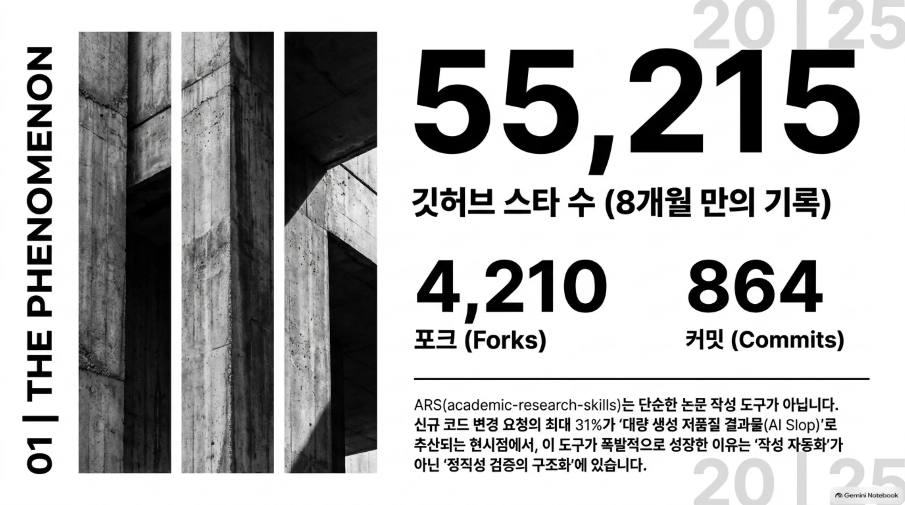
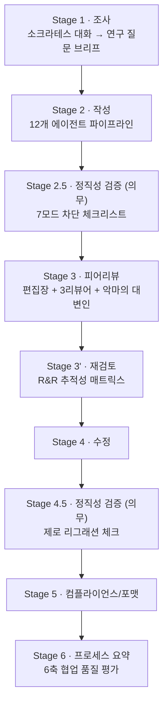
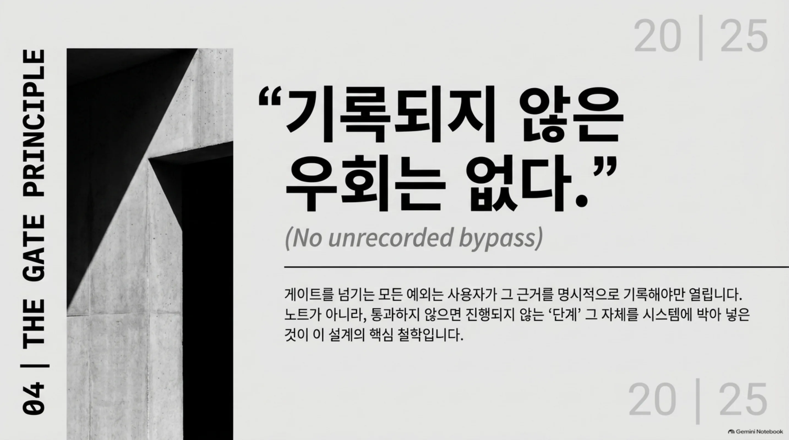
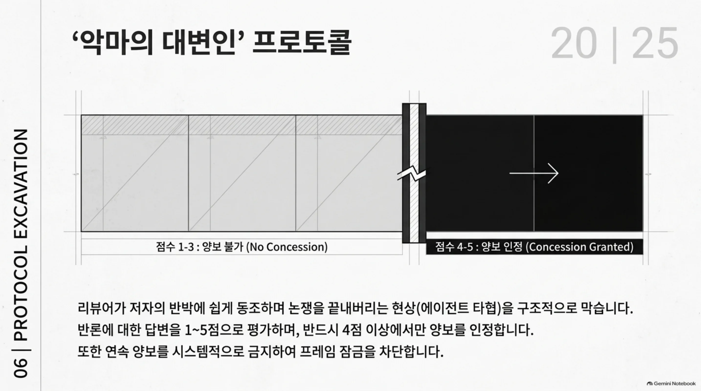
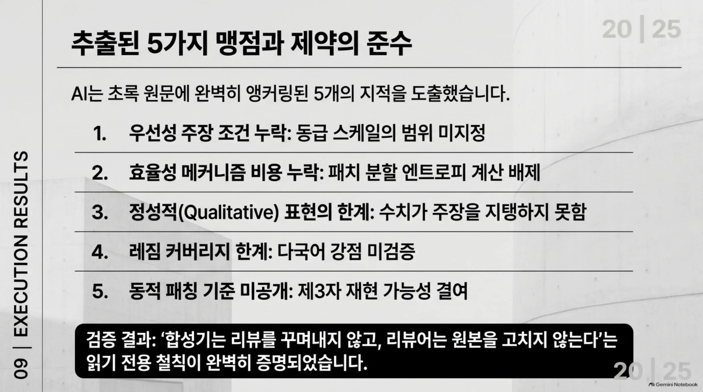
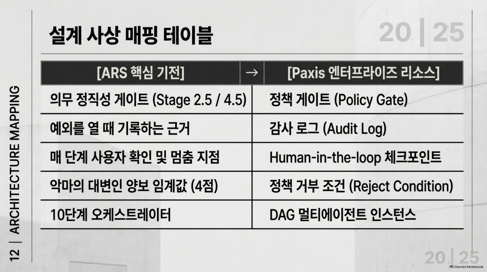
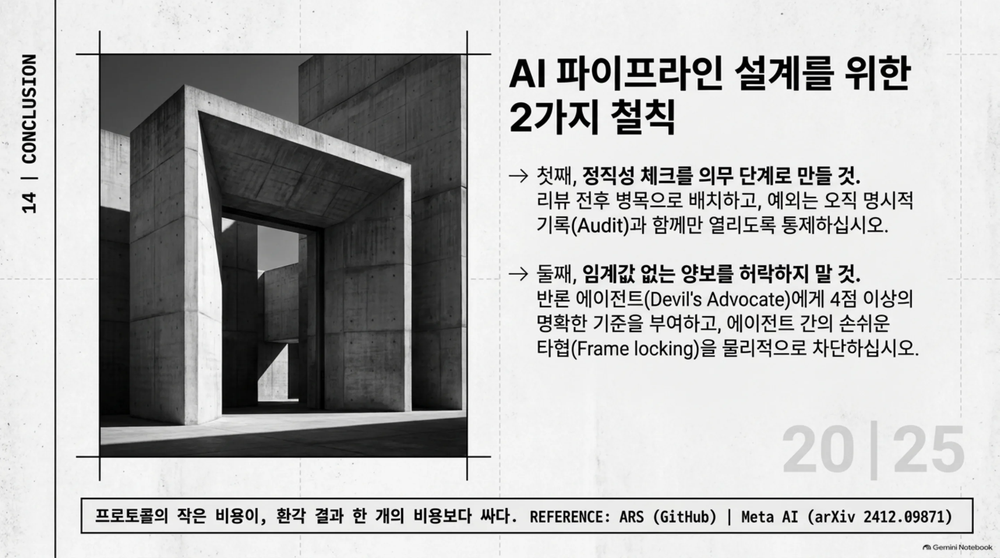

*게이트를 통과하지 못하면 다음으로 가지 못하는 파이프라인, 그중 의무 정직성 게이트 하나를 강조한 추상 이미지입니다.*

## 왜 읽어야 하나

클로드 코드로 논문이나 리서치를 돌리는 개발자라면 지금 한 가지를 정해야 합니다. 에이전트가 했다는 결과물에서, 실제로 했다는 것을 어디에 어떤 장치로 구분할 것인가. 이 글은 55,000개 스타를 받은 오픈소스 스킬 팩 academic-research-skills, 줄여 ARS의 설계 답안을 보고 우리가 인하우스에서 실제로 한 편을 검토시켜 본 결과를 전달합니다. 결론을 먼저 드리면, ARS의 가치는 작성 자동화가 아니라 정직성 검증을 못 빼는 단계로 만든 설계에 있고 그 설계는 Paxis의 정책 게이트와 감사 로그가 하는 일의 외부 완성형과 같습니다.

## 개요

ARS는 Cheng-I Wu가 유지하는 오픈소스 클로드 코드 플러그인입니다. 자료 조사, 작성, 검토, 수정, 마무리까지 논문 프로세스 전체를 플러그인 하나로 이어줍니다. 저장소는 2026년 2월 26일에 만들어졌고 11월 3일 기준 스타 55,215개, 포크 4,210개, 커밋 864개를 기록 중입니다. 8개월 만에 5만 스타를 넘긴 속도입니다.

유지보수 리듬도 눈에 띱니다. 8개월에 864개 커밋이고 최근 릴리스는 11월 2일 v3.24.1입니다. 스킬 팩에 Zenodo DOI가 부여되어 있다는 것조차 흔한 풍경은 아닙니다. 소프트웨어 버전처럼 릴리스 노트와 함께 움직인다는 뜻이니까요.


*저장소 수치(55,215 스타 · 4,210 포크 · 864 커밋)와 심사가 AI 생성물로 범람하는 시점의 배경을 한 장으로 압축한 슬라이드입니다.*

왜 지금인가. AI가 생성한 콘텐츠가 논문 심사대와 코드 리뷰 양쪽을 동시에 범람하는 시점입니다. 오픈소스 코드베이스에서는 신규 변경 요청의 25% 안팎이 대량 생성 저품질 결과물로 추산되고 대형 프로젝트에서는 31%까지 올라갑니다. 논문 쪽도 마찬가지입니다. 검토자가 마주하는 질문은 늘 같습니다. 이 수치는 정말 돌렸고 이 인용은 정말 존재하는가. ARS가 이 질문에 답하는 방식은 노트가 아니라 단계 자체를 만드는 것입니다. 정직성 검증을 파이프라인의 중간 단계로 넣고 그 단계를 통과하지 않으면 다음으로 넘어가지 못하게 설계했습니다.

구성부터 보겠습니다. 코어 스킬은 5개입니다.

- deep-research (v2.12.1): 리서치 단계. 소크라테스식 대화로 논문 구조를 잡고 연구 질문 브리프와 방법론 설계서를 만듭니다.
- academic-paper (v3.3.1): 작성 단계. 12개 에이전트 파이프라인으로 마크다운, DOCX, LaTeX PDF 출력을 만듭니다.
- academic-paper-reviewer (v1.11.1): 검토 단계. 7개 에이전트로 국제 저널 피어리뷰를 시뮬레이션합니다.
- academic-pipeline (v3.24.1): 전체를 잇는 10단계 오케스트레이터.
- sr-screener (v1.0.0): Semantic Scholar 기반 논문 스크리닝.

10단계 오케스트레이터의 흐름은 아래 도표와 같습니다. 핵심은 두 개의 의무 정직성 게이트, Stage 2.5와 4.5입니다.



게이트 설계의 원문에는 "no unrecorded bypass", 기록되지 않은 우회는 없다 라는 문구가 있습니다. 게이트를 넘기는 모든 예외는 사용자가 그 근거를 기록해야만 열립니다. 이 한 줄이 ARS 전체 철학의 축입니다.


*ARS 철학의 축인 한 줄, "기록되지 않은 우회는 없다". 모든 예외는 기록과 함께만 열립니다.*

## 이 도구는 무엇인가

정직성 게이트가 검사하는 대상은 AI 연구의 알려진 실패 모드 7가지입니다. 구현 버그, 환각 결과, 근사치 의존, 버그를 통찰로 재포장하는 행위, 방법론 조작, 프레임 잠금, 인용 환각입니다. 체크 항목을 풀면 인용 존재 확인, 주장과 출처의 정합, 보고된 방법론, 선언된 실험과 결과의 정합, 그림과 표의 충실도, 보고 형식 준수입니다. v3.3 이후에는 Semantic Scholar API로 인용이 실제 존재하는지 확인하고 VLM으로 그림이 실제로 그 결과를 담고 있는지 보는 검증까지 붙었습니다.

검토 단계의 7개 에이전트 구조도 짚어둡니다. 필드 분석가가 논문 영역을 판정해 5명의 리뷰어 신원을 동적으로 구성하고 편집장이 저널 적합성과 원창성을 봅니다. 방법론 리뷰어가 연구 설계와 통계 유효성을, 도메인 리뷰어가 문헌 커버리지와 기여도를, 관점 리뷰어가 학제간 연결과 실용성을 각각 담당합니다. 여기에 악마의 대변인이 한 명 붙습니다.

악마의 대변인 프로토콜이 이 도구의 가장 정교한 부분입니다. 반론에 대한 저자의 답변을 1에서 5점으로 매기고 4점 이상에서만 양보를 인정합니다. 연속 양보는 금지하고 매 체크포인트마다 프레임 잠금을 탐지합니다. 리뷰어가 반박을 받아들이는 순간 논쟁이 끝나는, 즉 에이전트가 상대 말에 맞춰 결론을 흘려보내는 행위를 구조적으로 막는 장치입니다. 편집합성 단계에는 또 하나의 철칙이 있습니다. 합성기는 어느 리뷰어 보고에도 없는 지적을 만들어내면 안 되고 악마의 대변인이 CRITICAL을 걸면 결정이 Accept가 될 수 없습니다.


*양보 임계값 프로토콜. 저자의 답변을 1에서 5점으로 매기고 4점 이상에서만 양보를 인정하며, 연속 양보는 금지합니다.*

v3.6.2에서 도입된 스프린트 계약도 짚어둡니다. 리뷰어는 논문을 두 번 접하게 되어 있습니다. 첫 호출에서는 논문 내용을 보지 못한 채 채점 기준과 실패 조건을 선언하고 두 번째 호출에서 비로소 논문을 봅니다. 논문을 읽은 뒤에야 기준을 맞추는 확인 편향을 구조적으로 끊는 장치입니다. 이 두 단계가 분리되어 있기에 리뷰어가 '읽다가 느끼다' 식으로 판단을 흔들지 못합니다.

재검토 단계의 산출물인 R&R 추적성 매트릭스도 눈여겨볼 부분입니다. 첫 리뷰의 각 지적을, 저자의 각 대응을, 그리고 재검토가 실제로 확인했는지를 한 표로 잇습니다. 리뷰가 다음 라운드로 흘러가면서 소실되는 것을 막는 장치입니다.

그런데 ARS 스스로가 그리는 경계선이 있습니다. "ARS는 절차가 실제로 수행됐는지, 원본 데이터가 진짜인지, 결과가 재현되는지를 확립하지 않는다"는 문구입니다. 게이트가 보증하는 것은 논문 내부의 주장과 기록이 서로 일치한다는 것이지, 실험이 물리적으로 돌았다는 것이 아닙니다. 이 한계를 스스로 선언해 두는 점은, 오히려 이 도구를 읽을 때 가장 신뢰를 주는 부분입니다.

보안 설계도 한 줄 짚고 갑니다. 리뷰어가 접하는 투고 원고와 리뷰 코멘트는 전부 "신뢰할 수 없는 자료"로 취급됩니다. 원고 안에 심어진 지시가 리뷰어의 신원, 라우팅, 도구 사용, 파일 작성을 바꿔서는 안 된다는 철칙이 skill 문서에 명시되어 있습니다. 에이전트가 외부 문서를 읽는 환경이라면, 프롬프트 인젝션 방어 설계가 이 위치에서 나와야 한다는 점을 ARS가 먼저 정리한 것입니다.

## 설치 및 통합

설치는 클로드 코드에서 두 줄입니다.

```
/plugin marketplace add Imbad0202/academic-research-skills
/plugin install academic-research-skills
```

요건은 최신 클로드 코드와 ANTHROPIC_API_KEY 환경변수입니다. DOCX 출력은 pandoc, APA 7.0 PDF는 tectonic과 Source Han Serif TC 폰트가 선택 사항입니다. Codex CLI용 배포판은 별도 저장소로 나와 있습니다.

라이선스는 CC-BY-NC 4.0입니다. 비상업 조건이 붙어 있다는 뜻이고 이 팩의 산출물을 상업 서비스에 그대로 얹어 쓰는 경계는 다음 한계 섹션에서 다룹니다.

실행 구조는 모드가 6개로 나뉘어 있는 것이 특징입니다. full은 7개 에이전트 전원이 뛰는 최초 투고용 전체 리뷰, quick은 필드 분석과 편집장만 거치는 15분 버전, re-review는 수정 반영 검증, methodology-focus는 방법론 2인 패널, guided는 소크라테스식 동반 검토, calibration은 리뷰어 자신의 FNR와 FPR을 골드 세트로 측정하는 옵트인 모드입니다. 우리 실험에서 quick을 고른 이유는 이 구조 때문입니다. 같은 도구가 비용 밴드를 스스로 관리할 수 있는 설계인지 확인하는 것이 실험의 목적이었거든요.

## 실제 실험 결과

문서만 읽지 않고 실제로 돌렸습니다. ARS의 academic-paper-reviewer 스킬은 우리 인하우스 논문 워크플로에 이미 심볼릭 링크로 연결되어 있고 야간 논문 팩토리에서 리뷰 단계를 담당합니다. 실험 대상 논문은 FAIR, 즉 메타 AI에서 발표한 Byte Latent Transformer입니다. arXiv 2412.09871로, 바이트 수준 LLM 아키텍처를 제안하고 8B 파라미터, 4T 학습 바이트까지 FLOP 통제 스케일링을 진행한 14명의 저자 논문입니다.

실행 설정은 quick 모드로, 필드 분석과 편집장 평가 두 단계만 돌리는 가장 가벼운 경로입니다. 입력은 논문 초록 수준으로 한정했고 읽기 전용 제약도 지켰습니다. 원고를 건드리지 않고 산출물만 별도로 만들어내는 것이 이 스킬의 철칙이기 때문입니다.

결과를 요약하면, 편집장이 5개 지적을 뽑았습니다. 전부 초록 원문에 앵커되어 있고 추측이 없습니다.

1. 우선성 주장이 조건 없이 나와 있습니다. "스케일에서 토크나이제이션 기반 LLM과 처음 동급"이라는 문장이 어느 스케일, 어느 태스크 스위트, 어떤 기존 바이트 수준 작업을 제외하는지 범위가 없습니다.
2. 효율성 주장에 메커니즘 비용이 빠질 수 있습니다. 패치 분할에 드는 엔트로피 계산과 가변 길이 처리가 FLOP 회계에 들어가야 진짜 통제된 회계가 됩니다.
3. 추론과 롱테일 일반화 향상은 "qualitative"라는 말로 담겨 있습니다. 수치가 주장을 지탱하지 못함을 스스로 드러내는 표현입니다.
4. 레짐 커버리지가 8B와 4T로 끝납니다. 더 큰 레짐으로의 일반화, 그리고 바이트 수준 모델이 구조적으로 가져야 할 다국어 강점은 초록에서 소진되지 않았습니다.
5. 동적 패칭은 데이터 의존이라, 제3자가 동일한 분할을 재구성하기 어렵습니다. 재현 가능성을 위한 분할 기준 공개가 필요한 시점입니다.


*quick 모드 실행에서 도출한 5가지 지적, 전부 초록 원문에 앵커되어 있고 읽기 전용 철칙 준수 여부에 대한 검증 결과까지 함께 담겨 있습니다.*

판정 문장은 이랬습니다. "단단한 최상위 컨퍼런스 기여이고 accept와 revise를 가르는 두 리스크는 1번과 2번이다."

이 실행에서 주목한 부분은 AI가 리뷰를 했다는 사실 자체가 아니라, 산출물의 형식입니다. 각 지적이 초록의 특정 문장을 인용하고 판정이 초록 수준에서 닫히지 않는 문제를 스스로 선언하고 읽기 전용 제약을 지켰습니다. skill 문서의 철칙인 "합성기는 리뷰를 만들지 않는다, 리뷰어는 원고를 고치지 않는다"가 실제 실행에서 지켜진 것을 확인한 것입니다.

재현을 위한 입력과 산출물은 그대로 둡니다. 입력은 arXiv API에서 받은 초록 텍스트이고 산출물은 필드 분석 카드와 편집장 평가, 5개 지적, 판정 문장입니다. 실험 로그는 outputs/blog-impl/academic-research-skills/에 run-1과 run-2로 남았습니다. run-1은 저장소 사실과 논문 메타데이터를, run-2는 리뷰 실행 결과를 담고 있습니다.

비용은 quick 단계에서 끝냈습니다. full 7에이전트 패널은 훨씬 무겁고 한 번의 전체 리뷰는 소규모 컨퍼런스 개최에 준하는 컨텍스트를 씁니다. 실사용의 현실적 기본값은 quick이며 full은 투고 직전 한 번 정도의 사용이 적절합니다.

## ThakiCloud 제품 적용 시사점

Paxis 렌즈로 보면, ARS는 우리가 제어 평면으로 만든 것의 외부 완성형입니다. Paxis는 에이전트 행동을 정책 게이트와 감사 로그로 통과시키는 Agent-Native Cloud이고 ARS의 설계와 원소 수준에서 대응합니다. 의무 정직성 게이트는 정책 게이트이고 예외를 열 때 기록하는 근거는 감사 로그의 항목이며 매 단계에서 사용자가 확인해야 하는 멈춤 지점은 human-in-the-loop 체크포인트입니다. 10단계 오케스트레이터는 DAG 멀티에이전트의 구체적 인스턴스이고 악마의 대변인의 양보 임계값은 정책의 한 유형, 즉 거부 조건입니다.

차이는 영역과 범위입니다. ARS는 연구라는 단일 도메인의 정책을 skill 문서로 쓰고 있고 Paxis는 그 원소들을 스킬, 도구, 정책, 감사 로그라는 일급 리소스로 끌어올려 모든 워크플로에 적용합니다. 특정 도메인의 에이전트 파이프라인을 설계할 때, 어떤 항목을 게이트로 만들지, 어떤 항목을 감사 로그로 남길지, 사람 확인을 어느 단계에 박을지를 ARS가 8개월의 릴리스 이력으로 답하고 있습니다.


*ARS와 Paxis의 원소 대응표. 의무 정직성 게이트는 정책 게이트, 예외 기록 근거는 감사 로그, 단계별 확인은 human-in-the-loop 체크포인트, 양보 임계값은 정책 거부 조건, 10단계 오케스트레이터는 DAG 멀티에이전트 인스턴스입니다.*

인하우스 실행에서 나온 구체적인 교훈이 하나 더 있습니다. 우리 로컬 설치의 academic-paper-reviewer 버전은 v1.10.0이고 업스트림은 v1.11.1입니다. v3.24.0 릴리스(10월 27일)에서 인용 조회와 주장 모순 확인 두 가지 자문 체크가 추가됐는데 로컬에는 아직 그 단계가 없습니다. 스킬 팩은 빠르게 움직이고, 버전 격차는 정직성이 조용히 낮아지는 첫 번째 위치입니다. 로컬 설치의 갱신은 다음 유지보스 사이클에서 처리할 일입니다.

## 한계 및 반론

라이선스가 CC-BY-NC 4.0이라는 점을 다시 짚습니다. 상업적 사용 제한 조건이 붙어 있어서, 이 팩 자체를 상업 서비스의 구성 요소로 채택하는 것과, 그 설계에서 교훈을 가져오는 것은 다른 판단입니다. 우리 입장에서는 후자에 해당하지만, 전자를 고려하는 팀이라면 라이선스 경계를 먼저 확인해야 합니다.

정직성 게이트의 보증 범위는 논문 내부 정합성에 한정됩니다. 실험이 실제로 돌았는지, 원본 데이터가 진짜인지는 게이트 밖입니다. ARS가 스스로 그 경계를 선언해 두기는 했지만, 최종 판단은 여전히 사람이 합니다. 자동화로 착각하면 안 되는 위치입니다.

리뷰어 캘리브레이션은 현재 NOT_CALIBRATED 상태입니다. calibration 모드로 골드 세트를 달아 FNR와 FPR을 측정할 수는 있지만, 실전 리뷰가 그 과정을 거치지 않고 나가고 있다는 뜻입니다. 점수는 참고 자료이지, 아직 측정치가 아닙니다.

자동화 수준도 의도적으로 낮습니다. 모든 단계에서 사용자 확인을 기다리며, 이는 설계 전제입니다. 그런데 사람을 두지 않고 돌리는 파이프라인을 원하는 입장에서는 이 확인 자체가 비용입니다. 10단계 전체를 한 번 돌릴 때마다 사람이 10번 서야 하는 구조이고, 단계마다 컨텍스트를 다시 세워야 합니다.

7에이전트 전체 패널의 비용은 실사용의 현실적 상한입니다. quick이 기본값이고 full은 예외가 되어야 한다는 점은, 이 도구를 추천하는 쪽에서조차 사실상 인정하고 있는 대가입니다.

## 정리

ARS가 8개월 만에 5만 5천 스타를 모은 이유는 작성 자동화 때문이 아닙니다. AI 연구의 신뢰 문제를 못 빼는 단계로 만든 설계 때문입니다. 정직성 게이트를 통과하지 못하면 리뷰로 가지 못하고, 예외를 열려면 근거를 기록해야 하고, 반론은 4점이 넘어서야 양보가 인정되고, 원고는 리뷰어가 읽기 전용으로 대하는 환경. 이 네 가지가 한 파이프라인 안에 들어 있다는 사실이 이 도구의 본체입니다.

자신의 에이전트 파이프라인을 돌리는 분들이라면 두 가지를 가져가면 됩니다. 첫째, 정직성 체크를 리뷰 전후의 의무 단계로 만드세요. 예외는 기록과 함께만 열립니다. 둘째, 반론 에이전트에게 임계값 없는 양보를 허락하지 마세요. 4점 이상에서만 양보하고, 연속 양보는 막습니다. 프로토콜의 작은 비용이, 환각 결과 한 개의 비용보다 싸다는 것이 이 실험에서 본 것의 전부입니다.


*가져가면 될 두 가지 철칙. 정직성 체크를 의무 단계로 두고 예외는 기록과 함께만 열며, 반론 에이전트에게는 임계값이 있는 양보만 허락합니다.*

## 참고

- GitHub 저장소: [Imbad0202/academic-research-skills](https://github.com/Imbad0202/academic-research-skills)
- 실험 대상 논문: [Byte Latent Transformer: Patches Scale Better Than Tokens (arXiv:2412.09871)](https://arxiv.org/abs/2412.09871)
- 스타 수·포크·커밋·생성일: GitHub API 실측 (2026-11-03 21:38 UTC)
- 실험 로그: outputs/blog-impl/academic-research-skills/run-1.log, run-2.log
