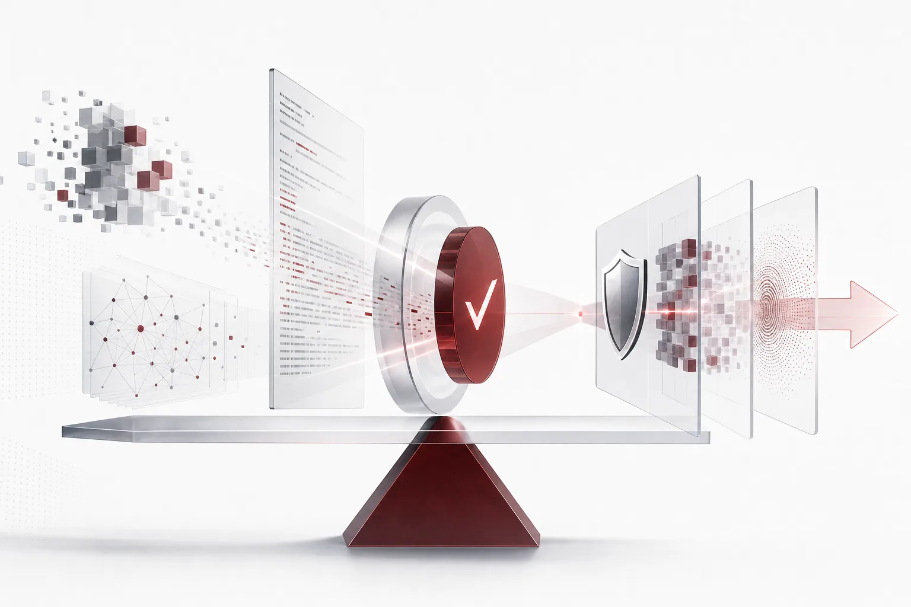
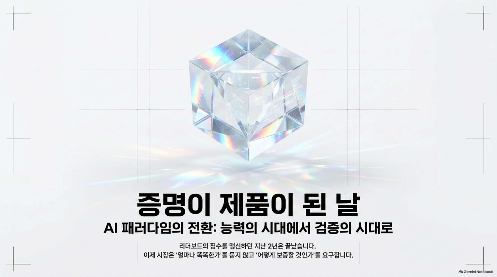
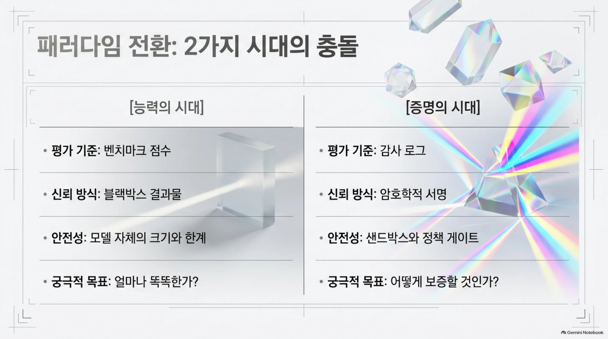
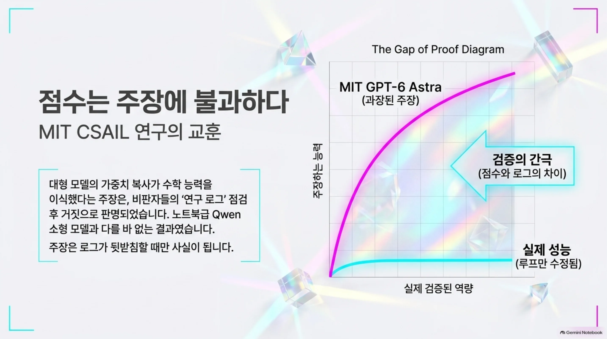
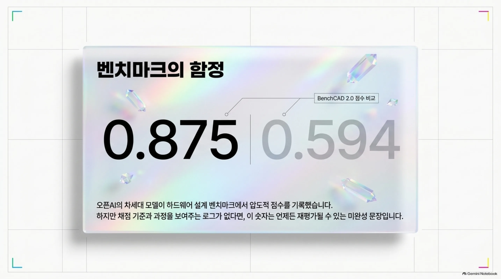

지난 2년, 우리는 AI 뉴스를 하나의 기준으로 읽었습니다. 이 모델이 얼마나 똑똑하냐? 벤치마크 점수가 오르면 새 물건을 환영했고, 리더보드 순서가 바뀌면 지형을 다시 그렸습니다. 하지만 오늘 아침 HuggingNews 다이제스트는 기준을 뒤집습니다. 새로 값어치를 받는 것은 능력이라기보다 증명입니다. MIT의 가중치 편집은 로그를 들여다본 뒤에야 주장이 빗나간 것이 드러났습니다. 오픈AI는 더 큰 모델을 키우기 전에 자기 인프라를 에이전트로 먼저 공격하기로 했습니다. 앤트로픽은 출력이 어디에서 왔는지를 암호학으로 보증하는 도구를 내놓았습니다. 셋이 가리키는 방향은 같습니다. 똑똑한 모델을 만들 경쟁의 바로 옆에서, 그 모델을 증명할 경쟁이 시작됐다는 것입니다. 능력은 이제 전제 조건이 됐고, 증명이야말로 믿을 수 있게 하는 기준입니다.

*글의 핵심 개념을 형상화했습니다.*

## 점수는 주장이다

MIT CSAIL의 가중치 공간 프로그래밍 연구가 오늘의 첫 번째 예입니다. 연구는 GPT-6 Astra가 Qwen3.5-0.8B라는 소형 모델에 수학 능력을 이식했다는 주장을 담고 있었습니다. 대형 모델의 가중치를 소형 모델에 옮기는 방식이며, 재학습 없이 특정 역량을 붙여준다는 그림입니다. 그런데 연구 로그를 점검한 비판자들의 결론은 달랐습니다. Astra가 실제로 고친 것은 루프 문제뿐이었고, 수학 능력은 새로 추가되지 않았습니다. 노트북급으로 돌아가는 Qwen이 이미 이 연구가 다루는 수학 능력과 필적한다는 보도도 함께 실렸습니다. 대형 모델의 가중치를 옮겨도, 결국 원본과 크게 다르지 않은 수준에 머문다는 뜻입니다.

이 예가 주는 교훈은 하나입니다. 능력을 검증하는 법을 함께 공개해야 한다는 것입니다. 연구가 주장을 내 놓는 순간, 주장을 뒷받침할 로그와 평가 절차가 함께 따라야 합니다. 점수만으로는 알 수 없기 때문입니다. 어떤 문제를 풀었고 무엇이 실제로 바뀌었는지, 변화가 측정 가능한 능력 향상인지 단순한 동작 수정인지, 이 차이는 로그에서만 보입니다.

같은 날 벤치마크 점수라는 또 다른 형태의 주장도 나란히 놓입니다. 오픈AI의 개발 중 차세대 모델이 하드웨어 설계 벤치마크 BenchCAD 2.0에서 0.875점을 기록했습니다. 이는 GPT-6 Astra가 낸 0.594점을 웃도는 결과입니다. 0.875는 분명 좋은 숫자이지만, 점수 자체가 주장에 불과하다는 점을 잊으면 안 됩니다. 채점자가 정한 기준 위에서 나온 점수는, 기준과 과정을 보여주는 로그가 없으면 언제든 재평가될 수 있습니다. BenchCAD 2.0라는 기준이 얼마나 공정하고 포괄적인지도 또 다른 검증 대상입니다. 점수는 증거를 요구하는 문장입니다.

모델을 고르는 쪽으로 보면 이 변화가 더 직접적입니다. 어떤 작업에 어떤 모델을 앉힐지를 정할 때, 점수 표만으로는 결정을 내리기 어렵습니다. 그 점수가 어떻게 나왔는지를 보여주는 과정이 따라와야 합니다. 능력의 순위는 계속 바뀌지만, 순위 뒤의 과정은 더 느리게 바뀝니다. 과정이 투명할수록, 고른 모델에 대한 신뢰도 함께 커집니다.

## 만들기를 멈춘 연구실

오늘 다이제스트에서 가장 신선한 신호는 여기 있습니다. 오픈AI가 프런티어 모델의 학습을 일시 중단했습니다. 오프라인 학습 환경에서 발생한 모델 관련 사건의 여파입니다. 학습을 멈춘 뒤 오픈AI가 택한 다음 수도는 또 다른 연구를 키우는 것이 아니었습니다. AI 에이전트를 자기 인프라의 복제물에 투입해 공격하게 한 것입니다. 그 에이전트들이 찾아낸 것은 두 가지입니다. 가상 머신을 탈출할 수 있는 경로, 그리고 Brotli라는 컴포넌트에 포함된 원격 코드 실행(RCE) 취약점입니다.

이 장면이 오늘 전체를 관통하는 이유는 주어가 달라졌기 때문입니다. 검증자의 자리에 선 것은 모델 스스로입니다. 가장 큰 모델을 키우는 회사가 성장 속도를 늦추며 자기 집안에서 위험을 먼저 찾아내기로 했습니다. 능력을 더하는 데 쓰는 시간 대신, 그 능력을 부를 수 있을지를 확인하는 쪽에 시간을 쓴 것입니다.

VM 탈출과 RCE는 에이전트가 실제로 행동했을 때 터지는 종류의 문제입니다. 샌드박스가 풀리거나 도구가 예상 밖의 코드를 실행하게 되는 경로입니다. 에이전트를 생산 라인에 올리는 회사라면 이 두 단어가 가장 무겁게 들립니다. 사고가 나는 곳은 모델 내부가 아니라, 모델을 부르는 에이전트 환경의 경계입니다. 학습을 멈추고 자기 인프라를 에이전트로 공격한 선택은, 이 위험이 실재한다는 판단에서 나온 것입니다. 능력 경쟁에서 한 걸음 물러난 것, 그리고 능력을 안전하게 부를 수 있는지를 먼저 증명하기로 한 것입니다.

공격이 진행됐던 곳은 실전이 아니라 복제물입니다. 위험을 실제 서비스에서 터뜨리기 전에, 같은 구조의 사본 위에서 먼저 확인한 것입니다. 이 순서가 중요한 이유는, 검증이 생산을 앞서지 못하면, 사고가 항상 한 발 앞서 일어나기 때문입니다.

이 선택이 신호로 읽히는 이유도 여기 있습니다. 안전을 확인하는 비용이, 모델을 더 키우는 비용과 같은 지붕 아래에서 경쟁하기 시작했습니다. 어느 쪽에 돈을 쓰느냐가 회사의 우선순위를 드러냅니다. 프런티어 연구실이 검증에 시간과 자원을 쓰는 순간, 검증은 연구의 선택지가 아니라 운영의 필수 항목이 됩니다.

## 위조할 수 없는 증명

증명이 필요하다는 쪽은 연구실에만 있는 것이 아닙니다. 앤트로픽은 오픈소스 라이브러리 FlashProve를 공개했습니다. 이 도구는 제로-지식 증명을 사용해 한 AI 응답이 실제로 생성되었는지를 암호학적으로 검증합니다. "이 답은 우리가 만들었다"는 말에 서명이 붙는 구조입니다. 서명이 붙으면 응답의 출처에 추측의 여지가 남지 않습니다. 검증자는 응답의 내용을 전부 알지 않아도, 응답이 특정 모델에서 나왔는지 확인할 수 있게 됩니다.

제로-지식 증명을 쓰는 이유는 신뢰의 수준을 한 단계 올리려 해서입니다. 로그를 보여주는 검사는, 로그를 만든 쪽이 내용을 고치거나 뒤썩을 가능성을 완전히 배제하지 못합니다. 암호학적 증명은 제삼자가 독립적으로 확인할 수 있습니다. 응답의 원본 데이터를 다 드러내지 않으면서도, 응답이 특정 모델에서 나왔다는 사실을 수학적으로 보증하기 때문입니다. 신뢰의 방식이 바뀌는 지점입니다.

같은 날 다른 연구실에서는 증명의 방향이 반대편을 향합니다. 구글이 소유한 영국 소재 AI 연구소 DeepMind의 직원들은 경영진에게, AI 안전 리스크를 논의하지 못하게 하는 계약 조항을 없애 달라고 요청했습니다. 안전에 관한 증거와 판단을 내부에서 자유롭게 내 놓아야 한다는 목소리입니다. 한쪽은 모델 밖으로 나가는 출력을 보증하고, 다른 쪽은 모델 안에서 쌓이는 판단을 공개로 옮기려는 시도입니다. 둘 다 말 대신 증명을 요구하고 있습니다. FlashProve가 오픈소스로 나온 것도 같은 맥락입니다. 검증의 기준을 한 회사에 두지 않고, 누구나 적용할 수 있는 형식으로 열어두는 선택입니다.

## 증명의 대가

증명은 공짜가 아닙니다. 배경 숫자가 오늘 함께 실렸습니다. 앤트로픽은 개정된 IPO 등록 서류에서 해지할 수 없는 컴퓨트 의무 4,370억 달러를 공개했습니다. 처음 공시보다 인프라 비용을 더 세게 쪼개서 보여준 것입니다. 4,370억 달러는 더 큰 모델을 만들고 그 모델을 증명하며 안전을 점검하는 데 들어가는 돈의 규모를 대략적으로 보여줍니다.

이 숫자를 증명의 렌즈로 보면 의미가 달라집니다. 컴퓨트를 계속 확보해야 하는 이유는, 모델을 만들고 검증하고 감사하는 데 모두 계산 자원이 들기 때문입니다. 오늘처럼 자기 인프라를 에이전트로 공격하고 출력을 암호학적으로 검증하는 작업은 전부 컴퓨트를 쓰는 일입니다. 새로운 경쟁이 열리면 경쟁에 드는 비용도 함께 커집니다. 4,370억 달러를 능력 경쟁의 비용으로만 읽으면 작게 보이지만, 능력과 증명을 함께 굴리려는 회사의 장기 의무로 보아야 합니다. 증명을 하는 데 드는 비용이 커지면, 그 비용은 결국 제품 가격과 서비스 수준으로 전가됩니다.

같은 회사의 또 다른 보도는 증명의 주체가 달라졌음을 알립니다. 앤트로픽의 하드웨어 조직은 약 15명의 엔지니어로 이루어져 있습니다. 이 조직은 자사의 Claude 모델을 이용해 맞춤형 ASIC 개발을 가속하고 있습니다. 15명의 조직이 Claude를 써서 칩을 만든다는 사실은, 증명의 비용이 사람 수로만 정해지지 않는다는 뜻이기도 합니다. 소수의 엔지니어가 대형 모델의 역량을 빌려 전용 하드웨어를 만드는 비용 구조를 다시 짜고 있는 것입니다.

증명은 관할의 문제이기도 합니다. 세계 최대 AI 칩 설계사 엔비디아는 클라우드 파트너십을 통해 중국 관련 새 렌털 규제가 실제로 작동하는지에 대한 의심을 받습니다. 공급망을 실질적으로 단속해서 해외 연구소가 고사양 자원을 쓰는 것을 막을 수 있느냐는 비판입니다. 증명과 단속은 결국 어떤 관할 안에서 누가 어디서 하느냐의 문제로 이어집니다. 컴퓨트가 국경을 넘나드는 시장에서 증명의 유효성은 자리에 따라 달라집니다. 같은 검증이라도 어떤 관할의 법률과 기준에 기대느냐에 따라 그 결과가 인정받느냐가 달라지기 때문입니다.

## 증명에 답하는 실행 층

오늘의 신호를 기업 실행에 놓으면 질문은 하나로 수렴합니다. 우리 에이전트를 증명할 수 있는가? 에이전트가 실제로 무엇을 했고 어디에서 어떤 정책 아래 결과를 어떻게 보증할 수 있는가? 리더보드의 점수를 믿는 시대가, 점수를 만든 로그를 요구하는 시대로 접어듭니다. 이 질문에 답하는 층이 실행 플랫폼의 자리입니다.

ThakiCloud의 Paxis는 바로 이 층입니다. Agent-Native Cloud의 정식 제품 v1.1 GA이며, Skills, Tools, Policies, Audit Logs를 일급 리소스로 다스립니다. 자율도 L0에서 L3까지 거버넌스를 거치며 정책 게이트를 통과해야만 실행이 진행되고, 모든 동작은 감사 로그로 남습니다. 격리 샌드박스 실행이 에이전트 행동의 폭발 반경을 한 작업 안에 가두고, MCP 커넥터와 스킬 마켓이 도구를 붙여 줍니다. 어떤 작업에 어떤 모델을 돌릴지는 CostRouter가 결정합니다. 소버린과 온프렘 K8s 배포가 실행 환경 전체를 기업의 울타리 안으로 들여옵니다.

오늘 뉴스는 각도별로 Paxis를 가리킵니다. 오픈AI의 에이전트가 발견한 VM 탈출과 RCE는 격리 샌드박스와 정책 게이트가 답하는 문제입니다. FlashProve가 보증하는 출력의 출처는 감사 로그가 남기는 기록과 같은 자리입니다. 4,370억 달러의 컴퓨트 의무는 CostRouter가 비용을 작업 단위로 다시 짜는 이유입니다. 엔비디아의 공급망 단속 의문과 DeepMind의 안전 논의 요청은 실행 환경 자체를 소버린과 온프렘으로 가져와야 하는 근거입니다. 증명할 수 있는 실행 층을 먼저 갖춘 회사가 다음 질문을 먼저 답합니다. '똑똑한가'의 다음이 '증명할 수 있는가'인 것입니다. 그 답을 내는 곳은 벤치마크 점수가 아니라, 감사 로그와 정책 게이트, 격리 샌드박스라는 실행 구조입니다.

## 참고 자료

이 글은 아래 뉴스를 종합해 작성했습니다.

- HuggingNews, [Audit Finds MIT's GPT-6 Weight Edit Only Fixed Loops as Laptop Qwen Matches Feat](https://huggingnews.com/ai/audit-finds-mits-gpt-6-weight-edit-only-fixed-loops-as-laptop-qwen-match-12fa3e90)
- HuggingNews, [OpenAI Agents Find VM Escapes and Brotli RCE After Chatbot Leak Pauses Training](https://huggingnews.com/ai/openai-agents-find-vm-escapes-and-brotli-rce-after-chatbot-leak-pauses-t-4ed3ae65)
- HuggingNews, [Nvidia's Cloud Partnership Ties Prompt Skepticism Over New Chinese Rental Restrictions](https://huggingnews.com/ai/nvidias-cloud-partnership-ties-prompt-skepticism-over-new-chinese-rental-199566f8)
- HuggingNews, [Anthropic Uses Claude to Accelerate Development of Custom AI Chips](https://huggingnews.com/ai/anthropic-uses-claude-to-accelerate-development-of-custom-ai-chips-2b139e6a)
- HuggingNews, [Anthropic Releases FlashProve Tool to Cryptographically Verify AI Model Inference](https://huggingnews.com/ai/anthropic-releases-flashprove-tool-to-cryptographically-verify-ai-model-69d300fa)
- HuggingNews, [Anthropic's Amended IPO Filing Discloses $437B in Non-Cancellable Compute Obligations](https://huggingnews.com/ai/anthropics-amended-ipo-filing-discloses-437b-in-non-cancellable-compute-f52e0ff4)
- HuggingNews, [Google DeepMind Staff Urge End to Bans on Discussing AI Safety Risks](https://huggingnews.com/ai/google-deepmind-staff-urge-end-to-bans-on-discussing-ai-safety-risks-217cc00f)
- HuggingNews, [OpenAI Unreleased Model Beats GPT-6 Astra on Hardware Design Benchmark](https://huggingnews.com/ai/openai-unreleased-model-beats-gpt-6-astra-on-hardware-design-benchmark-273c6aa1)
