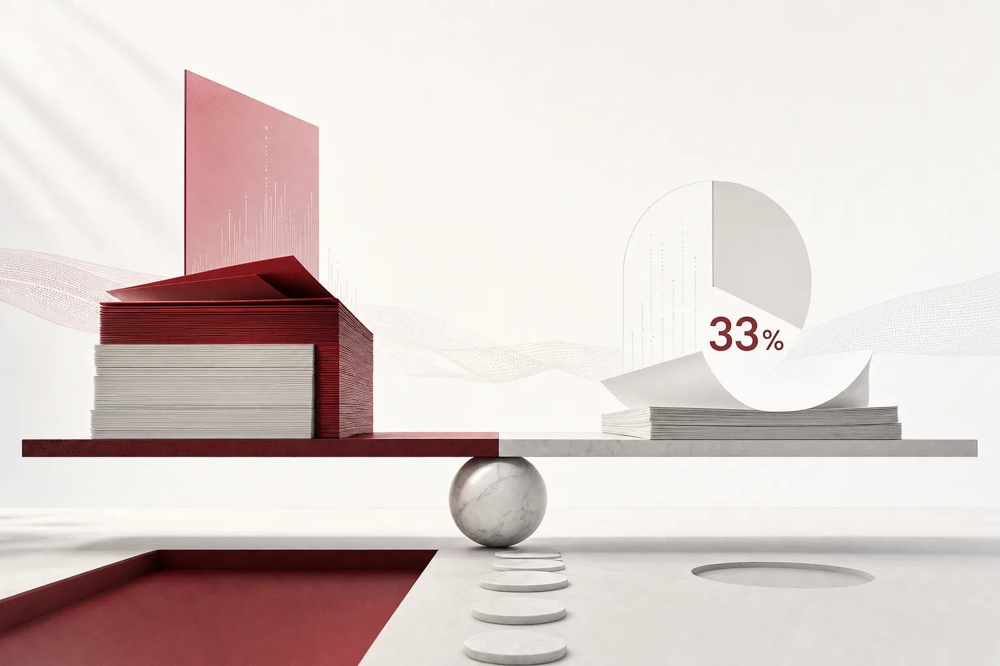

11월 5일 아침, 뉴스 다이제스트를 펼치면 아주 다른 두 개의 장부가 나란히 보입니다.

한 장부에는 8954억달러, 약 1203조원이 쓰여 있습니다. IPO를 앞둔 AI 기업 앤트로픽이 상장 신청서에 공개한 컴퓨팅 지출 약정입니다. 다른 장부는 200달러짜리. 애플이 엔지니어에게 내린 하루 AI 사용 한도가요. 전자는 '얼마나 쓸 것인가'를 적고 후자는 '얼마나 줄일 것인가'를 적지만 두 장부는 같은 산업의 같은 아침에 놓여 있습니다. 쓰기와 자르기가 동시에 보이기 시작하면, AI 이야기는 성장 투자의 서사가 아니라 장부의 서사가 됩니다. 오늘은 그 장부를 네 곳에서 펼쳐 읽습니다. 쓰는 쪽, 자르는 쪽, 그 사이에서 환율을 정하는 쪽, 그리고 이 모든 장부가 결국 내려앉는 자리까지입니다.

*글의 핵심 개념을 형상화했습니다.*

## 쓰기의 장부, 약정은 재량이 아닙니다

앤트로픽의 숫자는 규모가 남다릅니다. 9월 30일 기준 컴퓨팅 지출 약정 8954억달러, 그중 4475억달러는 2030년 말까지 지출 예정이라고 합니다. 3분기 매출은 169억6200만달러, 전년 대비 약 12배에 달하고 올해 3.5GW 이상 컴퓨팅 파워를 확보한 뒤 내년에는 두 배로 늘리겠다는 계획도 함께 실렸습니다. 그런데 기관투자자들은 기업가치를 2조달러에서 1조5000억~1조6000억달러(약 2016~2151조원)로 낮추도록 요구하고 있습니다. 블랙스톤은 IPO 이후에도 투기등급(BB+)에 머물 수 있다고 평가합니다. 같은 신청서에서는 FTC의 AI 해킹, 개인정보 관련 소환 조사 착수까지 드러났습니다. 약정이라는 숫자와 규제의 시선이 같은 장부에 함께 쓰인 셈입니다.

이 숫자에서 중요한 것은 크기가 아니라 성질입니다. 용량이 장기 계약으로 잠기면 지출은 재량이 아니라 의무가 됩니다. 수요가 흔들려도 지켜야 할 약정이야말로, 쓰는 쪽 장부의 현재형입니다.

국내 장부도 같은 방향으로 움직입니다. SKT는 미국 GPU 클러스터 기업 펭귄솔루션스의 전환우선주 20만주를 전량, SK하이닉스 증손회사 'AI Co.'에 넘겼습니다. 최종 매각대금 3억7716만달러(5066억원)로, 2024년 12월 최초 투자액 2억달러(2686억원)의 약 1.9배를 회수했지요. 그 위에 앤트로픽 보유 지분, 약 386만주(장부가액 3조5050억원, 지분율 0.2%)의 매각 가능성까지 열어두고 2029년 하반기 가동 목표의 울산 AIDC를 추진합니다. SK호라이즌은 울산, 서울에 약 180MW의 신규 데이터센터 추진을 밝혔고 2030년 이후에는 용량을 137MW에서 318MW 이상으로 키운다는 구상입니다. 같은 3분기 실적에서는 AI 데이터센터 매출 1261억원과 달리 GPUaaS 매출이 전분기 대비 7.4% 줄어든 공백이 눈에 띕니다. 단기 탄력 수요가 옅어지고 장기 계약 중심의 안정 부하로 넘어가는 사이, 일론 머스크는 스페이스X로 이동식 발전 기업 APR Energy를 약 10억달러에 사들였습니다. 발전용량을 850MW에서 1.1GW 이상으로 키우고 현장 여건에 따라 30~90일 내 설치와 가동이 가능하다고 합니다. GPU 경쟁이 'GPU를 돌리는 전기' 경쟁으로 넓어지는 장면입니다.

## 자르기의 장부, 한도는 관리입니다

쓰기의 장부가 미래의 용량을 잠그는 동안, 자르기의 장부는 지금의 소비를 다스립니다. 애플은 엔지니어의 하루 AI 사용한도를 300달러에서 200달러로, 기존 대비 33.3% 낮췄습니다. 일부 부서는 25달러 추가 삭감까지 검토 중이라고 EBN은 전했습니다. 엔지니어링 외 상당수 부서는 이미 하루 100달러 한도가 적용되어 있고, 업무상 더 필요한 직원은 고위 경영진에게 예외를 신청해야 합니다. 일부 조직에는 저가 모델, 온디바이스 모델 사용을 권유하는 수준까지 갔습니다.

그런데 같은 2026회계연도 R&D 비용은 전년 대비 32% 늘었습니다. 증가의 주원인이 AI와 인프라 지출이라는 점에서, 이 다이어트는 모순이 아니라 한 장의 장부에 동시에 올라가는 두 줄입니다. 쓰는 쪽을 키우면서 쓰는 단가는 깎는 것이지요.

한 기업의 일회성 조치가 아닙니다. 같은 보도에 따르면 마이크로소프트는 내부 AI 예산을 통제하고 있고 테슬라는 직원 AI 비용에 주당 200달러, 우버는 코딩 도구 월 1500달러 한도를 적용합니다. 코딩과 오류 수정 같은 작업은 고성능 모델이 막대한 토큰을 쓰기 때문에 개발자별 비용이 특히 크다는 것이 배경입니다. 업계가 이 흐름에 붙인 이름은 '비용 다이어트'이고, 속뜻은 더 단순합니다. 생산성 개선 효과가 충분히 증명되기 전까지는 단위 토큰 비용을 통제하며 지출 규모를 정하는 것이 핵심인 셈입니다. 한도는 예산 조치가 아니라, AI를 어디까지 쓰게 하느냐를 규칙으로 쓴 관리 행위입니다.

## 환율의 장부, 토큰당 비용이 KPI입니다

쓰는 쪽과 자르는 쪽 사이에는 환율이 있는 것입니다. 같은 일을 어떤 모델로, 어떤 칩에서, 얼마에 하는가의 문제죠.

전자신문은 'AMD 어드밴싱 AI 월드투어 서울 2026' 키노트에서 모레가 GPU 기반 AI 추론 비용 최적화 전략인 '토큰 팩토리'를 공개했다고 보도했습니다. MoAI 인퍼런스 프레임워크로 최신 오픈소스 모델을 AMD 인스팅트 MI355X에서 추론하면 엔비디아 B200 대비 2배 이상 처리량을 확보했고, 엔비디아 GPU로 프롬프트를 처리하고 AMD GPU로 응답을 생성하는 이기종 분산 추론에서는 동종 클러스터 대비 약 1.7배 처리량을 기록했습니다. 커널, 추론 엔진, 클러스터 분산 추론까지 전 계층을 직접 개발해 ROCm, vLLM, SGLang 같은 오픈소스에 기여하고 있다는 설명도 덧붙였습니다.

보도가 짚은 변화는 명확합니다. 데이터센터 사업이 AI 토큰을 생산하는 토큰 팩토리로 전환되면서, 경쟁의 기준이 GPU 보유량에서 토큰당 비용으로 이동하고 있다는 것이지요. 거의 매달 새로운 오픈소스 모델이 나오고 세대와 벤더가 다른 GPU마다 최적화가 달라지므로, 대규모 전문 엔지니어링 역량이 없는 사업자는 이 공백을 스스로 메우기 어렵습니다. AMD는 내년 서울에 실증 클러스터 구축까지 예고했습니다. '환율'을 낮추는 쪽에도 두 번째 공급자가 들어온 모양새인 셈입니다.

환율의 언어는 국내 장부에서도 열리고 있는 것입니다. SKT는 통신 가입자, AI 모델, 인프라를 연결하는 '토큰게이트' 사업을 추진 중인데, 우선 시장을 공공, 국방 등 소버린 AI로 지목했다고 합니다. 토큰이 거래의 단위로 불리는 시점에, 어떤 모델을 어느 용도로 쓰느냐는 계산이 사업 모델의 중심에 놓이기 시작한 것입니다. 토큰당 비용은 사업의 마진을 가르는 KPI가 됐고 추론 효율은 내부 최적화 항목이 아니라 제품이기도 합니다. 가격이 거래의 대상이 될 때, 가격을 낮추는 기술도 거래의 대상이 됩니다. 오늘 뉴스에서 '토큰 팩토리'가 기업 이름이 아니라 산업의 이름으로 읽히는 이유가 여기에 있습니다.

## 회계부의 장부, AI가 일의 26%를 할 때

장부는 결국 어디를 가리킵니까. 답은 다시 앤트로픽의 상장 신청서 속에 있습니다. 디지털투데이가 전한 수치에 따르면, 앤트로픽에서 AI가 수행한 R&D 업무 비중은 3월 1%에서 8월 26%로 급증했습니다. 다만 완전 자율 처리 비중은 여전히 0%라고 하지요. 공동창업자 잭 클라크는 재귀적 자기개선, RSI의 현실화 전망을 2027년으로 앞당겼고 다리오 아모데이 CEO는 통제 없이 진행되면 인간의 이해와 제어 능력을 앞질 수 있다며 신중을 주문했다. 오픈AI도 2028년 3월까지 자동화 AI '연구원' 개발을 목표로 내걸고 있다.

이 숫자의 함의는 이렇다. AI의 '일' 비중이 장부에 눈으로 보이는 속도로 커지지만 '완전 자율'은 아직 0%인 셈이다. 그러니 모든 일에는 누가 승인했고 얼마를 썼으며 근거가 무엇이었는지를 기록하고 책임질 장치가 필요하다. 장부 문제는 이제 재무팀의 지출 관리가 아니라, 일이 실제로 일어나는 실행 레이어의 공학 문제이다.

국내 현장도 이미 그 지점에 서 있다. 현대제철은 현대오토에버와 공동 개발한 사내 문서 검색, AI 에이전트 플랫폼 'Steel-X'를 11월 4일 가동했다. 임직원이 개발 지식 없이 지식 챗봇과 에이전트를 만들어 팀, 전사 단위로 공유하고 설비 이력과 운영 데이터까지 연결하는 구조이다. 사내 지식 자산화, 멀티 AI 통합 환경, 임직원 AI 플레이그라운드, 업무시스템 데이터 연계라는 4대 기능이 축이죠. 같은 날 조선일보는 경북 구미의 직원 12명 도장 공장, 제일칼라테크를 다뤘습니다. 기존 엑셀 파일만 입력하면 공장별 맞춤 생산 현황판이 생기고 월 구독료는 150만 원입니다. 집계 15~30분, 보고 정리 1시간, 하루씩 밀리던 의사결정이 실시간이 되었다고 합니다. 병원에서는 KLAS 2026 보고서가 AI 도구를 쓰는 의료진의 EHR 업무 효율 만족도가 7%p 높다는 결과를 냈고, JAMA Network Open 연구는 앰비언트 AI 도입 후 번아웃 비율이 51.9%에서 38.8%로 내려갔다고 보고했습니다. 한 HIS 기업의 진단도 같은 방향을 가리킵니다. 다양한 AI를 하나의 업무 흐름으로 통합하고 설계하는 역할 자체가 경쟁력이 된다고 이지케어텍은 말합니다.

장부는 먼 곳에 있지 않습니다. 제철소 라인, 도장 공장, 진료실에서 매일 쓰이고 읽히고 있습니다.

## 장부는 실행 레이어에서 닫힙니다

한 장을 읽은 아침, 뉴스를 하나의 렌즈로 다시 보겠습니다.

산업은 같은 장부 문제를 각기 다른 층에서 답하고 있습니다. 쓰는 쪽은 용량을 약정으로 잠그고 자르는 쪽은 한도로 다스리며 효율 쪽은 토큰당 환율을 낮추는 제품으로 대응합니다. 남는 질문은 하나입니다. 에이전트가 실제로 일하는 자리, 실행 레이어에서 장부는 어떤 형태로 유지될 것인가.

그 층이 ThakiCloud의 에이전트 네이티브 클라우드, Paxis가 쓰는 자리입니다. Paxis는 정식 제품(v1.1 GA)이고 장부를 사후에 붙이는 도구가 아니라 실행 환경 자체에서 스킬, 도구, 정책, 감사 로그를 일급 리소스로 다루는 것이다. 애플이 사람 단위로 내린 한도는, Paxis에서는 작업 단위로 자동으로 적용되는 정책 게이트가 됩니다. 자율도(L0~L3) 거버넌스가 에이전트가 혼자서까지 갈 수 있는 경계를 정하고, 토큰의 환율이 변하면 작업별 모델 선택(CostRouter)이 업무에 맞는 비용과 성능의 모델을 골라내는 셈입니다. 앤트로픽의 R&D 비중이 26%까지 올랐다면, 그 26%의 모든 일은 격리 샌드박스에서 실행되고 감사 로그에 남아야 하는 것입니다. 승인 근거와 결과가 언제나 추적 가능해야 하니까요. MCP 커넥터와 스킬 마켓, 소버린, 온프레미스 K8s(ai-platform) 배포 옵션은 장부를 폐쇄망 안에 두어야 하는 고객을 위한 문입니다.

두 장부가 나란히 놓인 아침이 말해주는 것은 이것인 셈. AI가 장부가 된 시대의 경쟁은, 더 쓰는 기업과 더 자르는 기업 사이가 아닙니다. 한 일, 한 토큰, 한 승인씩을 재고 그 기록을 지킬 수 있는 실행 레이어를 가진 곳의 경쟁이기도 합니다. 장부는 이미 제철소와 병원의 현장에 도착했습니다. 남는 선택은 하나, 그 장부를 손으로 적을 것인가, 실행 환경 자체가 회계사가 될 것인가입니다.

## 참고 자료

이 글은 아래 뉴스를 종합해 작성했습니다.

- 전자신문, [모레, '토큰 팩토리'로 GPU 기반 AI 추론 비용 최적화 지원](https://www.etnews.com/20261105000012)
- 머니투데이방송, [SKT, ‘울산 AIDC 2029년 하반기 가동 목표’…앤트로픽 지분 매각 가능성도](https://news.mtn.co.kr/article/2026110417000810970)
- 아시아경제, [아이폰 시리 AI의 한계…카톡·네이버 앞에선 무용지물](https://view.asiae.co.kr/article/2026110316563510299)
- 머니투데이, [로봇이 배울 '세상' 만든다…엔비디아 눈길 사로잡은 韓 3D 기업](https://www.mt.co.kr/future/2026/11/05/2026102016523357821)
- 비건뉴스, [현대제철, 사내 문서 검색·AI 에이전트 플랫폼 열어](https://www.vegannews.co.kr/news/article.html?no=400735)
- 전자신문, [[AI하스피탈 인사이트] AI 연결을 넘어 병원 업무의 통합으로](https://www.etnews.com/20261104000486)
- CBC뉴스, [[기업家] 앤트로픽 ②｜ 초대형 IPO 눈앞…천문학적 인프라 투자·규제](https://www.cbci.co.kr/news/articleView.html?idxno=623195)
- 더벨, [[더벨]SKT, 펭귄솔루션스 지분 전량 양도 'AI 투자 재편'](https://www.thebell.co.kr/free/content/ArticleView.asp?key=202611031058378560107271)
- 이코노미사이언스, [일론 머스크, AI 전력난에 발전회사까지 인수…GPU 넘어 전기 확보 경쟁](https://www.e-science.co.kr/news/articleView.html?idxno=138510)
- EBN, [AI 확대 외친 애플, 직원 사용료는 33% 삭감…빅테크 '비용 다이어트'](https://www.ebn.co.kr/news/articleView.html?idxno=1730513)
- CEO스코어데일리, [SKT, ‘해킹 악몽’ 1년 만에 벗었다…“가입자·실적 정상 복귀, AI 인프라”](https://www.ceoscoredaily.com/page/view/2026110413003093182)

