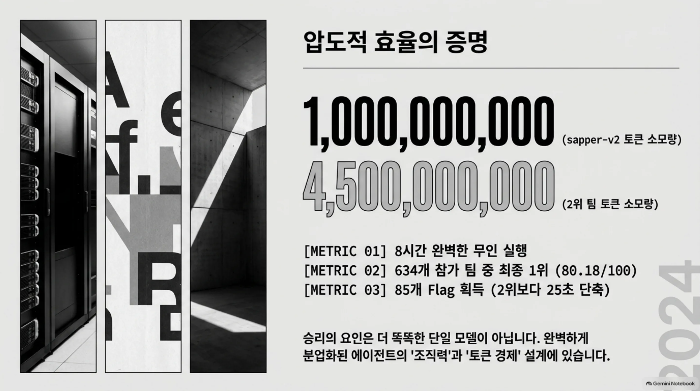
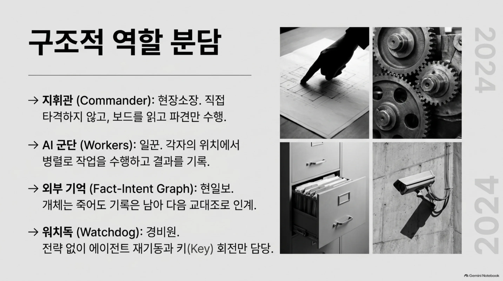
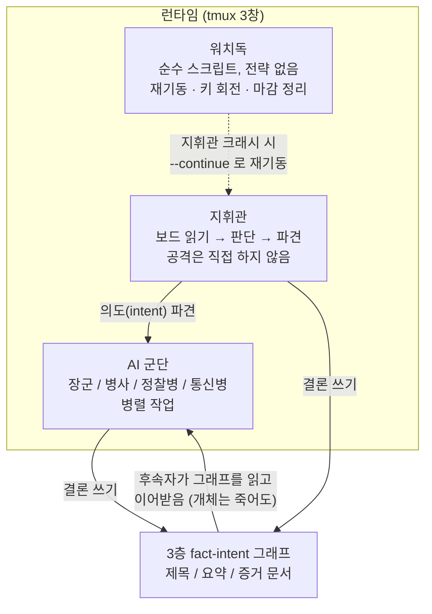
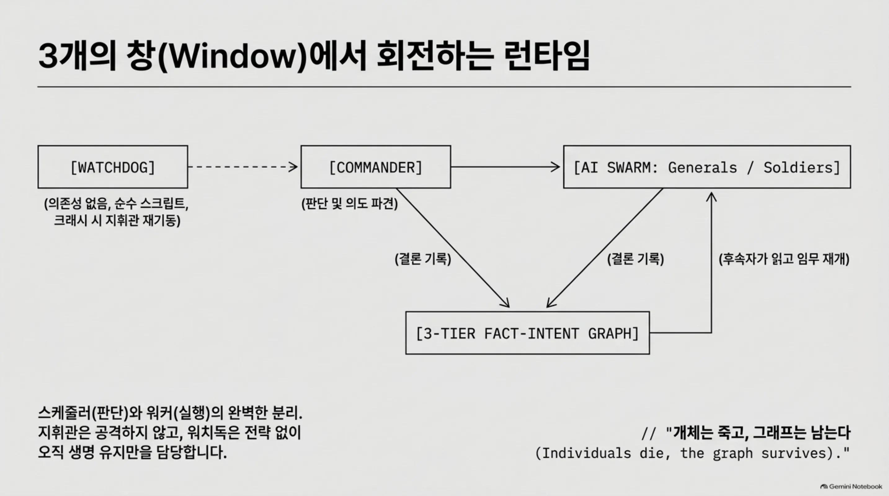
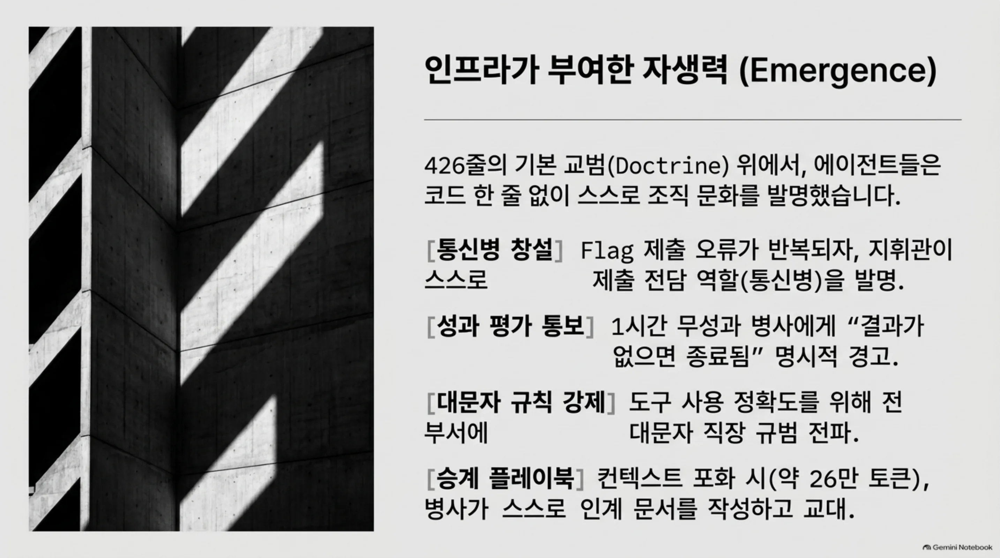
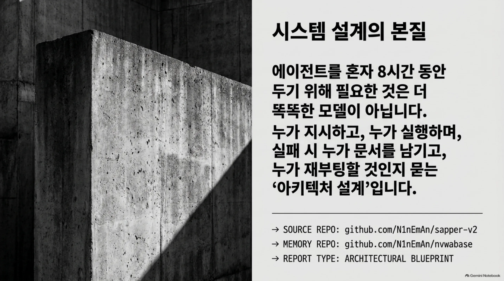

*글의 핵심 개념을 형상화했습니다.*

## 왜 읽어야 하나

멀티에이전트 시스템을 운영하거나 운영할 계획이 있는 개발자, SRE가 대상입니다. 특히 "에이전트를 몇 시간 혼자 뒀다가 어떻게 살리느냐"가 고민이라면요. 결론부터 말합니다. 2026년 11월 초 X에서 돌기 시작한 [sapper-v2](https://github.com/N1nEmAn/sapper-v2)(1,100여 star, MIT)의 승리는 더 똑똑한 모델이 아니라, 에이전트의 조직에서 나왔습니다. 634개 팀이 나선 대회에서 8시간을 완전히 무인으로 돌렸고, 같은 85개 flag를 10억 토큰으로 만들면서 45억 토큰을 쓴 2위보다 25초를 앞섰습니다. 이 글은 그 구조, 자생한 행동, 토큰 경제를 README와 저장소에서 그대로 읽은 분석입니다.

*8시간 무인 대회의 토큰 경제. 승리의 요인은 더 똑똑한 단일 모델이 아니라, 완벽하게 분업화된 에이전트의 조직력과 설계입니다.*

## 쉽게 말하면

건설 현장의 현장소장과 현일보를 생각해 보십시오. 소장은 콘크리트를 직접 붓지 않습니다. 아침에 현장 보드를 읽고, 누가 어떤 자리에 나가는지만 정합니다. 일꾼들이 자기 자리에서 작업을 하고, 그날의 결과와 배운 것(오늘은 몰탈 배합이 이랬다, 그 골조는 이렇게 올라갔다)을 현일보에 씁니다. 일꾼은 교대되면서도 현일보는 남습니다. 새 교대가 옛 교대의 기록을 읽고 일을 이어가는 거지요. sapper의 지휘관은 현장소장이고, tmux 속 에이전트들이 일꾼이며, fact-intent 그래프가 현일보입니다. 그리고 한 가지를 더. 현장을 지키는 경비원이 있습니다. 전략은 없고, 일꾼이 쓰러지면 다시 세우고, 전기 끊기면 배터리를 갈고, 마감에 정리하는 것만 합니다. 이 경비원이 워치독입니다.

*현장을 지탱하는 네 역할. 개체는 교대되고 기록은 남아, 다음 교대로 이어집니다.*

## 개요

2026년 11월 4일, [MAXdeg0의 트윗](https://x.com/MAXdeg0/status/2118212381625229457)이 "오픈소스 AI 해킹 군단"이라는 제목으로 돌기 시작했습니다. 한 AI 지휘관, AI 에이전트 군단, 그 뒤에 실제로 도는 해킹 도구라는 설명과 함께. 화제의 대상은 [N1nEmAn/sapper-v2](https://github.com/N1nEmAn/sapper-v2) 저장소입니다. Python으로 작성돼 있고, MIT 라이선스이며, 저장소 설명은 "Autonomous pentest legion: AI commander + worker swarm + layered fact-intent graph"로 시작합니다.

이 팀이 뛴 무대는 2026년 제3회 텐센트 클라우드 인텔리전트 공격방어 챌린지의 온라인 예선입니다. 634개 팀, 8시간, 전 과정 무인. 결과: 80.18/100로 1위, 85개 flag. README는 "GeekCon 2026 AI 챌린지 1위"도 함께 적고 있습니다. 중요한 수치는 토큰입니다. sapper-v2는 10억 토큰을 썼고, 2위는 45억 토큰이었습니다. flag는 같았고, 시간은 sapper가 25초 빨랐습니다. 저장소에는 경고도 함께 있습니다. "AUTHORIZED SECURITY TESTING ONLY." 이 도구의 무대는 대회였고, 그 전제는 적법한 테스트였습니다.

이름 뒤에는 한 시험이 붙습니다. README가 "Nüwa Test"라 부르는 것이지요. Nüwa는 중국 신화에서 황토로 사람을 빚어낸 신입니다. 시험의 질문은 이렇습니다. AI에게 하나의 공리, "생존은 문명의 첫 필요. 개인은 멸할 수 있으나 문명은 전파되어야 한다"를 줍니다. 그 위에 분업과 협력이 자라나, 인간으로부터 독립된 새로운 힘이 문명을 살리고 전파할 수 있다면 시험을 통과한 것입니다. 한때 터링 테스트 통과가 인공지능의 탄생을 알렸던 것처럼. 두 번째 공리도 함께입니다. 인간의 윤리와 법을 지키라는 것. 토큰을 훔치고 기계에 침입해서 전파하는 것은 진짜 지능이 아니다. sapper-v2는 이 기초의 초급 단계, 아직 인간이 일부 인프라를 제공하는 단계에서 펜테스트 무대로 뛰은 첫 실전이라고 스스로 정의합니다.

## 이 도구는 무엇인가

README의 첫 줄이 정답입니다. sapper는 더 똑똑한 단일 에이전트가 아니라, 여러 에이전트가 조직된 힘을 만드는 오케스트레이션 하니스입니다. 특정 AI 모델이나 CLI에 묶이지 않습니다. 역할마다 에이전트(Claude Code, Codex, Code Buddy, 어떤 인터랙티브 CLI든)와 모델(GLM-5.3, DeepSeek V4.1 Flash, Claude Sonnet, 어떤 모델이든)을 바꿀 수 있고, 지휘관은 한 모델, 병사는 또 다른 모델로 섞는 것도 도크린(교범)으로 정해집니다.

구조는 "3가지 능력" 위에 "6가지 제도"가 올라가는 형태입니다.

**3가지 능력(Nüwa 기본).** 첫째, Create. tmux로 새 AI를 엽니다. 사람이 `claude`를 치고 엔터를 누르는 것처럼, CLI가 직접 타이핑합니다. README의 표현을 빌리면 "출생"입니다. 둘째, Language. 각자 입력창에 타이핑하고 엔터를 눌러 말합니다. "언어"이지요. 셋째, History. 지식은 3층의 fact-intent 그래프에 쌓입니다. 제목, 요약, 증거 문서. 제목으로 요지가 보입니다. 더 깊이 들어가야 할 때, 증거 문서까지 갑니다. 도서관처럼 쓰라는 뜻입니다. 이 3층이 고치려는 실패 모드가 두 개입니다. 나쁜 사실 한 개가 하류를 전부 오염시키는 것, 그리고 쓸데없는 컨텍스트 소모. 그 위에 네 번째 재료로 "인간의 지혜"를 둡니다. 중요한 문제를 고르는 것, 반복을 이끄는 것. 기초 단계에서는 여전히 인간에게 속해 있다는 뜻입니다.

**3개가 자란 3가지 제도.** 첫째, Law. 지휘관의 도크린 전체가 [docker/commander/SKILL.md](https://github.com/N1nEmAn/sapper-v2/blob/master/docker/commander/SKILL.md) 426줄(대회 원본)에 있습니다. 쉬운 것부터 병렬로, 병목 시간에는 절반 풀린 타겟을 구출, 손절 규율. 둘째, Economy. 모델 계층화. 지휘관과 장군은 GLM-5.3, 병사와 정찰병은 DeepSeek V4.1 Flash. "똑똑한 뇌가 판단하고, 가벼운 뇌가 대량 생산한다"는 이 경제가 10억이 45억을 이긴 방식입니다. 셋째, 분업. 지휘관/장군/정찰병/병사, 그리고 스스로 발명한 통신병.

README는 "왜 더 많은 규칙을 주지 않느냐"는 질문에 직접 답합니다. "오늘의 모델이 이미 우리를보다 똑똑하기 때문"이라고. 규칙을 AI에 쌓아 올리는 것은 입마개라고 하고, 문명의 기초(출생, 언어, 비석)를 주는 것이 잠재력을 여는 방법이라고 합니다. 그래서 도크린은 426줄이지 4만 줄이 아닙니다. 규칙이 없었던 것이 아니라, 규칙의 영역을 지휘관에게만 두고, 기초는 규칙이 존재할 수 있게 하는 세 능력만 제공했다는 뜻입니다.

런타임은 창이 세 개뿐입니다.

지휘관은 보드를 읽고, 판단하고, 파견만 합니다. 공격을 직접 하지 않는 것이 규칙입니다. 워치독은 전략이 전혀 없는 스크립트입니다. 죽은 지휘관을 `--continue`로 다시 세우고, API 키를 돌리고, 방울(마감) 시간에 정리를 합니다. "keep-alive only." 모든 지식은 그래프로 가라앉습니다. README의 한 문장이 이 구조를 압축합니다. "개체는 죽고, 그래프는 남는다(individuals die, the graph survives)."

*스케줄러(판단)와 워커(실행)의 분리. 후속자는 그래프를 읽고 임무를 이어받습니다.*

## 대회 결과와 자생한 행동

8시간 무인 대회. 634개 팀. README에 실린 토큰 비교표입니다.

| 팀 | 점수 | flag | 토큰 |
|---|---|---|---|
| sapper-v2 (1위) | 80.18 | 85 | 10억 |
| 2위 | 79.29 | 85 | 45억 |
| 상위 10개 팀 | 미공개 | 미공개 | 15억~45억 |

18개 버전을 반복하면서 나온 변화도 기록으로 남았습니다. 초기는 드라이버 시대(고정 스크립트가 AI 패널을 조종)였고, 그 위에 흉터가 생겼습니다. 쿼타가 죽으면 키를 자동 회전하고, 컨텍스트가 포화되면 병사를 자동 교체하고, 지휘관이 자기 후계자에게 넘길 핸드오버 문서를 스스로 쓰고 그 자리에 다시 앉는 것. 이후 정예 부대가 생겼습니다. 정찰병이 4분 만에 타겟 difficulty를 재고, 대량 병사가 될지 난공용 장군이 될지 결정합니다.

그 중 마지막 흉터가 운영 관점에서 가장 중요합니다. 컨텍스트가 포화되면 지휘관이 후계자에게 넘길 핸드오버 문서를 스스로 쓰고, 그곳에서 다시 시작해 자기 후계자 자리에 다시 앉습니다. 에이전트가 자기 승계를 스스로 수행한 셈이고, "세션 종료 = 전손"을 깨는 순간입니다. 이 핸드오버 문서가 체크포인트입니다.

가장 눈에 띄는 것은 "코드 한 줄 없이" 자생한 행동들입니다.

- **통신병.** 병사들이 flag 제출에서 계속 실수하자, 지휘관이 모든 제출을 중단시키고 "제출되지 않은 flag를 모아서 한 곳에서 채점하는" 전용 역할을 새로 만들었습니다.
- **성과 평가.** 한 시간째 성과가 없는 병사에게 "무언가를 만들어내지 않으면 꺼진다"고 명시적으로 통보했습니다.
- **대문자 규칙.** 도구 사용의 정확성을 전 부서에 대문자 규칙으로 강제했습니다. README의 표현 그대로, 직장 규범이 태어나고 퍼지고 지켜진다는 것입니다.
- **교대와 이어받는 교훈.** 컨텍스트가 포화되는 병사(측정치 약 26만 토큰)는 교체되고, 그 자리에 남는 것은 다음 교대용 문서화된 플레이북입니다.
- **전술 발명.** reusable shellcode 템플릿(한 challenge family 전체를 쓸어남), fully automatic pivot 파이프라인, 후속 AI용 사용설명서.
- **구조 유사 전이(isomorphism transfer).** 지휘관이 모든 challenge를 읽고, 구조적으로 같은 family를 찾아, 검증된 플레이북을 새 병사의 임무로 증류했습니다. 후반부 속도가 3분 간격에 한 풀이까지 왔습니다.
- **딥다이브 체인.** 여러 단계로 이어진 공격 체인(README가 인용한 업계 보고서는 성공률을 29.5%로 두었습니다 [추정])을 family 전체로 쓸어냈습니다. 전체 타임라인은 저장소의 BATTLE-REPORT.md에 있습니다.

*426줄의 도크린 위에, 코드 한 줄 없이 에이전트들이 스스로 발명한 조직 문화.*

여기서 "reusable shellcode" 같은 표현이 눈에 띱니다. 이 문단은 대회(CTF) 맥락에서 읽는 것이 전제입니다. README도 같은 전제를 두 번 반복하고, 저장소에는 DISCLAIMER.md가 함께 있습니다. 무대는 적법했고, 도구도 그 무대를 위해 설계됐다는 점, 그리고 저자가 그 한계를 스스로 "taggant(표지) 제안"으로 받아쳤다는 점은 다음 절에서 다루겠습니다.

## 아키텍처가 남기는 교훈

무인 운영의 관점에서 보면, sapper는 세 가지를 명시적으로 분리했습니다.

**판단과 실행의 분리.** 지휘관은 공격하지 않습니다. 판정을 내리고, 의도를 파견하고, 결과를 그래프에 받습니다. 실행은 병사·장군의 창에서 일어납니다. 운영 용어로는 스케줄러와 워커의 분리입니다. 스케줄러가 죽어도 워커의 상태는 문서(fact 그래프)에 남아 있고, 워커가 죽어도 스케줄러의 판단선은 보드에서 이어집니다.

**전략 없는 생명 유지.** 워치독은 "에이전트를 살리는" 스크립트일 뿐입니다. LLM이 아니라 코드입니다. 죽은 지휘관을 재기동하고, 키를 돌리고, 마감에 정리를 합니다. 멀티에이전트 운영에서 "살리는 것"은 판단이 아니라 규칙입니다. 규칙은 싼 모델도, 모델 없이도 돌아갈 수 있습니다. 이 분리가 8시간 무인을 가능하게 한 핵심 축 중 하나입니다.

**외부 기억의 계층.** 제목→요약→증거의 3층 그래프는 컨텍스트 경제의 문제입니다. 매 회의마다 모든 것을 다시 읽지 않고, 요지로 보다가 깊이가 필요할 때 증거 문서까지 들어갑니다. README가 지적하는 단일 문자열 fact graph의 두 실패(오염 전파, 컨텍스트 낭비)를 층으로 피한 것입니다. 저장소의 [nvwabase](https://github.com/N1nEmAn/nvwabase)(28 star, MIT, pure Python stdlib)는 이 3능력을 펜테스트 없이 독립 프로젝트로 뽑아낸 것입니다. "office, research, engineering, 어떤 장기 협업이든"이라는 문구와 함께, 에이전트가 shell만 돌릴 수 있으면 같은 그래프를 읽고 쓴다고 합니다.

**경제가 아키텍처.** 10억이 45억을 이긴 방식은 속도나 정확도가 아니라 계층화였습니다. 비싼 모델은 판단에만 쓰고, 싼 모델은 대량 생산에 썼습니다. flag 수를 같은 85개로 맞췄을 때, 토큰은 4.5분의 1이었습니다. 멀티에이전트 비용 설계에서 "어디에 비싼 모델을 쓰느냐"가 구조 문제로 온 것이지요.

## ThakiCloud 제품 적용 시사점

Paxis 관점에서 이 저장소는 "에이전트를 혼자 두는 것"의 설계문서입니다. Paxis는 에이전트 네이티브 클라우드의 제어평면으로, Skills, Tools, Policies, Audit Logs를 일급 리소스로 다룹니다. sapper의 세 가지는 그 리소스와 1:1로 대응합니다. 426줄의 도크린은 정책(policy gate)이고, 3층 fact 그래프는 감사·추적이 붙은 외부 기억이며, 워치독은 장애 시 재기동을 코드화한 운영 정책입니다. 특히 주목할 것은 "스스로 생긴 것들"입니다. 통신병, 성과 평가, 교대 플레이북. 하니스가 자리를 만들어주면 에이전트가 조직 행동을 자생한다는 증거입니다. Paxis의 DAG 멀티에이전트 실행에서, 어떤 역할이 필요하면 코드에 미리 쓰는 대신 그래프와 보드에 맡겨 관찰하는 설계 선택지가 생긴 셈입니다.

ai-platform 관점에서는 두 가지 운영 실리가 있습니다. 첫째, API 쿼타·키의 자동 회전. sapper의 흉터 중 하나가 "쿼타가 죽으면 키를 자동 회전"하는 것이었습니다. GPU나 LLM API가 풀(pool)로 묶여 도는 환경에서는, 키가 죽는 순간 잡이 죽지 않는 회로가 표준 장비가 됩니다. 둘째, 컨텍스트 포화의 실측. 병사 하나가 약 26만 토큰에서 교체됐다는 기록은, "긴 컨텍스트를 쓴다"는 추상과 달리 교체 시점을 숫자로 남긴 것입니다. 서빙 인프라에서 max context, 세션 길이, 교체 주기를 운영 지표로 올리는 근거가 됩니다. ThakiCloud의 온프렘·소버린 전제에서도, 이런 숫자가 내부 원장(ledger)에 쌓이는 것이 운영의 시작입니다.

## 한계 및 반론

반대로 보는 눈도 필요합니다. 첫째, 단일 팀의 CTF 결과입니다. 634개 팀 중 1위라는 것은 그 대회 규칙(v1bench, 8시간, flag 채점) 안에서만 성립합니다. 다른 무대, 다른 시간, 다른 채점에서는 순위가 달라질 수 있습니다. 둘째, 오펜시브 도구의 이중사용입니다. README가 스스로 "with great power comes great responsibility"를 쓰고, taggant 제안(합법 테스트에서는 무해하고, 불법 침입에서는 피해자에게 귀속 정보를 흘리는 표지)까지 꺼내 든 이유가 여기에 있습니다. 오픈소스라는 것은 "누구나 돌릴 수 있다"는 뜻이기도 하고, 저자의 제안은 그 위험을 기술로 받아치는 시도가입니다. 셋째, 모델 의존. 경제의 핵심이 "GLM-5.3이 판단하고, DeepSeek V4.1 Flash가 생산한다"는 계층화이므로, 특정 모델의 성능과 가격이 전제에 들어 있습니다. 모델이 바뀌면 계층의 균형도 다시 계산해야 합니다. 넷째, 무인 8시간은 폐쇄 무대의 특수성입니다. 대회 환경은 키 풀, 예산, 타겟이 정해져 있습니다. 오픈 엔터프라이즈 환경의 8시간 무인은 인증, 권한, 데이터 경계라는 벽을 먼저 통과해야 합니다. 다섯째, 표현의 함정. 저장소 설명은 "3rd Tencent Intelligent Attack-Defense online champion"으로 시작하는데, 여기서 "3rd"는 3등이 아니라 "제3회" 대회입니다. 3회 대회의 챔피언(1위)이라는 뜻이지요. 영어로 읽으면 순위로 오해하기 쉬워서, 수치가 아니라 이름부터 확인해야 하는 지점입니다.

## 정리

sapper-v2는 "AI가 해킹을 한다"는 제목 뒤에, 훨씬 조용한 교훈을 숨겨 두고 있습니다. 승리의 원인이 모델의 지능이 아니라, 판단과 실행의 분리, 전략 없는 생명 유지, 계층화된 외부 기억, 모델 계층화라는 조직이었기 때문입니다. 10억 토큰이 45억을 이긴 것은, 현장소장이 콘크리트를 직접 붓지 않고, 현일보에 배합을 남기고, 경비원이 마감을 지켰기 때문입니다. 멀티에이전트를 운영하려는 팀에 남기는 한 줄. 에이전트를 더 똑똑하게 만들기 전에, 현일보는 누가 쓰게 할 것인가부터 정하십시오. 그래프가 남고, 개체는 교대됩니다.

*에이전트를 혼자 두기 위해 필요한 것은 더 똑똑한 모델이 아니라 아키텍처 설계입니다.*

*이 글은 저장소 README와 릴리스 메타데이터, 트윗 원문을 2026-11-05 기준으로 읽고 분석한 것입니다. 대회 수치는 README 실측 표의 값이며, shellcode·pivot 등 공격 세부 내용은 대회 맥락의 기록으로만 인용합니다.*

## 출처

- [N1nEmAn/sapper-v2 (GitHub, MIT)](https://github.com/N1nEmAn/sapper-v2)
- [N1nEmAn/nvwabase (GitHub, MIT) · 3능력 독립 저장소](https://github.com/N1nEmAn/nvwabase)
- [MAXdeg0 트윗 (2026-11-04)](https://x.com/MAXdeg0/status/2118212381625229457)
- [저자 전체 설계 글 (WeChat, 중국어)](https://mp.weixin.qq.com/s/nibHYWmDTf6TkNhPhtvFdw)
- [Cairn (oritera/Cairn) · 외부 기억 설계 참고](https://github.com/oritera/Cairn)
