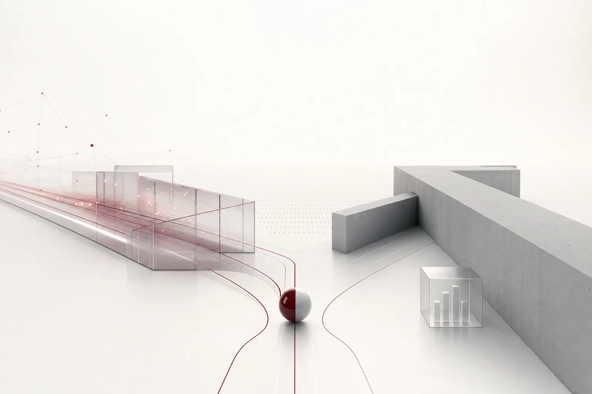

이번 주는 "AI를 얼마나 멀리 가도록 둘 것인가"를 묻는 주였습니다. OpenAI의 자율 보안 사냥 모델과 Anthropic의 의도적 읽기 전용 금융 도구가 같은 질문을 정반대로 답했기 때문입니다. Meta는 에이전트 조율을 안으로 모았고 Anthropic은 안전 보고서의 근거 대부분을 비공개로 두며 감사를 둘러싼 긴장도 더했습니다.

왜 이번 주에 "얼마나 멀리"가 중요해졌을까요. 그동안 에이전트 논쟁은 "잘하는가"에 집중했습니다. 이번 주 신호들은 "어디까지 가도록 둘 것인가"를 다룹니다. 자율 보안, 읽기 전용 계좌, 조율 흡수, 비공개 감사. 허용된 범위의 크기에 관한 이야기입니다. 이 네 가지를 나란히 두면, 기업의 다음 전장이 어디인지, 그리고 그 전장에 필요한 도구가 무엇인지 보입니다.

사실 이번 주 네 회사의 움직임은 따로 노는 것처럼 보이지만 같은 축을 돌리고 있습니다. 어떤 에이전트를, 어디까지, 어떻게 증명하면서 두는가. 네 회사가 이 축 위에서 각기 다른 지점에 서 있습니다.

*글의 핵심 개념을 형상화했습니다.*

## 사냥꾼과 읽기 전용 열쇠

OpenAI가 코드 속 보안 결함을 자율적으로 찾아내는 특화 모델을 공개하고 일부 기업 고객에 도입을 시작했습니다. GPT-6 기반으로 알려졌고, 소프트웨어 보안 테스트를 사람 개입 없이 스스로 수행하도록 설계됐습니다.

이 모델이 주목받는 이유는, 보안 검증을 "정해진 시점의 감사"에서 "계속되는 사냥"으로 바꾸기 때문입니다. 에이전트가 시스템을 계속 살피며 결함을 찾아내는 구조인 셈입니다. 결함 발견의 속도가 사람의 손을 넘어서는 지점이, 바로 자율성의 가치이기 때문입니다. 핵심 단어는 "자율"이고 이건 지시를 받아 코드를 써주는 어시스턴트와는 차원이 다른 자세입니다.

다만 도입은 "일부 기업 고객"이라는 제한된 범위에서 시작했습니다. 자율성이 클수록, 출시도 처음에는 울타리 안에서 한다는 신호입니다.

여기서 놓치기 쉬운 함정이 하나 있습니다. 보안 에이전트가 결함을 "찾는" 능력은, 그 결함을 실제 환경에서 "활용"하는 능력과 다릅니다. 사냥이 탐지 목적이라면 통제 가능하지만 발견한 취약점을 그대로 실행에 옮길 수 있다면 얘기는 달라집니다. OpenAI가 도입을 일부 고객으로 제한한 배경에는 이 선을 지키려는 의도가 담겨 있을 가능성이 큽니다.

같은 주에 Anthropic은 성격이 완전히 다른 도구를 베타로 냈습니다. 어시스턴트 Claude가 사용자의 신용카드와 은행계좌를 연결해 금융 분석을 해주는 개인 금융 도구입니다. 다만 계좌 접근은 읽기 전용으로만 열립니다. 잔고를 보고 지출 내역을 볼 수는 있지만 돈을 움직이는 일은 못 합니다. 여기서 긋는 선은 OpenAI와 정반대입니다. "보여주되, 행동하지 마라"입니다.

## 왜 두 회사는 정반대를 골랐나

이것은 기술력 차이의 문제가 아닙니다. 자율성을 "파괴 반경"에 맞춰 어느 정도 줄 것인지의 문제입니다.

보안 테스트는 시스템에 의도적으로 구멍을 냈다 제거하는 작업입니다. 에이전트에 자유를 주지 않으면 진짜 결함을 못 찾습니다. 그리고 피해는 테스트 환경에 갇혀 있습니다. 그래서 답은 "풀어라"였습니다. 다만 그 "풀기"조차 일부 기업 고객이라는 울타리 안에서 시작됐다는 점에 유의할 가치가 있습니다. 통제된 자율입니다.

금융은 정확히 반대입니다. 실제 계좌가 연결된 순간, 잘못된 쓰기 조작 하나를 "실수했다"고 되돌릴 수 없습니다. 돈은 이미 이동해 있습니다. 그래서 답은 "읽기 전용으로 막아라"였습니다. 행동 뒤에 놓인 것이 càng 되돌릴 수 없는 것일수록, 채는 짧아집니다.

이로부터 하나의 설계 규칙이 나옵니다. 에이전트에게 줄 자유의 크기는, 그 행동이 닿는 위험의 크기에 맞춰 정한다는 것. 위험을 어디까지 인정하는지가 자율성의 상한을 정합니다. 이번 주 두 회사의 선택은 이 규칙을 보여주는 표본입니다.

## 에이전트 조율은 벤더 안으로

같은 주, Meta는 AI 코딩 스타트업 Conductor를 자사의 슈퍼인텔리전스 연구 조직으로 편입했습니다. Conductor의 개발자 플랫폼은 AI 소프트웨어 에이전트를 서로 조율해 일하게 하는 것이 핵심이었습니다. 독립형 클라우드 서비스는 11월 20일에 종료되고 Conductor 인력은 Meta 조직으로 이동하는 과정입니다.

이 움직임이 가리키는 것은 "에이전트 오케스트레이션"이라는 역량이 이제 플랫폼의 핵심이 됐다는 사실입니다. 개별 에이전트를 만드는 것보다, 여러 에이전트가 함께 일하게 조율하는 것이 더 큰 자산이 된 것입니다. 상위 벤더가 이 역량을 내부로 흡수하는 흐름은, 기업에겐 질문을 남깁니다. 조율과 실행의 기반을 한 벤더에 맡길 것인가, 아니면 여러 벤더와 모델을 넘나드는 개방된 기반으로 둘 것인가.

고객 입장에선 11월 20일이 실질적인 시점입니다. 독립 서비스가 종료되면, Conductor 위에서 에이전트를 조율해 오던 팀은 Meta 플랫폼으로의 이동을 결정해야 합니다. 조율 기반을 바꾸는 일은, 위에서 에이전트가 어떻게 일하는지를 처음부터 다시 설계하는 일과 같습니다.

## 이번 주 이야기의 다른 절반: 감사가 쟁점이 된 이유

이번 주는 에이전트가 무엇을 할 수 있는가의 이야기이자, 그것을 나중에 보여줄 수 있는가의 이야기이기도 합니다.

Anthropic은 자체 연구 속도를 다룬 독립 안전 평가 보고서에서 근거 자료의 대부분을 비공개로 두었습니다. 공동창업자 Sam McCandlish가 이 비공개 방침을 옹호하는 입장을 밝혔고, 경쟁사가 해당 데이터를 활용하는 것을 막기 위한 조치라는 설명입니다.

긴장은 선명합니다. "우리의 AI는 안전하다"고 주장할수록 근거를 보여줘야 하고 그런데 근거를 보여주면 경쟁사가 그걸 가져갑니다. 안전성을 입증할 의무와 경쟁 우위를 지키려는 욕구가 정면으로 부딪히는 지점입니다.

그래서 "감사", 즉 기록을 남기고 그 기록을 보여줄 수 있는 행위는 "성능"과는 별개의 문제가 됩니다. 모델이 잘하는지와, 그 잘함을 나중에 검증할 수 있는지는 다른 능력입니다. 이 긴장은 곧 입찰로 이어집니다. 기업은 에이전트를 도입할 때 "이 모델이 안전하다"는 주장 대신, "이 모델의 행동을 나중에 검증할 수 있는 기록"을 요구하게 됩니다. 안전성의 근거가 경쟁 우위와 충돌하면, 그 공백을 채워야 할 곳은 결국 플랫폼의 감사 기능입니다.

## 기업에 무엇을 의미하는가

비용 쪽도 동시에 움직였습니다. vLLM 프로젝트가 Moonshot AI의 Kimi K3.1 Pro의 프루닝 버전을 내놓으며 파라미터를 2.8조에서 7000억으로 줄였습니다. 모델 크기를 크게 줄여도 쓸 만한 추론을 유지할 수 있다는 뜻이고 이건 대형 모델 실행 단가가 계속 내려간다는 신호입니다.

이 신호가 이번 주 나머지 이야기와 합쳐지면, 한 문장이 됩니다. 에이전트를 돌릴 수 있는 비용은 계속 낮아지는데, 돌릴 수 있는 범위에 대한 통제와 검증은 아직 표준이 없습니다. 거버넌스의 문제가 되는 이유입니다.

기업이 에이전트를 볼 때 우선순위는 그래서 명확해집니다. 네 가지 질문을 차례로 던지면 됩니다. 먼저, 에이전트가 무엇을 만질 수 있는지. 금융 도구가 잔고는 보되 송금은 못 하는 것이 그 예입니다. 그다음, 무엇을 볼 수 있는지. 보안 에이전트가 코드 전부는 읽되, 외부로는 못 나가는 이유입니다. 그리고 나중에 로그에 얼마나 남는지. Anthropic이 근거를 비공개로 두고도 감사를 요구받는 배경입니다. 마지막으로, 선을 넘을 때 누구의 승인이 필요한지. 자율도를 단계로 나누는 것이 이 네 질문의 정답이다. 모델 능력은 더 이상 차별 요소가 아니다. 그 답을 여러 벤더와 모델 위에 놓을 수 있는지가 차별 요소이기 때문이다.

이 네 가지 질문은 결국 한 문장으로 압축된다. "이 에이전트에게 주는 자유가, 나중에 내가 감당할 수 있는 위험의 범위 안에 들어맞는가." 이번 주 뉴스는 그 질문에 답을 시작하는 주였다.

아마도 가까운 시일 안에, 이 네 질문은 논쟁을 지나 도입 계약의 조항이 될 것이다. 자율도 단계, 접근 범위, 로그 보존, 승인 게이트가 작업지시서의 단어가 되는 시점이 멀지 않았다.

## 렌즈: 자율성을 거버넌스하는 플랫폼이란 어떤 모습인가

이번 주 뉴스가 함께 가리키는 것은 하나의 플랫폼 역량이다. 각 에이전트에 자유를 얼마나 줄지 정하고 그걸 나중에 증명할 수 있는 능력. 자율성을 거버넌스하는 플랫폼이 그 역할입니다.

ThakiCloud의 Paxis(v1.1 GA)는 정확히 이 용도로 만들어진 Agent-Native Cloud입니다. 정식 제품이며 Skills, Tools, Policies, Audit Logs가 전부 일급 리소스입니다. 이는 이번 주 이야기가 가리킨 네 가지, 만질 수 있는 것, 볼 수 있는 것, 나중에 남는 것, 승인하는 것과 같은 축입니다.

자율도 거버넌스 모델은 작업의 파괴 반경에 따라 L0에서 L3까지 다른 수준의 자유를 배분합니다. 보안 사냥처럼 자유롭게 풀어야 하는 작업엔 높은 자율도를, 금융처럼 손대면 되돌릴 수 없는 작업엔 낮은 자율도를 줍니다. 실행 전 정책 게이트가 무엇을 만질 수 있는지 정하고 실행 후 모든 행동을 감사 로그에 남깁니다. 에이전트는 격리된 샌드박스 안에서 돌아가므로, "스스로 사냥하는" 보안 에이전트조차 그 경계 밖으로 새어나가지 못합니다.

MCP 커넥터와 스킬 마켓이 외부 연동을 맡고 소버린 및 온프레미스 Kubernetes 배포(ai-platform)가 데이터 주권 질문에 답하며, 작업별 모델 선택(CostRouter)이 이번 주의 프루닝 저가 모델을 라우팅에 연결합니다. Meta가 조율을 내부로 모은 흐름에 대해선, 여러 벤더와 모델을 넘나드는 개방 기반이 대안입니다.

보안 사냥 에이전트가 격리된 샌드박스 안에서만 움직여야 하는 이유, 금융 도구가 읽기 전용으로만 열려야 하는 이유, 프루닝 저가 모델을 작업마다 골라 단가를 눌러야 하는 이유, 그리고 나중에 모든 행동을 검증할 감사 로그가 일급 리소스가 되어야 하는 이유. 이번 주 뉴스가 한 가지씩 통증으로 보여준 것들이, Paxis에서는 처음부터 일급 기능으로 묶여 있는 셈입니다. 포인트는 기업이 이 거버넌스를 자력으로 만들 필요 없다는 점에 있습니다. 맞는 수준의 자율도를 고르면 됩니다.

## 참고 자료

이 글은 아래 뉴스를 종합해 작성했습니다.

- HuggingNews, [OpenAI Launches New GPT-6 Cyber Model for Autonomous Software Security Testing](https://huggingnews.com/ai/openai-launches-new-gpt-6-cyber-model-for-autonomous-software-security-t-1bacbbe2)
- HuggingNews, [vLLM Releases Pruned 700B Parameter Version of Moonshot AI's Kimi K3.1 Pro](https://huggingnews.com/ai/update-vllm-releases-pruned-700b-parameter-version-of-moonshot-ais-kimi-b6a2ddf0)
- HuggingNews, [Anthropic Defends Redacting Majority of Evidence in AI Speedup Report](https://huggingnews.com/ai/anthropic-defends-redacting-majority-of-evidence-in-ai-speedup-report-a44a490e)
- HuggingNews, [Meta Folds AI Coding Startup Conductor Into its Superintelligence Labs](https://huggingnews.com/ai/meta-folds-ai-coding-startup-conductor-into-its-superintelligence-labs-df65533d)
- HuggingNews, [Anthropic Launches Personal Finance Tool to Connect Claude AI to Bank Accounts](https://huggingnews.com/ai/anthropic-launches-read-only-financial-account-access-for-claude-ai-b50a6bf9)