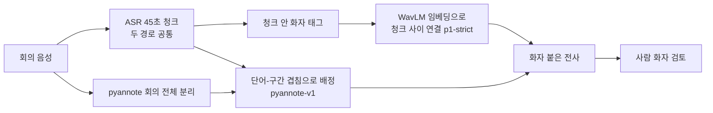
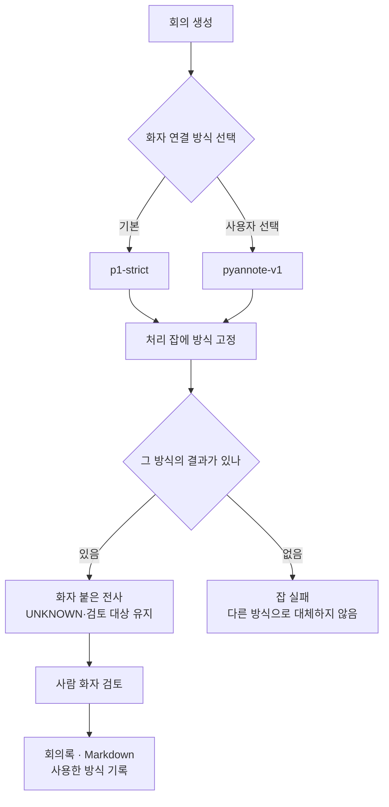

## 왜 읽어야 하나

회의록 기능에서 가장 티가 나는 오류는 글자 오타보다 **화자 오류**입니다. 두 사람이 한 사람으로 합쳐지면 누가 무엇을 약속했는지가 통째로 틀어집니다. 이 글은 회의록이나 상담 기록에 화자 분리를 붙이려는 엔지니어를 위해 썼습니다.

먼저 결론입니다. 다키클라우드는 회의록 제품 Thaki Minutes에 들어갈 화자 연결 방식 두 가지를 한국어 실제 회의 64건(dev2 30건, final2 34건)에서 비교했습니다. ASR, 정답, 채점기는 같습니다. 두 세트는 따로 보고하고 수치를 합치지 않았습니다. 아래 수치는 모두 제품 규칙을 켠 제품 경로 값입니다.

- final2의 5~8명 회의 24건에서는 pyannote 쪽이 오병합(wrong-merge)을 크게 줄였습니다. **0.4085 → 0.0342**입니다.
- final2의 3~4명 회의 10건에서는 화자 정밀도와 cpCER이 나빠졌습니다. cpCER **0.2743 → 0.3562**입니다. 원인은 확정하지 못했습니다. dev2의 같은 구간에서는 이 회귀가 나오지 않았습니다.
- 그래서 제품 기본값은 바꾸지 않았습니다. 회의를 만들 때 사용자가 방식을 직접 고르게 했습니다. 화자 수를 추정해 자동으로 갈라 주는 기능은 넣지 않았습니다.
- 어느 쪽을 써도 자동 화자 분리는 완성되지 않았습니다. 사람이 확인해야 합니다.

## 무엇을 비교했나

두 경로 모두 ASR은 같습니다(NVIDIA Nemotron 30B, 45초 청크). 달라지는 것은 "이 단어를 누가 말했나"를 정하는 부분입니다.

| 구분 | p1-strict (기존 기본값) | pyannote-v1 (대안) |
|---|---|---|
| 화자 단서 | ASR 청크 안의 화자 태그 + WavLM 화자 임베딩 | pyannote/speaker-diarization-community-1 RTTM (pyannote.audio 4.0.7) |
| 청크 사이 연결 | WavLM 임베딩 유사도로 보수적으로 잇습니다. 확신이 없으면 미확인(UNKNOWN)으로 남깁니다 | 회의 전체를 한 번에 분리하므로 청크 사이 연결 단계가 없습니다 |
| 화자 수 | 따로 지정하지 않습니다 | 지정하지 않습니다(`num_speakers` 미지정, 기본 파라미터) |
| 단어 배정 | strict 연결 규칙 | 단어 시간과 화자 구간의 겹침 비율로 배정. 섞인 턴·겹친 턴은 검토 대상으로 보냅니다 |

제목에는 "WavLM과 pyannote"라고 썼지만 정확히는 **두 파이프라인의 비교**입니다. 임베더만 바꿔 끼운 실험이 아닙니다.

## 평가 세트: 한국어 회의 64건

본 연구는 AI Hub 「주요 영역별 회의 음성인식 데이터」(#464)의 기존 평가 자료를 사용했습니다. 논문이나 블로그에는 집계된 성능 지표만 제시하며, 원본 음성·개별 전사문·회의 식별자는 공개하지 않습니다.

64건은 dev2 30건과 final2 34건입니다. 두 세트 모두 반복 채점에 사용한 기존 평가 세트입니다.

| 세트 | 회의 수 | 3~4명 | 5~8명 | 역할 |
|---|---|---|---|---|
| dev2 | 30 | 10 | 20 | 반복 채점에 사용한 기존 평가 세트 |
| final2 | 34 | 10 | 24 | 반복 채점에 사용한 기존 평가 세트 |

ASR 화자 무관 CER은 dev2 0.1712, final2 0.1708입니다. 화자 방식과 상관없이 같은 전사를 쓰기 때문에, 아래 차이는 모두 화자 쪽에서 나온 것입니다.

세트끼리는 우열을 비교하지 않았고, 두 세트의 성능 수치를 합산하지도 않았습니다. 화자 수 구간도 정답 화자 수로 나눈 것입니다. 시스템이 추정한 화자 수로 나눈 것이 아닙니다.

## 지표 정의

| 지표 | 정의 | 좋은 방향 |
|---|---|---|
| Precision(P) | 화자가 붙은 단어 중 정답 화자와 맞는 비율 | 높을수록 |
| Coverage(C) | 정답 단어 중 화자가 붙은 비율. 미확인은 붙지 않은 것으로 셉니다 | 높을수록 |
| UNKNOWN | 미확인으로 남은 글자 비율(회의 평균) | 낮을수록. 다만 일부러 남기는 설계도 있습니다 |
| DER | 출력 기준 화자 오류율. 10ms 프레임, 정답 경계 ±0.25초 제외, 시간 가중. 미확인은 어떤 정답 화자와도 맞지 않은 것으로 칩니다 | 낮을수록 |
| wrong-merge(오병합) | 정답 화자 중, 가장 많이 겹친 시스템 화자가 다른 정답 화자와 같은 사람의 비율. 두 사람을 한 사람으로 합친 정도입니다. 회의별로 구해 평균을 냅니다 | 낮을수록 |
| cpCER | 화자별로 글자를 모은 뒤, 화자 대응을 가장 유리하게 맞췄을 때의 CER. 빠진 화자와 없는 화자를 만든 경우도 벌점을 받습니다 | 낮을수록 |
| 화자 수 exact/under/over | 추정 화자 수가 정답과 같음/적음/많음인 회의 수 | exact가 많을수록 |

이 데이터의 정답 라벨에는 시간상 겹친 발화가 없습니다. 그래서 겹친 발화를 맞게 배정했는지는 이번 평가로 알 수 없습니다.

아래 표의 pyannote-v1 값은 모두 **제품 경로**입니다. 실제 제품 규칙을 켠 값으로, 섞인 턴과 겹친 턴을 검토 대상으로 돌리고 화자를 미확인으로 둡니다. 그래서 Coverage가 낮고 UNKNOWN이 높습니다. 의도한 동작입니다. 제품 규칙을 켜기 전 분리기 자체 결과는 측정 단계가 달라서 표에 섞지 않고 뒤에 따로 적었습니다.

## 전체 결과

| 세트 | 방식 | P | C | DER | 오병합 | UNKNOWN | cpCER | 화자 수 exact/under/over |
|---|---|---|---|---|---|---|---|---|
| dev2 (30) | p1-strict | 0.9355 | 0.8656 | 0.3014 | 0.3317 | 0.1255 | 0.3674 | 3/26/1 |
| dev2 (30) | pyannote-v1 제품 경로 | 0.9576 | 0.8894 | 0.2465 | 0.1679 | 0.0926 | 0.3585 | 19/7/4 |
| final2 (34) | p1-strict | 0.8905 | 0.8107 | 0.3862 | 0.3962 | 0.1792 | 0.4318 | 4/30/0 |
| final2 (34) | pyannote-v1 제품 경로 | 0.9652 | 0.8900 | 0.2480 | 0.1026 | 0.0888 | 0.3540 | 22/7/5 |

두 세트 각각에서 pyannote-v1 제품 경로가 표의 모든 칸에서 p1-strict보다 낫습니다. 다만 Coverage와 UNKNOWN은 두 방식이 미확인을 남기는 규칙이 달라 직접 비교의 의미가 약합니다. 눈에 띄는 것은 화자 수입니다. p1-strict는 두 세트 모두 대부분의 회의에서 사람 수를 적게 셌습니다(under 26/30, 30/34). strict는 미확인을 남겨 정밀도를 지키는 설계인데도 오병합이 0.33~0.40이었습니다. 확신을 갖고 붙인 라벨 안에서도 두 사람이 한 라벨로 합쳐졌다는 뜻입니다.

## 5~8명 회의: 오병합이 크게 줄었다

| 세트 · 구간 | 방식 | P | 오병합 | cpCER | 화자 수 under |
|---|---|---|---|---|---|
| dev2 5~8명 (20) | p1-strict | 0.9285 | 0.3059 | 0.3969 | 17 |
| dev2 5~8명 (20) | pyannote-v1 제품 경로 | 0.9550 | 0.0768 | 0.3912 | 3 |
| final2 5~8명 (24) | p1-strict | 0.8760 | 0.4085 | 0.4691 | 24 |
| final2 5~8명 (24) | pyannote-v1 제품 경로 | 0.9719 | 0.0342 | 0.3534 | 3 |

final2 5~8명 회의 24건에서 p1-strict는 24건 모두 화자 수를 적게 셌습니다. pyannote-v1에서는 under가 3건으로 줄었고, 같은 구간의 오병합도 0.4085에서 0.0342로 내려갔습니다. dev2 5~8명 회의 20건에서도 오병합은 0.3059에서 0.0768로, under는 17건에서 3건으로 줄었습니다.

화자 수 과소 추정과 오병합이 함께 줄어든 것은 측정으로 확인했습니다. 다만 p1-strict가 왜 사람 수를 적게 세는지, 그 원인을 따로 분리해 검증하지는 않았습니다.

## 3~4명 회의: 한 세트에서 나빠졌다

| 세트 · 구간 | 방식 | P | C | 오병합 | cpCER | 화자 수 exact/under/over |
|---|---|---|---|---|---|---|
| dev2 3~4명 (10) | p1-strict | 0.9527 | 0.9228 | 0.3833 | 0.2984 | 1/9/0 |
| dev2 3~4명 (10) | pyannote-v1 제품 경로 | 0.9640 | 0.9401 | 0.3500 | 0.2822 | 6/4/0 |
| final2 3~4명 (10) | p1-strict | 0.9471 | 0.9513 | 0.3667 | 0.2743 | 4/6/0 |
| final2 3~4명 (10) | pyannote-v1 제품 경로 | 0.9348 | 0.9242 | 0.2667 | 0.3562 | 5/4/1 |

final2 3~4명 구간에서 오병합은 0.3667에서 0.2667로 줄었습니다. 그런데 정밀도는 0.9471에서 0.9348로, cpCER은 0.2743에서 0.3562로 나빠졌습니다. 같은 구간의 dev2에서는 정밀도와 cpCER 모두 pyannote 쪽이 나았습니다.

관찰한 것은 다음과 같습니다.

- final2 3~4명 회의 10건 중 1건에서 pyannote-v1이 4명을 6명으로 나눴습니다.
- 화자 수 over가 dev2 3~4명에서는 0건, final2 3~4명에서는 1건입니다.

**원인은 확정하지 못했습니다.** 위 관찰이 cpCER 상승을 설명한다고 확인하지 않았습니다. 구간당 회의가 10건뿐이라 표본 편차인지 실제 약점인지도 가를 수 없습니다. 이 회귀를 판정할 기준은 미리 정해 두지 않았고, 결과를 본 뒤에 기준을 만들어 회귀를 덮지도 않았습니다.

## 따로 적는 값: 제품 규칙 전 분리기 자체 결과

위 표와 측정 단계가 다릅니다. 아래 값은 pyannote가 낸 화자 구간을 제품 규칙 없이 그대로 단어에 배정해 채점한 것입니다. 제품에서 사용자가 받는 결과는 위 표의 제품 경로 값입니다. 두 값을 같은 줄에 놓고 비교하지 않습니다.

final2 5~8명 회의에서 분리기 자체 결과의 오병합은 0.0223이었습니다. 제품 경로에서는 0.0342입니다. final2 3~4명 회의의 cpCER은 분리기 자체 결과에서 0.3062, 제품 경로에서 0.3562였습니다. 세트 전체 cpCER은 분리기 자체 결과에서 dev2 0.2663, final2 0.2694였습니다. 두 단계 사이 차이가 어디서 오는지는 따로 분리해 검증하지 않았습니다.

## 그래서 기본값을 바꾸지 않았다

선택지는 세 가지였습니다.

| 전략 | 내용 | 판단 |
|---|---|---|
| A. 전체 전환 | pyannote-v1을 기본값으로 | 보류. final2 3~4명 회귀가 풀리지 않았습니다. 별도 한계 사례(아래)에서도 자동 화자 분리가 실패했습니다 |
| B. 자동 분기 | 추정 화자 수로 3~4명/5~8명을 나눠 방식 선택 | 하지 않음. 추정 화자 수 자체가 틀리는 것이 이번 오류의 중심입니다 |
| C. 기본값 유지 + 회의별 선택 | 기본은 p1-strict, 사용자가 회의마다 pyannote-v1을 고름 | 채택 |

C를 실제 기능으로 만들면서 지킨 규칙은 다음과 같습니다.

- 회의를 만들 때 고른 방식은 처리 잡에 사본으로 고정됩니다. 처리가 시작되면 바꿀 수 없습니다.
- 고른 방식의 결과가 없으면 다른 방식의 결과로 조용히 대체하지 않고 잡을 실패시킵니다.
- 전사, 회의록 리비전, 내보낸 Markdown에 어느 방식을 썼는지 남깁니다. "자동 화자 귀속은 사람 확인이 아님"이라는 문구도 함께 붙습니다.
- pyannote가 붙인 화자는 사람 확인으로 자동 승격되지 않습니다. 미확인과 검토 대상 표시, 수동 분리·재지정은 그대로입니다.

화면의 선택지 설명도 측정한 만큼만 씁니다. pyannote-v1에는 "실제 한국어 5~8명 회의에서 오병합 감소 확인, 섞인 턴과 겹친 턴의 검토량이 많음, 3~4명 개선은 미확인"이라고 적었습니다.

## 한계

- **사람 검토가 전제입니다.** 이번 수치는 사람이 화자를 확인하기 전의 자동 출력입니다.
- **실제 사용자 검증은 하지 않았습니다.** 화자 확인과 승인은 자동 드라이버가 했고, 실제 사용자는 0명입니다. pyannote-v1이 만드는 검토 항목이 사람의 시간을 얼마나 쓰는지 모릅니다.
- **겹친 발화는 평가하지 못했습니다.** 정답 라벨에 겹침이 없습니다.
- **평가 세트의 독립성에 한계가 있습니다.** 두 세트 모두 반복 채점에 사용한 기존 평가 세트입니다. final2도 이전 라운드에서 이미 채점에 썼고, 같은 화자가 dev와 final 양쪽에 있을 가능성을 배제하지 못했습니다.
- **3~4명 구간은 세트마다 회의 10건입니다.** 회의 하나가 결과를 크게 흔듭니다.
- 결정·Action·담당자 정확도처럼 회의록 내용의 정확도는 정답이 없어 이번 글의 범위 밖입니다.

### 한계 사례: 합성 3화자 회의

64건 결과와 별개인 점검입니다. 수치를 64건 표와 합치지 않습니다. 합성 3화자 회의 1건으로 실제 엔진 전 구간을 돌렸을 때 업로드부터 승인 Markdown까지는 통과했습니다. 하지만 자동 화자 분리는 실패했습니다. pyannote가 세 사람을 두 사람으로 합쳤고, 한 역할은 자동 연결 커버리지가 0이었습니다. 표본이 1건이라 정확도 판정에는 쓰지 않습니다.

## 정리

화자 분리 방식을 바꾸자 final2 5~8명 회의의 오병합은 0.4085에서 0.0342로 줄었습니다. final2 3~4명 회의에서는 cpCER이 0.2743에서 0.3562로 나빠졌고, 원인은 아직 모릅니다. 한쪽 구간의 큰 개선을 보고 전체 기본값을 바꾸면 다른 구간 사용자가 그 비용을 집니다. 그래서 기본값은 그대로 두고 회의마다 고르게 했습니다. 어떤 방식을 썼는지는 산출물마다 남깁니다.

다음에 볼 것은 두 가지입니다. 인원이 적은 회의를 늘려 3~4명 구간을 다시 재는 것, 그리고 사람이 실제로 화자를 검토하는 데 드는 시간을 재는 것입니다.

시리즈 이전 글: [Nemotron 3.5 Transcribe 한국어 LoRA 공개: 30B 음성인식 모델을 어떻게 파인튜닝했나](https://thakicloud.com/tech-blog/ko/agentops/nemotron-transcribe-korean-lora/)

---

## 근거

본문 수치는 모두 내부 실험 원장에 기록된 측정값에서 가져왔습니다. 원장 자체는 공개하지 않습니다.

*데이터 출처: AI 허브(AI-Hub) — 「주요 영역별 회의 음성인식 데이터」(#464). 데이터는 재배포하지 않으며, 이 글에는 집계 지표와 화자 수 구간별 집계만 실었습니다.*

*다키클라우드 AI Engineering · Speech & Meeting Intelligence*
