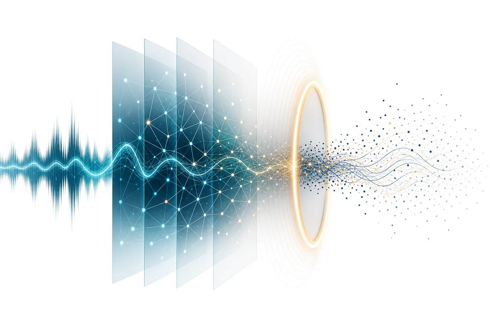

*한국어 음성을 30B 음성인식 모델에 맞추는 일은 어댑터 학습과 디코딩 가드를 함께 설계하는 일이었습니다.*

## 왜 읽어야 하나

이 글은 대형 음성인식 모델을 한국어 업무 음성에 맞추려는 엔지니어를 위해 씁니다. 다키클라우드는 NVIDIA Nemotron 3.5 Transcribe 30B-A4B에 한국어 LoRA 어댑터를 학습해 [Hugging Face](https://huggingface.co/ThakiCloud/Thaki-KSpeech-KO-30B-A4B-LoRA-v1)에 공개했습니다. 결론부터 말씀드리면 출시 게이트를 넘긴 구성은 어댑터 파일 하나가 아니라 **어댑터와 디코딩 가드 guarded-dg-v1의 조합**입니다. 가드 없이 평가한 두 번의 학습은 모두 출시 판정을 받지 못했습니다.

이 글에서 다루는 내용은 다음과 같습니다.

- 학습 데이터와 LoRA 설정
- 첫 학습(v1)과 두 번째 학습(v2)이 탈락한 이유
- 9.35초 발화에서 단어 약 507개가 나온 원인과 디코딩 가드의 설계
- 기반 모델과 어댑터를 같은 파이프라인으로 비교한 한국어 결과
- 직접 재현하는 방법과 이 결과가 말하지 않는 것

## 학습 방법

### 데이터

학습에는 AI 허브 데이터셋 두 개에서 한국어 음성 32,000발화, 47.8시간을 썼습니다.

| 출처 | 발화 수 | 길이 |
|---|---|---|
| AI 허브(AI-Hub) — 「회의 음성」(#132) | 24,000 | 36.43시간 |
| AI 허브(AI-Hub) — 「한국어 음성」(#123) | 8,000 | 11.37시간 |
| 합계 | 32,000 | 47.8시간 |

132번은 24,000행 전부 라이선스·녹음 동의·학습 동의 필드를 확인했습니다. 123번은 8,000행 전부 라이선스·상업 이용 허용·권리 근거를 확인했습니다. 평가 세트(Zeroth-Korean, HiKE, FLEURS, 보류 dev/test)는 학습에서 빼고 음성 해시와 문장 해시로 누출을 검사했습니다.

AI 허브 데이터는 재배포하지 않으며 모델 가중치만 공개합니다. 공개 저장소에는 음성도 전사도 넣지 않았습니다. 이 글에도 원문 예시를 싣지 않습니다. 저장소에 함께 올린 것은 학습된 어댑터 가중치와 추론 코드뿐입니다.

### LoRA 설정

| 항목 | 값 |
|---|---|
| 기반 모델 | `nvidia/NVIDIA-Nemotron-3.5-Transcribe-30B-A4B`, bf16 |
| 학습 대상 | LoRA r=32 + `multi_modal_projector`(학습 파라미터 36.9M) |
| 학습률 · 유효 배치 | 2e-5 · 32 |
| 스텝 | 1,000(H200 1장) |
| 체크포인트 | step 800. 학습 전에 정한 규칙으로 dev_132와 dev_gen에서 골랐습니다 |

어댑터는 병합하지 않고 `PeftModel`로 얹습니다. 병합 체크포인트는 제공하지 않습니다.

## 첫 학습(v1): 좋아진 곳과 무너진 곳이 같이 나왔다

같은 레시피의 첫 학습은 짧은 발화와 영어가 섞인 발화에서 크게 좋아졌습니다. dev 800발화 중 2초 미만 발화의 CER은 27.8%에서 17.8%로, 영어가 섞인 발화의 CER은 26.5%에서 16.3%로 내려갔습니다. 기반 모델이 아무것도 내지 않던 빈 출력 3건은 0건이 됐습니다.

반면 일반 한국어 벤치인 Zeroth-Korean의 CER은 2.91%에서 6.85%로 올랐습니다. 모델은 457발화 중 149발화에서 아라비아 숫자를 썼습니다. Zeroth 정답은 숫자를 한글 수사로 적습니다. 이 149발화가 CER 오류 증가분 760자 중 664자를 차지했습니다. 다만 숫자를 한자어 수사로 바꾸는 보조 정규화를 적용해도 CER은 5.63%여서 회귀가 남았습니다. 숫자 표기 하나로는 설명되지 않는 회귀였습니다.

판정은 NO_RELEASE였습니다. 일반 한국어 벤치 성능이 크게 나빠지면 다른 영역이 좋아져도 출시하지 않는다고 학습 전에 정해 두었기 때문입니다.

## 두 번째 학습(v2): 회의 음성 게이트에서 다섯 체크포인트가 모두 떨어졌다

두 번째 학습에서는 전사 표기 정책을 바꾸고 위 데이터 구성으로 다시 짰습니다. 선택 규칙도 미리 등록했습니다. 회의 음성 dev(dev_132)의 WER이 기반 대비 0.5%p 이상 나빠지면 그 체크포인트는 고를 수 없습니다.

결과는 다섯 체크포인트 모두 탈락이었습니다. 일반 한국어 dev(dev_gen) WER은 2.15~3.66%p 좋아졌지만 dev_132 WER은 0.52~3.84%p 나빠졌습니다. 가드 없이 평가한 v2의 NO_RELEASE 판정은 지금도 바꾸지 않았습니다. 아래 가드 결과는 다른 추론 구성에서 얻은 기록입니다.

## 9.35초 발화에서 단어 약 507개가 나왔다

dev_132 오류를 발화 단위로 나눠 보니 늘어난 단어 오류 대부분이 발화 하나에서 나왔습니다. 9.35초짜리 발화이고 정답은 일곱 단어입니다. 어댑터는 처음 몇 토큰을 낸 뒤 같은 토큰을 503번 반복해 생성 상한 512토큰을 채웠습니다. 단어로는 약 507개, 오류로는 약 500개가 이 한 발화에서 생겼습니다.

dev 평가 경로에는 반복을 감지하는 장치도 공식 후처리도 없었습니다. 모델이 EOS를 내지 못하면 상한까지 그대로 생성했습니다. 학습에 효과가 없었다기보다는 반복 생성 한 건이 회의 음성 지표 전체를 바꿀 수 있는 디코딩 경로가 문제였습니다.

## 디코딩 가드 guarded-dg-v1

가드는 세 부분으로 이루어집니다.

**길이 상한.** 학습 전사 32,000건의 초당 토큰 수를 세어 보니 99.9백분위가 7.58이었습니다. 상한은 `min(8192, ceil(2.0 × (16 + 7.58 × 초)))`입니다. 9.35초 발화라면 상한은 174토큰입니다. 그 발화의 정답은 17토큰입니다. 학습 전사 중 이 상한을 넘는 것은 0건이었습니다.

**반복 정지.** 생성 꼬리 40토큰 이상이 1~64토큰 단위로 4회 이상 반복되면 생성 중에 멈춥니다. 정답 전사에 이 규칙을 돌리면 학습 32,000건 중 1건, dev 두 세트에서 0건이 걸립니다.

**판정.** EOS로 끝나면 `ok` 또는 `empty`, 반복이나 길이 상한으로 멈추면 `unverified`입니다.

`unverified`는 신뢰도가 낮다는 표시가 아닙니다. 전사를 확정하지 못했다는 뜻입니다. 이때 텍스트는 비워서 돌려주며 반복을 잘라 낸 나머지를 전사로 내놓지 않습니다. 평가에서도 빈 출력으로 채점했습니다. 가드는 반복을 멈출 뿐 그 구간의 말을 복원하지는 못합니다.

## 한국어 평가: 같은 파이프라인으로 비교

기반 모델과 어댑터(v2 step 800)에 같은 가드, 같은 프롬프트, 같은 전처리를 적용했습니다. test_gen은 체크포인트를 고른 뒤 한 번만 잰 보고용 세트입니다.

| 세트(발화 수) | 용도 | 기반 WER | 어댑터 WER | 기반 CER | 어댑터 CER | unverified(기반→어댑터) |
|---|---|---|---|---|---|---|
| dev_132(798) | 선택 | 28.08% | 25.78% | 11.14% | 9.59% | 0 → 2 |
| dev_gen(800) | 선택 | 24.47% | 20.95% | 10.32% | 7.24% | 0 → 0 |
| test_gen(800) | 보고 전용 | 25.63% | 21.29% | 9.99% | 6.78% | 0 → 0 |

dev_132에서 기반 모델의 `unverified`는 0건이지만 EOS로 끝난 빈 출력이 3건 있습니다. 어댑터 쪽 2건은 가드가 멈춘 구간이라 전사가 없습니다.

### 회귀 게이트는 따로 읽어야 한다

아래는 사전등록한 회귀 게이트입니다. 기반 모델 수치는 **가드 없이 먼저 측정해 고정해 둔 값**이라 위 표와 같은 조건의 비교가 아닙니다. 개선 폭의 근거로 읽으면 안 됩니다.

| 세트(발화 수) | 지표 | 기반(가드 없음, 사전 고정) | 어댑터(가드 적용) | 게이트 | 통과 |
|---|---|---|---|---|---|
| Zeroth-Korean test(457) | CER | 2.91% | 3.28% | ≤ 3.91% | 예 |
| Zeroth-Korean test(457) | WER | 21.01% | 18.99% | ≤ 22.01% | 예 |
| HiKE test(1,121) | MER / PIER | 29.68 / 46.99 | 19.56 / 31.84 | ≤ 24.68 / ≤ 41.99 | 예 |
| FLEURS en_us test(647) | WER | 5.27% | 5.31% | ≤ 5.57% | 예 |

Zeroth CER은 사전 고정 기준선보다 0.36%p 나쁩니다. 허용폭 안이어도 회귀입니다. HiKE 1,121발화 중 3발화는 `unverified`(반복 2, 길이 상한 1)로 끝나 빈 출력으로 채점됐습니다.

## 재현 방법

80GB 이상 GPU 1장, Nemotron 3.5 Transcribe를 지원하는 `transformers` 커밋, `peft>=0.17`이 필요합니다.

```bash
pip install "git+https://github.com/huggingface/transformers@66f51e76efd8542232b8bdd40ade7d1edbaac46f" "peft>=0.17" soundfile librosa accelerate
git clone https://huggingface.co/ThakiCloud/Thaki-KSpeech-KO-30B-A4B-LoRA-v1 && cd Thaki-KSpeech-KO-30B-A4B-LoRA-v1
python infer_guarded.py --adapter . sample.wav
```

기반 모델 revision, 프롬프트, 상한 식, 반복 규칙, 가드 코드 sha256은 저장소의 `pipeline.json`에 고정돼 있습니다. 긴 녹음은 45초 이하로 잘라 넣습니다. `status`가 `unverified`로 오면 그 구간은 사람 검토로 보내고 근거로 쓰지 않습니다.

하드웨어도 결과에 영향을 줍니다. 공개 전에 저장소 파일만으로 새 환경을 꾸려 122건을 다시 디코딩했습니다. 원평가와 같은 H200 NVL에서는 122건이 모두 정확히 일치했습니다. B200에서는 배열 입력 100건 중 11건의 출력이 달랐습니다. 그 100발화의 CER은 6.69%에서 6.97%로 바뀌었습니다. 모든 발화가 EOS로 끝났고 상태값도 같았습니다. GPU마다 bf16 연산 결과가 조금씩 달라 greedy 선택 몇 개가 갈린 것입니다. 그래서 정확한 재현은 H200에서만 확인했다고 모델 카드에 적었습니다.

## 이 결과가 말하지 않는 것

- **화자 분리 기능이 없습니다.** 이 어댑터는 말을 받아쓸 뿐 누가 언제 말했는지 나누지 않습니다. 후처리에서 화자 태그를 지웠고 평가도 단일 화자 발화 전사로 했습니다. 회의록에 쓰려면 화자 분리를 따로 붙여야 합니다.
- **Thaki Minutes의 기본 ASR은 바뀌지 않았습니다.** 다키클라우드 회의록 제품의 기본값은 지금도 수정하지 않은 NVIDIA 원본 기반 모델과 45초 청킹입니다. 내부 canary 비교에서 어댑터가 더 나은 지표는 없었습니다. 이 비교에서는 기반 모델을 H200에서, 어댑터를 B200에서 돌려 가중치 효과와 하드웨어 효과를 나눌 수 없었습니다. 그래서 어댑터가 회의록 품질을 높였다고도 낮췄다고도 주장하지 않습니다.
- 학습 시드 하나, 체크포인트 하나입니다. 시드에 따른 편차는 재지 않았습니다.
- 추론 경로는 `transformers` + `peft` 하나만 확인했습니다. vLLM 같은 서빙 엔진에서는 평가하지 않았습니다.
- 단어 타임스탬프, 스트리밍, 호출당 45초를 넘는 음성은 게이트에 포함하지 않았습니다.
- 대화체 한국어 오류율은 절대값으로 여전히 높습니다. 위 세 세트 모두 WER이 20%를 넘습니다.

## 정리

이번 작업에서 배운 것은 재현의 단위가 가중치 파일 하나가 아니라는 점입니다. 같은 어댑터라도 생성 상한과 반복 처리 방식이 바뀌면 회의 음성 WER이 게이트 안팎을 오갑니다. 그래서 공개 단위를 기반 모델 revision, 병합하지 않은 어댑터, 고정 프롬프트, sha256으로 고정한 가드 코드, `ok` 출력에만 적용하는 후처리의 묶음으로 잡았습니다.

대형 음성인식 모델을 파인튜닝하신다면 학습 레시피와 함께 디코딩 경로를 먼저 점검해 보시길 권합니다. 모델이 멈추지 못하는 경우를 막는 일과 그렇게 막은 구간을 전사 성공으로 세지 않는 일만으로도 판정이 달라질 수 있습니다.

시리즈 다음 글: [한국어 실제 회의 64건에서 비교한 화자 분리 파이프라인: WavLM과 pyannote](https://thakicloud.com/tech-blog/ko/agentops/korean-meeting-diarization-pyannote-vs-wavlm/)

## 근거

본문 수치는 모두 내부 실험 원장에 기록된 측정값에서 가져왔습니다. 원장 자체는 공개하지 않습니다.

---

*다키클라우드 AI Engineering · Korean Speech*

*모델: [ThakiCloud/Thaki-KSpeech-KO-30B-A4B-LoRA-v1](https://huggingface.co/ThakiCloud/Thaki-KSpeech-KO-30B-A4B-LoRA-v1) (revision `cf73497c`). 학습 데이터 출처: AI 허브(AI-Hub) — 「회의 음성」(#132), AI 허브(AI-Hub) — 「한국어 음성」(#123). 데이터는 재배포하지 않으며 모델 가중치만 공개합니다.*
