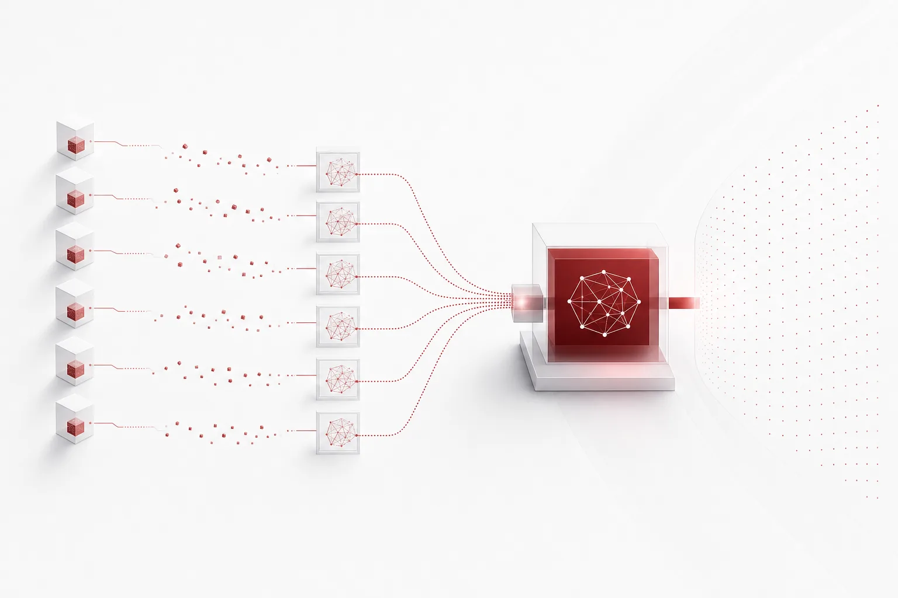
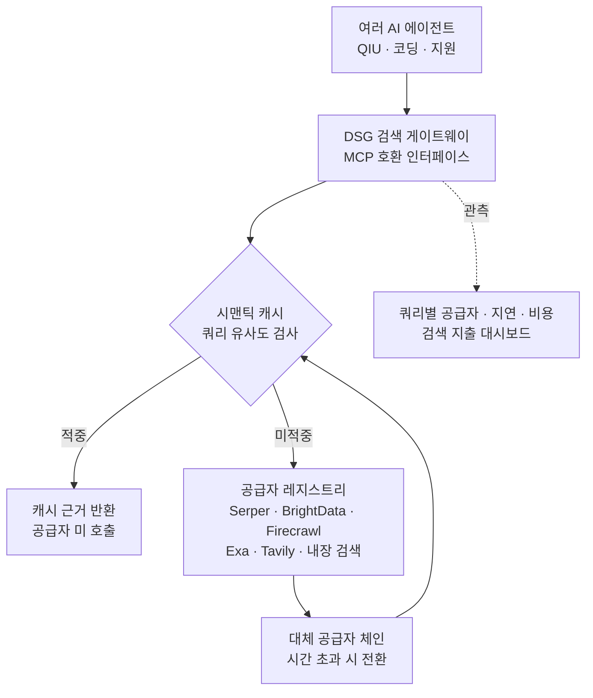
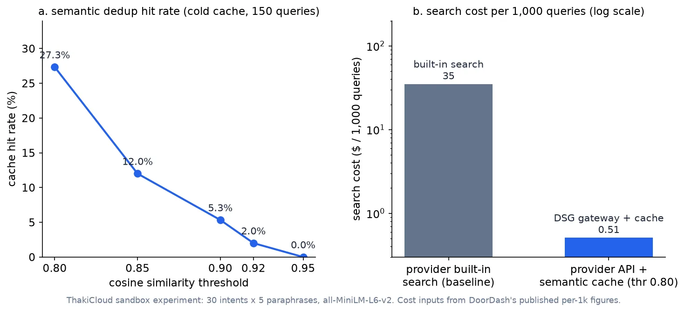

## 왜 읽어야 하나

LLM 기반 에이전트를 운영하면서 "웹 검색 비용을 누가 내는가"를 결정해야 하는 AI 플랫폼, 에이전트 인프라 엔지니어를 대상으로 씁니다. 결론부터 말하면, DoorDash가 검색 비용을 98% 이상 줄인 것은 더 싼 검색 공급자를 찾은 것이 아니라 검색 자체를 모델의 내장 기능에서 빼내어 모든 에이전트가 하나의 게이트웨이를 공유하도록 구조를 바꾼 것이었습니다. 이 글에서는 그 구조를 작은 샌드박스로 재현해, 냉각기 상태에서도 시맨틱 캐시 적중률 27.3%만으로 100% 정밀도에서 검색 비용 98.5% 절감이 나는지 실측 수치로 검증합니다.



## 쉽게 말하면

회사마다 각 부서 연구자가 필요할 때마다 출판사에 직접 책을 주문한다고 상상해 보세요. 매 주문마다 출판사 수수료가 붙고, 같은 책이라도 부서마다 따로 주문하면 중복 비용이 쌓입니다. DoorDash의 방식은 "중앙 장서 주문 데스크"를 한 곳 만들어 모든 부서가 거기로만 주문하게 하는 것입니다. 데스크가 먼저 도서관에 이미 있는 책의 카탈로그(시맨틱 캐시)를 조회하고, 없으면 더 싼 지역 도매상(검색 공급자 API)에 주문합니다. 어떤 도매상을 쓰지, 몇 권을 주문할지, 몇 날 동안 창고에 둘지는 데스크를 운영하는 플랫폼팀이 하나의 설정 파일로 조정합니다. 이후 이 글에서 "게이트웨이"와 "카탈로그"는 이 비유를 그대로 씁니다.

## 개요

DoorDash 엔지니어링 블로그가 공개한 Decoupled Search Grounding, 이하 DSG는 에이전트와 검색 사이를 갈라놓는 구조입니다. 핵심 수치는 다음과 같습니다. QIU(Query Intent Understanding, 검색어 의도 분류) 프로덕션 워크로드와 공개 QA 벤치마크 3개에서 정확도를 유지하거나 소폭 올리면서, 검색 공급자 요금만 기준으로 한 검색 비용이 98% 이상 줄었습니다. 캐시가 축적된 운영 구간에서는 캐시 적중률이 6.2%에서 99.4%까지 올라가고, 평균 지연이 68% 감소했습니다.

문제가 커진 배경도 짚어둘 가치가 있습니다. DoorDash는 QIU처럼 검색이 에이전트 파이프라인의 한 단계로 들어간 워크로드가 프로덕션 규모에 달했고, 내장 검색의 요금 구조에서는 이 단계의 비용이 모델 요금과 뒤섞여 쿼리 단위로 측정하기 어려웠습니다. 공급자 내장 검색을 쓰면 "검색이 얼마를 썼나"를 따지는 게이트가 구조적으로 없게 됩니다. DSG가 먼저 해결한 것이 절감보다 이 측정 가능성입니다.

QIU는 DoorDash 마켓플레이스 검색의 실제 워크로드입니다. 사용자가 "450 north"처럼 의미 불명의 쿼리를 입력하면, 상품 카탈로그와 웹 근거를 함께 참고해 최종 의도(예: Alcohol)를 분류합니다. 평가는 일반 비식품 소매 7,988건과 합성 롱테일 2,335건으로 이루어졌고, 추론 모델은 Gemini Flash, 기준선은 Google 검색 그라운딩을 넣은 내장 검색이었습니다.

이 패턴이 중요한 이유는 에이전트가 늘고 있기 때문입니다. 에이전트마다 LLM 내장 검색을 쓰게 하면 검색 지출은 에이전트 수에 정비례로 자라고, 각 공급자 API에 검색 정책이 박혀 있으면 공급자를 바꿀 때마다 모든 에이전트를 손봐야 합니다. DSG는 검색 지출을 에이전트 수에서 떼어 내어 플랫폼 하나의 운영 변수로 만듭니다.

## 이 기술은 무엇인가

기존 방식인 내장 검색은 모델 공급자 API가 자체 검색 스택을 생성 과정에 결합해 돌리는 구조입니다. 밖에서 조율하기 어렵고, 제어와 재사용과 관측 가능성이 약합니다. DoorDash가 지적한 문제는 비용만이 아니었습니다. 내장 검색이 유발하는 장황한 응답이 에이전트의 중간 산출물을 JSON, 열거형, 불리언으로 파싱할 때 문제를 일으켰고, HotpotQA 기준 Claude Sonnet 4의 파싱 위반율은 78.1%였습니다. 건물 높이 비교 사례에서 내장 검색은 245자의 응답을, DSG는 "Yes" 3자를 내며 둘 다 정확했는데 파싱 가능한 답은 하나였습니다.

DSG는 에이전트와 추론 모델, 그리고 검색 백엔드 레지스트리 사이에 서서 MCP 호환 인터페이스를 내는 게이트웨이입니다. 백엔드로 Serper, BrightData, Firecrawl, Exa, Tavily를 두고, 내장 검색조차 이 인터페이스 뒤의 한 공급자로 등록합니다. 공급자 선택과 대체 순서와 캐시 정책과 검색 깊이는 코드가 아니라 YAML 어댑터 형태의 설정이 됩니다. 새 HTTP 원원은 어댑터를 추가하는 것으로, 시간 초과 시 대체 공급자 체인으로 넘어갑니다.

캐시 설계의 핵심은 공유입니다. 캐시는 에이전트별로 분리되지 않아 여러 워크로드의 사용 결과가 쌓이고, 항목은 공급자별로 분리되어 TTL을 개별 설정합니다. 관측에서는 쿼리별 공급자, 캐시 결과, 처리 분기, 검색 깊이, 지연, 비용을 원격 측정 데이터로 기록해 대시보드에서 검색 지출을 추적합니다.

정확도 수치는 공급자별로 다릅니다. GPT-4o, GPT-4o-mini, Gemini 2.5 Flash, Gemini 2.5 Pro, Claude Sonnet 4 다섯 모델로 공개 QA 벤치마크 3개와 QIU를 측정했고, QIU 최종 의도 정확도는 아래처럼 나옵니다.

| 구성 | 일반 비식품 (7,988건) | 합성 롱테일 (2,335건) | 비용 (1,000건당) |
|---|---|---|---|
| 내장 검색 (기준) | 93.40% | 87.62% | 약 $35 [추정] |
| DSG + Serper | 93.90% | 87.79% | $0.70 미만 |
| DSG + BrightData | 기준 대비 1.6%p 이내 | 동일 | 기준의 1/11 |

정확도를 지키거나 소폭 올리면서 비용을 98% 이상 줄인 것이 이 표의 골격입니다. 내장 검색의 비용 수치는 DoorDash가 직접 발표한 것이 아니라 98% 절감에서 역산한 값이라 [추정]으로 표기했습니다.



## 설치 및 통합 (재현)

DSG 전체를 재현하는 것은 의도가 아니지만, 비용 절감의 두 축, 내장 검색에서 공급자 API로 이관하는 것과 시맨틱 캐시의 중복 제거는 작게 재현할 수 있습니다. 격리된 git worktree 샌드박스에 sentence-transformers(all-MiniLM-L6-v2)를 공유 venv로 설치하고, 30개의 기본 검색 의도 각각에 5개의 패러프레이징 변형을 붙인 150개의 쿼리를 에이전트 트래픽처럼 섞어서 스트림했습니다.

```bash
# 격리 샌드박스 (scripts/blog/impl_sandbox.sh)
bash scripts/blog/impl_sandbox.sh setup dsg-search-grounding
VIRTUAL_ENV="$PWD/.venv" uv pip install sentence-transformers

# 실험: 150쿼리 스트림 x 5개 유사도 임계값
.venv/bin/python semantic_gateway.py
# 결과: outputs/blog-impl/dsg-search-grounding/run-1.log
```

비용 입력값은 DoorDash가 공개한 쿼리 1,000건당 수치입니다. DSG+Serper가 1,000건당 0.70달러 미만이고, 내장 검색 기준은 98% 절감 역산으로 1,000건당 약 35달러 [추정]로 잡았습니다. 미적중 시점의 업스트림 API 지연은 전형적인 웹 검색 API 왕복 시간 300ms로 시뮬레이션했으며, 이 값은 모든 결과 줄에 "simulated"로 표기했습니다. 임베딩 지연은 이 머신에서 실측했고, 쿼리당 6.77ms(모델 로딩 9.65s 1회)였습니다. 150쿼리 전량 임베딩에 1.02초라, 게이트웨이의 유사도 검사는 업스트림 호출 대비 무시할 수준입니다.

## 실제 실험 결과

실험은 5개 임계값(0.80, 0.85, 0.90, 0.92, 0.95)으로 게이트웨이를 돌린 스윕입니다. 캐시는 쿼리 스트림을 순회하며 미적중 시에만 항목을 기록하는 콜드 스타트 방식으로, 의도별 첫 쿼리는 항상 업스트림을 부릅니다. 이는 DoorDash가 공개한 캐시 충전 실행 구간(적중률 6.2%에서 시작)과 동일한 출발점입니다.

| 임계값 | 캐시 적중률 | 정밀도 | 업스트림 호출 | 검색 비용 (1,000건당) | 평균 지연 |
|---|---|---|---|---|---|
| 0.80 | 27.3% | 100% (오판 0) | 109 | $0.509 | 225ms |
| 0.85 | 12.0% | 100% (오판 0) | 132 | $0.616 | 271ms |
| 0.90 | 5.3% | 100% (오판 0) | 142 | $0.663 | 291ms |
| 0.92 | 2.0% | 100% (오판 0) | 147 | $0.686 | 301ms |
| 0.95 | 0.0% | - | 150 | $0.700 | 307ms |



세 가지가 보입니다. 첫째, 절감의 1차 축은 공급자 이관입니다. 내장 검색(1,000건당 약 35달러 [추정])에서 Serper급 공급자 API(0.70달러)로만 옮겨도 98.0%가 줄고, 캐시는 그 위에 얹는 2차 축입니다. 27.3% 적중이 추가 절감을 0.51달러까지 밀어올립니다. 둘째, 정밀도입니다. 150쿼리 전체에서 캐시 오판이 0건이었고, 이는 DoorDash의 "정확도 유지" 주장과 같은 방향의 신호입니다. 셋째, 지연입니다. 냉각기에서도 225ms vs 307ms로 26.7%가 줄었고, DoorDash의 68%는 캐시가 축적된 운영 구간 수치입니다.

임계값 운영 관점에서는 0.80이 이 실험의 운영 지점입니다. 0.80에서 0.85로 올리면 적중이 27.3%에서 12.0%로 반토막 나는 반면, 절감은 98.5%에서 98.2%로 0.3%p만 줄어듭니다. 비용 절감의 대부분은 1차 축(공급자 이관)이 이미 확보한 것이므로, 임계값은 비용을 아니라 정밀도를 위해 높이는 것입니다. 실제 트래픽으로 같은 스윕을 돌려 적중 정밀도가 1.0에서 떨어지는 지점을 찾고, 그 바로 위에 임계값을 두는 것이 이 구조의 표준 튜닝 순서입니다.

## ThakiCloud 제품 적용 시사점

에이전트 운영 관점에서 보면, 이 패턴은 Paxis의 실행 경제성과 직결됩니다. 다중 에이전트 DAG 파이프라인은 같은 주제 쿼리를 서로 다른 프롬프트로 반복 발행하기 쉽습니다. 리서치 에이전트가 "Kueue 선점 정책"을 조사한 뒤, 검증 에이전트가 "kueue preemption 설정"으로 같은 의도를 다시 검색하면, 각자가 내장 검색을 쓸 때는 두 번 전액이 나갑니다. 검색을 MCP 호환 게이트웨이 뒤로 빼고 시맨틱 카탈로그를 공유하면 두 번째 쿼리는 캐시에서 나가고, 검색 지출이 에이전트 수에서 플랫폼 하나의 운영 변수로 넘어갑니다.

공급자 선택과 캐시 TTL이 설정이 되면, 에이전트를 고치지 않고 검색 정책을 바꿀 수 있습니다. 쿼리별 비용 원격 측정이 있으면 테넌트별 검색 지출을 대시보드에서 따를 수 있고, 이는 Paxis의 정책 게이트와 감사로그가 처리하는 영역과 같은 층위입니다. 에이전트 실행 경제성에서 검색이 차지하는 비중을 측정할 수 있어야, 어떤 워크로드에 캐시를 먼저 얹을지를 결정할 수 있습니다.

인프라 관점에서도 의미가 있습니다. 검색 비용이 분리되면 추론 예산과의 합산이 단순해집니다. DoorDash 수치를 그대로 대입하면, 쿼리 1,000건당 0.5달러대의 검색 지출은 같은 모델의 짧은 추론 몇 번 비용과 같은 크기라, 검색이 에이전트 비용의 숨은 복리가 되기 쉬운 구간입니다. 다만 이 글의 실험은 패턴 검증이지, 다키클라우드가 DSG를 운영 중인 보고서가 아닙니다. 적용 제안은 위의 구조 분석에 기반합니다.

반대로, 이 구조를 쓰면 안 되는 경우도 명확합니다. 첫째, 단일 에이전트입니다. 게이트웨이의 공유 효과는 에이전트, 워크로드가 둘 이상일 때 생기고, 검색을 하는 쪽이 하나면 캐시 적중의 대부분이 같은 세션의 자기 쿼리에서 나옵니다. 둘째, 최신성 임계가 높은 워크로드입니다. FreshQA에서 5개 모델 모두 내장 검색이 우위였다면, 시세와 긴급 이슈 같은 영역은 캐시 TTL을 단위로 짧게 가져가거나 내장 검색 공급자를 체인에 남겨두는 것이 정답입니다. 셋째, 쿼리량이 낮은 구간입니다. 게이트웨이의 운영과 관측에 드는 고정 비용이 절감분보다 크면 구조가 오히려 비용을 만듭니다. 이 세 가지가 해당하지 않고도 검색 지출이 차트처럼 커지는 구간에서 DSG 패턴이 성립합니다.

## 한계 및 반론

이 실험은 냉각기 조건입니다. 150쿼리의 단일 세션에서 의도가 30개인 셈이므로 적중률 상한은 80%이고, 27.3%는 그 하방입니다. DoorDash의 99.4% 적중은 수개월의 프로덕션 트래픽이 카탈로그에 쌓인 온캐시 구간 수치라, 이 둘을 같은 값으로 비교하면 안 됩니다. 1,000건당 35달러 기준도 98% 절감에서 역산한 [추정]이지, DoorDash가 직접 발표한 숫자가 아닙니다.

정밀도 100%는 이 실험이 같은 의도의 정직한 패러프레이징으로만 이루어졌기 때문입니다. 실제 트래픽에는 의미는 비슷하지만 답이 달라지는 근접 쿼리가 섞이며, 그때 캐시가 낯은 답을 내리면 "캐시가 없느니만 못하다"는 결과가 납니다. DoorDash 원문도 최신성이 중요한 FreshQA에서는 5개 모델 모두 내장 검색이 DSG보다 우위였고, 다중 홉 추론은 단일 홉보다 이득이 작아 반복 검색 루프가 필요하다고 했습니다. 세 공급자에 대한 의존(안정성, 지연, 품질, 가격 변동)도 구조를 함께 승계합니다.

원문이 짚은 후속 방향은 세 가지입니다. 적응형 라우팅(쿼리 종류별로 공급자를 나누는 것), 출력 계약 기반 검증(검색 응답이 에이전트의 파싱 계약을 깨지 않는지 게이트하는 것), 그리고 다중 홉 워크로드용 반복 검색입니다. 이 세 가지를 빼면 DSG는 "싼 검색을 공유하는 캐시" 수준에 머무르고, 이 세 가지를 더해야 에이전트 운영 구조로 성립합니다.

## 정리

에이전트가 내장 검색을 호출하고 있다면, 검색을 하나의 공유 게이트웨이로 빼는 것이 비용 절감의 1차 레버이고 시맨틱 카탈로그가 2차 레버입니다. 시작은 재현보다 측정입니다. 쿼리 1,000건당 검색 지출과 쿼리 간 유사도 분포를 먼저 보면, 임계값 하나 조정으로 캐시 적중이 얼마나 올라가는지 이 실험의 구조 그대로 확인됩니다. 검색 지출을 에이전트 수에 맡긴 팀과 플랫폼 변수로 가져온 팀의 비용 곡선이 갈라지는 지점이 바로 여기입니다.

## 출처

- DoorDash Engineering Blog: How DoorDash Reduced LLM Search Costs by 98% Without Losing Accuracy (careersatdoordash.com, 원문 직접 fetch 403, GeekNews 번역본으로 사실확인)
- GeekNews: DoorDash가 정확도를 유지하면서 LLM 검색 비용을 98% 줄인 방법 (news.hada.io/topic?id=36733)
- ThakiCloud 샌드박스 실험: outputs/blog-impl/dsg-search-grounding/run-1.log (2026-11-08)
