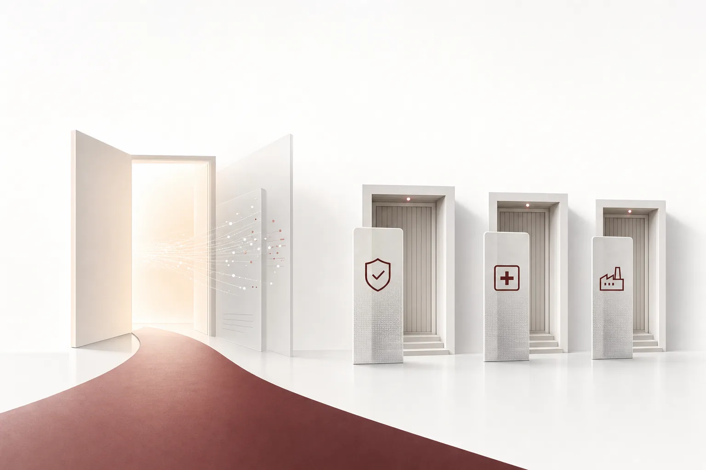

한국경제는 "중고거래 앱인 줄 알았는데"라고 썼다. 오후, 어떤 상인이 챗GPT를 연다. "오늘 광고 잘 나갔어?" 연결해 둔 당근 광고 계정을 AI가 읽고, 지출과 클릭, 매출을 자연어로 답한다. 더 이상 가상의 장면이 아니다. 한국경제 보도에 따르면 당근은 지난 9월 국내 광고 플랫폼 가운데 가장 먼저 '광고 MCP'를 출시했다. 광고 계정을 챗GPT와 클로드에 연결하면, 광고 현황과 성과를 자연어로 조회하고 분석할 수 있다.

당근은 동네 상인과 자영업자가 사고파는 지역 중고거래 플랫폼이다. 이런 플랫폼조차 광고 운영을 AI에 열고 있다는 것은, AI의 진입점이 골목 아래로 내려오고 있다는 뜻이다.

속도를 보면 이미 방향이 정해져 있는 셈이다. 9월에 조회와 분석을 위한 MCP, 10월에 수정과 이벤트 전송을 위한 오픈API, 그리고 다음 단계로 AI가 광고를 스스로 만들고 고치는 기능. 문을 여는 계단을 몇 달 단위로 올라간다.

*글의 핵심 개념을 형상화했습니다.*

## 중고거래 앱이 된 AI의 문

10월에는 한 걸음 더 갔다. 광고 오픈API 베타를 공개했는데, 외부 시스템이 캠페인과 광고 소재의 등록과 수정은 물론 구매와 장바구니 전환 이벤트 전송까지 자동으로 처리한다. 'AI가 데이터를 읽는' 단계에서 'AI가 업무를 수행하는' 단계로 넘어온 것이다. 그리고 한국경제에 따르면 당근은 MCP의 범위를 광고 생성과 수정까지 넓힐 계획이라고 한다. 다음 단계에서는 AI가 성과만 분석하는 것이 아니라 광고 설정 자체를 손본다. 광고 운영은 반복 업무의 전형이었고 이제 그 반복이 자연어 지시 하나로 넘어간다.

경쟁사의 반응도 빠르다. 카카오는 지난해 12월 모먼트AI를, 네이버는 광고 성과 API를 각각 내놓은 상태다. MCP(모델 컨텍스트 프로토콜)는 AI 모델이나 에이전트가 외부 시스템과 연결해 데이터를 조회하고 업무를 수행하게 해 주는 표준 계층이다. 이제 커머스와 광고 플랫폼의 사실상 인터페이스로 굳어진다. 같은 보도의 포인트는 여기다. 외부 AI 서비스와 광고 계정을 직접 연결해, 별도의 데이터 추출과 분석 도구 없이 평소 쓰던 AI만으로 운영할 수 있다는 것. 한국경제는 이 흐름을 코딩을 하지 않는 소상공인과 중소기업까지 업무 시스템을 AI 에이전트와 연결하는 시대의 시작으로 읽는 것이다. AI 도입의 주체가 대기업과 공공을 지나 상점과 자영업까지 넓어지면, 통제와 감사에 대한 수요도 같은 궤적으로 커진다. 중고거래 앱이 연 문은 특수한 사례가 아니다.

## 문지기가 없는 문

흥미로운 것은 문이 열린 뒤의 이야기다. 플랫폼의 동기는 명확하다. 문을 넓게 열면 AI가 자기 서비스의 진입통로가 되기 때문이다. 그런데 문은 한쪽만 열리지 않는다. 상인이 광고 성과를 묻는 데 쓴 것과 같은 MCP로, 경쟁사의 영업사원이거나 사내 운영자가 회사의 광고 지출을 건드릴 수도 있다. 도구가 표준이 되면, 문을 여는 방식도 표준이 된다.

더 큰 문제는 책임이다. AI의 판단 오류나 잘못된 설정은 가상적 손실이 아니라 실제 광고비 낭비다. 틀린 설정 한 번에 타는 광고비를 누가 물어내야 하는가. 소비자가 여는 문에서 실패의 대가는 광고비이다. 기업이 여는 문에서 실패의 대가는 환자 데이터나 제조 공정일 수도 있다. 손해의 단위는 달라도, 책임의 구조는 똑같은 셈이다. 한국경제 보도는 AI가 플랫폼 안에서 직접 업무를 수행하면서, 통제와 감사에 대한 요구가 함께 커지고 에이전트 실행의 신뢰와 보안 인프라가 중요해진다고 짚는다.

결국 문이 열릴수록 커지는 질문은 이것인가. 어떤 일을, 누구의 허락으로, 어떤 조건에서 수행하고 틀리면 누가 책임지며 사후에 증명할 수 있는가. 필요한 것은 문지기다. 문제는 오늘의 MCP가 '문'의 표준이지, '문지기'의 표준은 아니라는 것이다.

## 각자의 방식대로 문을 여는 곳

반대로 문이 가장 단단히 잠겨 있는 쪽은 문지기를 짓고 있다.

보험은 영업 모델 자체를 다시 설계하는 단계까지 왔다. 현대해상 'Hi-헬퍼'는 1분 안에 추천 플랜 세 개를 자동 생성하고 삼성화재 'AI Advisor'는 고객 라이프사이클 기준으로 가입부터 계약 유지까지 상담을 돕는다. 삼성생명은 AI 디지털 휴먼이 가상 고객 역할을 하는 'AI롤플레잉'으로 설계사의 반복 훈련을 지원하고, 신한라이프는 자연어 기반 가입설계 시스템까지 도입했다. 보험 4사가 모두 AI 설계 지원에 들어갔다는 것은, 보험산업의 AI 전환이 새로운 국면에 왔다는 신호다. 녹색경제신문은 주요 컨설팅사들이 2026년 보험산업 AI 전환의 핵심 과제로 비즈니스 모델 재설계를 지목하고 있다고 전한다. 상품과 담보 구조가 갈수록 복잡해지면서, 설계사의 전문 상담 역량과 AI 자동화 사이의 균형이 경쟁 변수로 부상하고 있다. 자연어 상담과 디지털 휴먼 훈련 도구가 상용화 단계에 오르면서 설계사 교육과 양성을 위한 AI 투자도 함께 커진다.

병원의 답은 다르다. 환자 데이터는 밖으로 나갈 수 없으니, 루닛이 300억 파라미터 규모의 국내 모델 '러닝유닛 2.0'을 오픈소스로 공개하고 9개 의료기관에서 6개월 실증을 마무리했다. 과기정통부 '의과학 특화 파운데이션 모델' 국가 사업의 주관기관으로 23개 기관 컨소시엄을 이끈 결과물이다. 실증은 다학제 치료 제안과 응급 중증도 분류, 보험 심사를 포괄했고 17개 벤치마크에서 1200억 파라미터의 GPT-OSS보다 높은 정확도를 보였다. 문을 열지 않는 대신, AI를 내부에서 돌리는 선택이다.

제조는 규칙책을 내놨다. 이코노미스트 보도에 따르면 글로벌 AI 서비스의 표준 약관에서는 기업 데이터가 재학습에 활용되고 미국 정부의 법적 제출 요청에 따라 데이터가 제3자에게 넘어갈 수 있다. 계약 조항으로는 안전을 담보하기 어려운 수준이다. 이 배경에서 국정원은 이달 말, 역대 최대 규모의 '산업보안컨퍼런스'를 열고, 현대오토에버는 'AI 보안 가이드'라는 실무 지침을 발표할 예정이다. 핵심은 하이브리드 전략이다. 핵심 기밀과 국가핵심기술은 사내 온프레미스 AI로, 일반 업무는 클라우드 AI로 처리한다. 여기에 외산 AI 계약의 3대 필수 조건도 제시한다. 입력 데이터 재학습 금지, 국내 리전 저장 제한, 계약 종료 시 완전 삭제와 객관적 증빙 제공. 역할 정의, 계약 점검, 권한 관리, 삭제 확인의 4단계 거버넌스 구조도 함께 권장하는 것이다.

국방은 문이 가장 단단히 잠긴 곳이다. 뉴스웨이에 따르면 KT는 국방 SI 사업 이행의 프로젝트 리더급 인력과 5G 특화망, 위성통신 전문 인력을 채용하고 있다. 지난해 8월 207억원 규모의 국방 5G 인프라 구축 사업을 본격화했고, NATO 국방통신 표준화 프로젝트 NWCSP에는 국내 통신사 최초로 표준화위원 자격으로 참가했다. SK텔레콤은 다른 길을 택했다. 육군본부 '2026 지상군페스티벌'에 유일하게 참가한 민간기업으로, 데이터 플랫폼과 온톨로지, 디지털트윈 기반의 'AI 참모'를 공개했다. 3분기 실적발표에서는 기업용 AI보다 공공과 국방의 소버린 AI 분야에서 사업 기회가 먼저 열릴 것이라고 전망했다. 국가 안보에 가까울수록, 경쟁의 중심은 '누가 문을 세우느냐'로 이동하기 때문이다.

문을 지나가는 쪽의 능력도 더 예리해지고 있다. 신아일보 기자수첩에 따르면 앤트로픽의 AI 에이전트는 OpenBSD에서 27년간 미발견 상태로 남아 있던 취약점을 찾아냈다. 같은 주에 문은 더 넓어졌고 문지기는 더 무거워졌다.

## 문은 표준, 문지기가 경쟁

이것을 한 줄로 묶으면 일관된 그림이 나온다. '문'은 빠르게 표준화되고 있다. 누구나 AI를 연결하는 MCP는 광고와 커머스를 넘어 더 넓은 업무 영역으로 퍼져 간다. AI의 진입점은 골목의 상점으로 내려오고 수행되는 업무의 범위는 상담에서 실제 조작까지 커진다. 느리게 논의되는 것은 '문지기'다. 어떤 일을 AI가 하고 어떤 권한과 조건으로, 그리고 실수하면 누가 책임지느냐. 오늘 뉴스가 모은 산업들은 모두 '문을 넓게 열어주면 되는' 곳이 아니다. AI 도입의 전선은 '얼마나 잘 하는가'에서 '어느 정도 믿을 수 있는가'로 넘어오고 있다.

경쟁은 더 이상 문을 얼마나 빨리 여느냐가 아니다. 문을 앞에 서는 사람이 누구냐다. 프로토콜 레벨에서는 능력이 상품화되고 있다. 실행 레벨에서는 신뢰가 유일한 희소 자산이 되는 것이다.

오늘의 답은 네 갈래. 문을 넓게 여는 것, 단단히 잠그는 것, 문을 열지 않고 내부에서 돌리는 것, 조건을 붙여 여는 것. 이 답들은 모두 같은 전제를 두고 있다. AI가 실제로 업무를 수행한다는 점이다. 달라지는 것은, 그 업무를 수행한 조직이 그 수행에 대해 책임질 수 있느냐다.

당근이 예고한 다음 단계, 광고를 스스로 만들고 고치는 AI가 현실이 되면 문지기의 질문은 더 이상 기업의 과제가 아니다. 문을 연 플랫폼의 과제가 된다. 에이전트가 써 버린 돈의 책임을 물어야 할 대상이 상인을 넘어, 문을 연 플랫폼으로 넓어지기 때문이다.

## 문지기 Paxis가 준비하는 것

ThakiCloud의 Agent-Native 클라우드 Paxis(v1.1 GA)는 정확히 문지기 일을 위해 지어진 제품이라 말할 수 있다. Paxis에서 Skills, Tools, Policies, Audit Logs는 부수 기능이 아니라 일급 리소스다. 에이전트는 무조건 수행하지 않는다. 자율도 L0부터 L3까지의 거버넌스 안에서 정책 게이트를 단계별로 통과하며, 모든 실행은 감사 로그로 남는다. 실행 환경은 격리된 샌드박스라, 실수해도 피해의 범위가 제한된다.

당근이 광고 시스템으로 챗GPT를 연결하듯, Paxis의 MCP 커넥터와 스킬 마켓은 기업이 이미 쓰는 업무 시스템 위에 에이전트를 붙여 준다. CostRouter의 작업별 모델 선택은 모든 일을 하나의 모델로 푸는 대신, 작업마다 적합한 모델을 고른다. 나아가 소버린과 온프레미스 K8s(ai-platform) 환경에서 동작할 수 있어, 현대오토에버가 그은 '기밀은 내부 AI'라는 선도 설계 범위 안에 있다. 오늘의 뉴스가 드러낸 통증은 하나씩 대응 지점이 있다. 틀린 광고 설정 한 번의 책임을 묻는 질문은 감사 로그가 답하고, 환자 데이터와 국가핵심기술이 건물 밖으로 나가지 않아야 한다는 요구는 소버린과 온프레미스 실행환경이 답한다. 에이전트 호출마다 가장 비싼 모델을 쓰게 될 우려는 작업별 선택이 답한다. 이런 답을 매일, 생산 환경에서 내어 줄 수 있는 능력. 그것이 문지기. Paxis가 선택한 일이 바로 그것인 셈이다.

오늘 뉴스를 한 문장으로 요약하면 이렇다. 중고거래 앱은 AI에게 문을 열었고 기업들은 문지기를 짓고 있다. 문은 표준이 되는 중이다. 경쟁을 가르는 것은 문의 크기가 아니라, 문 앞에 서는 사람이기 때문이다.

## 참고 자료

이 글은 아래 뉴스를 종합해 작성했습니다.

- 뉴스웨이, [KT, 국방 SI 확장 채비…SKT와 공공 인프라 주도권 경쟁](https://www.newsway.co.kr/news/view?ud=2026110617292609797)
- 한국경제, ["중고거래 앱인 줄 알았는데"…당근이 챗GPT에 문 연 이유 [정지은의 테...](https://www.hankyung.com/article/202611093475i)
- 비즈월드, [[헬스 HOT 뉴스] 루닛, 의료 특화 AI '러닝유닛 2.0' 공개…"9개 병원서 ...](http://www.bizwnews.com/news/articleView.html?idxno=151185)
- 이코노미스트, [“기업 기밀은 내부 AI로”…데이터 주권 지키는 하이브리드 전략 [2026 ...](https://economist.co.kr/article/view/ecn202611040074)
- 녹색경제신문, [보험사, 영업현장에 AI 생태계 구축 '속속'...보험설계사 전문역량 강화...](https://www.greened.kr/news/articleView.html?idxno=354117)
- 신아일보, [[기자수첩] AI 딸깍 해킹 시대…'범부처 보안 컨트롤타워' 시급](https://www.shinailbo.co.kr/news/articleView.html?idxno=5080371)