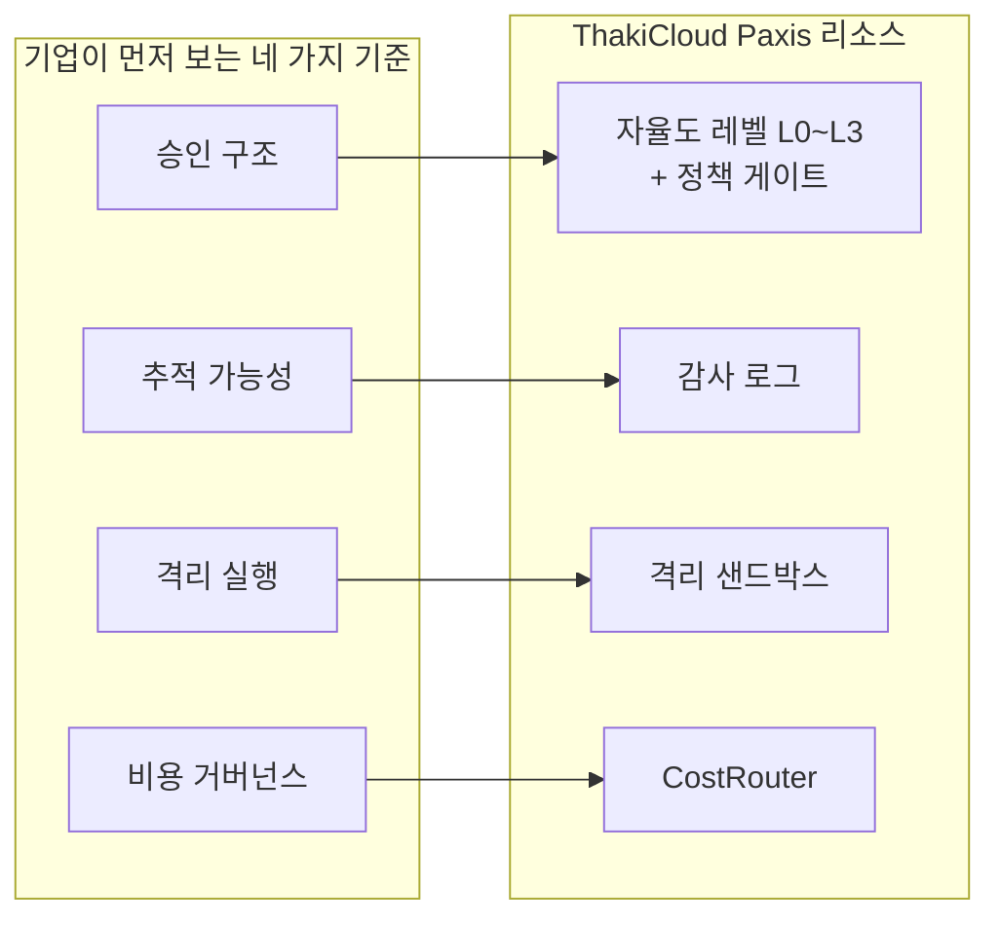

*줄은 풀려 있고 차체에는 블랙박스가 단단히 박혀 있는 장면을 형상화한 이미지입니다.*

## 이름부터 모순인 OS

하네스(harness). 말의 머리를 잡아 방향을 잡게 하는 가죽 장치를 뜻합니다. 이 단어에서 가장 먼저 떠오르는 것이죠, 바로 '통제'인 셈입니다. 그런데 딥시크는 자사의 에이전트 프레임워크에 이 이름을 붙였습니다. 그리고 11월 9일 공식 발표로, 생태계가 얼마나 빠른 속도로 커지고 있는지 보여주었습니다.

글로벌이코노믹 보도에 따르면 Harness의 일일 활성 사용자, 즉 DAU는 154만 명에 도달했습니다. 11월 4일 기준 Harness API의 하루 토큰 소모량은 약 92조 개, 초당 11억 개 수준입니다. 서드파티 플러그인은 3만 5,000개를 넘었고 활성 사용자의 약 60%가 외부 플러그인을 함께 쓰고 있습니다. 출시 3개월의 기록.

이 숫량의 무게를 알기 위해 하나만 더 붙여 볼까요. Harness는 챗봇이 아닙니다. 파일 읽기와 쓰기, 터미널 명령 실행, 웹 검색 같은 외부 도구를 묶어 AI 모델이 스스로 조작하도록 만든 실행 기반입니다. 에이전트가 일하는 자리, 그 자체죠. 하루 92조 토큰이라는 규모는 수만 개가 넘는 에이전트 작업이 매일 이 OS 위에서 돌아가고 있다는 뜻입니다.

## 챗봇이 OS가 되기까지 3개월

Harness는 8월 13일 공개됐습니다. 9월 29일에는 독립형 데스크톱 에이전트 앱이 추가됐습니다. '하나의 모델이 답을 주는' 시대가 '수많은 에이전트가 함께 일하는' 시대로 넘어간다는 신호는 이미 곳곳에 있었죠. 이데일리 보도를 보면 앤스로픽은 약 1,000개 에이전트가 협력해 30시간 만에 페르마의 마지막 정리를 린(Lean)으로 형식화한 실험을 공개했습니다. 전문기관 전용 모델 미소스 5.2의 공개 보안 취약점 재탐지율도 78.3%에서 89.6%로 높아졌습니다. 에이전트가 보안 분석 같은 전문 영역에도 투입되고 있다는 뜻이죠.

그리고 11월, 딥시크는 유무료 플러그인 등록과 거래를 위한 전용 마켓플레이스 론칭을 공식화했습니다. 우수 개발자에게 대규모 무료 API 토큰 보조금을 지급하고 제인 스트리트 출신 추이톈이씨가 이끄는 사내 첫 상업용 제품 부서를 신설해 B2B와 B2C 유료 소프트웨어 수익 모델을 세운다는 계획까지 밝쳤습니다. 전문가들은 3개월 만에 하루 92조 토큰을 흡수한 이 생태계 침투력이 AI 에이전트 시장 판도를 뒤흔들 복병이 될 것이라 평가합니다. '에이전트 플랫폼의 안드로이드'라는 별칭은 여기서 나옵니다.

오픈AI와 앤스로픽이 코덱스, 클로드 코드 중심의 완성형 엔터프라이즈 코딩 도구로 시장을 채워가는 동안, 딥시크는 저렴한 API 단가와 개방형 플러그인 아키텍처로 정반대 길을 택했습니다. 앱을 파는 것이 아니라, 여는 운영체제. 그것이 오늘의 배팅입니다.

## 사라진 하네스, 새는 비밀번호

여기서 이름의 모순이 진짜로 드러납니다. 통제의 장치를 뜻하는 단어가, 가장 개방적인 에이전트 OS에 붙은 셈이니까요. 지난 이틀간의 뉴스는 하네스가 풀렸을 때 어떤 일이 벌어지는지를 그대로 보여줍니다.

조선일보 보도에 따르면 이스라엘 보안 업체 아피이로(Apify)는 깃허브 공개 저장소 1,994곳에서 비밀번호 등 접속 정보 2,539건을 발견했습니다. 기업과 학생 단체를 포함한 63개 조직의 정보가 섞여 있었던 것입니다. 유출의 대표 경로는 앤스로픽 클로드 코드의 '다시 묻지 않기' 자동 승인 기능입니다. 승인된 작업 명령어에 비밀번호가 섞이면 별도 기록 파일에 함께 저장되고, 그 파일이 저장소로 올라가면 해킹을 당하지 않아도 비밀번호가 새고 있었던 것입니다. 접속 정보가 담긴 파일 1,122개 중 215개는 주류 보안 탐지 도구 두 종류 모두에 걸러지지 않았습니다. 앤스로픽 책임자 보리스 처니는 자동 승인 시 민감 정보 확인과 기본 탐지 기능 도입을 검토하고 있다고 밝혔습니다.

단일 조직의 관리 실패담으로만 읽을 일은 아닙니다. 아피이로뿐 아니라 다수 보안 매체와 기트가디언(GitGuardian) 같은 시크릿 탐지 업체들이 별도 보도를 내놓았기 때문입니다. AI 에이전트가 퍼지며 공격 표면이 코드 밖, 즉 승인 기록과 메모, 대화 로그로 옮겨갔고 기존 스캐너는 그 파일 자체를 보지 못합니다. 업계 공통 과제로 떠올랐습니다.

속도 격차도 함께 벌어지고 있습니다. 파이낸셜뉴스 보도에 따르면 마이크로소프트의 2026 디지털 방어 보고서는, 공격자가 AI를 활용해 취약점 발견부터 공격도구 완성까지 걸리는 시간이 중앙값 24시간 미만인 반면 기업 조치는 최대 60일까지 소요된다고 전합니다. 방어 체계가 아직 사람의 속도로 움직이고 있는 사이, 공격은 이미 에이전트의 속도로 빨라지고 있다는 뜻이죠.

같은 날 IT조선은 멘로벤처스의 '2026 기업 AI 현황' 보고서를 소개했다. 기업의 생성형 AI 지출은 1년 만에 5.4배로 늘었고 2026년 9월 수준을 연간 환산하면 1,768억달러에 이른다. 기업용 AI 애플리케이션 시장 773억달러 가운데 코딩 분야 340억달러가 가장 큰 세그먼트다. 지출이 가장 쏠리는 곳에서 검증 도구가 등장했다는 점도 주목할 만하다. 마이크로소프트 리서치는 11월 5일, 코딩 에이전트가 작성한 프로그램을 검증하는 도구 PDD Kit를 공개했다.

그리고 멜리사 팬 등의 'Measuring Agents in Production' 조사가 오늘의 현실을 짚는다. 에이전트의 74%는 사람 평가에 의존한다. 68%는 사람의 개입 전에 10단계 이하의 업무만 소화한다. 칼럼은 자동 처리율이나 성공률만 보면 쉬운 업무만 자동화되고 복잡한 업무는 사람에게 남아 성과가 과대계산되는 착시가 생긴다고 경고한다. 지출은 5배로 뛰고 병목은 '얼마나 잘하는가'에서 '무엇을, 어떻게 검증하는가'로 이동하고 있는 셈이다.

## 에이전트 OS 앞에 서는 기업이 먼저 보는 것

한국 기업은 이미 현장에서 답을 찾고 있다. 블로터 보도에 따르면 금융위원회는 6월 22일 금융분야 AI 가이드라인을 시행했다. 거버넌스, 합법성, 보조수단성, 신뢰성, 금융안정성, 신의성실, 보안성 등 7대 원칙을 제시했고 AI는 보조수단에 그치며 최종 결정과 책임은 사람이 지는 원칙을 세웠다. 한국만의 일은 아니다. 미국에서는 JP모건자산운용이 40년치 데이터를 학습한 '머니볼', 블랙락의 '아시모프'가 포트폴리오 의사결정 보조 도구로 운용되고 있다.

도입 속도는 결코 느리지 않다. 하나은행은 30분 이상 걸리던 기업 신용평가 심사의견 업무를 10초로 줄였고, 연간 7만건 중 2만7,000시간을 절감했다. 신한은행의 감정평가서 AI 점검 에이전트는 건당 점검시간을 70% 단축했고, 하루 처리량은 세 배로 늘렸다. 문제는 그 뒤다. 현행 책무구조도의 48개 세부 책무는 AI가 자율적으로 신용모형을 바꾸거나 이상거래를 판단하는 상황을 직접 규정하지 못한다. AI기본법상 과태료 상한은 최대 3,000만원에 그친다. 칼럼의 저자는 '기술의 속도가 제도의 빈틈을 앞질러 간다'며, 소비자의 돈과 계약에 영향을 주는 업무에는 사람의 사전승인 절차가 필요하다고 요구한다.

모델 선택도 같은 논리로 이동하고 있다. 이데일리 보도에 따르면 앤스로픽은 신형 페이블 5.2로 아티피셜 애널리시스 AI 지능지수 65점을 기록해 1위를 탈환했고 API 가격을 20% 인하했다. 입력 토큰 100만개당 10달러에서 8달러, 출력 50달러에서 40달러로 바꿨다. 동시에 일반 코딩과 지식 업무에는 먼저 오퍼스 5.5를 쓰고, 복잡하고 난도가 높은 작업에만 페이블과 미소스를 투입하는 작업 난도별 모델 라우팅을 공식 권장했다. 고속 모드는 2배 가격에 최대 2.5배 속도를 제공하는 구조도 함께 내놨다.

참고로 코딩 평가 프론티어코드 2.0에서는 페이블 5.2가 49.1%로 오퍼스 5.5(45.5%), GPT-6 아스트라(42.8%)를 앞섰다. 그런데 기업 업무 자동화 벤치마크 오토메이션벤치에서는 제미나이 4 카본이 53.9%로 페이블 5.2(51.4%)를 앞서고 있다. 코딩과 업무 자동화, 각각 다른 모델이 앞서 있다는 뜻이죠. 벤더 단일화가 아니라 벤치마크 기반의 멀티모델, 멀티하네스 혼합 운영이 합리적 답으로 올라서는 이유입니다. 기업의 OS에서 엔진을 고르는 기준은 브랜드가 아니라 업무의 성격입니다.

## 에이전트 OS의 다음 쟁점: 차체에 박힌 블랙박스

그렇다면 기업은 에이전트 OS에 어떤 '하네스'를 달아야 할까요. 오늘 뉴스만 모아봐도 기준은 네 개입니다. 첫째, 승인 구조입니다. 에이전트가 자율적으로 할 수 있는 것과 사람의 사전승인이 필요한 것의 경계는 사후적 문구가 아니라 1차 설정이어야 합니다. 둘째, 추적 가능성입니다. 어떤 정책, 어떤 모델, 어떤 순서로 판단이 내려졌는지가 감사 로그로 남아 뒤늦게 설명되어야 합니다. 셋째, 격리 실행입니다. 개방형 플러그인 생태계라면 더더욱, 신뢰할 수 없는 코드는 버릴 수 있는 샌드박스 안에서만 실행되어야 합니다. 넷째, 비용 거버넌스입니다. 작업마다 맞는 모델을 고르고 하루 92조 토큰이 남의 뉴스가 아니라 내 손익계산서가 되는 구조가 필요합니다.

글로벌이코노믹의 짚기도 같은 방향입니다. 중국발 오픈소스 하네스의 글로벌 침투가 가속되면 엔터프라이즈 영역에서 데이터 주권과 국산 대안을 둘러싼 고민이 커진다는 것입니다. 다중 하네스와 다중 모델을 오케스트레이션해 최적의 성능과 비용, 보안을 확보하는 중립형 에이전트 플랫폼에 대한 수요가 높아지고 있습니다. 시장이 개방만으로는 답이 안 되는 순간을 이미 준비하고 있다는 뜻입니다.

이 네 가지 기준이 ThakiCloud Paxis가 다루는 영역입니다. Paxis는 ThakiCloud의 Agent-Native Cloud로, v1.1 GA 단계의 정식 제품입니다. Skills, Tools, Policies, Audit Logs를 추가 기능이 아니라 일급 리소스로 다룹니다. L0에서 L3까지 자율도 레벨을 워크플로별로 정하고 정책 게이트와 감사 로그가 판단의 근거를 남깁니다. 에이전트 실행은 격리된 샌드박스에서 일어나며 MCP 커넥터와 스킬 마켓으로 생태계를 연결합니다. 소버린, 온프렘 Kubernetes (ai-platform) 환경에도 같은 구조를 올려 실행할 수 있습니다. CostRouter는 작업마다 맞는 모델을 골라 주며 앤트로픽의 20% 인하처럼 가격 경쟁이 격화되는 시장에서 이것이 바로 운영 지렛대가 됩니다. 네 가지 기준은 이 리소스 위에 그대로 놓입니다. 승인 구조는 자율도 레벨과 정책 게이트가, 추적 가능성은 감사 로그가, 격리 실행은 샌드박스가, 비용 거버넌스는 CostRouter가 담당합니다.

*에이전트 OS 앞에서 기업이 먼저 보는 네 가지 기준과 그 기준을 담당하는 Paxis 리소스입니다.*

하네스라 부르는 운영체제가 등장한 날입니다. 기업이 원하는 것은 하네스가 풀리는 것이 아니라, 하네스가 OS에 단단히 박히는 쪽입니다. 에이전트 OS의 다음 전장은 플러그인의 숫자가 아니라, 차체에 박힌 블랙박스의 두께로 결정될 것입니다.

## 참고 자료

이 글은 아래 뉴스를 종합해 작성했습니다.

- 뉴스로드, ["미국발 AI 투자 불확실성"…AWS·MS·오픈AI까지 한국 데이터센터로 눈…](http://www.newsroad.co.kr/news/articleView.html?idxno=67398)
- 조선일보, [해킹 없이도 비밀번호가 줄줄… AI '자동 승인'에 비번 2500건 노출](https://www.chosun.com/economy/tech_it/2026/11/09/DOOMGNCD7RH2NJJJ2SIRDHBRWE/)
- 글로벌이코노믹, ["단순 챗봇 넘어 OS로"… 딥시크 '하네스', 출시 3달 만에 日 150만 명 돌…](https://www.g-enews.com/view.php?ud=2026110918061930770c8c1c064d_1)
- 비즈니스플러스, [[삐그덕거리는 데이터센터 열풍/①] 미국발 규제 역풍…AI 인프라 투자 …](https://www.businessplus.kr/news/articleView.html?idxno=119541)
- 뉴스웍스, [SKT·엔비디아·리벨리온 'GPU·NPU 통합 시스템 개발 MOU'](https://www.newsworks.co.kr/news/articleView.html?idxno=902490)
- 파이낸셜뉴스, [AI로 하루면 해킹하는데 기업 방어까지 최대 두달 - 파이낸셜뉴스](https://www.fnnews.com/news/202611091829460821)

