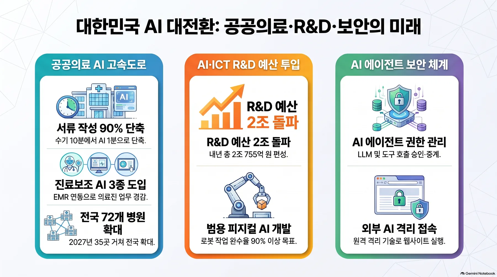
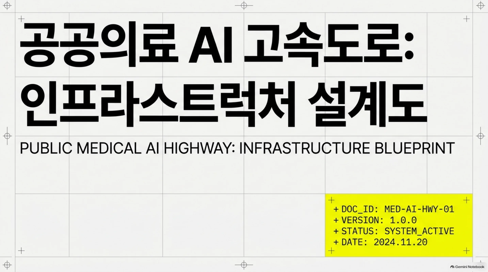
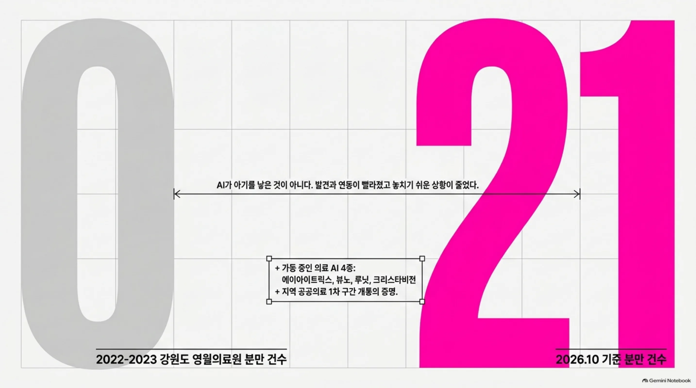
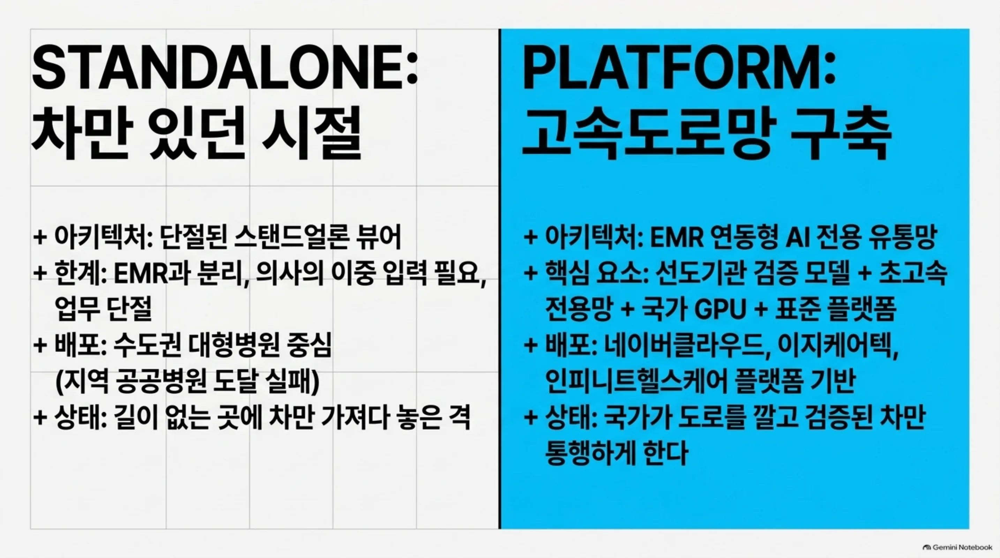
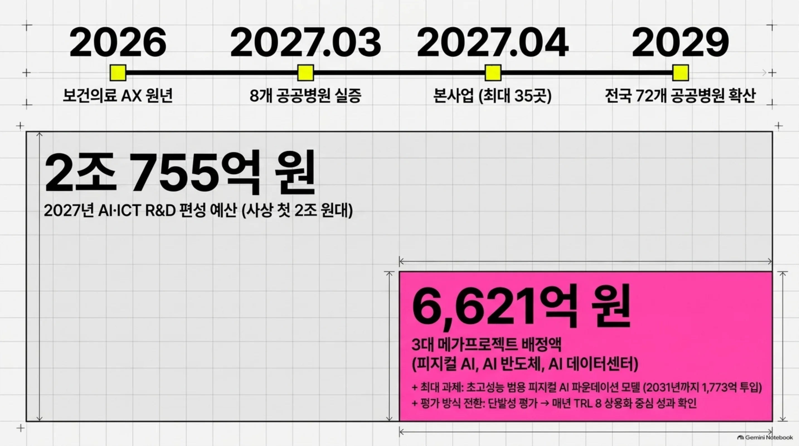
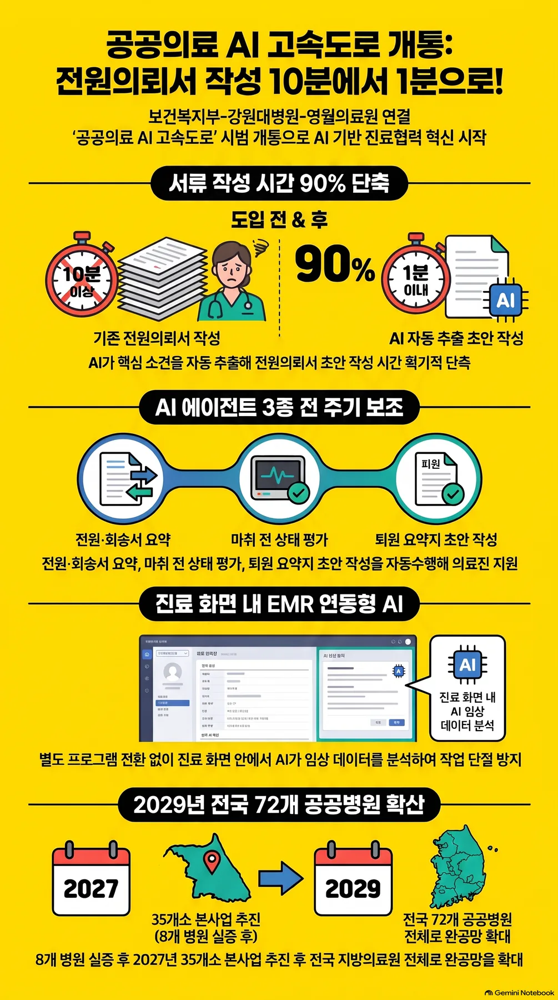

강원도 영월. 지역 공공병원에서 분만이 끊긴 적이 있습니다. 2022년과 2023년, 두 해 동안 0건였습니다. 2026년 10월 기준, 그 숫자는 21건이 됐습니다. 메디컬월드뉴스 보도에 따르면 영월의료원은 에이아이트릭스, 뷰노, 루닛, 크리스타비전의 AI 4종을 가동 중입니다. 물론 AI가 아기를 낳은 것은 아니다. 바뀐 것은 그 주위입니다. 발견이 빨라졌고 연동이 빨라졌고 놓치기 쉬운 상황이 줄었습니다. "아이가 다시 태어났다"는 작은 사실이 AI 산업에게는 그보다 훨씬 무거운 뉴스인 이유가 있습니다. 강원도 끝자락에서 도로의 1차 구간이 열렸다는 사실 때문.

그 배경에 '공공의료 AI 고속도로'의 첫 개통이 있습니다. 몇 달 전에는 존재하지 않던 도로가, 2027년 3월까지 8개 병원에, 2029년까지 72개 병원에 이르게 됩니다. 지역 공공병원이 시작점인 점이 이 프로젝트의 성격을 말해 줍니다. AI가 먼저 도달해야 할 곳이 격차가 가장 큰 곳인지 묻게 합니다. 이 글은 그 고속도로가 가장 먼저 싣는 것이 무엇이고, 출구에서 아직 빠져 있는 것이 무엇인지 보는 이야기입니다.

## 1차 구간, 무엇인가 열렸나

고속도로의 1차 구간은 시연였습니다. 공개된 AI 에이전트 3종은 표준 전원의뢰서 작성, 마취 전 상태 평가지, 퇴원기록 회송 소견서 초안입니다. 눈에 띄는 숫자는 하나, 전원의뢰서입니다. 작성 시간이 10분 이상에서 1분 이내로 줄었습니다. 절감 비율이 약 90%라는 계산입니다.

전원의뢰서는 작은 병원서 환자를 큰 병원으로 보내는 문서입니다. 왕복 소통의 시작점이라고 할 수 있습니다. 환자가 큰 병원으로 가고 다시 돌아올 때 그 여정의 양끝을 문서가 잇습니다. 마취 전 상태 평가수는 수술 앞에 놓여야 하는 절차서고, 퇴원기록 회송 소견서는 "환자를 무사히 돌려보낸다"는 소식이 원래 보낸 병원으로 돌아가는 일입니다. 시연에서 나온 에이전트 3종은 전부 이 문서를 다룹니다. 진단도, 시술도 하지 않습니다.

세 문서 가운데 조직의 경계를 넘는 것은 전원의뢰서 하나입니다. 작은 병원에서 큰 병원으로, 그리고 다시 되돌아오는 왕복 길 위에 놓인 문서입니다. 이 고속도로의 물류가 '병원 간 문서 흐름'이라는 점을, 첫 화물에서 이미 읽을 수 있습니다.

시연 뒤에 놓인 노선도는 이미 잡혀 있습니다. 2027년 3월까지 공공병원 8곳에서 실증합니다. 2027년 4월 본사업으로 넘어가면 참여 병원은 최대 35곳입니다. 그리고 2029년, 전국 72개 공공병원까지. 단계도 구분돼 있습니다. 지금까지 쓰던 1단계 스탠드얼론 의료 AI는 EMR과 분리된 방식이었습니다. 이 고속도로가 실현하는 2단계는 EMR 연동형 AI입니다. 3단계, AI 네이티브 EMR은 2028년에 기획되고 2029년에서 2030년에 개발돼 2031년 확산된다는 계획입니다. 정부가 2026년을 보건의료 AX 원년으로 선언한 뒤, AI 기본의료 전략의 첫 현장 구현이 바로 이것입니다.

<!-- nlm-visual -->

*NotebookLM이 소스를 종합해 생성한 인포그래픽입니다.*

## 도로는 모델이 아니라 유통망

그렇다면 왜 '도로'인가. 의료 AI의 병목이 모델이 아니었기 때문입니다. 보도를 보면 기존 시판 의료 AI의 대부분은 EMR과 분리된 스탠드얼론 뷰어 방식였습니다. 의사는 진료 중 프로그램을 오가며 환자 정보를 다시 입력해야 했습니다. 업무 단절이라는, 오래된 고통입니다. 수도권 대형병원에서 개발·실증된 의료 AI가 지역 공공병원에는 도달하지 못했던 격차도 같은 문제였습니다. 수도에는 차가 있었고 지역에는 도로가 없었던 시절입니다.

정부가 내린 답은 유통망입니다. 선도기관이 검증한 모델, 초고속 전용망, 국가 GPU 컴퓨팅 자원, 표준 연계 플랫폼을 하나로 묶어 배포하는 전용 유통망을 지은 것입니다. 네이버클라우드, 이지케어텍, 인피니트헬스케어가 플랫폼을 맡고 루닛과 뷰노 같은 의료 AI 기업이 실립니다. 실증 병원은 8곳입니다. 모델이 병원까지 어떻게 도달하고 어떻게 돌아가게 만들 것인지를 표준화하는 그 자체, 즉 도장 작업이 프로젝트인 셈입니다. 도로를 깔아주는 것이 핵심입니다.

해외 병원이 각자 모델사와 계약하고 각자 서버를 세우고 각자 데이터를 옮기던 방식과 결이 다릅니다. 한국 공공의료의 선택은 "국가가 도로를 깔고 검증된 차만 통행하게 한다"는 쪽입니다. 그만큼 속도는 규제에 걸리지만 72개 병원이 같은 규격을 공유한다는 이득이 생깁니다. 국가 GPU 자원 배분을 둘러싼 클라우드 사업자 간 공공 시장 경쟁도 이 도로 위에서 벌어질 일입니다.

예산도 같은 그림을 그리고 있습니다. 천지일보 보도에 따르면 2027년 AI·ICT R&D 예산은 2조 755억원으로 편성됐습니다. 사상 첫 2조원대입니다. 투자는 피지컬 AI, AI 데이터센터, 프론티어 AI 개발, 4대 권역 AI 고속도로 기반 구축, 연구인력 양성 5개 분야에 모입니다. 피지컬 AI, AI 반도체, AI 데이터센터 3대 메가프로젝트에는 6621억원이 배정되고 그중 최대 과제는 초고성능 범용 피지컬 AI 파운데이션 모델입니다. 내년 280억원으로 시작해 2031년까지 1773억원이 투입되고 복합·장기 작업 완수율 90% 이상이 목표입니다. 과제의 운영 방식도 바뀐습니다. 연구 종료 시 한 번 평가하던 것에서 매년 단계별 성과 확인, TRL 8 상용화 중심으로 옮겨가고, 기업과 대학·연구기관이 서로의 과제에 참여하도록 유도합니다. IITP는 내년 10대 화두로 에이전틱 이코노미, 토큰 효율성, 풀스택 소버인 AI를 제시했습니다. 공공의료 고속도로와 국가 예산은 하나의 그림입니다. 전자는 그 그림의 1차 구간이고, 후자는 전체 설계도입니다.

## 첫 화물은 전원의뢰서

이 고속도로가 가장 먼저 싣는 화물은 무엇인가. 문서입니다. 병원이라는 조직에서 가장 지루한 부분이지만 동시에 의료 시스템의 관절을 다루는 것입니다. 전원의뢰서는 두 병원을 잇고 마취 전 평가수는 수술의 전제이고 퇴원 소견은 병원 간 소통입니다. 관절이 움직여야 몸이 움직입니다. 관절에 윤활유를 채우는 것부터 시작했기 때문입니다.

현실적인 판단입니다. 진단은 아직 의사의 영역이고 법적 책임이 가장 무거운 지점입니다. 반면 문서 작성은 형식이 정해져 있는 만큼 에이전트가 안정적으로 해낼 수 있는 업무입니다. 효과가 의사 눈앞에 바로 보이기도 합니다. 10분 걸리던 전원의뢰서가 1분이 되면, 의사는 "AI가 좋다"가 아니라 "일이 줄었다"고 말합니다. 도입은 바로 그 문장에서 시작되는 겁니다.

참가 병원의 요구가 이를 뒷받침합니다. 본사업에 참여하는 병원들은 EMR과 PACS 인터페이스의 표준화, 그리고 국가 GPU 자원의 안정적 배분을 정부에 요구하고 있습니다. 병원이 달라는 것은 도로, 이것입니다. 이 문장은 다시 읽을 가치가 있습니다. 모델 하나를 골라 들여오던 시절의 병원이 요구한 것은 "좋은 모델을 달라"였습니다. 고속도로 시대의 요구는 "도로를 표준화하고 통행을 안정적으로 해 달라"로 바뀐 것입니다.

비용의 계산도 여기에 묶입니다. 지역 중소병원 한 곳만으로는 프런티어 모델에 쓸 만한 서빙 환경을 갖추기 어렵습니다. 국가 GPU 자원이 전용망과 표준 플랫폼을 타고 72개 병원에까지 닿아야, "문서 자동화"라는 작고 반복적인 작업도 버는 일로 바뀐습니다. 10분에서 1분으로 줄어든 전원의뢰서는 그 경제학의 첫 표본입니다. 도로의 가치는 그 도로를 달리는 차에서 결정되고 차의 성능은 출구의 실행 환경에서 결정됩니다. 이 순서가 오늘 뉴스 전체를 관통합니다.

## 도로는 깔리는데, 신호등은 아직

에이전트가 관절을 만지는 순간, 문제는 민감해집니다. 전원의뢰서에는 환자 정보가 실립니다. 어떤 에이전트가 어떤 기록을 읽고 무엇을 쓰고 틀리면 어디까지 증명이 가능한가. 이 질문들은 배포 전에 답이 나와야 하는 것입니다. 고속도로에는 노선과 화물까지 잡혀 있지만 신호 체계는 아직 없습니다.

보안 업계의 언어로 바꾸면, 에이전트는 비인간 신원입니다. 기계가 행동하기 때문에, 신원을 등록하고 최소한의 권한만 주며 모든 행동을 기록하는 과정이 새로운 핵심 과제로 부상하고 있습니다. 인증 정보가 새거나 권한이 악용되면 피해가 여러 시스템으로 연쇄될 수 있다는 계산에서 출발합니다.

금융이 같은 날, 같은 질문을 공식 의제로 올리고 있다는 점이 눈에 띕니다. 비건뉴스 보도에 따르면 금융보안원이 주최하는 FISCON 2026이 12일 서울 여의도 콘래드에서 열립니다. 주제는 '미래 금융을 위한 지금'이고 금융권 AI 거버넌스와 AI 에이전트 권한 통제가 주요 세미나 의제로 이름을 올렸습니다. 소프트캠프는 3종의 보안 솔루션을 선보인데, 그중 SHIELD AI Gateway가 대표적입니다. LLM과 업무 도구를 호출하는 AI 에이전트의 신원과 권한을 확인하고, 허용된 호출만 중계하면서 이력을 기록하는 장치입니다. SHIELD Gate는 외부 생성형 AI 웹사이트를 업무 단말과 분리된 환경에서 실행하게 하고, XSCAN 계열은 SBOM 기반 소프트웨어 자산과 취약점 조치 이력을 관리합니다.

의료와 금융, 가장 예민한 두 업종이 같은 날 에이전트 거버넌스를 의제로 세웠습니다. 여기서 왜 신호등이 연장 구간보다 먼저 오는지를 읽을 수 있습니다. 이 두 업종에서는 "빠르게 한다"는 이득보다, "틀리지 않았음을 증명한다"는 비용이 훨씬 큽니다. 감사는 전제 조건입니다.

구체적으로는 세 줄이거든요. 어느 에이전트가 어떤 기록을 읽을 수 있는가. 초안으로 나온 전원의뢰서는 누가 확인하고 보낸 뒤로 책임이 넘어가는가. 그리고 그 과정을 나중에 감사원, 또는 환자 앞에서 보여줄 수 있는가. 고속도로의 1차 구간이 문서 에이전트인 만큼, 이 세 줄이 먼저 정리되어야 다음 화물이 올라타는 겁니다.

## 도로의 출구가 보는 것

도로가 깔리면, 가치의 중심은 출구 쪽으로 이동합니다. 72개 공공병원은 요구 목록이 아주 구체적입니다. 데이터는 병원을 떠나면 안 됩니다. 폐쇄망, 소버린 환경이어야 합니다. 에이전트의 모든 행동은 나중에 감사할 수 있어야 합니다. 의료 기록이 오가는 실행은 안전해야 하고 비용은 지역 중소병원 규모에서도 버텨야 합니다.

ThakiCloud의 Paxis(Agent-Native Cloud)는 이 요구 목록을 전제로 지어진 제품입니다. 에이전트의 기능(Skills), 도구(Tools), 정책(Policies), 감사 로그(Audit Logs)를 플랫폼의 일급 리소스로 다룹니다. 자율도를 L0에서 L3까지 네 단계로 관리하고 정책 게이트를 넘지 못한 동작은 그 자리에서 멈추며 그 과정은 감사 로그가 증빙합니다. 에이전트는 격리된 샌드박스 안에서 실행되고 EMR, PACS 같은 병원 시스템은 MCP 커넥터로 이어집니다. 배포는 온프레미스 K8s 소버린 환경에서 이뤄지고 비용은 CostRouter가 작업별로 다른 모델을 골라 전원의뢰서를 쓰는 일까지 프런티어 모델 가격을 치르게 하지 않습니다.

공공의료 AI 고속도로의 첫 화물은 전원의뢰서입니다. 문서 작성 시간이 10분에서 1분으로 줄어든 오늘, 이 도로의 1차 구간이 열렸습니다. 다음 구간은 72개 병원이고 그 위의 과제는 신호 체계입니다. 그리고 이 고속도로가 어디까지 가느냐를 가르는 것은, 출구에서 에이전트를 신뢰할 수 있게 하는 실행 기반이 될 것입니다.

## 참고 자료

이 글은 아래 뉴스를 종합해 작성했습니다.

- 천지일보, [내년 AI·ICT R&D 2조 755억원…사상 첫 2조원대](https://www.newscj.com/news/articleView.html?idxno=3447955)
- 메디컬월드뉴스, ['공공의료 AI 고속도로' 첫 개통…전원의뢰서 작성 10분→1분](https://medicalworldnews.co.kr/news/view.php?idx=1510978394)
- 비건뉴스, [소프트캠프, FISCON서 AI 에이전트 권한관리 선보인다](https://www.vegannews.co.kr/news/article.html?no=403697)

<!-- nlm-visual -->

*NotebookLM이 소스를 종합해 생성한 인포그래픽입니다.*
