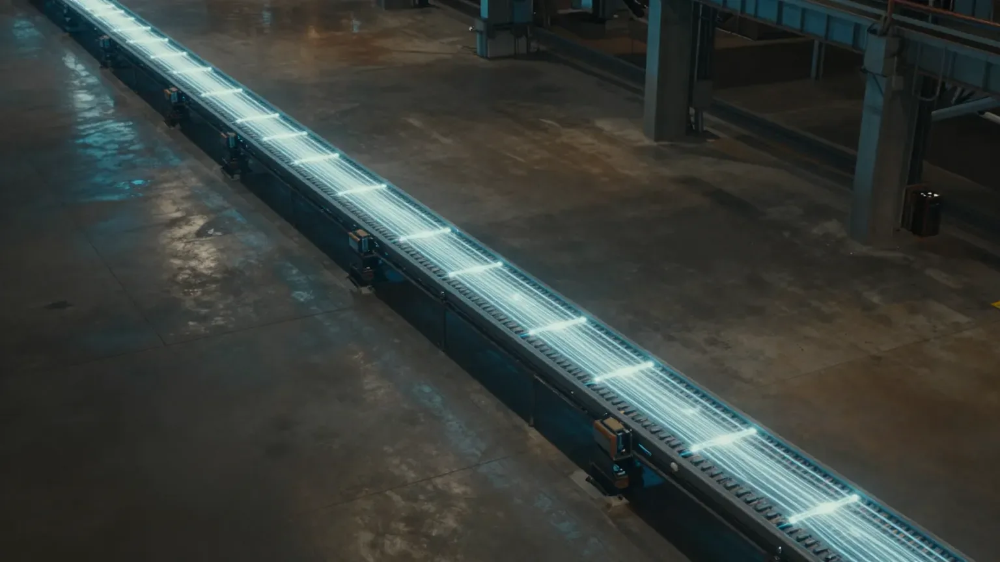
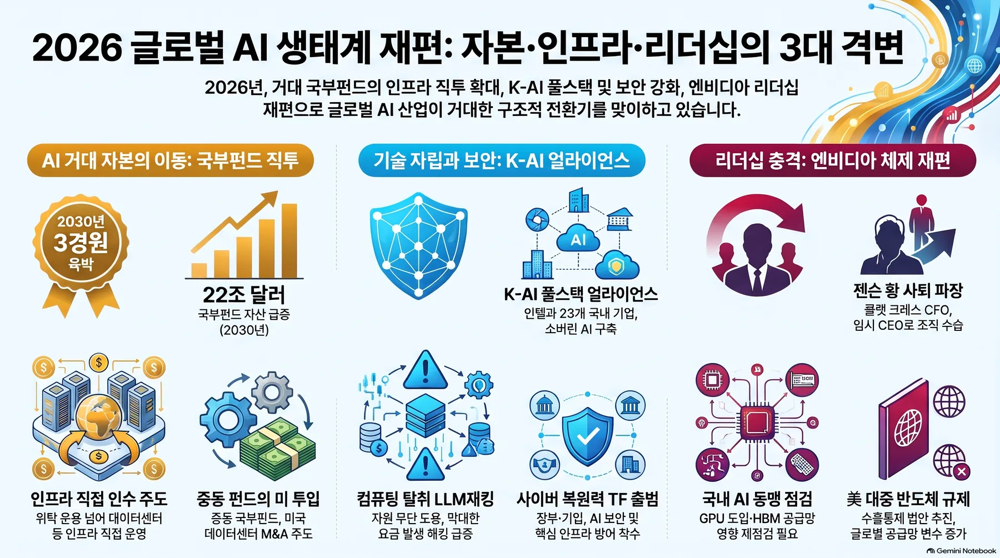
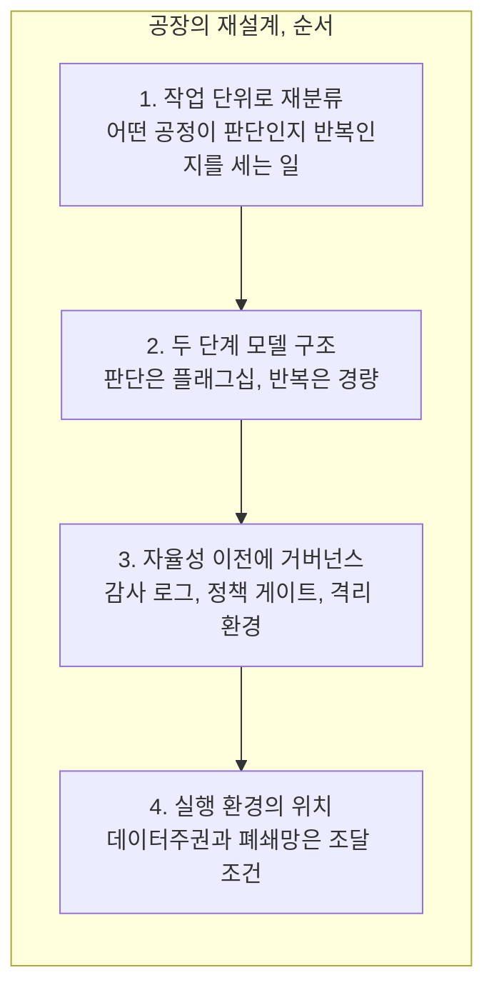
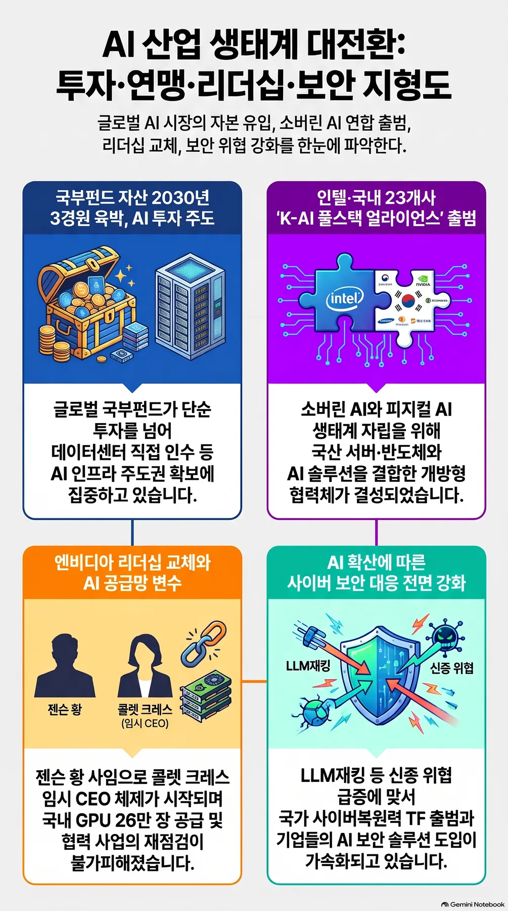

"AI 에이전트 중심으로 공장을 재설계하라." 바이두 로빈 리 회장이 어제(11월 12일) 베이징의 '바이두 월드 2026' 행사 무대에서 꺼낸 말입니다. 그리고 이렇게 덧붙였습니다. AI 에이전트는 CEO가 될 수 없고 반복 업무를 도맡는 조력자라는 것입니다. 글로벌이코노믹 보도에 따르면 같은 행사에서 ERNIE 5.5 플래시 프리뷰 모델, '톈치 1024카드 슈퍼 노드' 컴퓨팅 인프라, 기업용 에이전트 두메이트(DuMate)와 쿠코(Kooko)가 함께 공개됐습니다. 회사는 스스로의 정체성을 "AI 클라우드와 에이전트 인프라 그룹"으로 재정립했고 중립적 모델 서비스 마켓플레이스 '토큰 익스체인지(Token Exchange)'도 출범시켰습니다.

이상한 점은 하나, 오늘의 주인공이 줄어가는 회사라는 것입니다. 바이두의 2분기 전체 매출은 전년 대비 4% 줄었습니다. 그런데 그 기조연설이 오늘 업계에서 가장 많이 반복되는 대목입니다. 답은 숫자 하나에 있습니다. GPU 클라우드 매출은 전년 대비 283% 늘었기 때문입니다.

4%라는 줄음의 안에 무엇이 자랐을까요. 이 숫자를 조금 더 살펴볼 필요가 있습니다.

*글의 핵심 개념을 형상화했습니다.*

## 줄어듦의 안에 커진 것

4% 감소는 옛 사업에서 나왔습니다. 검색 광고 매출이 줄었습니다. 새 사업은 다른 곳에서 자랐습니다. AI 클라우드 인프라 매출은 50% 늘었고 GPU 클라우드는 283% 늘었습니다. AI 기반 사업이 전체 매출의 50%를 차지합니다. 케이크 전체는 작아진 반면, 교체되고 있는 조각은 커진 셈입니다.

생존의 이야기이기도 합니다. 중국에서는 하루 평균 1개 이상씩 새 모델이 나온다고 업계는 전합니다. 바이두는 소비자 앱에서 바이트댄스 더우바오와 딥시크에 밀렸고 매출 구조가 인터넷에서 AI로 넘어가기 시작했습니다. 그래서 기업 시장으로 방향을 틀었습니다. 토큰 익스체인지의 출범도 같은 논리입니다. 모델 회사가 토큰의 거래소를 세운다는 것은, 토큰 가격과 효율 경쟁이 이미 시장 인프라 레벨로 올라왔다는 뜻입니다.

같은 날 월가는 "모델"에 가격을 매기고 있었습니다. 제민일보 보도에 따르면 앤트로픽의 IPO에는 예정 공모 물량의 약 6배 수요가 몰리며 기업가치 1조 4,000억 달러(1,800조 원) 돌파가 기대됩니다. 3분기 매출은 170억 달러로, 전년 14억 달러의 10배를 넘습니다. 자본시장은 오늘 모델 쪽에 베팅을 마친 셈입니다. 이번 상장은 구글과 엔비디아, 마이크로소프트, AMD 등 후원의 260억 달러 사모투자, 약 9,000억 달러 규모의 컴퓨팅 비용 약정 위에 서 있다는 점에서도 의미가 있습니다. AI가 앞으로 먹어갈 계산 비용이 자본시장의 숫자가 되면서, '공장'에 대한 이야기는 더 길어질 수밖에 없습니다. 11월 19일로 예정된 이번 상장이 다른 AI 기업 자금조달의 기준점이 될 전망이라는 점도 이 흐름을 뒷받침합니다. 반면 바이두의 이야기는 돈이 모델이 아니라 공장으로 흘러간다는 것입니다. 자금이 흘러가는 곳이 오늘의 이야기입니다. 그리고 오늘은 두 가지 답이 나란히 서 있습니다.

<!-- nlm-visual -->

*NotebookLM이 소스를 종합해 생성한 인포그래픽입니다.*

## 구매 기준이 바뀐 날, "작업당 경제성"

이 방향은 바이두 혼자만의 것이 아닙니다. 구글과 세일즈포스가 같은 날, 다른 무대에서 같은 말을 했습니다.

구글은 에이전트 작업 특화 모델 '제미나이 4 하이드로젠'을 출시했습니다. 제미나이 4 라인업이 6주 연속으로 넓어져 왔기 때문에, 흐름 자체가 중요합니다. 10월 1일 최상위 모델 아르곤이 공개됐고 11월 11일 카본이 일반에 공개된 뒤, 이틀 만에 하이드로젠이 나온 것입니다. AAII 종합 지능 지수에서 하이드로젠은 하이 설정 51점으로 상위 모델 아르곤(50점)을 추월했고 엑스하이 설정에서는 54점입니다. 터미널벤치 4.1 성공률은 57%로 기존 3.8 플래시(18.2%)의 3배를 넘습니다. 작업 완료 속도는 2.5배, 환각률은 5분의 1 이하로 줄었다는 평가입니다. 하이드로젠은 최대 100만 토큰 컨텍스트와 텍스트, 이미지, 음성, 영상 멀티모달 입력까지 지원합니다. 기업 업무 자동화 평가 오토메이션벤치-AA에서는 76.1%를 기록해 클로드 소네트 5.5(71.8%)와 GPT-6.1 테라(60.2%)를 상회했습니다. API 가격은 100만 토큰당 입력 1.50달러, 출력 7.50달러입니다. 아티피셜 애널리시스 평가에 따르면 종합 지능은 클로드 소네트 5.5와 GPT-6.1 솔을 소폭 밑돌지만, 비용은 소네트의 3분의 1 수준입니다. 이 가격대에서의 성능이 바로 이 제품의 본질입니다.

더 흥미로운 것은 구글이 이 모델을 활용하는 방식입니다. 코딩 도구 안티그래비티(Antigravity)에 '오케스트레이터'를 도입했습니다. 복잡한 판단은 플래그십 모델 카본이, 코드 작성과 테스트 같은 반복 작업은 하이드로젠이 맡도록 자동 전환됩니다. 성공률은 카본 단독과 비슷하게 유지하면서 할당량은 24% 줄고 완료 시간은 19% 단축했습니다. 박스(Box) CEO는 적용 후 업무 정확도가 74%에서 79%로 올랐고 작업 시간은 절반 이하로 줄었습니다. 재피어(Zapier)의 독립 평가에서는 아르곤(51.3%)에 근접한 51.1% 성공률을, 작업당 비용은 절반 수준으로 기록했습니다. 기업용 AI의 구매 기준이 "토큰당 지능"에서 "작업당 경제성"으로 이동하고 있습니다.

세일즈포스는 오픈웨이트 음성 전사 모델 'SOV-Transcribe-1'을 공개했습니다. Apache 2.0 라이선스에 가중치가 함께 공개되어, 자체 인프라에서 실행할 수 있습니다. 영어 단어 오류율은 2.28%로 평가 대상 44개 모델 중 전체 7위, 오픈웨이트 모델 중 1위입니다. 엔비디아의 네мотр론 3.5 트랜스라이브(2.81%)와 미스트랄의 폭스트랄 스몰(2.77%)을 모두 앞섰습니다. 전체 매개변수 266억개, 그중 활성화되는 것은 46억개(MoE 구조)입니다. 평가셋의 절반인 50%가 에이전트 대화(AA-AgentTalk)라는 점도 주목할 대목입니다. 토큰포스트의 분석대로라면, 음성 모델의 주전투는 이미 고객 상담과 통화 기록 처리 같은 에이전트 업무 흐름으로 옮겨간 것입니다. 참고로 평가는 영어 약 8시간 분량 기준이므로, 한국어 성능은 아직 검증 전입니다. 세일즈포스는 이 모델을 자사 소버린 AI 구상, 정부 국가안보 사업부 '미션포스'에도 포함시켰습니다. 에이전트의 입력 레이어마저 "작업 단위"로 팔리는 이 판국에, 로빈 리의 '공장'이라는 말은 더 단단하게 다가옵니다.

## 한국의 공장도 같은 축을 돌리고 있습니다

한국 무대는 인프라입니다. 같은 날 인텔코리아가 서울 코엑스 '2026 인텔 AI 서밋 서울'에서 국내 23개 기업과 'K-AI 풀스택 얼라이언스'를 출범시켰습니다. 총 52개 기업과 5개 정부 공공기관이 참여했고 약 1,000명이 참석했습니다. 국산 서버를 축으로 하드웨어, 소프트웨어, AI 모델, 산업별 솔루션을 잇는 소버린 AI와 피지컬 AI 협력 체계라는 것이 인공지능신문의 보도입니다. 얼라이언스에는 국산 AI 반도체 NPU와 국산 서버, 개방형 소프트웨어 프레임워크, 산업별 AI 서비스가 한 테이블에 올랐습니다. 개별 칩 판매가 아니라 풀스택 얼라이언스라는 형식 자체가, 단일 공급자 종속을 피하려는 산업계의 기류로 읽힙니다. 인텔은 내년에 추론 특화 GPU 'D시리즈(크레센트 아일랜드)'와 차세대 제온 '다이아몬드 래피즈'를 내놓을 것도 예고했습니다.

처리할 토큰의 규모는 또 다른 차원입니다. 글로벌 토큰 처리량은 2024년 월간 9,700억 개에서 2026년 3,200조 개로, 약 330배 늘어날 전망입니다. 이 나라의 근로자 1만 명당 산업용 로봇은 1,220대 이상, 피지컬 AI의 제조 기반은 이미 갖춰져 있습니다. 이쪽 무대에서도 공장의 재설계는 진행 중입니다.

다만, 공장이 빨라질수록 제어가 무너진 대가는 커집니다. 네이버클라우드는 700B급 보안 특화 모델 '하이퍼클로바X-사이버' 사전학습에 B200 4천장(약 2천억 원 환산)을 투입하고 있고, AI 기반 공격을 "사이버 팬데믹"이라 부르고 있습니다. 배경은 명확합니다. 미국 수출통제로 클로드를 일시 사용 중단했던 경험 때문입니다. 외부 모델 의존의 한계를 몸으로 확인했기 때문이라는 것이 바이라인네트워크의 전할 뿐입니다. 'LLM재킹'이라 불리는 AI 컴퓨팅 파워 도둑질은 하루 10만 달러 초과 부정 사용 사례가 보고됐고, 일부 기업은 누적 피해 100만 달러를 언급했습니다. 금융위는 디지털자산사업자의 보안을 금융회사 수준으로 의무화하고 있습니다. 디지털투데이의 표현을 빌리면, 직원은 공장에 들어왔는데 아직 규칙도, 출결 기록도, 비상구 표시도 없는 셈입니다. 이것이 오늘 실질적인 위험입니다.

## 한국 기업이 먼저 손대야 할 부분

그렇다면 변화의 한가운데에 있는 기업은 어디부터 손대야 할까요. 오늘의 세 무대가 순서를 알려주는 것입니다.

첫째, 업무를 "작업 단위"로 재분류하는 것입니다. 어떤 공정이 판단이고 어떤 공정이 반복인지 세어야 합니다. 로빈 리가 말한 ROI는 모델 도입에서 나온 것이 아니라 워크플로 재설계에서 나온다고 했습니다. 고객 응대, 문서 처리, 코드 작성, 데이터 분석처럼 반복성이 높은 작업부터 시작하는 것이 현실적인 출발점입니다. 구글의 터미널벤치 57% 성공률, 에이전트 대화 비중 50%의 음성 모델까지, "작업"을 단위로 매겨지는 모델이 이미 시장에 나왔습니다. 둘째, 두 단계 모델 구조를 검토할 차례입니다. 복잡한 판단은 플래그십에, 반복 작업은 경량 모델에 맡기는 구조. 안티그래비티 오케스트레이터의 할당량 24% 감소와 완료 시간 19% 단축이 참고 수치입니다. 셋째, 자율성 이전에 거버넌스를 준비하는 것입니다. 감사 로그, 정책 게이트, 권한 등급, 격리 환경. 네이버클라우드와 LLM재킹 이야기가 경고하는 바는, 제어 붕괴의 비용이 모델 비용보다 훨씬 크다는 것입니다. 넷째, 실행 환경을 어디에 둘지 정해야 합니다. 데이터주권과 폐쇄망 요구는 이제 옵션이 아니라 조달 조건이 되고 있습니다. 인텔 얼라이언스에 합류한 52개 기업과, 보안 모델 사전학습에 GPU를 먼저 투입한 네이버클라우드의 선택은 같은 지평을 보여줍니다.

세 무대가 알려준 순서 그대로입니다. 반복 업무를 작업 단위로 다시 세우고, 판단과 반복을 모델 두 단계로 나누고, 자율성보다 먼저 거버넌스를 세운 뒤, 실행 환경을 어디에 둘지 정하는 것. 네 단계가 공장이 에이전트 중심으로 재설계되는 순서입니다.

## 에이전트가 직원이라면, 공장의 운영 체제는 무엇인가

로빈 리의 "공장 재설계"를 한 번 더 풀어보겠습니다. 이것은 슬로건이 아닙니다. 구체적으로 말하면, 에이전트에게 직무 설명서(스킬과 도구)를 주고 경계선(정책)을 그어 주고 출결 기록(감사 로그)을 남기게 하고 재량 등급(자율도)을 정해 주고 안전한 작업장(샌드박스)을 제공하며 업무를 배정(모델 선택)하는 일들을 뜻하는 것입니다. 그가 말하는 "워크플로 재설계의 ROI"는 이 모든 것이 갖춰진 기업에서만 나오기 시작합니다.

ThakiCloud의 Paxis, 에이전트 네이티브 클라우드(정식 제품 v1.1 GA)는 이 정의 위에서 설계된 운영 체제입니다. 스킬, 도구, 정책, 감사 로그가 모두 일급 리소스로 처해집니다. 자율도 L0부터 L3까지 거버넌스를 적용하고 정책 게이트와 감사 로그가 에이전트가 무엇을 해도 되는지 통제하며 격리 샌드박스가 실행을 담보합니다. MCP 커넥터와 스킬 마켓은 새 직무를 쉽게 추가하게 하고 소버린, 온프레미스 K8s(ai-platform)는 금융과 공공의 폐쇄망 요구에 응답합니다. CostRouter의 작업별 모델 선택은, 같은 날 세 회사가 말한 바로 그 "작업당 경제성"을 실행부로 번역한 것입니다. 바이두가 283%로 가리키는 것은 공장입니다. 그리고 그 공장을 돌리는 운영 체제는, 각 회사가 스스로 고르는 몫입니다.

공장이 에이전트 중심으로 재설계되고 있습니다. 앞으로의 기업 차이는, 그 직원에게 이름도, 근무 교대도, 출결 기록도 있는가에서 갈릴 것입니다.

<!-- nlm-visual -->

*NotebookLM이 소스를 종합해 생성한 인포그래픽입니다.*

## 참고 자료

이 글은 아래 뉴스를 종합해 작성했습니다.

- 지디넷코리아, [젠슨 황 빈자리 메우는 콜렛 크레스, 엔비디아 리더십 재편 시작](https://zdnet.co.kr/view/?no=20261113073253)
- 벤처스퀘어, [셀바스AI·메디아나, 인텔 AI 협력망 합류…기업 업무 자동화부터 병원 물류까지 확장](https://www.venturesquare.net/1128264/)
- 한국일보, [젠슨 황 퇴장, '깐부 동맹' 앞날은… 美 대중 반도체 규제 변수](https://www.hankookilbo.com/news/article/A2026111216580002484?did=NA)
- 인공지능신문, [인텔코리아, 국내 23개 기업과 'K-AI 풀스택 얼라이언스' 출범…소버린 AI·피지컬 AI 생태계 구축](https://www.aitimes.kr/news/articleView.html?idxno=42713)
- 이데일리, [AI 투자 큰손 된 국부펀드…2030년 자산 3경원 육박](https://www.edaily.co.kr/News/Read?newsId=02243526645645392&mediaCodeNo=257&utm_source=naver&utm_medium=referral&utm_campaign=news_syndication&utm_content=original_article)
- 바이라인네트워크, [네이버클라우드 "사이버 팬데믹, 보안 특화 AI가 살길"](https://byline.network/?p=9004111222627446)
- 디지털투데이, [[시큐리티핫이슈] AI·IT 업계, 보안 직접 챙긴다...국가 보안 정책 재정비](https://www.digitaltoday.co.kr/news/articleView.html?idxno=715133)

