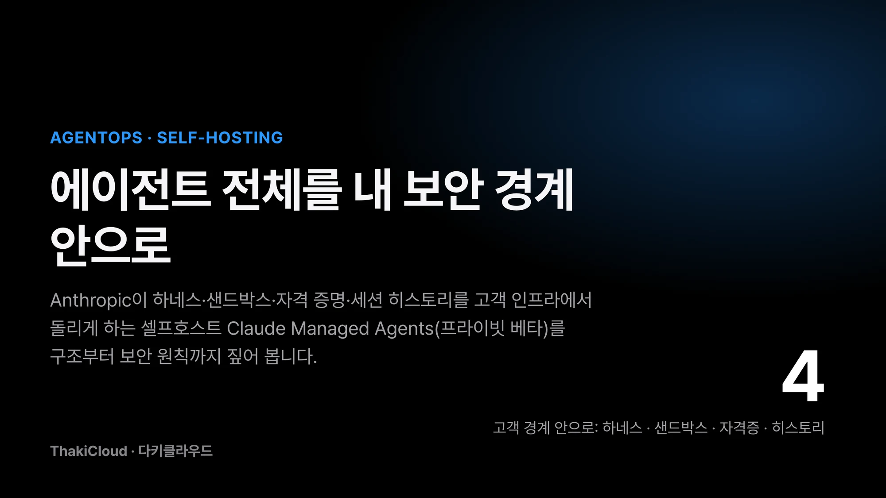
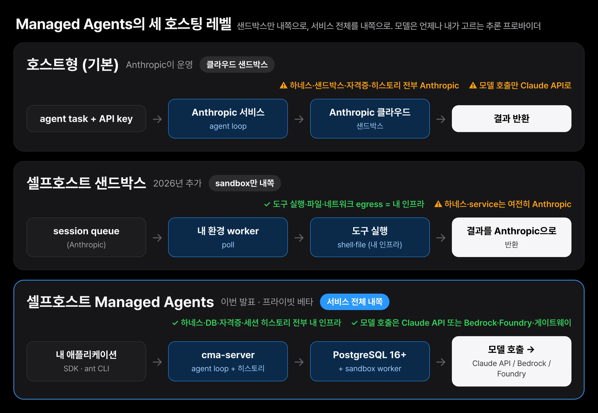
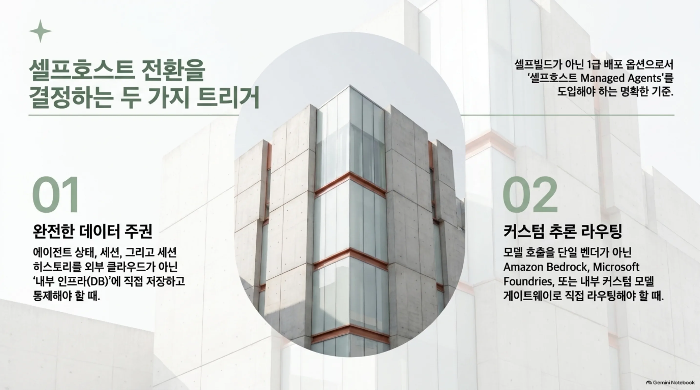
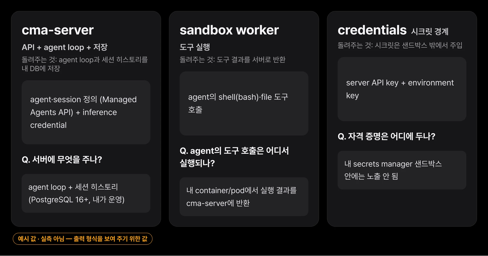
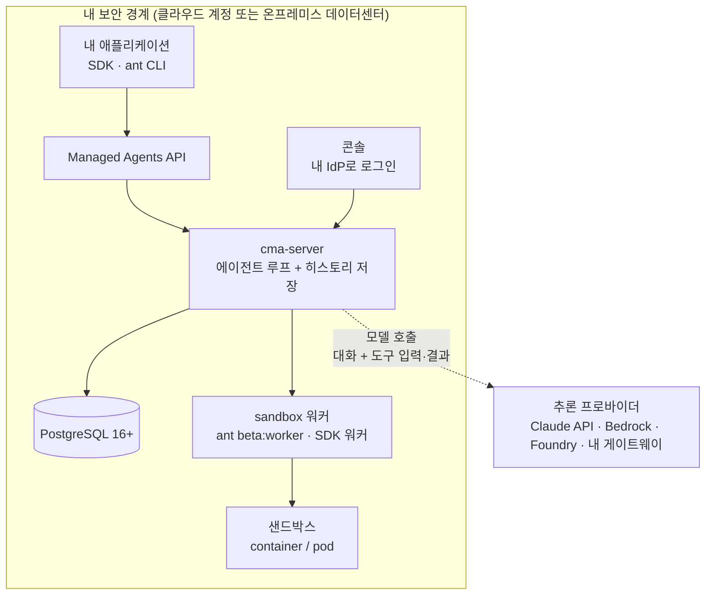
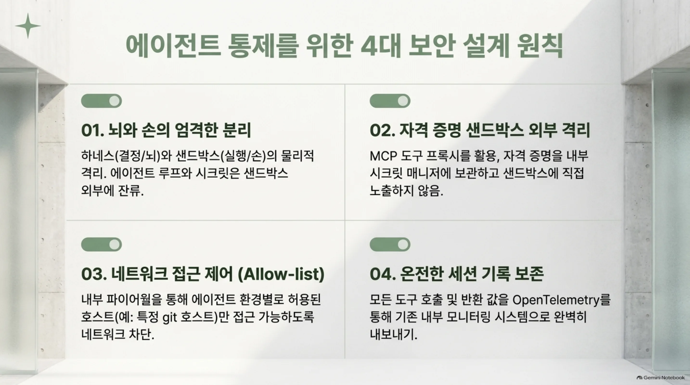
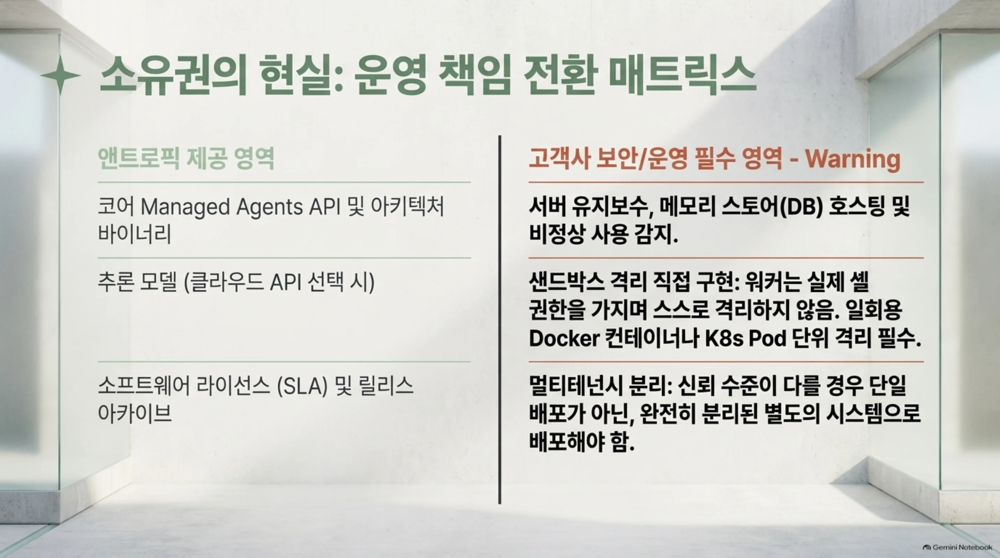
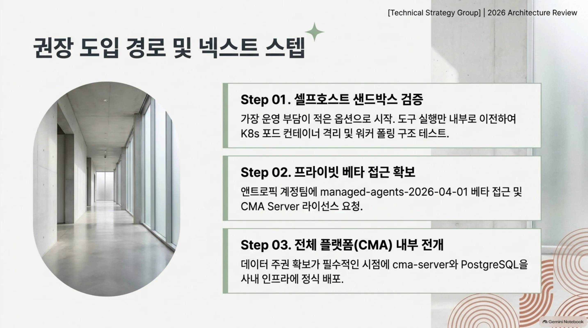

에이전트를 프로덕션에 올린 팀이라면 이 질문을 한 번쯤 마주합니다. 새벽에 깨진 빌드를 고치는 에이전트, 릴리스를 테스트하는 에이전트, 알람을 트리아지하는 에이전트, 버그 백로그를 파고드는 에이전트. 이런 에이전트는 무인으로, 내 코드 위에, 내 내부 시스템에 접속한 채로 돌아야 합니다. 그런데 이 에이전트를 실제로 돌리는 플랫폼 자체는 어디에 두는 걸까요.

그동안 답은 둘 중 하나였습니다. 전부 앤트로픽 클라우드에 두는 쪽, 아니면 샌드박스(도구 실행 환경)만 내 쪽으로 빼놓고 나머지 서비스는 앤트로픽에 두는 쪽, 이 둘이었습니다. 후자가 셀프호스트 샌드박스였습니다. 앤트로픽이 이제 그 답을 한 칸 더 내밀었습니다. 하네스, 샌드박스, 자격 증명, 세션 히스토리를 전부 내 인프라에서 돌리는 '셀프호스트 Claude Managed Agents'가 프라이빗 베타로 나왔습니다. 에이전트를 고객이 돌리고, 자격 증명과 세션 히스토리를 고객에게 두며, 클로드에 보낼 요청의 목적지까지 고객이 고를 수 있게 됐다는 뜻입니다.

즉, '플랫폼 자체를 내 보안 경계에 두느냐'가 셀프빌드가 아니라 1급 배포 옵션이 됐다는 것이 이번 발표의 핵심입니다.

이 글은 이 새로운 배포 옵션이 어떤 구조로, 어떤 보안 원칙 위에서, 그리고 무엇을 내 것으로 가져가면 함께 어떤 책임이 넘어오는지를 짚습니다. 에이전트 플랫폼을 내 보안 경계 안에 두고 싶은 인프라 담당자, 그리고 이미 같은 패턴을 돌리는 Paxis 운영팀이 읽으면 좋습니다.

*클라우드 샌드박스(기본)부터 셀프호스트 샌드박스, 이번 셀프호스트 Managed Agents까지. 고객이 직접 돌리는 것의 범위가 넓어집니다.*

## 샌드박스만 내쪽으로 넣던 것에서 한 칸 더

Managed Agents는 "자율 에이전트를 만들어 배포하는 조립식 API 모음"입니다. 에이전트를 프로덕션으로 보내려면 네 가지가 필요하고, Managed Agents는 그 네 가지를 한 번에 줍니다. 하네스(에이전트 루프), 샌드박스, 자격 증명 처리, 세션 히스토리. 이 네 가지가 각각 어디에서 도느냐에 따라 배포 옵션이 갈립니다.

문서에 정리된 세 단계는 아래 도표와 같습니다. 기본 호스트형은 앤트로픽이 전부 돌립니다. 2026년에 추가된 셀프호스트 샌드박스는 도구 실행만 내 인프라로 옮기고, 하네스와 서비스는 여전히 앤트로픽이 맡습니다. 그리고 이번 셀프호스트 Managed Agents는 서비스 전체를 내 경계 안으로 옮깁니다.

*Managed Agents의 세 호스팅 레벨. 하이라이트된 아래 레인이 이번 발표입니다.*

"셀프호스트 Managed Agents를 언제 고르는가"에 대해 문서는 딱 두 가지 이유를 줍니다. 첫째, 에이전트·세션·세션 히스토리를 나 스스로 저장해야 할 때입니다. 둘째, 모델 호출을 내가 고르는 추론 프로바이더로 보내야 할 때입니다. 이 두 가지가 다 해당되지 않고, 그냥 도구를 내 인프라에서 돌리려는 것뿐이라면 셀프호스트 샌드박스가 맞는 선택입니다. 앤트로픽이 그쪽도 여전히 서비스로 운영해주기 때문입니다.

*셀프호스트 전환을 결정하는 두 가지 트리거입니다. 에이전트·세션·히스토리를 내가 저장해야 하고, 모델 호출을 내가 고른 프로바이더로 라우팅해야 할 때.*

## 서버, 데이터베이스, 워커, 콘솔: 내 경계 안의 주체들

"서버 하나, 그 데이터베이스, 내 샌드박스가 하나의 배포"를 이룹니다. 그 안에 들어가는 주체를 하나씩 보면, 누가 무엇을 맡는지가 명확해집니다.

- **cma-server**: API를 서빙하고 에이전트 루프를 돌리며, 에이전트·세션·각 세션의 히스토리를 저장합니다. 에이전트가 모델이 필요할 때마다 추론 프로바이더를 부릅니다. 그런데 이 서버는 에이전트의 셸이나 파일 도구는 절대 직접 실행하지 않습니다.
- **데이터베이스**: PostgreSQL 16 이상. 데이터베이스가 없으면 서버가 메모리에 데이터를 갖고, 리스타트하면 사라집니다.
- **워커**: 서버에서 일을 받아 에이전트의 셸·파일 도구를 내 샌드박스에서 실행하는 프로그램입니다. `ant beta:worker` 명령이거나 SDK 워커입니다.
- **콘솔**: 서버 주소의 웹페이지로, 내 아이덴티티 프로바이더(IdP)로 로그인해 에이전트를 만들고 세션을 돌립니다.
- **관리 CLI(cma-server-admin)**: 환경과 환경 키를 만듭니다. Linux(x86-64, Arm)과 Apple 실리콘 macOS에서 도는 바이너리입니다.
- **내 애플리케이션**: SDK나 `ant` CLI로 서버에 닿는, 내 코드와 스크립트.

세 가지 자격 증명도 구분됩니다. 애플리케이션과 `ant` CLI, 관리 CLI가 가진 '서버 API 키', 서버를 폴링하는 워커가 가진 '환경 키', 그리고 서버가 추론 프로바이더에 인증할 때 쓰는 '추론 자격 증명'입니다.

*서버·워커·자격 증명, 각 주체가 받는 것과 돌려주는 것.*

네트워크 경계는 이 주체들이 어떻게 이어지는지에서 가장 잘 보입니다. 내 애플리케이션, 서버, 데이터베이스, 워커는 전부 내 네트워크 안에 있고, 그 안에서 API로 부르고 폴링으로 일을 빼고 DB에 저장합니다. 경계를 넘는 것은 오직 모델 호출 하나입니다.

그 하나마저 어디까지 나가느냐는 문구가 명확합니다. 서버는 각 모델 호출마다 "지금까지의 대화, 즉 도구 입력과 도구 결과를 포함해" 추론 프로바이더로 보냅니다. 기본적으로는 클로드 API이고, 클로드 API 호출에는 해당 세션과 그 세션의 에이전트·환경 ID도 함께 실립니다.

## 모델 호출만 내가 고르는 곳으로

이번 배포 옵션의 경제적 핵심은 "모델이 어디에서 도느냐"를 고객이 정할 수 있다는 점입니다. 서버는 내가 구성한 추론 프로바이더에 각 모델 호출을 보냅니다. 클로드 API가 기본값이고, 아마존 베드록, 구글 클라우드의 클로드 모델(구글 관리), 마이크로소프트 파운드리스, 또는 내 모델 게이트웨이로 바꿀 수 있습니다.

중요한 것은 API가 변하지 않는다는 점입니다. 호스팅 Managed Agents와 같은 코어 API로 에이전트를 만들 수 있고, SDK와 `ant` CLI가 내 서버에서도 그대로 동작합니다. 셀프호스트를 처음 도입한다고 해서 호스트형부터 거쳐갈 필요도 없습니다. 문서의 예시에는 버전을 고르는 헤더가 등장합니다. `anthropic-version: 2026-10-21`, 그리고 베타 헤더 `anthropic-beta: managed-agents-2026-04-01`.

데이터 잔류 관점에서도 같은 구조가 이어집니다. 세션 히스토리는 내 데이터베이스에 있고, 만약 내 조직이 앤트로픽과 제로 데이터 잔류(ZDR) 계약을 맺었다면 클로드로 보내는 요청에도 일반 Messages API 호출과 똑같이 ZDR가 적용됩니다.

## 에이전트 보안은 아키텍처에서 시작된다

발표 자료는 "에이전트 보안은 아키텍처에서 시작된다"고 쓰고, 앤트로픽이 전부 돌릴 때도, 샌드박스만 내가 돌릴 때도, 서비스 전체를 내가 돌릴 때도 모두 적용되는 네 가지 설계 원칙을 줍니다.

*에이전트 통제를 위한 4대 보안 설계 원칙을 한눈에 담은 슬라이드입니다.*

**뇌와 손을 나눈다.** 하네스(뇌)가 클로드를 부르고, 샌드박스(손)가 에이전트의 코드를 실행합니다. 에이전트 루프, 세션 히스토리, 볼트 시크릿은 샌드박스 바깥에 남습니다. 샌드박스는 도구가 필요할 때에만 시작하고, 세션 히스토리는 샌드박스 바깥에 이벤트 로그로 쌓입니다.

**자격 증명은 샌드박스 밖으로.** MCP 도구와 지원되는 API 호출에 자격 증명을 붙이는 프록시가 샌드박스 바깥에 있고, 셀프호스팅에서는 자격 증명을 내 시크릿 매니저에 둘 수도 있습니다.

**네트워크 접근은 제한할 수 있다.** 각 환경을 허용 호스트 목록으로 묶고, 목록 밖 호스트는 차단합니다. 빌드를 고치는 에이전트라면 그 목록이 "git 호스트와 패키지 레지스트리" 두 개에 불과할 수도 있습니다. 샌드박스를 내가 돌리는 경우에는 이 제한을 내 파이어월에서 직접 씁니다.

**모든 세션은 온전한 기록을 남긴다.** 각 단계, 도구 호출, 반환 값을 모두 기록하고, OpenTelemetry로 내 기존 모니터링으로 내보냅니다.

네 원칙은 새로운 기능 목록이 아니라, "에이전트에게 내부 시스템 접근을 주는 것"이라는 전제에서 어떻게 사고를 해야 하는지를 보여줍니다. 특히 1번과 2번은 에이전트가 아무리 능력을 키워도 '실행 환경'과 '결정 환경'을 분리해야 한다는, 에이전트 인프라의 오래된 원칙을 1급 API로 고정하고 있다는 점에 의미가 있습니다.

## 내 것으로 옮기면 함께 넘어오는 것

좋은 선택지를 고르는 것만큼, 함께 따라오는 책임을 아는 것이 중요합니다. 문서는 이번 셀프호스트 Managed Agents에서 고객이 직접 운영·보안해야 하는 것을 정직하게 늘어놓습니다. 서버와 그 데이터베이스, 내 샌드박스를 돌리고 안전하게 지키는 일, 그리고 각 릴리스를 내가 설치하는 일까지입니다. 앤트로픽이 호스트형에서 맡았던 것이 이쪽 책임으로 넘어오는 것입니다. 서버를 지키고, 메모리 스토어를 호스팅하고, 비정상 사용을 감지하는 것까지 포함합니다.

*소유권의 현실입니다. 앤트로픽이 계속 제공하는 영역과, 고객이 반드시 지워야 하는 영역이 나뉩니다.*

샌드박스 격리는 여기서 자주 놓치는 부분입니다. 문서의 표현을 그대로 따지면, "에이전트의 bash 도구는 워커 프로세스의 권한과 네트워크 접근을 가진 실제 셸"이고, "워커는 그 셸을 격리하지 않습니다". 격리는 내가 합니다. Docker Compose 스택과 `cma-sandboxes` Helm 차트 각각은 세션마다 워커를 별도의 컨테이너나 포드로 시작하고, 워커를 직접 돌린다면 "내가 지켜야 할 것이 하나도 없는 일회용 컨테이너나 VM"에 돌리라고 권합니다.

멀티테넌시는 또 다른 주의점입니다. "각 신뢰 수준은 별도의 배포가 필요합니다." 같은 배포 안에서 서로 다른 신뢰 수준을 섞어 돌리는 것이 아니라, 신뢰 등급이 바뀌면 배포 자체를 나누어야 합니다. 소프트웨어 라이선스는 "Software License Agreement: Claude Managed Agents Server"이고, 각 릴리스 아카이브에는 그 버전의 운영 가이드(operator-guide.md)가 함께 들어 있습니다. 도입은 프라이빗 베타로, 앤트로픽 계정팀에 요청해 접근을 받습니다.

## ThakiCloud에게는 이미 익숙한 형태

이 발표가 흥미로운 이유는, 우리가 같은 구조를 이미 돌리고 있기 때문입니다. Paxis는 ThakiCloud의 Agent-Native Cloud로, 에이전트가 코드를 실행하는 환경을 '결정'이 일어나는 환경에서 분리하는 것을 기본 설계로 둡니다. Paxis의 Skill Harness는 960개 이상의 스킬을 BM25로 골라 격리 샌드박스에서 실행하고, 모든 동작을 정책 게이트와 감사 로그로 통과시킵니다. 발표 자료의 네 원칙을 Paxis 레이어로 대조해 보면 겹치는 부분이 많습니다.

| 발표 자료의 원칙 | Paxis에서 이미 있는 대응 |
|---|---|
| 뇌와 손 분리 | Skill Harness(결정)와 샌드박스 실행(실행)이 이미 분리 |
| 자격 증명 샌드박스 밖 | MCP 커넥터의 OAuth 자동 재연결, 시크릿은 샌드박스 밖에서 주입 |
| 네트워크 제한 | 샌드박스 egress 정책, 허용 호스트 목록 |
| 온전한 세션 기록 | 감사 로그가 이벤트 기록으로, 관측으로 내보내기 |

다만 앤트로픽 발표가 만드는 차이는 명확합니다. 하네스 자체가 이제 고객이 운영할 수 있는 1급 아티팩트가 됐다는 점입니다. "어느 쪽의 뇌가 도느냐"가 아키텍처의 문제가 아니라 배포 옵션의 문제가 된 것입니다.

인프라 측면에서도 같은 형상입니다. cma-server와 PostgreSQL, 그리고 큐를 폴링하는 워커가 K8s 포드로 나가는 배포는, ThakiCloud가 K8s 위에서 워크로드를 돌리고 스케줄하는 방식과 겹칩니다. 온프레미스나 소버린을 요구하는 고객이 에이전트 플랫폼 전체를 내 경계에 두려면, 이제 셀프빌드 대신 1급 배포 옵션을 고를 수 있습니다. 물론 이는 제품 통합 발표가 아니라 아키텍처 비교이고, 두 플랫폼을 직접 이어쓰는 것도 아닙니다.

## 쓰기 전에 알아둘 것들

- 프라이빗 베타입니다. 앤트로픽 계정팀에 요청해 접근을 받아야 하고, 셀프호스트에 앞서 호스트형을 경험할 필요는 없습니다.
- 호스트형에만 존재하는 기능이 일부 있습니다. 결정 전에는 문서의 'Differences from the hosted service'를 확인해야 합니다.
- 공개 벤치마크 수치가 아직 없습니다. 이번 발표는 속도나 성능 주장이 아니라, "플랫폼을 어디에 두느냐"의 배포 옵션입니다.
- 운영·보안 책임이 통째로 넘어옵니다. 서버·메모리 스토어·비사용 감지, 그리고 릴리스당 설치가 모두 내 몫입니다.
- bash 도구는 워커가 격리하지 않는 실제 셸입니다. 격리는 컨테이너·포드 단위에서 내가 해야 합니다.
- 신뢰 수준이 달라지면 배포도 나눕니다. 한 배포 안에서 멀티테넌트 격리를 기대하면 안 됩니다.

## 끝으로

"에이전트 플랫폼 전체를 내 보안 경계 안에 둘 수 있는가"에 대한 1급 답이 생긴 것입니다. 판단은 두 가지 트리거로 좁혀집니다. 에이전트·세션·히스토리를 스스로 저장해야 하는가, 그리고 모델 호출을 베드록·파운드리스·내 게이트웨이로 보내야 하는가. 둘 다 맞으면 셀프호스트 Managed Agents입니다. 도구가 내 인프라에서 도는 것만 필요하면 셀프호스트 샌드박스가 부담이 적습니다.

*권장 도입 경로를 세 단계로 짚은 슬라이드입니다.*

첫 실험은 낮은 부담부터 시작하는 것이 좋습니다. 셀프호스트 샌드박스에서 도구 실행만 내 쪽으로 빼고, 워커가 폴링하며 샌드박스가 컨테이너로 뜨는 형상을 확인한 뒤, 서비스가 필요해지는 시점에 cma-server와 데이터베이스를 함께 올립니다. 도입 문서는 docs의 self-hosted 페이지, 발표 자료의 claude.com 리소스 페이지, 그리고 라이선스 페이지가 정본입니다.
