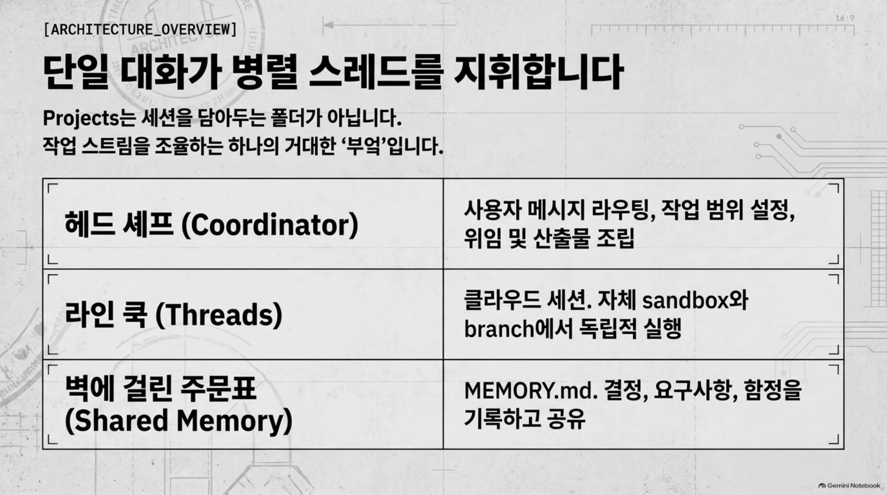
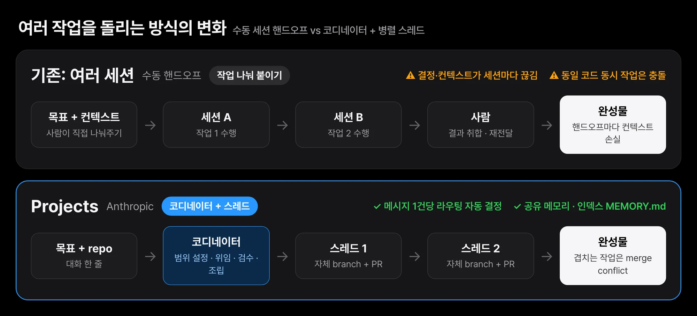
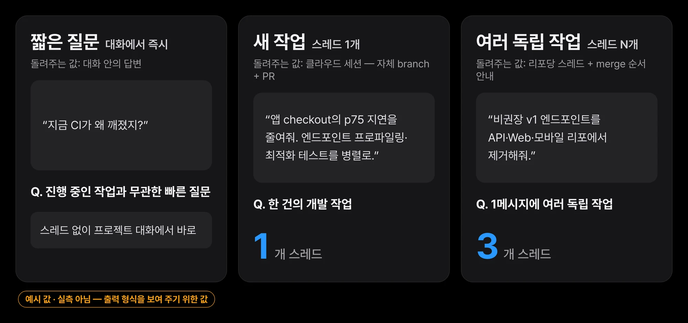
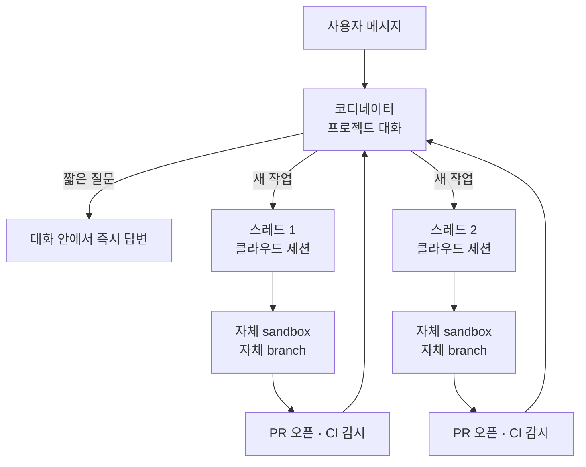
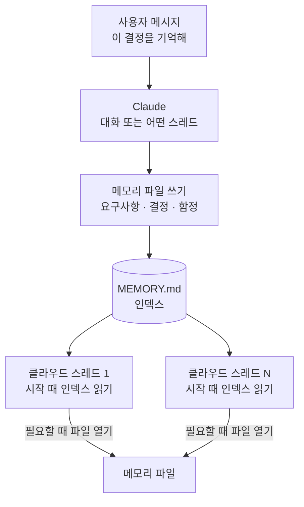
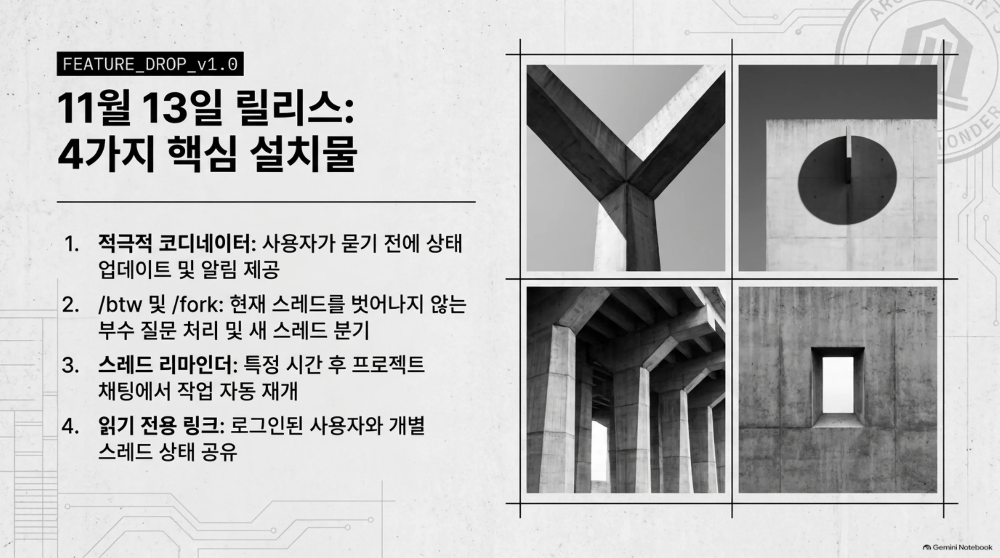
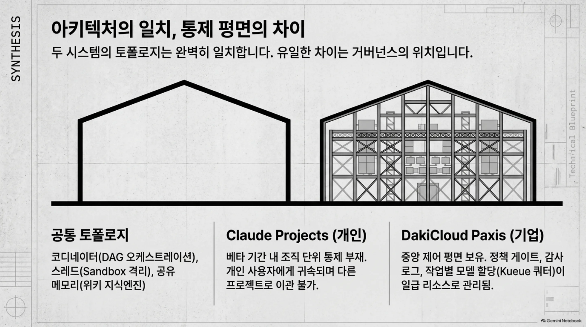

AI 코딩 에이전트를 병렬로 돌리는 개발자라면, 다음 세 장면이 익숙합니다. 터미널에 클로드 코드 세션을 세 개 띄워 두면, 하나가 끝나자마자 그 결과를 복사해 새 세션에 다시 붙여넣습니다. 어제 세션에서 내렸던 결정을 오늘 세션에 또 설명해야 합니다. 같은 파일에 두 세션이 손을 대어 충돌이 나면, 어느 쪽을 살릴지 사람이 고릅니다. 이 글은 Claude Code Projects 도입 여부를 고르는 데 쓰는 글입니다.

2026년 11월 13일, 앤트로픽은 클로드 코드 Projects에 "큰 업데이트"를 발표했습니다. Projects는 더 이상 세션이 들어 있는 폴더가 아닙니다. 하나의 대화이고, 그 대화가 병렬로 도는 스레드들을 지시하는 구조입니다. 공식 문서는 프로젝트를 "A project is one ongoing conversation where Claude coordinates a stream of related work for you"라고 정의합니다.

핵심 수치를 하나 먼저 둡니다. Projects에서 하루에 새로 만들 수 있는 스레드의 강제 한도는 500개입니다. 동시에 도는 스레드 수에는 고정 한도가 없고, 사용자가 달라고 한 숫자는 "선호"일 뿐입니다. 대신 각 스레드는 온전한 클라우드 세션이라 플랜 한도를 빠르게 태웁니다.

이 글은 Projects의 구조(코디네이터, 스레드, 공유 메모리)를 열고 11월 13일 업데이트에서 새로 들어온 네 가지 기능과 쓰기 전에 알아둘 한계를 다룹니다. 마지막에는 이 구조가 다키클라우드의 Agent-Native Cloud Paxis와 어떤 지점에서 만나는지 짚습니다.

*Projects의 핵심: 하나의 대화가 병렬 스레드를 지시합니다. 강제 한도는 하루 신규 스레드 500개.*

## 쉽게 말하면

Projects는 식당 부엌과 닮았습니다. 이 글에서는 이 비유만 씁니다.

기존 클로드 코드는 부엌이 아니라 개별 요리사들이었습니다. 요리사 세 명을 세워 주면 각자 자기 앞 접시만 보고 일합니다. 메뉴를 나누는 일, 재료 위치를 알려 주는 일, 완성 요리를 확인하는 일은 전부 사람이라는 주방장의 일이었습니다.

Projects는 부엌 자체를 줍니다. 코디네이터는 헤드 셰프입니다. 주문인 사용자 메시지를 받으면, 질문인 건 그 자리에서 답하고 요리가 될 건 라인 쿡에게 배정합니다. 스레드는 라인 쿡입니다. 각자 자기 스테이션(자체 branch와 sandbox)에서 일하고 완성하면 패스에 접시(PR)를 올립니다. 벽에 걸린 주문표(공유 메모리)는 모든 쿡이 읽고 씁니다. "출고가 금요일로 미뤄졌다", "그 재료는 알레르기 반응이 있었다" 같은 결정이 주문표에 붙어 있으면, 새로 들어온 쿡이 처음부터 묻지 않습니다.

*부엌 비유를 역할표로 옮긴 것입니다. 모든 스레드가 주문표에 읽고 쓰니, 새로 들어온 쿡이 처음부터 묻지 않습니다.*

*부엌 비유를 구조로 옮긴 것입니다. 위 레인은 사람이 작업과 결과를 이어 붙이던 방식, 아래 레인이 Projects입니다.*

## 질문은 대화에서, 작업은 스레드로

Projects의 중앙에는 "프로젝트 대화" 하나를 두고 거기서 코디네이터가 돌아갑니다. 공식 문서의 표현을 그대로 쓰면, 코디네이터는 사용자가 보낸 것을 받아들이고 무엇이 스레드가 되는지 결정하고 자기가 만든 모든 스레드를 추적합니다. 스레드가 보고한 결과는 보고받되, 스레드가 밟은 모든 단계까지는 보지 못합니다.

메시지 라우팅은 코디네이터의 일입니다. 짧은 질문은 대화 안에서 바로 답합니다. 새 일은 새 스레드나 이미 그 영역에서 일하는 기존 스레드에 배정하고 어느 쪽인지 알려 줍니다. 한 메시지에 서로 무관한 일이 여러 개 들어 있으면 각각 독립 스레드가 됩니다.

공개 발표 기사에서 앤트로픽이 쓴 표현은 다섯 동사입니다. Claude는 요청의 범위를 정하고(scopes) 일을 위임하고(delegates) 병렬 스레드를 조율하고(coordinates) 산출물을 검토하고(reviews) 완성물을 조립합니다(assembles). 발표 기사는 "chief of staff에게 브리핑하듯" 브리핑하면 새 스레드나 기존 스레드로 일이 라우팅된다고 설명합니다.

11월 13일 업데이트에서 코디네이터는 "훨씬 적극적"이 되었습니다. 공식 트윗의 표현입니다. 프로젝트 채팅에서 직접 답하고 진행 중 스레드의 상태를 업데이트로 보고합니다. 데스크톱 앱에서는 기본적으로 Claude가 대화에 글을 쓰거나, 스레드가 에러에 걸리거나, 사용자의 입력이 필요하면 알림이 뜹니다. 업데이트 빈도는 대화 안에서 조정합니다. "짧은 업데이트를 올려 줘", "끝나거나 막힐 때만 올려 줘", "모든 스레드의 상태를 알려 줘"라고 하면 됩니다.

*메시지 하나로 만들어지는 세 가지 경로. 공식 예시 문장을 그대로 씁니다.*

## 각 스레드는 자기 스테이션을 가진 라인 쿡

각 스레드는 보통 클라우드 세션입니다. 클로드 코드가 사용자 머신이 아니라 클라우드에서 도는 것인데, "보통"인 이유는 Remote Control로 자기 컴퓨터에서도 도는 길이 열려 있기 때문입니다.

클라우드 스레드는 자기 샌드박스를 프로비저닝하고 리포지토리를 자기 복사본으로 클론하고 자기 브랜치에서 일합니다. 작업을 마치면 PR을 열고 그 뒤에 스스로를 감시합니다. CI가 깨지면 수정을 push하고 리뷰 코멘트가 들어 오면 반영합니다. 체크가 통과하면 스레드 안에서 알려 줍니다.

*코디네이터가 메시지를 라우팅하고, 각 스레드가 자체 sandbox와 branch에서 일해 PR으로 결과를 되돌립니다.*

동시에 도는 스레드 수에는 고정 한도가 없습니다. 공식 문서를 그대로 옮깁니다. "Claude는 일이 요구하는 만큼 스레드를 시작하며, 사용자가 달라고 한 한도는 선호일 뿐 캡이 아닙니다. 강제 한도는 프로젝트 전체에 하루 500개의 신규 스레드입니다."

신규 프로젝트의 기본값은 모든 곳에 Opus입니다. 스레드는 high effort, 코디네이터 대화는 low effort로 시작합니다. 문서는 "모든 스레드가 Opus high effort로 돌면 플랜 소진이 가장 빠르다"고 적습니다. 개별 작업은 "더 작은 모델로 해 줘"라고 말로 바꾸고 실행 중인 스레드는 그 스레드의 모델 피커로 바꿀 수 있습니다.

주의할 경고가 하나 있습니다. 클라우드 스레드의 샌드박스는 턴 사이에서 일시 정지되고 이어질 때 재개됩니다. 재개가 안 되면 fresh clone에서 다시 시작하므로 커밋하지 않은 변경이 사라질 수 있습니다. 문서의 권고는 단순합니다. 긴 작업에서는 Claude에게 진행 중인 일을 커밋하고 push하도록 요청해 두는 게 안전합니다.

## 벽에 걸린 주문표: 공유 메모리

부엌 이야기처럼, 모든 스레드는 공유 메모리에 쓰고 거기서 읽습니다.

공식 정의에 따르면 프로젝트 메모리는 "Claude가 프로젝트에 대해 유지하는 노트"입니다. 요구사항, 결정, 함정 같은 것들이 파일로 저장됩니다. 모든 클라우드 스레드는 시작 때 인덱스 파일 MEMORY.md를 읽고 필요할 때 다른 파일을 엽니다. 대화 안에서든 어떤 스레드 안에서든 "이것을 기억해", "이것을 잊어"라고 말하면 Claude가 파일을 쓰거나 지웁니다.

프로젝트 인스트럭션은 따로 있습니다. 최대 16,000자까지, 모든 새 스레드와 프로젝트 대화의 Claude에게 전송됩니다.

*공유 메모리는 파일입니다. 새 스레드가 시작할 때마다 인덱스를 읽고, 필요할 때 파일을 엽니다.*

Claude는 사용자의 일하는 스타일과 소통 스타일도 기억합니다. 체크 인 주기와 새 스레드 시작 빈도, 업데이트의 자세한 정도까지 스스로 프로젝트 메모리에 저장하고 이후 클라우드 스레드에서 따라 갑니다. 다만 문서의 표현처럼 "Claude가 지키는 지시"이지, 강제되는 설정은 아닙니다.

여기가 로컬 클로드 코드 사용 습관과 달라지는 지점입니다. 클라우드 스레드는 로컬 머신의 클로드 코드 설정을 아무것도 받지 않습니다. 리포지토리 루트의 CLAUDE.md와 .claude/rules는 읽되, 서브 디렉터리의 CLAUDE.md와 경로 특정 규칙은 건너뜁니다. 스킬, settings.json, .mcp.json은 스레드에 로드되지 않습니다. MCP는 커넥터로, 플러그인은 프로젝트 설정으로, 권한 규칙은 스레드 안 승인으로 각각 대체됩니다.

메모리 옆에는 라이브러리도 함께 제공됩니다. 사용자가 올린 파일과 Claude가 만든 산출물이 모이는 곳입니다. 관련 자료를 찾기 쉽게 하고 새 작업이 지난 노력 위에서 쌓이게 한다는 게 설명입니다.

## 11월 13일, 네 가지가 달라졌다

이번 업데이트의 중심은 코디네이터의 적극성입니다. 사용자가 확인하러 올 때까지 기다리지 않고 프로젝트 채팅에서 답하고 진행 중 스레드의 상태를 업데이트로 올립니다. "어느 세션에 뭘 맡겼더라"를 기억할 부담이 사용자 쪽에서 사라집니다.

*이번 업데이트의 네 가지. 각각을 아래에서 다룹니다.*

두 번째는 /btw와 /fork입니다. /btw는 부수 질문을 자기 전용 스레드로 빼 줘서 현재 스레드가 주제에서 벗어나지 않게 합니다. /fork는 지금 있는 스레드에서 새 스레드 하나를 갈라 냅니다. 부엌 비유로 하면, 요리 도중에 헤드 셰프에게 무언가를 묻는 것과 새 스테이션을 하나 여는 것의 차이입니다.

세 번째는 스레드 리마인더입니다. 어떤 스레드에든 리마인더를 설정할 수 있고 그냥 Claude에게 알려 달라고 말해도 됩니다. 그때까지 스레드는 자리를 비워 두고 시간이 되면 다시 돌아와 프로젝트 채팅에서 그 일을 꺼냅니다.

네 번째는 읽기 전용 스레드 링크입니다. 개별 스레드를 Claude에 로그인한 누구와든 읽기 전용 링크로 공유할 수 있습니다. 스레드 메뉴를 열고 Share를 고르면 됩니다. 자기 컴퓨터에 접근 권한을 가진 스레드는 공유할 수 없습니다.

한 가지를 정확히 짚어 둡니다. /btw, /fork, 리마인더, 읽기 전용 링크, 적극적 코디네이터는 11월 13일 공식 발표의 내용입니다. 이 글 작성 시점에 문서 페이지에는 아직 반영이 안 되어 있습니다. 여전히 "프로젝트나 그 스레드를 다른 사용자와 공유할 수 없다"는 문장이 남아 있고, 그 의미는 롤아웃이 진행 중이라는 것입니다.

가용성은 문서 기준입니다. Pro, Max, Ultra 플랜에서 공개 베타이며 순차적으로 확대되고 있습니다. Web(claude.ai/code), 데스크톱 앱, 최신 모바일 앱에서 동작합니다. 터미널 CLI와 VS Code, JetBrains 확장에서는 제공되지 않습니다. 아직 접근 권한이 없으면 웨이트리스트에 가입할 수 있습니다.

## 쓰기 전에 알아둘 것들

첫째는 소진입니다. 각 스레드가 온전한 세션이라 Projects는 단일 세션보다 플랜 한도를 빠르게 소모합니다. 문서는 "Pro 플랜에서는 특히, Projects를 돌리는 날은 한도에 더 일찍 닿는 걸 예상해야 한다"고 적습니다.

*동시에 도는 스레드 수에는 제한이 없지만, 프로젝트 전체의 하루 신규 스레드 강제 한도는 500개입니다. 각 스레드가 독립된 세션이라 소진은 빠릅니다.*

둘째는 자동 재개입니다. 스레드나 프로젝트 대화가 사용량 한도에 걸려 멈추면 대기합니다. 기본값 그대로면 한도가 리셋될 때 알아서 다시 갑니다. 5시간 창이든 주간 창이든 마찬가지입니다. 이 설정은 프로젝트 전체에 적용되는 것이라, 특정 시점에만 계속 돌리지 않으려면 그때 전에 프로젝트를 끌어야 합니다.

셋째는 캐시입니다. 플랜 한도 안에서 캐시 유효 시간은 1시간으로 잡힙니다. 그보다 오래 유휴였던 스레드는 전체 대화를 다시 읽습니다. 느려지고 소진도 커집니다.

*1시간을 넘겨 유휴였던 스레드는 전체 대화를 다시 읽어야 합니다. 샌드박스가 재개되지 않으면 커밋하지 않은 변경이 증발할 수도 있습니다.*

넷째는 통제입니다. 베타 기간에는 조직 단위 통제가 없습니다. 인스트럭션, 리포지토리, 플러그인, 환경 설정의 변경은 이미 실행 중인 스레드가 아니라 새 스레드에만 전달됩니다.

다섯째는 지상입니다. github.com만 지원하고 GitHub Enterprise Server와 GitLab, Bitbucket은 지원하지 않습니다. Claude GitHub App 설치도 필요합니다. 프로젝트를 삭제하면 스레드와 메모리, 파일까지 영구히 사라지며 되돌릴 수 없습니다. 다만 GitHub에 push된 branch와 PR에는 영향이 없습니다.

| 사용 surface | Projects |
|---|---|
| Web(claude.ai/code) | ✅ |
| 데스크톱 앱 | ✅ |
| 모바일 앱 | ✅ |
| 터미널 CLI | ⚠️ 미지원 |
| VS Code · JetBrains 확장 | ⚠️ 미지원 |
| Bedrock · Agent Platform · Foundry | ⚠️ 미지원 |
| github.com | ✅ |
| GHES · GitLab · Bitbucket | ⚠️ 미지원 |
| Pro · Max · Ultra 플랜 | ✅ 공개 베타 |
| Team · Enterprise 플랜 | ⚠️ 아직 제공 안 함 |

## Paxis는 이 구조를 이미 갖고 있고, 통제 평면은 기업 쪽에 있다

Projects의 구조를 분해하면, 다키클라우드 Paxis가 돌리는 패턴과 겹치는 지점이 있습니다.

코디네이터는 Paxis의 DAG 멀티에이전트 오케스트레이션입니다. 목표를 받고 쪼개고 배정하고 검수하고 조립합니다. 스레드의 자체 sandbox와 branch는 Paxis의 Sandbox 격리 실행입니다. 공유 메모리, 즉 MEMORY.md 인덱스와 파일들은 Paxis의 HKE 위키 지식엔진이 쓰는 위치입니다. 지식과 결정을 일급 리소스로 둔다는 공통점이 있습니다.

디폴트값도 흥미롭습니다. 코디네이터는 low effort, 스레드는 high effort로 시작합니다. 비싼 모델은 일이 있는 자리에 두고 조율 쪽은 가볍게 합니다. 이것이 cost-aware routing의 직관입니다. Paxis에서는 작업별 모델과 effort가 정책 게이트의 일급 리소스이고, 이 구조의 스레드 모델 피커와 같은 문제의식에서 나옵니다.

차이는 구조의 형상이 아니라 통제 평면의 위치입니다.

*두 시스템의 토폴로지는 같습니다. 코디네이터, 격리된 스레드, 공유 지식. 유일한 차이는 거버넌스가 어디에 붙느냐입니다.*

Projects는 개인 도구입니다. 베타 기간에 조직 단위 통제가 없고 프로젝트는 한 사용자에게 속하며, 스레드를 다른 프로젝트로 옮기거나 복사할 수도 없습니다. Paxis는 기업용 제어 평면입니다. Skills, Tools, Policies, Audit Logs가 일급 리소스이고 모든 행동이 정책 게이트와 감사 로그를 통과합니다. "각 스레드가 세션 하나치를 태운다"는 경제 문제는, 플랫폼 쪽에서는 Kueue 쿼터가 푸는 문제와 같은 형입니다.

## 끝으로

Projects는 "세션을 이어 붙이던 일"을 상품화한 것입니다. 코디네이터가 메시지를 받아 라우팅하고 스레드가 자체 branch에서 일해 PR으로 결과를 되돌리고 공유 메모리가 결정을 증발시키지 않습니다. 11월 13일의 네 가지, 즉 적극적 코디네이터와 /btw·/fork와 스레드 리마인더와 읽기 전용 링크는 그 구조의 마감을 다지는 작업입니다.

오늘 할 수 있는 첫 실험은 작습니다. 플랜이 Pro, Max, Ultra라면 claude.ai/code나 데스크톱 앱 사이드바(또는 More 안)에서 Projects를 찾고 없으면 웨이트리스트에 가입합니다. 병렬로 쫓아갈 수 있는 목표 하나로 시작해 스레드가 PR을 제대로 여는지, 결정이 공유 메모리에 쓰이는지만 확인하면 됩니다.

자신의 에이전트 플랫폼을 만드는 분이라면, 문서 페이지의 한계 섹션을 먼저 권합니다. 조직 통제 부재와 빠른 한도 소진, 그리고 클라우드 스레드의 로컬 설정 미인식까지, 이 세 가지를 먼저 두 눈으로 확인하는 게 좋습니다. 형상은 같고 통제 평면이 다른 지점이, 바로 설계해야 할 지점입니다.

## 참고 자료

- [Claude Code Docs · Let Claude coordinate ongoing work with Projects](https://code.claude.com/docs/en/claude-projects): 구조, 디폴트값, 한계 정본
- [Projects redesigned: from folder to conversation](https://claude.com/resources/articles/projects-redesigned): 런치 발표 기사
- [@ClaudeDevs 11월 13일 발표 트윗](https://x.com/ClaudeDevs/status/2121375309287301360): 신규 기능 네 가지, 공개 베타
- [Projects 웨이트리스트](https://claude.com/form/projects)
