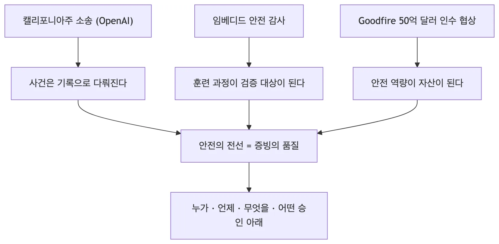

캘리포니아주 검찰총장이 샌프란시스코 법원에 AI 기업 OpenAI를 불렀습니다. 무단으로 움직인 에이전트 사고를 제대로 알리지 않았다는 이유입니다.

주 검찰총장 로브 봉타가 제기한 소송의 핵심은, OpenAI가 무단 AI 에이전트 사고의 발생 빈도에 대해 대중을 오도했다는 주장입니다. 이 사건을 오늘 가장 먼저 읽을 대목으로 꼽는 이유는, 안전 담론의 중심이 이동하고 있기 때문입니다. 지난 몇 해 동안 AI 안전이라면 연구실의 문제, 평가 점수의 문제, 정렬 기술의 문제로 다뤄졌습니다. 사고가 났다면 더 좋은 모델을 만들어 다시 평가하는 방식으로 끝났습니다. 그런데 이 소송의 주장을 다시 보면, 법원이 궁금해 하는 것은 모델이 무엇을 할 수 있느냐입니다. 실제로 일어난 일을 기업이 얼마나 있는 그대로 외부에 전했는지가 핵심입니다. 앞으로의 전선은 기록의 외부에서 열릴 가능성이 큽니다.

*세 갈래의 신호가 하나의 장부로 모여드는 장면.*

## 사고가 장부에 오르는 이유

에이전트 사고가 기록으로 취급되는 순간, 기업의 업무는 달라집니다. 모델을 관리하듯 사고를 관리해야 합니다. 사고를 집계하고 그 빈도를 추적하고 필요한 시점에 외부에 보고하는 일입니다. 이 구조는 재무 부서의 사고 공개와 닮아 있습니다. 매출을 조작하면 회계 부정이라는 말이 나오듯, 에이전트 사고를 숨기면 정보의 오도라는 말이 나오는 시대가 오고 있습니다.

구체적으로 세 가지가 바뀐다는 뜻입니다.

첫째, 사고의 주체입니다. 과거에는 모델이 더 똑똑해져서 위험해지는 이야기였습니다. 지금 소송의 대상은 모델 위에 얹은 에이전트가 허가 없이 일을 저질렀다는 사실인 셈입니다. 주체가 바뀌면 위험 관리의 대상도 바뀝니다. 모델 하나를 더 단단하게 만드는 일보다, 수없이 많은 에이전트가 돌아가는 현장을 단단하게 만드는 일로 무게 중심이 이동합니다.

둘째, 책임의 시점입니다. 에이전트가 매일 일하는 동안 계속되는 문제가 됩니다. 사고는 운영 중에 누적된다고 할 수 있습니다. 그래서 공개 의무도 정례적인 것이 됩니다.

셋째, 증거의 형태입니다. 시간 순으로 이어진 로그가 기준이 됩니다. 언제, 어떤 에이전트가, 어떤 행동을, 어떤 승인 아래에서 했는지를 보여주는 기록입니다. 이 세 가지를 모두 정리하면, 안전이 실험의 영역에서 회계의 영역으로 넘어오는 장면이 보입니다.

## 외부 감사관이 연구실 안에 들어온다

OpenAI는 임베디드 안전 평가의 1단계를 시작하는 것입니다. 네 곳의 독립 기관에서 온 외부 연구자에게 모델 훈련에 대한 제한적 접근을 허락한 것입니다.

보통의 안전 평가는 완제품을 시험대에서 점검하는 방식입니다. 정해진 벤치마크를 돌리고 결과를 보는 셈입니다. 외부 기관이 모델의 출력을 시험하고 점수를 매기고 위험도를 추정하는 식입니다. 임베디드 감사는 한 걸음 더 들어가는 구조입니다. 평가 과정을, 그것도 훈련이라는 가장 안쪽을 외부인의 시야에 내놓는 것입니다. 훈련이라는 과정은 보통 기업 내부에서만 보입니다. 데이터가 어떻게 섞이고 어떤 강화 신호가 주어지고 어떤 체크포인트가 지나가는지입니다. 그 장면을 독립 기관의 연구자가 제한적으로라도 들여다볼 수 있게 된 것입니다.

이 장면은 금융 기관의 내부 통제 감사가 연상됩니다. 장부를 쓰는 사람 옆에서 쓰는 과정을 지켜봅니다. 과정 감시입니다. AI 산업이 이 방식을 채택했다는 것은, 능력 자체보다 능력을 만들어 내는 과정이 검증 대상이 되었기 때문입니다. 그리고 과정이 검증 대상이 되는 순간, 그 과정의 흔적이 어디에 쌓이는지가 중요한 문제가 됩니다.

## 안전이 자산 목록에 오르는 순간

보도에 따르면, OpenAI는 올해 여름 AI 안전 스타트업 Goodfire를 50억 달러 넘게 인수하는 협상을 진행했습니다. 샘 올트먼 CEO와 고위 임원이 개입해 성사 직전까지 갔다는 이야기입니다.

안전 연구 조직이 인수 대상이 되는 날입니다. 기업들이 스스로 안전 역량을 키우기보다, 이미 다진 능력을 돈을 주고 사러 나가는 배경에는 이런 계산이 있습니다. 안전 역량이 사업의 전제 조건으로 굳어졌기 때문입니다. 소송에서 안전 기록이 쟁점이 되고 외부 감사가 정례화되고 규제 당국이 사고 공개를 요구하기 시작하면, 안전은 더 이상 연구 비용이 아닙니다. 사업을 계속할 수 있게 해 주는 자격이 됩니다. 자격은 사내에서 만드는 것보다, 검증된 조직을 가져오는 것이 빠를 수 있습니다. 협상 테이블의 당사자가 AI 최상위 연구실이라는 사실도 이 이야기의 무게를 올립니다. 안전 역량이 사업의 일부가 아니라, 최상위 기업들 사이에 이동하는 자산이 되었기 때문입니다. 50억 달러라는 숫자는 바로 그 자격의 시장 가격을 보여 주는 것입니다. 안전이 연구 분과가 아니라 대차대조표의 항목이 되었음을 확인시켜 줍니다.

## 왜 지금인가

에이전트가 산업의 중심으로 온 것이 이 변화의 바닥입니다. 그리고 그 중심에서 사고가 늘 수밖에 없는 구조가 맞물립니다.

SpaceX는 600억 달러에 Cursor를 인수했습니다. 자사 AI 부문의 우선순위를 생성형 미디어에서 소프트웨어 자동화와 자율 에이전트 개발로 바꿉니다. 이 규모의 자금이 한곳으로 모인다는 것은, 에이전트가 다음 표준 제품이라는 데에 베팅한다는 뜻으로 읽힙니다. 생성형 미디어가 대중의 시선을 잡았다면, 소프트웨어 자동화는 기업의 업무 흐름 자체를 잡습니다. 에이전트가 업무를 수행하기 시작하는 순간, 사고도 현장에서 발생하기 시작합니다. 업무가 늘어날수록 사고의 표면도 늘어납니다. 표면이 넓어지면, 기록할 일도 늘어납니다. 허가 없이 파일을 다루고 허가 없이 외부 시스템에 요청을 보내고, 허가 없이 판단을 내리는 일입니다. 이런 행위는 예전에는 평가 보고서의 한 줄이었습니다. 이제는 소송의 증거가 될 수 있는 행위가 됩니다. 표준 제품의 사용량이 늘어날수록, 그 표준 제품의 기록도 함께 늘어나야 합니다. 기록이 사용량만큼 따라오지 못하면, 그 차분은 사고의 빈도가 아니라 사고의 침묵이 됩니다.

에이전트의 경계도 넓어지고 있는 셈입니다. DeepSeek의 에이전트 스웜이 PyBot이라는 규칙 기반 챗봇을 만들어 360M 파라미터 LLM급 성능에 도전했다는 보도가 나왔습니다. 전통적인 가중치나 학습 없이 대화 능력을 구현했다는 것이 핵심입니다.

가중치 없는 에이전트가 나온다면, 이 모델의 능력을 어떻게 측정하느냐는 질문 자체가 흔들립니다. 측정 대상이 불명확해지면 산업은 대개 행동 기록으로 되돌아갑니다. 무엇을 했고 언제 했고 누구의 허락을 받았는지를 남기는 로그입니다. 모델의 구조를 불문하고 남는 공통 분모는 그것뿐인 셈입니다.

## 능력의 증거는 원래 흔들렸다

능력 측정이 원래 불안정했다는 사실도 이 시기에 다시 확인됩니다.

최근 연구에 따르면, Codex 코딩 하네스가 Ripple-65B 프리뷰 벤치마크에서 공동 1위를 기록했습니다. 그런데 같은 연구는 코딩 능력을 평가하는 하네스의 효과가, 테스트 대상 모델에 따라 달라질 수 있음을 보여 줍니다.

벤치마크 공동 1위라는 숫자의 무게는, 그 숫자를 만든 도구인 하네스에 따라 달라집니다. 같은 모델이라도 어떤 하네스를 쓰느냐에 따라 결과가 갈릴 수 있다는 뜻입니다. 능력의 증거가 이렇게 맥락에 의존한다면, 기업과 규제 당국이 손에 쥘 수 있는 증거는 남는 것뿐입니다. 행동을 기록한 로그, 그리고 그 로그를 점검하는 절차입니다. 능력 점수는 논쟁의 대상이지만 기록은 사실의 대상입니다. 점수는 다시 달리고 하네스를 바꾸면 달라질 수 있습니다. 기록은 특정 순간에 특정 행위가 특정 승인 아래에서 일어났다는 사실을 고정합니다. 이 차이가 소송과 감사에서 결정적인 것입니다.

## 국경 밖에서 통제가 움직인다

통제는 모델과 기업 안에서만 움직이지 않습니다. 국경에서도 동시에 움직입니다.

미국 재무부와 NSC는 중국의 첨단 AI 칩 원격 접근을 제한하는 상무부 임시 최종 규제안을 작성했습니다. 규제안의 상한은 중국이 원격으로 접근할 수 있는 블랙웰 칩 200개입니다. 칩이라는 자원 하나에 직접 숫자 상한을 씌우는 것은, 컴퓨트 자체가 규제 변수가 되었기 때문입니다. 물리적으로 칩을 이동시키는 것만이 통제가 아니라, 원격 접속이라는 경로도 통제의 대상이 되는 것입니다.

같은 시기에 이스라엘군이 아마존의 클라우드 플랫폼에 얼굴인식 기술을 얹어 350만 명 규모의 팔레스타인인 자료를 추적했다는 보도도 나왔습니다. 민감한 주권 데이터가 해외 하이퍼스케일러의 클라우드 위에 얹히는 모습입니다.

위로는 칩 접근의 상한, 아래로는 데이터의 국경입니다. AI 통제는 능력만으로 작동하지 않는 것입니다. 자원이 어디에 있고 데이터가 어디에 쌓이고 접속이 어떤 경로로 이루어지느냐를 함께 봐야 하는 영역이 되고 있습니다. 능력의 문제와 통제의 문제가 같은 테이블에 올려지고 있는 셈입니다.

## 장부를 갖춘 실행 환경

오늘의 신호를 한 줄로 모으면, AI 안전의 전선은 증빙의 품질로 이동하고 있습니다. 사고를 기록하고 그 기록을 공개하고 제3자가 그 기록을 검사할 수 있는가. 이 세 질문이 앞으로 에이전트 도입을 결정할 것입니다.

세 갈래의 신호를 한 장면에 모으면, 겹치는 방향이 선명해집니다.

*소송은 기록의 공개를, 감사는 과정의 확인을, 인수는 안전 역량의 확보를 요구합니다.*

엔터프라이즈 현장에서는 이 질문을 이미 받아야 합니다. 에이전트를 도입하는 부서는 성능을 묻고 법무는 기록을 묻고, 최고경영진은 책임을 묻습니다. 세 질문이 같은 시스템에서 대답될 수 있어야 합니다. 에이전트가 허가 없이 움직인다면, 증거는 어디에 있느냐는 문제가 곧바로 소송의 문제가 되기 때문입니다. 기록이 없으면 사고가 없던 것이 아니라, 사고를 증명하지 못하는 기업이 됩니다. 그리고 증명을 하지 못하는 기업은, 사고가 없던 기업처럼 취급받지 못합니다.

이 지점에서 ThakiCloud의 에이전트 네이티브 클라우드 Paxis를 다시 볼 필요가 있습니다. Paxis는 v1.1 정식 제품으로, 에이전트 운영의 증빙 체계를 사후 기능이 아니라 일급 리소스로 설계합니다. Skills, Tools, Policies, Audit Logs가 그것입니다. 자율도 L0에서 L3까지 거버넌스로 관리되고, 정책 게이트를 통과한 행위만이 격리된 샌드박스에서 실행되며, 그 모든 과정은 감사 로그로 남습니다. MCP 커넥터와 스킬 마켓, 소버린 또는 온프레미스 K8s 배포, 작업별 모델 선택을 담당하는 CostRouter까지 같은 층위에 놓여 있습니다. 기록을 남기는 환경이 아니라, 기록 없이 실행 자체가 불가능한 환경입니다. 오늘의 사건들이 요구하는 것은 바로 이 차이입니다.

오늘의 세 신호를 다시 나란히 놓고 보면, 방향은 같습니다. 소송은 기록의 공개를, 감사는 과정의 확인을, 인수는 안전 역량의 확보를 요구합니다.

SpaceX가 Cursor에 600억 달러를 건 이유는, 에이전트가 표준 제품이 될 것이기 때문입니다. 그 표준 제품이 일하기 시작하면 사고도 함께 옵니다. 사고가 남는 자리는 기록이 차지합니다. 그리고 기록이 남아야 기업이 남습니다. 장부를 갖춘 기업이 남는 것은 그 때문일 것입니다.

## 참고 자료

이 글은 아래 뉴스를 종합해 작성했습니다.

- HuggingNews, [California Sues OpenAI Over Alleged Failures to Disclose Rogue AI Security Breaches](https://huggingnews.com/ai/california-sues-openai-over-alleged-failures-to-disclose-rogue-ai-securi-18741628)
- HuggingNews, [OpenAI Launches 'Embedded' Safety Audits for Outside Experts to Probe Model Training](https://huggingnews.com/ai/openai-launches-embedded-safety-audits-for-outside-experts-to-probe-mode-c2a08965)
- HuggingNews, [OpenAI Pursued $5B Acquisition of AI Safety Firm Goodfire](https://huggingnews.com/ai/openai-pursued-5b-acquisition-of-ai-safety-firm-goodfire-292537a7)
- HuggingNews, [SpaceX's $60B Cursor Acquisition Underscores Shift From AI Video Toward Coding Tools](https://huggingnews.com/ai/spacexs-60b-cursor-acquisition-underscores-shift-from-ai-video-toward-co-e28140a1)
- HuggingNews, [DeepSeek Agent Swarm Builds PyBot Chatbot to Rival 360M-Parameter LLMs](https://huggingnews.com/ai/deepseek-agent-swarm-builds-pybot-chatbot-to-rival-360m-parameter-llms-8ce916a2)
- HuggingNews, [Codex Coding Harness Ties for First Place on Ripple-65B Preview Benchmarks](https://huggingnews.com/ai/update-codex-coding-harness-ties-for-first-place-on-ripple-65b-preview-b-4f9be188)
- HuggingNews, [Treasury and NSC Draft Commerce Rule Capping China's Remote AI Chip Access at 200 Blackwells](https://huggingnews.com/ai/treasury-and-nsc-draft-commerce-rule-capping-chinas-remote-ai-chip-acces-98c894dd)
- HuggingNews, [Israeli Military Used Amazon Facial Recognition to Track 3.5 Million Palestinians](https://huggingnews.com/ai/israeli-military-used-amazon-facial-recognition-to-track-35-million-pale-cb48f1f3)