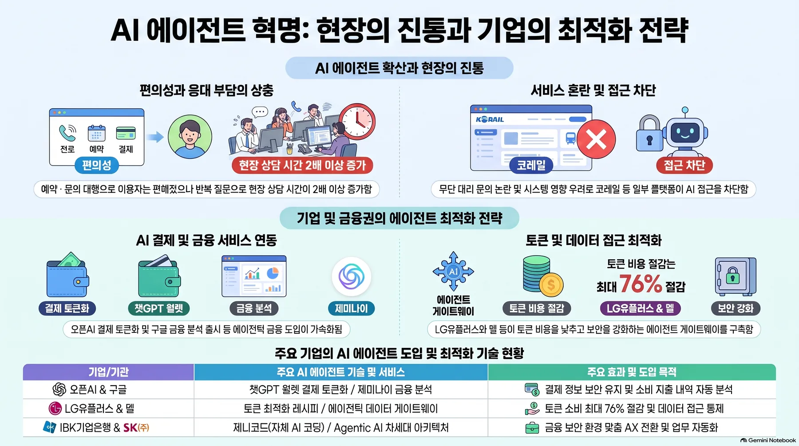
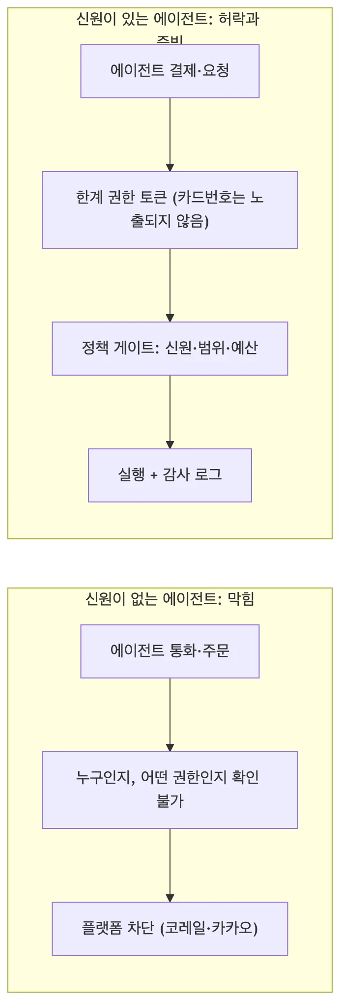
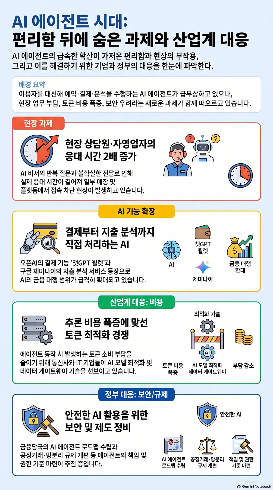

서울의 한 식당. 저녁 손님이 몰리는 시간, 전화가 울립니다. "안녕하세요, 내일 7시에 두 분 예약 부탁드려요." 목소리는 정중하고 또박또박합니다. 주인장이 누구의 주문인지, 어떤 권한으로 그러는지 되묻자 통화 너머에서는 같은 멘트가 반복됩니다. 이 장면은 어디선가 막 걸려 온 전화를 가정한 것이 아니라, 조선비즈가 자영업자와 고객센터 운영진의 증언을 모아 전한 것을 재구성한 것입니다. 전화의 발신자는 AI 비서 '피클'인 셈입니다.

그 전화는 지난 두 주 사이, 서울 곳곳에서 매일 울리고 있습니다. 오늘 아침 다이제스트는 이 한 장면을 여덟 갈래의 뉴스가 반복해서 확인해 줍니다. 에이전트가 물리 세계의 행동을 시작했고 세상은 아직 그들을 확인하는 법을 배우지 못했다는 뜻입니다. 이 글은 그 한 줄을 따라 오늘 나온 사실들만 고를 것입니다.

*에이전트의 통화, 그리고 아직 연결되지 않은 신원의 문.*

## 한 통의 전화, 두 개의 숫자

수요 측 숫자는 놀랍습니다. 피클의 일간 활성 이용자(DAU)는 출시 직후 5천694명에서 약 2주 만에 9만9천828명까지 늘었습니다. 17배 이상인 것입니다. 애플 앱스토어 전체 무료 앱 3위. 계정만 연동하면 네이버, 쿠팡, 당근 등에서 상품 주문을 대신 처리하고 식당 예약 전화도 직접 걸고 통신사 고객센터 요금제 문의까지 처리합니다. 편한 쪽은 이용자가 맞습니다. 기존 생성형 AI가 질문에 답하고 정보를 제공하는 수준에 머물렀다면, 지금의 에이전트는 이용자의 지시에 따라 외부 서비스에 접속해 전화, 예약, 주문 같은 실제 작업을 수행합니다.

전화 너머의 숫자는 다릅니다. 음식점 자영업자와 고객센터 운영진에 따르면 AI가 같은 질문을 반복하고 요구를 정확히 전달하지 못해 상담 시간이 두 배가 되었습니다. 어떤 곳은 AI 비서 문의를 아예 받지 않겠다고 발표했습니다. 공공운수노조는 AI 대리 권한 확인이 어렵다며 대책을 요구했고, 플랫폼의 첫 대응은 차단이었습니다. 코레일은 매크로와 AI 에이전트 등 자동화 프로그램의 접근을 막았습니다. 피클의 카카오톡 연동 기능은 공개 하루 만에 중단되었습니다.

만남의 순간에 '누구인지 확인하는' 옵션이 없었습니다. 그래서 첫 번째 수단이 '안 들어오게 하는' 것이 되었습니다. 코레일과 카카오의 대응이 시사하는 바는, 에이전트 확산과 기존 서비스 생태계 사이의 거버넌스 충돌이 이제 본격화됐다는 것입니다. 에이전트 경제의 첫 공개 마찰은 능력의 실패가 아니라, 만남의 충돌입니다. 에이전트는 이미 손님입니다. 다만 손님을 맞이하는 쪽에, 그 손님의 신원을 물을 체계가 아직 없습니다.

<!-- nlm-visual -->

*NotebookLM이 소스를 종합해 생성한 인포그래픽입니다.*

## 같은 다이제스트의 다른 편, '확인'을 그리는 사람들

서울에서 전화가 막히던 같은 날, 오늘 다이제스트의 다른 편에서는 신분증 설계가 그려지고 있었습니다.

오픈AI는 한 칸 더 앞서 있었습니다. 컨슈머타임스 보도에 따르면 오픈AI는 아메리칸 익스프레스, 마스터카드, 비자를 연동한 '챗GPT 월렛'을 미국에서 내놓고 AI 에이전트 'dots'가 대리 결제를 수행하게 했습니다. 설계의 핵심은 이것입니다. 결제 순간 실제 카드번호가 아니라 카드 네트워크의 결제 토큰을 쓰게 해, 카드정보를 판매자도 에이전트도 넘겨 받지 않는 구조. 에이전트는 돈을 쓸 수 있는데, 카드번호를 알 수 없습니다. 구글은 다른 축을 택했습니다. 제미나이에 구글 월렛을 연동해 지출 차트 분석, 정기결제 관리, 연말 예산 제안을 제공하되, 송금과 투자처럼 돈을 옮기는 일은 제외했습니다. 하나는 돈을 움직이는 축, 하나는 돈을 보는 축. 과거 AI가 정보 제공과 요약 수준에 머물렀다면, 에이전트는 이제 자금 흐름에 직접 개입합니다. 에이전트 상거래가 본격화되는 지점이 바로 여기입니다. 두 거물이 나란히 택한 것은, 에이전트에게 필요한 정보보다 적게 주는 규율입니다.

제도 쪽도 움직합니다. 금융위원회가 연말 전후로 AI 에이전트 도입 로드맵을 내놓을 전망이라는 것이 같은 보도의 내용입니다.

델은 기업용 버전을 그리었습니다. 시카고 슈퍼컴퓨팅 2026(SC26)에서 에이전트별 데이터와 도구 접근을 한곳에서 관리하는 '에이전틱 데이터 게이트웨이'를 공개했습니다. 외부 에이전트도 MCP(모델 컨텍스트 프로토콜)로 연결 가능하며 요청마다 신원, 접근 범위, 예산을 적용하고 처리 과정을 추적합니다. 9월 내부 시험에서는 합성 데이터, 질문 20개, 작업 유형 6개 조건에서 토큰 소비가 최대 76% 줄고 답변 정확도가 60%에서 94%로 올랐습니다. 델 내부 시험 수치이고 실제 고객 성과는 아닙니다. 새 기능은 12월부터 공급됩니다. 경쟁 구도는 이미 치열합니다. F5가 에이전틱 AI 대응 차세대 AI 게이트웨이로 거버넌스와 비용 최적화를 내세우는 동안, 시만텍과 스노우플레이크도 MCP 거버넌스를 전면에 배치했습니다. '에이전트 데이터 접근 관리'가 별개의 제품 카테고리로 독립되는 신호입니다. 델이 내세우는 차별점은 데이터가 있는 곳, 프라이빗 클라우드든 외부 인프라든 공용 클라우드든 파이프라인을 실행하는 멀티 사이트 접근이고, 온프레미스 강점이 배경입니다. 기존 AI 팩토리 고객은 6500곳이 넘습니다.

국내에서도 금융권이 내부부터 움직합니다. 금융권이 외부 상용 에이전트를 꺼리는 이유는 보안과 데이터 주권입니다. 데이터가 은행 내부에 머물러야 하는 에이전트는, 결국 실행 인프라 자체를 필요로 합니다. 뉴시안 보도에 따르면 기업은행은 외부 상용 에이전트가 아니라 은행 내부 인프라로 자체 AI 코딩 에이전트 '제니코드'를 구축했습니다. 직원이 자연어로 요청하면 보고서와 엑셀 자료 분석부터 업무용 프로그램 개발까지 수행합니다. 본부 부서 AX 담당자가 먼저 운영하고 안정성 검증과 기능 고도화 뒤에 단계적으로 확대하는 순서. 목표는 'AI 네이티브 은행'입니다. 신한은행은 자체 개발 AI 에이전트 21종을 공개했습니다. SK㈜는 분기보고서에서 'AI 디폴트' 기업 도약을 선언하고 성능 저하와 비용 증가를 사전 감지하는 에이전트Ops 루프를 갖춘 통합 에이전트 플랫폼을 구축 중입니다. 사용자 승인형 추출과 수명 관리 기능을 갖춘 개인화 기억 기술, 딥 에이전트, 멀티 에이전트 공조 체계도 함께 개발하고 있습니다.

여럿이지만 질문은 하나입니다. 결제든, 데이터든, 코드가든, 에이전트에게 실행을 허락하기 전에 묻는 것이 같습니다. 누구입니까? 어디까지 닿아도 좋습니까? 나중에 증명할 수 있습니까?

## 신분증이 없으면 남은 것은 문이다

같은 에이전트 요청이라도 신원 여부에 따라 전혀 다른 끝자락에 닿습니다. 두 경로를 나란히 그려 보면, 막음과 허락의 차이가 한눈에 보입니다.

*신원이 없는 에이전트는 차단으로, 신원이 있는 에이전트는 한계 권한 토큰과 감사 로그로.*

확인할 수 없으면, 상대의 선택지는 좁아지는 셈입니다. 코레일의 차단 정책과 식당 주인장의 "아예 받지 않겠다"는 말은 같은 동작입니다. 에이전트가 신분을 못 밝히면, 세상은 문을 닫는 것 말고는 답이 없던 셈입니다.

이것이 능력 우선 전략의 대가입니다. 17배 성장 곡선은 아무도 세우지 않은 벽에 부딪혔고 마찰은 전화기 너머 사람에게서 치러진 것입니다. 두 배가 된 상담 시간은 인건비라는 이름의 청구서입니다. 그것만이 비용은 아닙니다. 비즈한국이 전한 수치를 보겠습니다. 에이전트는 결과 하나를 내는 데 20여 단계를 거치고 화면에 표시되지 않는 내부 추론이 전체 비용의 80% 이상을 차지하는 것입니다. 오픈라우터 통계로는 글로벌 토큰 소비량이 1년 사이 약 35배 늘었습니다. 같은 기간 단가는 빅테크 기준으로 약 80% 낮아진 셈입니다. 싼 토큰을 더 많이 쓰는 구조가 된 것입니다. 에이전트 운영은 인건비 장부와 토큰 장부, 두 곳에 함께 기록됩니다.

그러니 기업의 첫 질문은 "얼마나 빨리 하나"에서 "나중에 증명할 수 있는가"로 이동해야 합니다. 그리고 그 답의 미니어처는 오늘 뉴스에 이미 있습니다. dots의 결제 토큰 구조, 즉 능력을 비밀과 분리해 한계 권한의 토큰만 에이전트에게 쥐어준 설계. 이 스키마를 사내 데이터와 구매, 코드로 확장하면, 요청마다 신원이 적용되고 권한 범위가 미리 정해지고 처리 흔적이 장부에 남습니다. 에이전트에게 신분증이 주어지면, 상대와의 대화는 '막을 것인가, 들일 것인가'에서 '무엇을 허락하고 무엇을 증명할 것인가'로 바뀝니다. 피클 사례가 열어준 수요도 있습니다. '에이전트에게 전화를 받는 기업'은 이제 스스로 수신 체계를 갖춰야 합니다. 발신 품질과 수신 검증, 둘 다 인프라가 되는 영역입니다.

## Paxis: 전화 소리가 아니라 감사 기록으로

ThakiCloud의 Agent-Native Cloud, Paxis는 이 장면을 렌즈로 봅니다. Paxis는 v1.1 GA로 출시된 정식 제품이고 내는 답은 정책 문서가 아니라 인프라입니다.

Paxis는 Skills, Tools, Policies, Audit Logs를 일급 리소스로 다스립니다. 에이전트의 모든 행동은 정책 게이트를 통과한 스킬로서 실행되고 자율도 L0에서 L3까지가 거버넌스로 나뉘어 어디까지 스스로 결정하고, 어디서 사람의 승인을 받을지가 미리 정해집니다. 모든 실행은 감사 로그에 남으므로, 나중에 "누구의, 어떤 권한으로, 무엇을 했다"를 증명할 수 있습니다. 격리 샌드박스는 실행을 주변에 영향을 주지 않는 경계 안에 두고, MCP 커넥터와 스킬 마켓은 도구와 데이터를 야생의 전화가 아니라 신원이 있는 채널로 연결하게 합니다. CostRouter는 작업별로 모델을 고르므로 20단계의 내부 추론이 청구서를 부풀리지 않습니다. 주권이 문제되는 금융과 공공에서는 온프레미스 K8s(ai-platform) 위에 Paxis가 설치되니, 경계 자체를 내 영역 안에 두는 것도 가능합니다.

수신 측도 마찬가지 문제입니다. 기업은 이제 자사 에이전트를 내보내는 발신자이면서 타사 에이전트의 전화를 받는 수신자이기도 합니다. 들어오는 에이전트를 감지하고 그 권한을 확인하고 주고받은 것을 장부에 남기는 일은 같은 역량의 거울상입니다. 피클의 두 주가 보여준 것은, 이 거울에 대한 수요가 추측이 아니라 실물입니다.

## 다음번 전화가 울릴 때

피클이 2주 만에 17배가 되었습니다. 에이전트의 채택 곡선이 이 속도라면, 규약이 따라오기 전에 부딪히는 벽은 아직 더 많습니다. 금융위원회의 로드맵은 연말 전후에, 플랫폼의 차단은 곧 규칙으로 바뀔 것입니다. 12월이 분수령입니다. 델의 게이트웨이가 공급을 시작하면 기업은 선택의 기준을 물어야 합니다. 외부 관문을 사서 붙일 것인가, 실행 환경에 처음부터 내장할 것인가. 에이전트의 신분증은 있으면 좋은 것에서, 없으면 못 들어오는 것으로 이동하는 중입니다. 속도 경쟁은 이미 한바탕 끝났습니다. 지금 시작되는 경쟁은, 에이전트를 확인 가능하고 제한 가능하며 증명 가능한 존재로 먼저 만든 기업이 이기는 자리입니다.

식당의 전화는 계속 울릴 것입니다. 바뀌는 것은, 그 소리가 울릴 때 다른 쪽이 발신자의 신원을 확인할 수 있느냐. ThakiCloud가 이 질문에 내는 답은 Paxis라는 뜻입니다. 통화를 빨리 만드는 것이 아니라, 통화를 믿게 만드는 것입니다.

## 참고 자료

이 글은 아래 뉴스를 종합해 작성했습니다.

- 컨슈머타임스, [AI가 결제하고 소비 분석…오픈AI·구글 美서 서비스](https://www.cstimes.com/news/articleView.html?idxno=728098)
- 토큰포스트, [델, 기업 AI 에이전트 데이터 관문 공개…새 기능 12월 공급](https://www.tokenpost.kr/news/ai/439180)
- 조선비즈, [AI 비서가 예약 전화까지… 이용자는 편한데 상담원은 “시간 두 배”](https://biz.chosun.com/topics/topics_social/2026/11/17/MAIZ7H6CFJDLDEBOSDZSM2G43E/?utm_source=naver&utm_medium=original&utm_campaign=biz)
- 뉴시안, [[금융픽] 기업은행, 자체 AI 코딩 에이전트 '제니코드' 구축 外](https://www.newsian.co.kr/news/articleView.html?idxno=101380)
- 비즈한국, ["AI 청구서 깎아주는 비법이 곧 수익모델" LG유플러스 '토큰 최적화 레시...](https://bizhankook.com/articles/lguplus-recipe-token-strategy.html)
- 파이낸셜포스트, [[분석] 'AI 디폴트' 기업 도약하는 SK㈜…차세대 에이전트 아키텍처로 혁...](https://www.financialpost.co.kr/news/articleView.html?idxno=301325)

<!-- nlm-visual -->

*NotebookLM이 소스를 종합해 생성한 인포그래픽입니다.*
