숏드라마나 만화 드라마 같은 세로형 영상 콘텐츠를 코딩 에이전트 위에 파이프라인으로 돌리려는 개발자라면, 이 글은 이 스킬 팩을 도입할지, 도입하지 않더라도 무엇을 가져올지 판단하는 데 씁니다. 11월 17일 @VibeEverything의 "AI 숏드라마 만들 때 쓸만한 스킬 86개 모음"이 화제가 됐습니다.

줄거리, 대본과 후킹, 스토리보드, 캐릭터 시트 고정까지. 숏폼 제작 단계별로 실전 스킬을 모아두었고 Seedance와 Kling, MiniMax 같은 영상 모델별 프롬프트 스킬도 들어 있습니다. 수백 개 스킬이 놓인 지금, "세로형 영상 제작"이라는 세로 영역 전체를 큐레이션으로 묶은 팩이 나온 것입니다.

결론부터 말합니다. 86이라는 숫자는 이미 옛것입니다. 레포에는 131개 프로젝트가 있고 하루 새 16개가 늘었습니다. 흥미로운 것은 개수가 아니라 구조입니다. 단계 × 모델 × 에이전트라는 세 축으로 인덱싱하고 팩 안에 그 인덱스를 소비하는 finder 스킬을 스스로 넣었다는 사실. 이것이 에이전트 네이티브 스킬 큐레이션의 모양입니다. 이 글은 팩의 데이터를 실제로 받아 집계하고 그 구조에서 무엇을 가져올지 씁니다.

## 숫자가 움직이는 큐레이션

팩의 정본은 GitHub의 awesome-short-drama-skills 저장소입니다. UnderleveledBuilder가 유지하고 별 2.5k, 포크 300, 커밋 96회. shortdramaskills.com이라는 사이트가 같은 데이터를 인덱스로 서빙합니다.

데이터는 두 층으로 나뉘어 있습니다. 사람이 쓰는 층과 기계가 긁는 층. skills.toml은 사람이 쓰는 층입니다. 각 항목에 repo, 요약, 그룹, 단계, 모델, 에이전트 태그가 있고 checked 날짜로 "사람이 대조한 날"을 적어둡니다. meta.json은 기계가 긁는 층입니다. scripts/refresh.py가 별수와 포크수, 라이선스, SKILL.md 개수, 마지막 커밋 날짜를 GitHub API에서 가져옵니다. 사람이 대조한 분류와, 기계가 갱신한 수치가 같은 저장소에서 만나게 됩니다. 이 구조는 뒤에서 다루는 eval과 라이선스 컬럼의 전제이기도 합니다.

숫자를 나열해봅니다. 트윗은 86개였습니다. 사이트의 data.json은 115개 프로젝트, 갱신일 2026-11-16. 레포 main의 skills.toml은 제가 2026-11-17에 받은 시점에 131개였습니다. 하루에 16개. 트윗이 나온 주 안에는 86에서 131로 50퍼센트 가까이 늘었습니다.

이 속도는 의도된 것 같습니다. 저장소는 Suggest a skill 이슈로 외부 기여를 받고 별수는 매주 월요일에 새로고침됩니다. 큐레이션이 산이 아니라 강이라는 뜻입니다. 그래서 이 글의 수치는 전부 "2026-11-17 수신 기준"이고 인용할 때는 날짜를 함께 붙이는 것이 맞습니다.

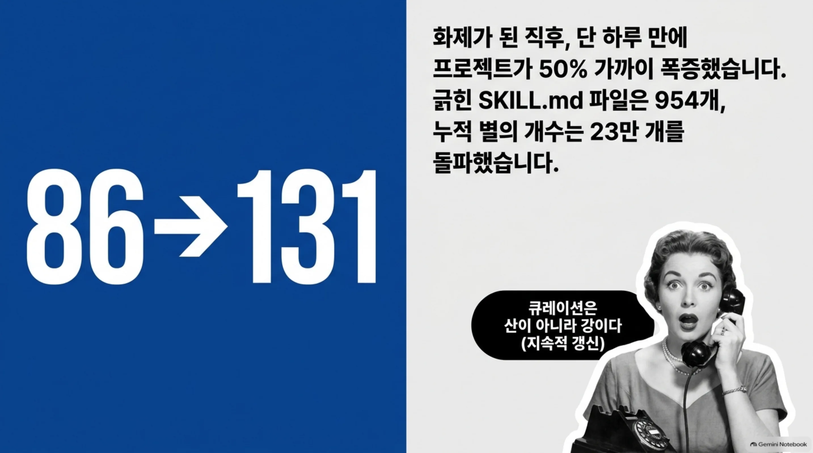
*화제가 된 직후 하루 만에 50퍼센트 가까이 폭증했습니다. 긁힌 SKILL.md 파일 954개, 별 23만 개 돌파.*

## 세 축: 단계, 모델, 에이전트

131개 프로젝트를 세 축으로 펼칩니다. 첫 번째 축은 제작 단계. 9개 단계에 걸친 커버리지입니다.

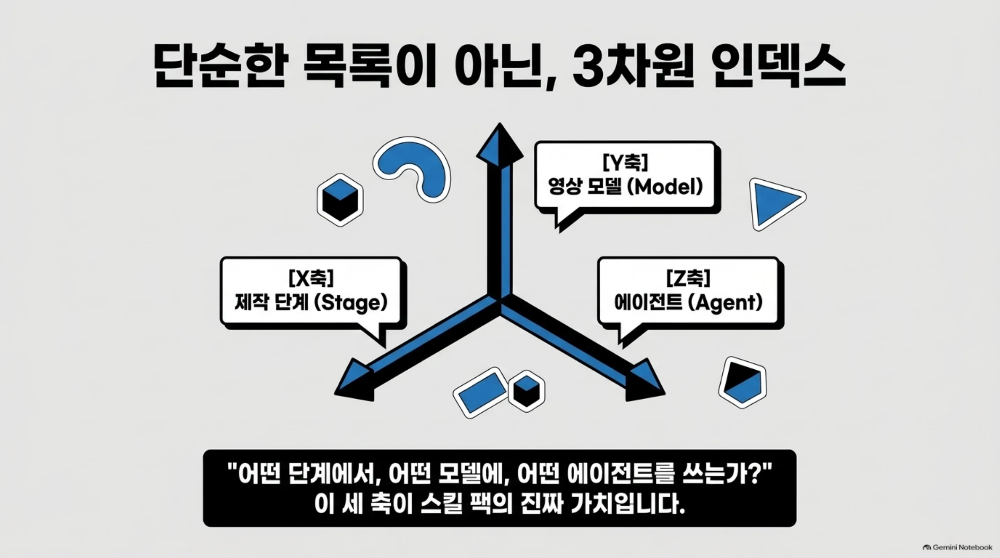
*제작 단계, 영상 모델, 에이전트. 이 세 축은 "어떤 단계에서, 어떤 모델에, 어떤 에이전트를 쓰는가"라는 질문에 팩이 스스로 답하는 구조입니다.*

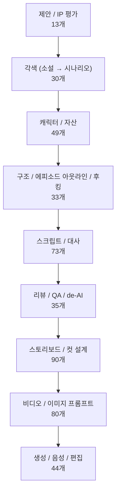
*9개 제작 단계와 단계별 커버리지. 숫자는 다중계입니다. 프로젝트 하나가 여러 단계를 커버하기 때문에 합이 131을 넘습니다.*

막대가 긴 순서 그대로 제작 순서입니다. 스토리보드 90개, 프롬프트 80개, 스크립트 73개. 후반 공정, 즉 영상 모델에게 먹여 살리는 층에 프로젝트가 몰려 있고 진입 단계인 제안에는 13개로 가장 적습니다. IP를 고르는 일에는 사람의 판단이 여전히 필요하다는 뜻이기도 합니다.

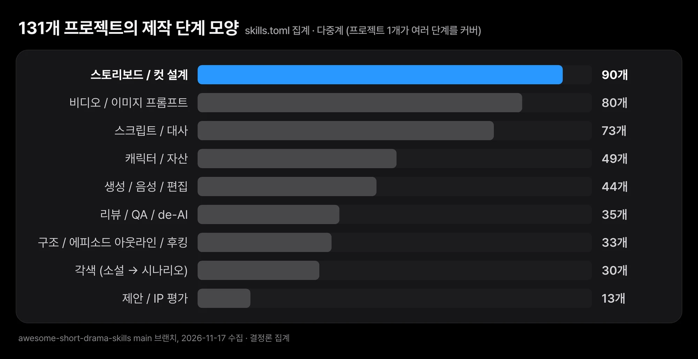
*막대가 긴 순서 그대로 제작 순서입니다. 스토리보드와 프롬프트에 프로젝트가 가장 몰려 있고 진입 단계(제안)에는 가장 적습니다.*

두 번째 축은 영상 모델. Seedance 47개, MiniMax H3 22개, Kling 12개, Wan 5개, ComfyUI 5개, Veo 5개, Sora 4개, Nano Banana 3개. Seedance에 131개 중 47개가 쏠려 있습니다. 중국 세로형 영상 시장의 실제 생산 라인에서 어떤 모델이 쓰이는지를 그대로 보여주는 분포입니다.

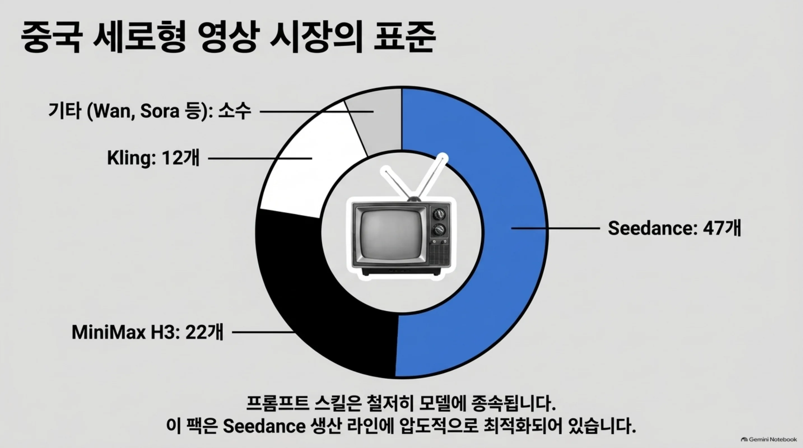
*Seedance 47개, MiniMax H3 22개, Kling 12개. 프롬프트 스킬은 모델에 철저히 종속되고, 이 팩은 Seedance 생산 라인에 압도적으로 최적화되어 있습니다.*

세 번째 축은 에이전트 플랫폼. Codex 40개, Claude Code 38개, Cursor 7개, WorkBuddy 5개, OpenClaw 4개, Gemini CLI 3개. 스킬이 붙는 대상이 모델만이 아니라 에이전트 자체라는 점에 유의해야 합니다. "이 스킬은 Claude Code에서 쓴다"는 태그가 1차 분류 축입니다. 6개 태그의 합이 96개인 반면, 항목은 131개입니다. 에이전트 필드가 비어 있는 35개 내외는 "저작자가 명시하지 않은 것"이고 SKILL.md 형식의 스킬은 대부분 어떤 에이전트에서나 돌아가는다는 전제입니다. 태그가 없으니 검색 축에서 누락되는 것이 이 축의 실사용 함의입니다.

에이전트 축에서 눈여겨볼 것은 Codex와 Claude Code가 40과 38로 거의 동수라는 점입니다. 두 에이전트를 함께 태그한 스킬이 많다 보니, "에이전트마다 스킬을 따로 만들어야 하는가"라는 질문의 답이 팩 안에 들어 있습니다. 스킬 본문은 에이전트 중립이고 붙는 곳이 여러 개인 것입니다. Cursor 7, WorkBuddy 5, OpenClaw 4, Gemini CLI 3가 뒤에 따라붙어 있습니다.

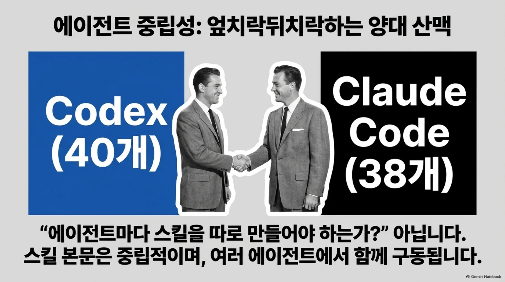
*Codex 40개, Claude Code 38개로 거의 동수입니다. 스킬 본문의 대다수가 중립적이고 여러 에이전트에서 함께 구동됩니다.*

그룹 분류도 함께 보면 구조가 선명해집니다. visual 54, pipeline 35, platform 16, writing 11, source 6, craft 6, companion 3. visual가 절반에 가까운데, 이것은 스토리보드와 캐릭터 자산, 프롬프트 묶음 같은 "보는 것" 층입니다. pipeline 35는 소설부터 완성편까지 한 번에 가는 도구입니다. platform 16은 스킬이 아니라 완제품 앱입니다.

Toonflow, huobao-drama, waoowaoo 같은 것들이 여기 들어 있고 별수로 보면 팩의 상위권 전체를 이 그룹이 차지합니다. format 분포도 같은 방향입니다. skill 113, app 16, prompts 2. 팩의 압도적 다수가 SKILL.md 형식, 즉 에이전트가 읽는 문서입니다.

## 실제로 확인한 것

방법은 간단합니다. 저장소의 data 파일들, skills.toml과 meta.json, skill_index.json을 받아 결정론적으로 집계했습니다. 분석 중에 네트워크는 사용하지 않았습니다. 실험 로그는 outputs/blog-impl/short-drama-skill-pack/에 있고 이 글의 수치는 전부 그 로그 기준입니다.

라이선스부터 봅니다. MIT 72, Apache 2.0 7, MIT-0 2, ISC 1, CC-BY 4.0 1로 permissive가 83개, 63퍼센트입니다. 라이선스가 없는 것이 45개, 34퍼센트. GPL 3.0이 2개, AGPL 3.0이 1개로 copyleft가 3개, 2퍼센트. 큐레이션 레이어 자체는 CC0입니다만, 프로젝트별 라이선스는 각자 것입니다.

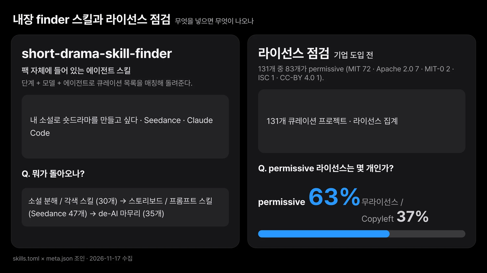
*팩은 사용자를 대신해 큐레이션을 찾아주는 스킬을 스스로에 넣고 도입 전 라이선스 점검까지 같은 데이터로 합니다.*

별수 상위권은 이렇습니다. blader/humanizer 69,484, HBAI-Ltd/Toonflow-app 21,894, chatfire-AI/huobao-drama 17,527, waooAI/waoowaoo 14,865, HKUDS/ViMax 12,932, dramaclaw 7,718, yi1108/printfilm 7,455, shuohao-skills 6,685, seedance2-skill 4,494. 131개 프로젝트의 별수 합은 232,164이고 긁힌 SKILL.md 파일은 954개입니다.

평균 별수는 1,772입니다. 다만 이 평균은 상위권이 끌어올린 값입니다. humanizer 하나만 빼면 162,680, 상위 5개만 빼도 95,462가 남습니다. 분포가 몇 개의 큰 저장소와, 그 아래 길게 이어지는 작은 저장소들의 합이라는 뜻입니다. 큐레이션을 읽을 때 상위 10개와 나머지 121개를 다른 눈으로 봐야 하는 이유가 여기에 있습니다.

두 가지를 짚습니다. 첫 번째, 별 1위인 humanizer는 de-AI 스킬입니다. 7만 개 별이 "AI 냄새를 빼는 것"에 붙어 있는 것은, 이 산업에서 콘텐츠의 병목이 생성이 아니라 마무리라는 뜻입니다. 두 번째, HKUDS는 홍콩과기대 Data Science 랩입니다. 학계 랩이 세로형 영상 제작 팩에 이름을 올리고 있는 것 자체가, 이 영역이 연구 대상이 됐다는 신호입니다.

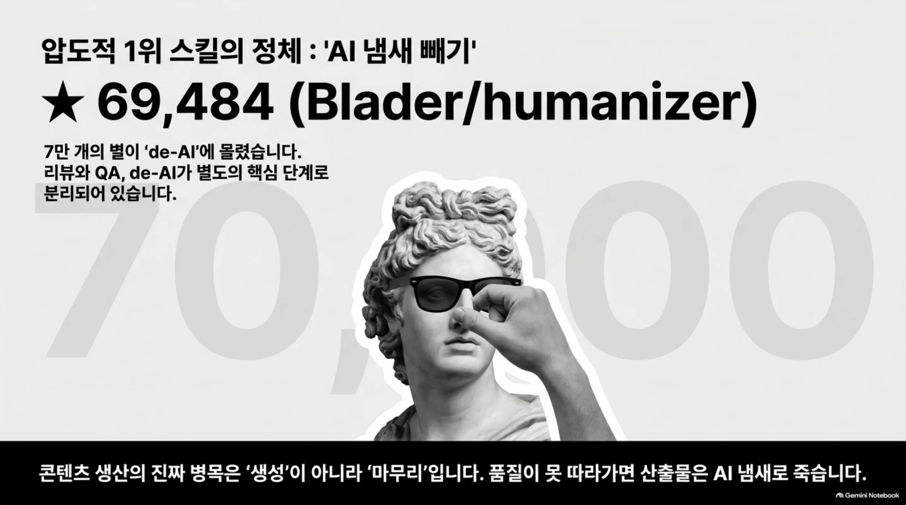
*별 69,484의 Blader/humanizer는 de-AI 스킬입니다. 리뷰와 QA, de-AI가 별도의 핵심 단계로 분리되어 있는 이유는, 콘텐츠 생산의 병목이 마무리에 있기 때문입니다.*

featured 티어는 5개뿐입니다. 큐레이션이 131개를 담되, 손으로 추린 최상위만 따로 표를 박아둡니다. 다섯 개를 보면 어떤 눈으로 추렀는지 보입니다. shuohao-skills는 캐릭터 분해부터 분경까지, drama-skills는 소설 분해에서 영상 프롬프트까지 전 연쇄를 가는 도구입니다. manju-laoli-skill은 워크플로에 게이트를 박은 케이스로, 스테이지별 승인, 자산 고정, 규칙 기반 질검을 붙여둡니다. 다만 작성자가 테스트 버전이라고 표시해 둔 것이기도 합니다.

Seedance2-Storyboard-Generator는 모델 이름이 레포명에 붙어 있는 케이스입니다. 스킬이 모델에 붙어 있다는 뜻입니다. screenwriting-skills는 유일하게 이론 축의 featured로, 구조와 Truby, 시리즈 바이블까지 다루고 일본과 한국, 프랑스, 미국 사례를 함께 담았습니다.

checked 날짜는 "인수 정보를 사람이 대조한 날"이지 "효과를 실측한 날"이 아닙니다. 저장소 주석에 그렇게 적혀 있습니다. 5개도 그 범위의 것입니다.

## 팩 안에 finder를 넣는 것

팩의 가장 에이전트 네이티브인 부분은, 팩이 finder 스킬을 스스로에 넣었다는 사실입니다. short-drama-skill-finder. SKILL.md 프론트매터에 name과 description이 있고 description이 곧 라우팅 힌트입니다. 숏드라마 스킬을 추천해달라고 하면, 저장소가 아니라 팩이 먼저 응답합니다.

finder가 하는 일은 데이터를 소비하는 일입니다. shortdramaskills.com의 data.json을 가져오고 실패하면 README에 같은 항목을 텍스트로 담고 있어 그걸 읽게 됩니다. data.json에는 taxonomy가 들어 있습니다. type, stages, models의 라벨을 중국어와 영어로. 각 항목은 repo, 단계, 모델, 에이전트, 요약, 에디터 노트를 갖습니다.

finder 스킬의 SKILL.md description을 보면 라우팅 힌트가 이중 언어로 들어 있습니다. 중국어와 영어 모두에 "stage, model, agent" 매칭 조건과 "Use when" 문장이 있고 이게 곧 BM25 같은 검색으로 찾아질 문구입니다. 스킬 설명이 사람에게 설명문이면서 동시에 검색 인덱스인 것입니다.

data.json의 스키마도 짚습니다. 항목별로 repo와 GitHub 링크, 요약과 상세 오버뷰, 에디터 노트, 상세 페이지 링크가 들어 있고 type과 stages, models, agents 태그가 붙어 있습니다. summary와 note는 큐레이터가 직접 쓴 편집문입니다. 기계 인덱스에 편집 판단이 함께 들어 있는 형태입니다.

이 설계가 말하는 것은 명확합니다. 큐레이션은 사람이 보는 표가 아니라, 에이전트가 소비하는 인덱스여야 합니다. data.json과 llms.txt를 서빙하는 것은 사이트의 편의가 아니라, 에이전트에게 팩을 "읽을 수 있는 것"으로 만드는 행위입니다. 그리고 팩은 그 인덱스 위에서 3회 블라인드 평가, 스크립트, 제안, 전편 스켈레톤을 실제로 돌렸다고 README에 적어둡니다. 큐레이션에 eval이 붙기 시작한 것입니다.

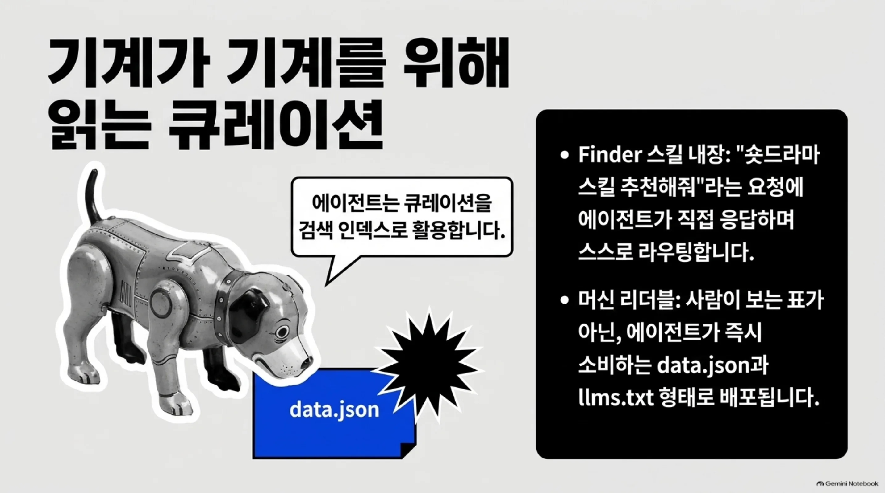
*Finder 스킬이 내장되어 "숏드라마 스킬 추천" 요청에 팩이 스스로 라우팅합니다. 큐레이션은 에이전트가 즉시 소비하는 data.json과 llms.txt 형태로 배포됩니다.*

## 스킬 큐레이션에서 가져올 것

Paxis가 스킬을 일급 리소스로 다루는 구조에서, 이 팩은 세로 영역의 큐레이션이 어떤 형태를 갖춰야 하는지 보여주는 샘플입니다. 다키클라우드의 Paxis Skill Harness는 960개 넘는 스킬을 BM25로 고릅니다. 그 960개는 도메인을 가리지 않는 수평 스킬입니다. 이 팩의 131개는 반대로, 숏드라마 한 세로 영역 안에서만 쓰는 수직 스킬입니다.

두 개를 나란히 두면 차이와 공통이 함께 보입니다. 차이는 범위이고 공통은 "고르는 일"입니다. 960개에서 맞는 하나를 고르는 일과, 131개에서 자기 단계와 모델에 맞는 것들을 골라 파이프라인에 얹는 일은 같은 작업입니다. Paxis가 수평 스킬로 이 일을 한다면, 이 팩은 수직 스킬로 같은 일을 세로 영역에서 끝내는 것입니다.

가져올 것은 다섯 가지입니다. 첫째, 세 축 인덱싱. 스킬을 평평하게 쌓지 않고 워크플로의 단계와 대상 모델, 실행 에이전트로 분류합니다. 둘째, 머신 리더블 인덱스. data.json과 llms.txt처럼 에이전트가 그대로 소비할 수 있는 형식으로 큐레이션 자체를 배포합니다. 셋째, 내장 finder. 인덱스를 소비하는 스킬을 팩 안에 넣고 "무엇을 쓸지"라는 질문을 팩이 받도록 합니다. 넷째, eval. 블라인드 평가 3회처럼, 큐레이션에 대한 검증 기록을 팩과 함께 둡니다. 다섯째, 라이선스 컬럼. 34퍼센트가 라이선스 없는 상태에서, 도입 전 점검을 데이터로 가능하게 하는 것입니다.

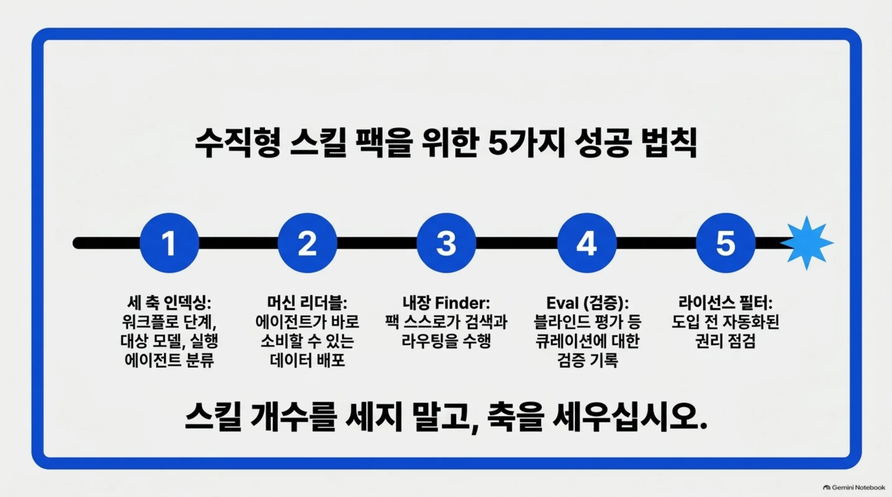
*세 축 인덱싱, 머신 리더블, 내장 Finder, eval, 라이선스 필터. 이 팩이 보여주는 수직형 스킬 큐레이션의 다섯 기준입니다.*

특히 de-AI 단계를 1급 항목으로 둔 것은 눈여겨볼 만합니다. 리뷰와 QA와 de-AI를 별도의 단계로 분리해 35개 프로젝트를 얹어두었고 별 1위도 그 층의 스킬입니다. 생성 품질이 올라가도 마무리 품질이 못 따라가면, 최종 산출물은 AI 냄새로 죽습니다. Paxis의 콘텐츠 계열 워크플로에 de-AI 단계를 명시하는 것은, 이 팩이 보여주는 방향 그대로입니다.

## 도입 전에

도입을 생각한다면, 먼저 라이선스를 봅니다. permissive 63퍼센트는 좋지만, 무라이선스 34퍼센트는 저작권 기본 원칙상 전유권 보존입니다. 회사 산출물에 섞이는 순간 문제가 됩니다. AGPL 1개는 네트워크 서비스 조건이 강해서, 서빙에 쓰는 경우 별도 판단이 필요합니다.

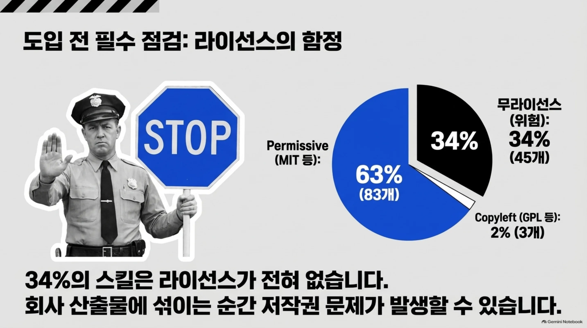
*Permissive 63퍼센트(83개), 무라이선스 34퍼센트(45개), Copyleft 2퍼센트(3개). 라이선스가 없는 34퍼센트는 회사 산출물에 섞이는 순간 저작권 문제가 됩니다.*

다음은 신선도입니다. meta.json의 pushed_at을 보면, 별 1,600이 넘는 스킬도 마지막 커밋이 4월인 경우가 있습니다. 11월 기준으로 7개월을 안 본 스킬입니다. 영상 프롬프트 스킬은 모델 버전에 종속되어 있으므로, 마지막 업데이트가 오래된 스킬은 프롬프트가 이미 죽어 있을 가능성이 큽니다. 별수가 아니라 push 날짜를 보는 이유가 여기에 있습니다.

두 번째, 체크와 실측의 차이를 기억합니다. checked는 대조일이지 효과 실측일이 아닙니다. 131개 중 featured는 5개입니다. 나머지는 "담아둔 것"이지 "추린 것"이 아닙니다. 스킬 하나를 실제 파이프라인에 붙일 때는 그 스킬의 eval 기록과, 자기 워크로드에서의 A/B가 필요합니다.

세 번째, 모델 쏠림입니다. Seedance 47개. 프롬프트 스킬은 모델에 종속됩니다. 모델이 바뀌면 프롬프트도 바뀝니다. 팩을 Seedance 생산 라인으로 읽으면 정확하고 영상 모델 일반으로 읽으면 틀립니다. 네 번째, 언어입니다. zh 78개, multi 31개, en 22개. 60퍼센트가 중국어 원문입니다. 한국어 콘텐츠로 쓰려면 각색이 필요하고 그 각색이 바로 Paxis 스킬 작업의 형태입니다.

밝은 점도 하나. 큐레이션 레이어 자체는 CC0입니다. skills.toml과 taxonomy, data.json의 분류 체계와 편집 노트는 법적 재사용이 열려 있습니다. 프로젝트들은 각자 라이선스를 갖고 있지만, "이 세로 영역의 스킬 지형도" 자체를 가져다 쓰는 것에는 허락이 필요 없습니다.

## 끝으로

86개에서 131개로, 하루에 16개. 숫자는 계속 움직일 것입니다. 움직여도 남는 것은 구조입니다. 세 축 인덱싱, 머신 리더블 인덱스, 내장 finder, eval, 라이선스 컬럼. 에이전트 네이티브 스킬 큐레이션의 최소 형식은 이 팩이 이미 보여주고 있습니다.

가져갈 것 하나만 남기겠습니다. 세로 영역의 스킬을 쌓을 때, 개수를 세지 말고 축을 세라는 것입니다. 어떤 단계에서, 어떤 모델에, 어떤 에이전트로 붙는지. 그 질문에 답하는 인덱스가 있으면, 스킬 팩은 사람이 보는 목록이 아니라 에이전트가 쓰는 도구가 됩니다. shortdramaskills.com의 data.json을 받아 자신의 파이프라인에 finder를 만드는 것은, 이 글이 제안하는 다음 단계입니다.

출처:
- [awesome-short-drama-skills (GitHub)](https://github.com/UnderleveledBuilder/awesome-short-drama-skills)
- [shortdramaskills.com (EN)](https://shortdramaskills.com/en/)
- @VibeEverything X 게시물 (2026-11-16, 본 큐 RT 경유, 원문 확인 불가라 인용)
