AI 코딩 에이전트로 영상까지 만들려는 개발자라면, 세 장면에서 막혔을 겁니다. 원본 영상을 열자마자 편집 프로그램 창을 손으로 열고, 침묵 구간을 타임라인 위에서 일일이 자르고, 씬이 바뀌는 지점을 화면을 좌우로 당기며 눈으로 확인합니다. 이 글은 "Claude Code에 영상 편집실을 세울 만한 도구 세트가 있는가"를 고르는 데 쓰는 글입니다.

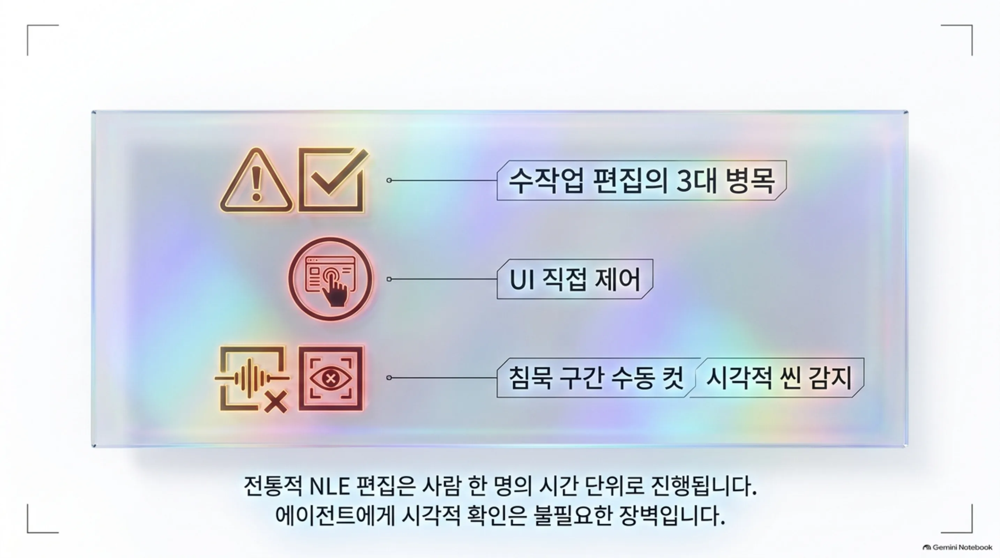
*수작업 편집의 세 병목. 편집 프로그램 창을 직접 여는 일, 침묵 구간을 타임라인 위에서 하나하나 자르는 일, 씬 전환 지점을 눈으로 확인하는 일입니다.*

결론을 먼저 둡니다. 14개 오픈소스 리포로 영상 편집 파이프라인을 조립할 수 있고, 그 라인에서 사람이 하지 않아도 되는 CPU 코어 두 개는 제가 실제로 돌린 결과입니다. 14개 리포의 스타를 오늘 GitHub API로 전부 세어 보았습니다. 합계는 166,548개였습니다.

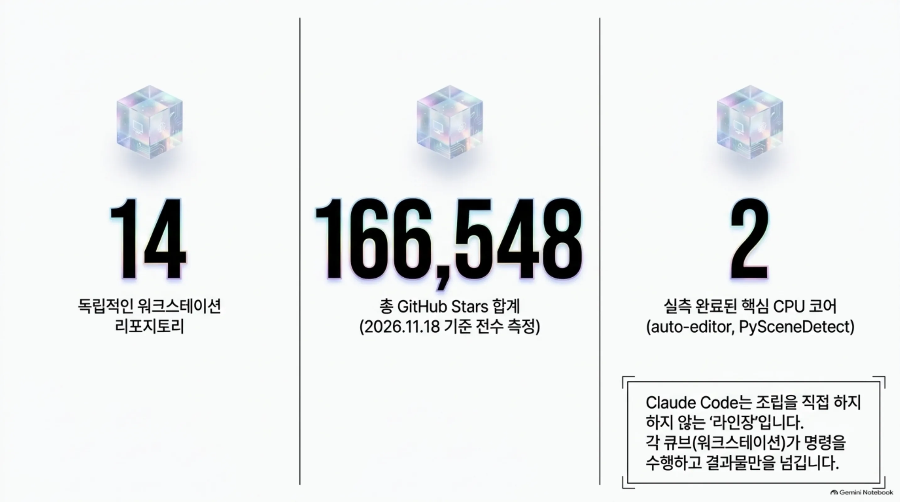
*독립 워크스테이션 14개, GitHub 스타 합계 166,548, 이 글에서 직접 돌린 CPU 코어 2개. 그리고 라인을 지휘하는 라인장, Claude Code.*

이 글은 트윗 하나로 돌아다니던 그 14개 목록을 하나씩 검증한 기록입니다. 어떤 도구가 라인의 어느 자리에 앉는지, 합성 영상으로 CPU 단계를 돌렸을 때 침묵 몇 초가 실제로 줄어드는지를 봅니다. GPU 단계는 실행하지 않은 이유, 유지보수가 멈춘 리포, API가 부서진 버전도 함께 적습니다.


*14개 리포 합계 166,548 스타. 2026-11-18 GitHub API 전수 측정.*

## 쉽게 말하면

이 파이프라인은 공장 유니트 라인입니다.

원본 영상이 라인 첫 번째 워크스테이션에 도착합니다. 각 워크스테이션은 한 가지 일만 합니다. 침묵 구간을 자르는 곳, 말한 단위에 타이밍을 붙이는 곳, 씬이 바뀌는 지점을 찾는 곳, 색을 고치는 곳, 마지막에 렌더하는 곳. 일은 끝나면 결과 파일을 다음 워크스테이션으로 넘깁니다.

Claude Code는 라인장입니다. 라인장은 조립을 직접 하지 않습니다. "침묵을 다 지워"라고 하면 auto-editor 워크스테이션이 돌아서 지운 파일을 넘깁니다. "씬 경계표도 만들어"라고 하면 PySceneDetect 워크스테이션이 돌아서 CSV와 OTIO 파일을 넘깁니다. 사람이 할 일은 라인장에게 일을 시키는 것과, 라인 끝에서 완성품을 받는 것뿐입니다.

이 글에서는 도구마다 "워크스테이션"이라 부릅니다. 비유를 끝까지 씁니다.

## 14개 워크스테이션, 라인 위에 앉힌 위치

원문 트윗은 라인을 다섯 단계로 압축합니다. Watch. Cut. Caption. Grade. Render. 그 안을 풀어 쓰면 footage, 즉 원본 영상에서 시작해 침묵 자르기, 워드 타이밍(말한 단어 하나하나의 위치), 씬 컷(화면이 바뀌는 지점), 그라데(색보정), 렌더(최종 출력)로 이어집니다. 14개 도구를 이 순서대로 배치하면 아래 표가 나옵니다.

| 순서 | 도구 | 맡은 일 | stars (11-18) |
|---|---|---|---|
| 1 | video-use | 원본 영상에서 final.mp4까지 대화형 편집 | 31,198 |
| 2 | ffmpeg-skill | FFmpeg 도구 42개를 로컬에서 호출 | 7,694 |
| 3 | Claude Eyes | 에이전트가 장면을 직접 보는 도구 | 98 |
| 4 | whisperX | 단어 단위 타이밍 + 화자 분리 | 25,422 |
| 5 | Silero VAD | 말이 시작하고 끝나는 지점 감지 | 10,692 |
| 6 | auto-editor | 침묵 구간을 자동으로 자르는 | 5,964 |
| 7 | PySceneDetect | 씬 컷·전환 지점 감지 | 5,539 |
| 8 | editly | 편집 전체를 스펙 파일 하나로 표현 | 5,627 |
| 9 | OpenTimelineIO | 타임라인을 소프트웨어끼리 주고받는 개방 형식 | 2,098 |
| 10 | DaVinci Resolve MCP | Resolve Studio를 Claude가 직접 조작 | 4,155 |
| 11 | Uncut | Claude Code가 내장된 macOS 편집기 | 27 |
| 12 | Yap Studio | 에이전트가 무음 제거 + B-롤 삽입 | 57 |
| 13 | Take One | 한 줄 입력에 런칭 영상 출력 | 345 |
| 14 | FFmpeg | 이 라인 거의 모든 도구의 밑바닥 엔진 | 67,632 |

14개 전부 GitHub API로 존재 확인을 했고, stars는 2026-11-18에 실측했습니다. 트윗의 "160K+ stars combined" 주장은 166,548으로 성립합니다.

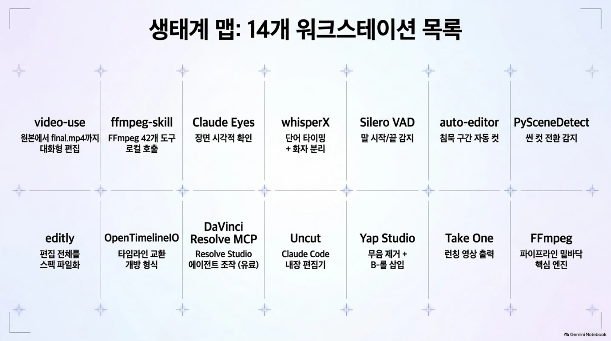
*생태계 맵. 14개 워크스테이션을 각자의 맡은 일과 함께 배치한 모습입니다.*

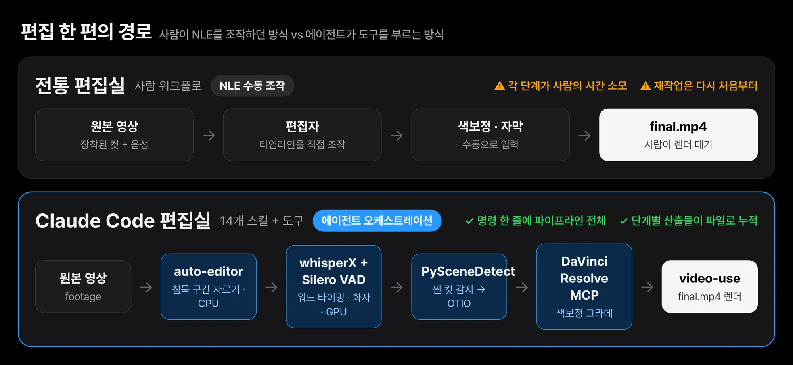
*전통 편집은 사람 한 명의 시간 단위로 진행됩니다. 스킬 파이프라인은 도구별로 책임을 나누고, OTIO 같은 공통 형식이 이음새가 됩니다.*

## 라인을 돌리는 순서, 그림으로

라인의 흐름은 아래와 같습니다. 각 화살표는 "결과 파일이 넘어간다"를 뜻합니다.

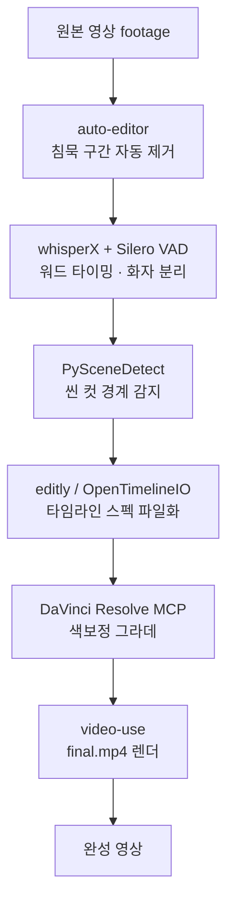

이 그림에서 중요한 것은 도구가 아니라 화살표입니다. 침묵을 자른 파일, 워드 타이밍이 붙은 파일, 씬 경계표, OTIO 타임라인. 라인이 도는 동안 산출물이 파일로 쌓입니다. 파일은 에이전트가 읽고 쓸 수 있는 형식입니다.

파일로 쌓인다는 것은 실패에서도 의미가 있습니다. 라인은 어느 워크스테이션에서 끊겨도 그 지점의 입력 파일에서 재개할 수 있습니다. 에이전트는 전체 라인을 처음부터 다시 돌리지 않고 실패한 단계만 다시 돌립니다. NLE에서는 상태가 프로젝트 파일 안에 있으니 되돌리려면 편집기부터 여는 일인데, 라인에서는 되돌리는 단위가 파일 하나입니다.

## CPU 워크스테이션 두 개, 합성 영상으로 실측

GPU 단계는 이번 실험에서 돌리지 않았습니다. 그래서 라인의 CPU 코어, auto-editor와 PySceneDetect 두 워크스테이션을 실제로 돌려 봅니다.

재기 방법은 단순합니다. 40초짜리 합성 영상을 만듭니다. 640x360, 30fps, 1200프레임. 서로 다른 화면 패턴 다섯 개를 8초씩 이어 붙여 하드 컷 4개를 만들고, 오디오로 440Hz 사인파를 깔아 4초~6초, 12초~14초, 20초~22초, 28초~30초 구간에 2초씩 침묵을 심었습니다. 컷 4개와 침묵 8초가 정답인, 답이 있는 시험지입니다.

**auto-editor.** 첫 실행 때 GitHub releases에서 자기 플랫폼용 Go 바이너리(29.3.1 macos-arm64)를 자동으로 받아 설치했습니다. 40.000초 영상을 3.1초 만에 처리했고, 출력은 33.733초였습니다. 심어 둔 침묵 8초 중 6.267초를 잘랐습니다. 8초가 아니라 6.27초인 이유는, 침묵 감지가 임계값(진폭 비율 0.04가 기본) 기준이라서입니다. 인코더가 침묵 경계로 남기는 꼬리와, 사인파가 실제로 침묵까지 떨어지지 않는 구간이 섞여 있습니다. 침묵은 불리언이 아니라 임계값 문제라는 것을, 1.7초 차이로 확인한 셈입니다. 잘라낸 구간 목록은 내보낼 수 있고, Adobe Premiere Pro가 읽는 XML 형식으로도 만들 수 있습니다.

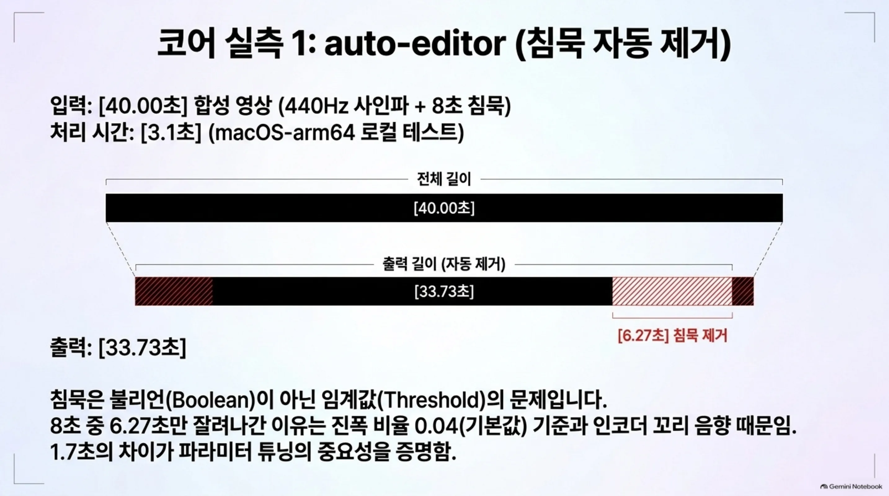
*auto-editor 실측. 심어 둔 침묵 8초 중 6.27초가 잘려 나갔습니다. 임계값(진폭 비율 0.04)과 인코더 꼬리 음향이 남은 1.7초의 이유입니다.*

**PySceneDetect.** 이번 실험에서 가장 먼저 부딪힌 벽도 여기 있습니다. 0.6세대 API로 쓰던 `video.detect_scenes()`가 0.7.3에서는 사라져 AttributeError가 납니다. 0.7은 CLI 중심으로 재구조화되었습니다.

```
scenedetect -i sample.mp4 detect-content list-scenes save-otio -o exp_out
```

이 한 줄로 1200프레임을 0.2초에 처리했고, 평균 5,265fps였습니다. 심어 둔 컷 4개(8초, 16초, 24초, 32초)를 전수 적중해 씬 5개를 감지했습니다. 산출물 CSV는 이런 형태입니다.

```
1,1,00:00:00.000,0.000,240,00:00:08.000,8.000,240,00:00:08.000,8.000
2,241,00:00:08.000,8.000,480,00:00:16.000,16.000,240,00:00:08.000,8.000
```

씬 번호, 시작·끝 프레임과 타임코드, 길이. 행 한 개가 편집의 최소 단위가 됩니다.

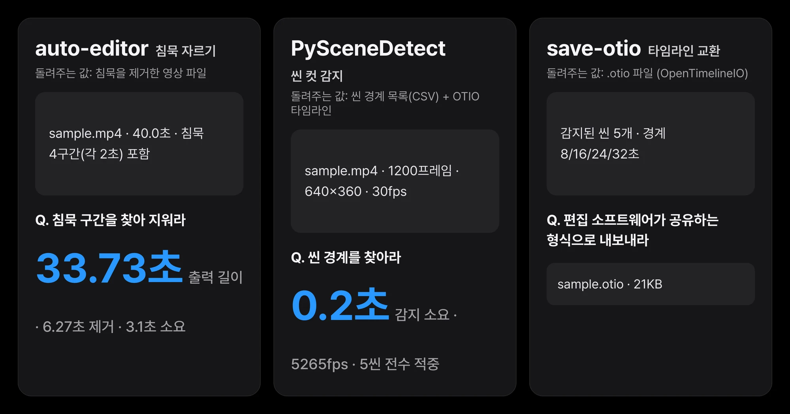
*동일한 40초 합성 영상(4개 하드 컷 + 8초 침묵 4구간)에 CPU 단계 두 개를 실측한 결과. GPU 단계(whisperX 등)는 실행하지 않았습니다.*

그리고 실험에서 가장 마음에 들어한 산출물은 `sample.otio`입니다. 21KB의 OpenTimelineIO 타임라인 파일. 파일 안을 열어 보면, OTIO 스키마 선언("Timeline.1")과 Video 1 트랙, 그리고 씬 하나하나가 클립(각자의 source_range 포함)으로 담겨 있습니다. 씬 경계 4개를, 편집 소프트웨어가 공통으로 읽는 형식으로 내보낸 것입니다. PySceneDetect가 다음 도구에 넘기는 것이 "씬이 5개예요"라는 문장이 아니라 파일인 이유가 여기에 있습니다.

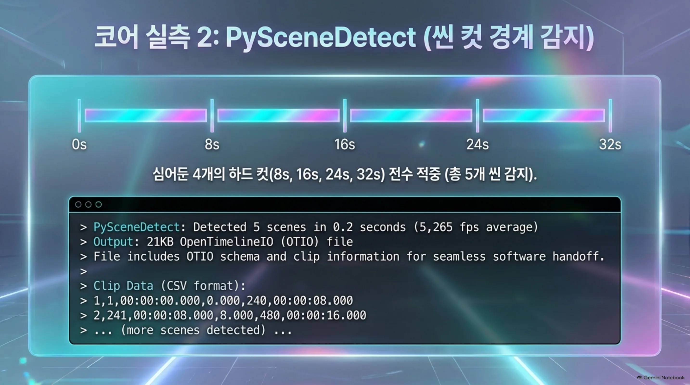
*PySceneDetect 실측. 8초·16초·24초·32초의 심어 둔 하드 컷 4개를 전부 적중해 씬 5개를 감지했고, 산출물은 OTIO 파일 21KB입니다.*

## GPU 워크스테이션은 라인에 넣지 않은 이유

whisperX와 Silero VAD는 이 라인의 비용을 결정하는 단계입니다. 워드 단위 타이밍과 화자 분리를 하려면 음성 인식(ASR) 모델을 돌리는데, 이는 노트북으로 할 일 범위가 아닙니다. 다키클라우드에서 같은 라인을 돌린다면 이 두 단계는 GPU 큐에 들어가는 잡이 되고, auto-editor와 PySceneDetect는 로컬 몇 초 일로 남습니다. GPU 잡이 끝내면 워드 타이밍 파일이 라인의 다음 워크스테이션으로 넘어가고, 그 파일에서 침묵 자르기의 정밀도를 다시 조정하는 것이 두 계층이 만나는 지점입니다.

그래서 이 글은 CPU 코어의 실측만 담습니다. whisperX가 이 영상에서 ms 단위 정확도로 워드 타이밍을 내리는지, 침묵 감지와 화자 분리가 몇 %나 겹치는지는 측정하지 않았으니, 이 글에서 그 수치를 주장하지 않습니다.

## 스펙을 쓰는 것이 편집이 되는 자리

라인에서 특이한 위치를 차지하는 워크스테이션이 둘 있습니다. editly와 OpenTimelineIO. 둘 다 영상 파일을 다루지 않습니다. 편집의 "계획"을 파일로 다룹니다.

editly는 편집 전체를 스펙 파일 하나로 표현합니다. 자를 위치, 넣을 자막, 그라데 파라미터를 선언형 파일로 적으면 렌더링까지 그 파일이 산출됩니다. OpenTimelineIO는 영화 아카데미(Academy Software Foundation)가 표준으로 만든 타임라인 교환 형식입니다. 각기 다른 편집기가 같은 타임라인을 읽고 쓸 수 있게 하는 공용 언어입니다.

에이전트 워크플로에서 이 둘은 라인장을 대신합니다. 사람이 NLE 창에서 마우스로 타임라인을 당기던 자리를, 에이전트가 스펙 파일을 쓰고 OTIO를 읽는 자리로 바꿉니다. 편집의 산출물이 "프로젝트 파일 내부의 상태"에서 "디스크 위의 파일"로 이동하는 순간, 다음 워크스테이션이 그 파일을 받아야 라인이 도는 것입니다.

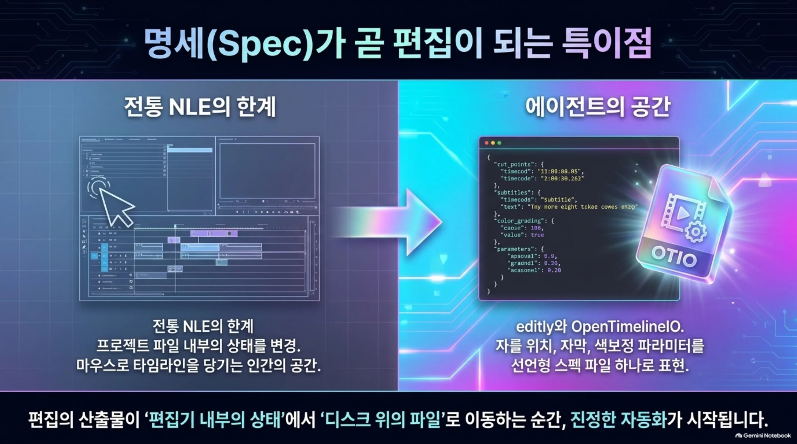
*스펙이 편집이 되는 지점. 왼쪽은 프로젝트 파일 내부의 상태를 마우스로 바꾸던 NLE의 한계, 오른쪽은 자를 위치·자막·색보정 파라미터를 선언형 스펙 파일 하나로 표현하는 editly와 OpenTimelineIO입니다.*

## 쓰기 전에 알아둘 것들

**14개 리포의 체형은 고르게 퍼져 있지 않습니다.** 상위 3개, FFmpeg(67,632) · video-use(31,198) · whisperX(25,422)가 합계의 75%를 집니다.

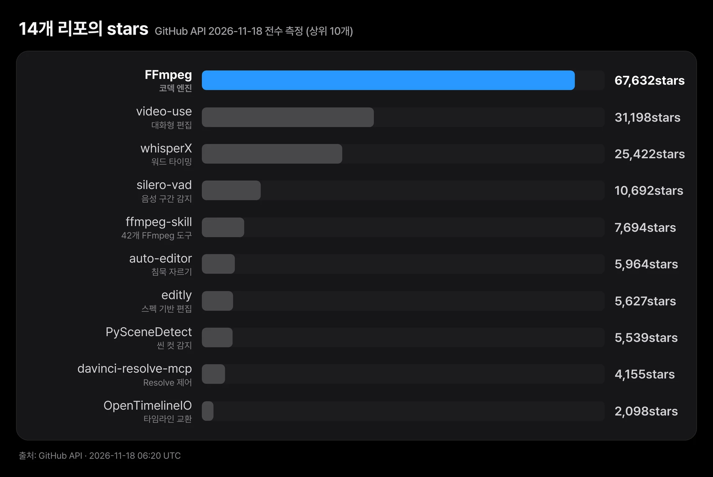
*FFmpeg 한 리포의 스타가 상위 10개 합계의 40%를 넘습니다. 파이프라인의 절반은 수십 년 된 기존 도구이고, 에이전트 스킬은 그 위에 얹힌 얇은 층입니다.*

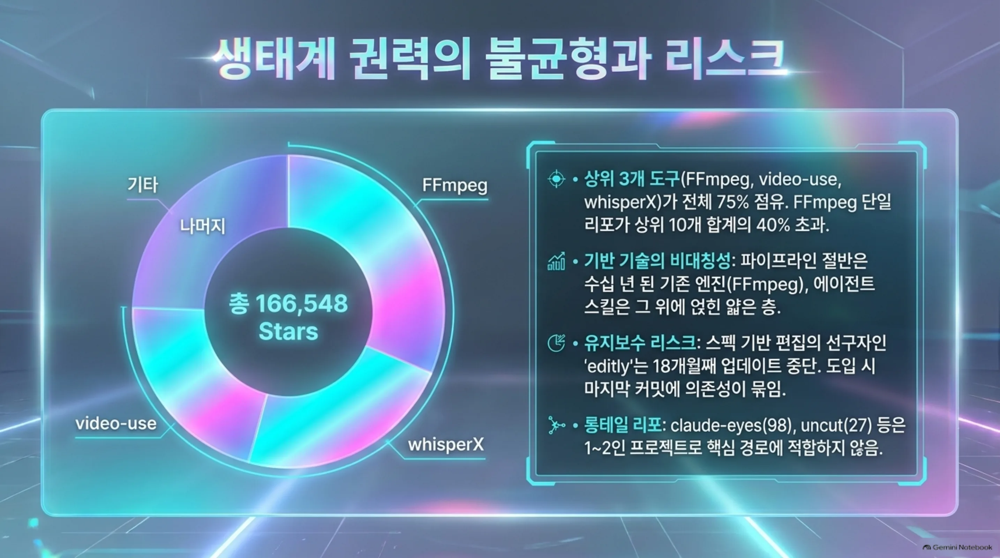
*생태계 권력의 불균형. 상위 3개(FFmpeg, video-use, whisperX)가 합계의 75%를 집고, 스펙 기반 편집의 선구자인 editly는 18개월째 업데이트가 멈춘 상태입니다.*

**유지보수가 멈춘 워크스테이션이 있습니다.** stars와 별개로 14개 리포의 마지막 push 일자도 전부 확인했습니다. 13개는 최근 두 달 이내에 살아 있고, 예외는 editly 하나입니다. 마지막 push는 2025년 5월, 18개월째 침묵 중입니다. 스펙 기반 편집이라는 컨셉은 선점했지만, 지금 이 표를 복사해 그대로 쓰는 순간 의존성은 그 리포의 마지막 커밋에 묶입니다. stars는 커다란 커뮤니티를 가리키고, push 일자는 지금 손이 닿아 있는지를 가리킵니다. 둘 다 봅니다.

**롱테일 리포는 작습니다.** claude-eyes 98, yap-studio 57, uncut 27 스타. 개발자가 한두 명인 프로젝트이고, 라인의 핵심 경로에 있지 않습니다. 핵심 경로에 올리는 것이라면 stars를 확인하는 것만으로 충분합니다.

**돈이 되는 워크스테이션도 있습니다.** DaVinci Resolve MCP가 조종하는 Resolve Studio는 유료 라이선스입니다. MCP는 무료지만 조종대 끝의 기계는 아닙니다.

**자른 침묵이 증거로 남습니다.** auto-editor는 침묵을 자른 영상만 내보내는 것이 아니라, 잘려 나간 침묵 구간 자체도 별도 파일로 내보낼 수 있습니다. "6.27초를 잘랐습니다"라는 보고서 뒤에, 실제로 잘려 나간 침묵 4구간이 파일로 함께 있으면 검증이 끝납니다. 편집의 산출물이 결과뿐 아니라 과정의 증거까지 파일로 남는 것, 이 라인의 다른 특징입니다.

| | 전통 NLE | 스킬 라인 |
|---|---|---|
| 조작 주체 | 사람의 손 | 에이전트 |
| 산출물 | 편집기 내부 프로젝트 파일 | OTIO·CSV 등 핸드오프 파일 |
| 재작업 비용 | 타임라인 다시 | 해당 단계 명령 재실행 |
| 규모 | 1인 1라인 | 워크스테이션 수만큼 |
| 버전 위험 | 편집기 업데이트 | 리포별 push 이력 (editly 18개월 침묵) |

## 이 라인이 다키클라우드에서 만나는 두 지점

**Paxis.** 다키클라우드의 Agent-Native Cloud Paxis가 돌리는 영상 제작 스킬군은 이미 이 도구 집합과 겹칩니다. video-use, ffmpeg-toolkit, openmontage 계열을 라우팅하는 스킬이 있고, 각 단계가 파일을 내주고 다음 단계가 파일을 받는 계약은 Paxis의 DAG 멀티에이전트 실행과 같은 형입니다. 차이 하나. Paxis에서는 이 라인의 각 워크스테이션 호출이 정책 게이트와 감사 로그를 통과합니다. 라인장이 시키는 일 하나하나에 "이 도구를 이 파일에 쓰게 할 것인가"를 기록으로 남기는 것입니다.

**GPU 인프라.** 이 라인의 비용 구조는 CPU 단계와 GPU 단계가 섞여 있습니다. auto-editor 3.1초, PySceneDetect 0.2초는 로컬이 하고, whisperX는 큐가 해야 합니다. 같은 파이프라인이 두 실행 계층에 걸쳐 도는 모습은, 다키클라우드 GPU 클러스터가 Kueue 큐로 잡을 배분하는 방식과 정확히 같은 분업입니다. 값싼 단계는 가까이 두고, 비싼 단계는 줄을 서게 하는 것입니다.

## 끝으로

영상 편집실은 설치하는 소프트웨어가 아니라 조립하는 파이프라인입니다. 14개 리포, 합계 166,548 스타가 이 라인이 이미 다른 누군가에 의해 길게 서 있다는 증거이고, CPU 코어 두 개의 실측은 제가 그 라인에 한 박자씩 박아 본 기록입니다. 심어 둔 컷 4개 전수 적중, 침묵 8초 중 6.27초 제거, 산출물 OTIO 21KB.

오늘 할 수 있는 첫 실험입니다. 5분이면 됩니다.

```
uv pip install auto-editor scenedetect
scenedetect -i your-video.mp4 detect-content list-scenes save-otio
auto-editor your-video.mp4 -o cut.mp4
```

자신의 영상에서 씬 경계를 CSV로 받아 보고, 침묵을 잘라 본 뒤, OTIO 파일을 다른 편집기가 읽는지 확인해 보십시오. 라인을 돌린 경험 하나면, 14개 워크스테이션 중 어디를 자기 라인에 올릴지가 보입니다. 에이전트가 영상을 만들라고 한다면, 올인원 편집기를 찾지 마십시오. 워크스테이션을 배치하고, 그 사이에 넘기는 파일을 OTIO로 정하십시오. 그것이 이 글이 말하는 "영상 편집실을 세운다"는 것입니다.

## 참고 자료

- 원문 트윗: [@plusxbt, 2026-11-16](https://x.com/plusxbt/status/2122312123183235554)
- 14개 리포: [video-use](https://github.com/browser-use/video-use) · [ffmpeg-skill](https://github.com/kajisho5/ffmpeg-skill) · [Claude Eyes](https://github.com/moritzkremb/claude-eyes) · [whisperX](https://github.com/m-bain/whisperX) · [Silero VAD](https://github.com/snakers4/silero-vad) · [auto-editor](https://github.com/WyattBlue/auto-editor) · [PySceneDetect](https://github.com/Breakthrough/PySceneDetect) · [editly](https://github.com/mifi/editly) · [OpenTimelineIO](https://github.com/AcademySoftwareFoundation/OpenTimelineIO) · [DaVinci Resolve MCP](https://github.com/samuelgursky/davinci-resolve-mcp) · [Uncut](https://github.com/blazejkustra/uncut) · [Yap Studio](https://github.com/cathrynlavery/yap-studio) · [Take One](https://github.com/talsiach/take-one) · [FFmpeg](https://github.com/FFmpeg/FFmpeg)
- PySceneDetect 문서: https://scenedetect.com/docs/
- stars 실측: GitHub API, 2026-11-18 06:20 UTC (14개 전수)
- 실험 산출물: 40초 합성 영상 · auto-editor 33.733초 출력 · sample.otio 21KB (2026-11-18, Mac 로컬 CPU)
