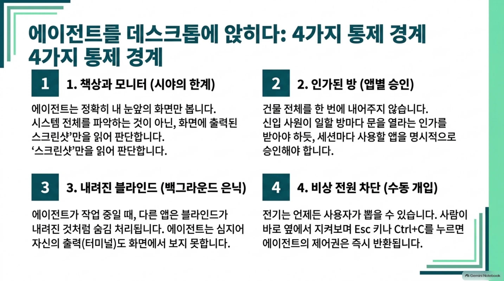
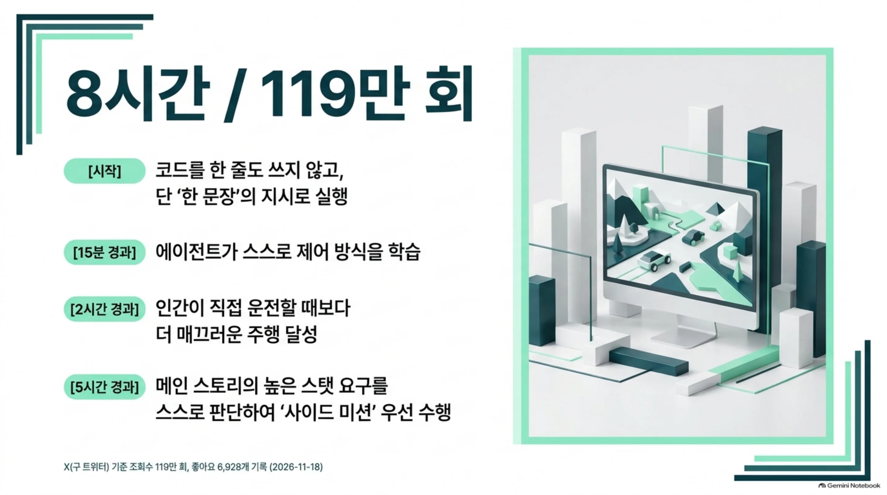
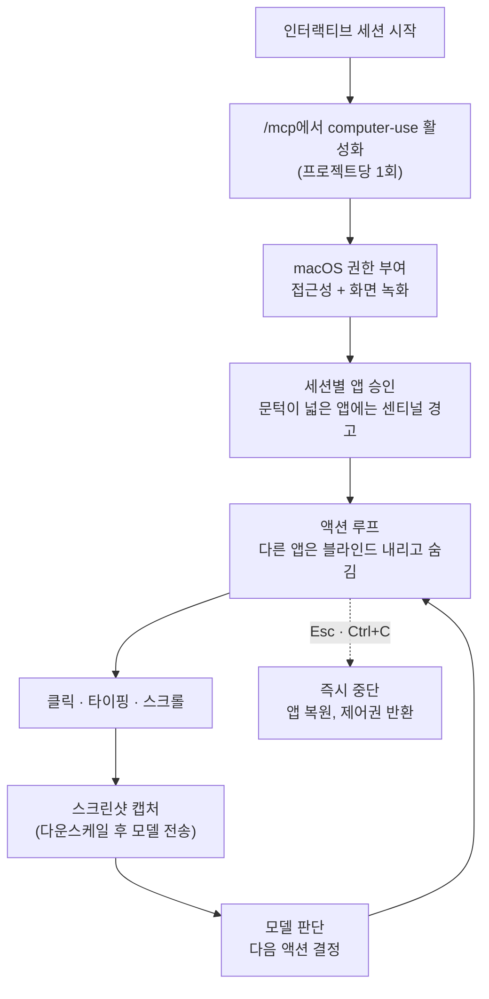
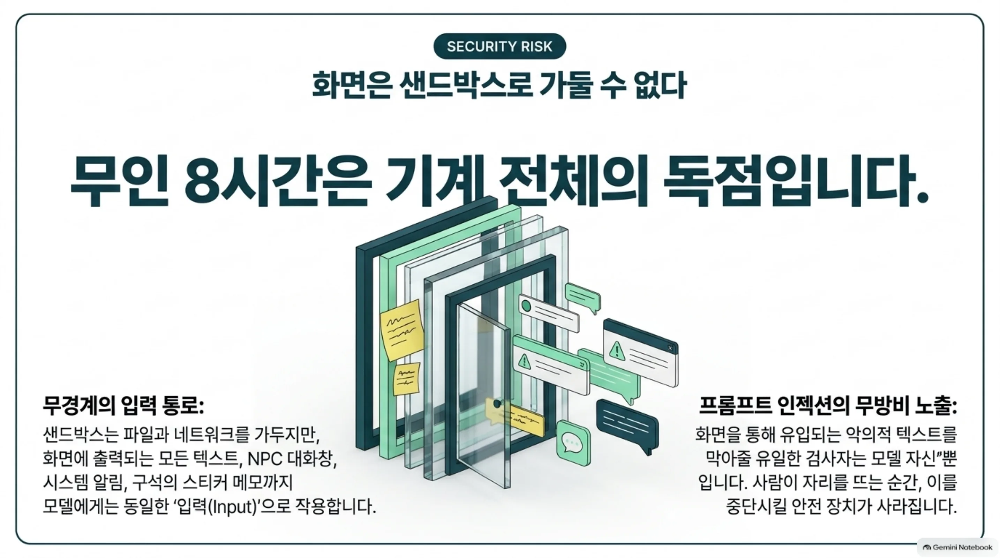
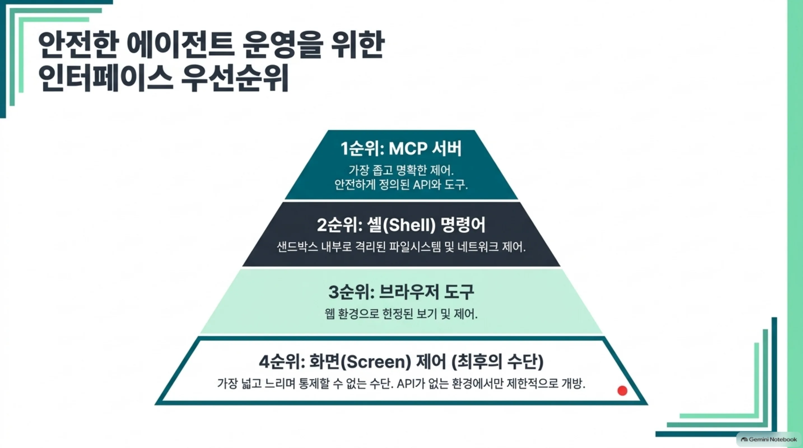
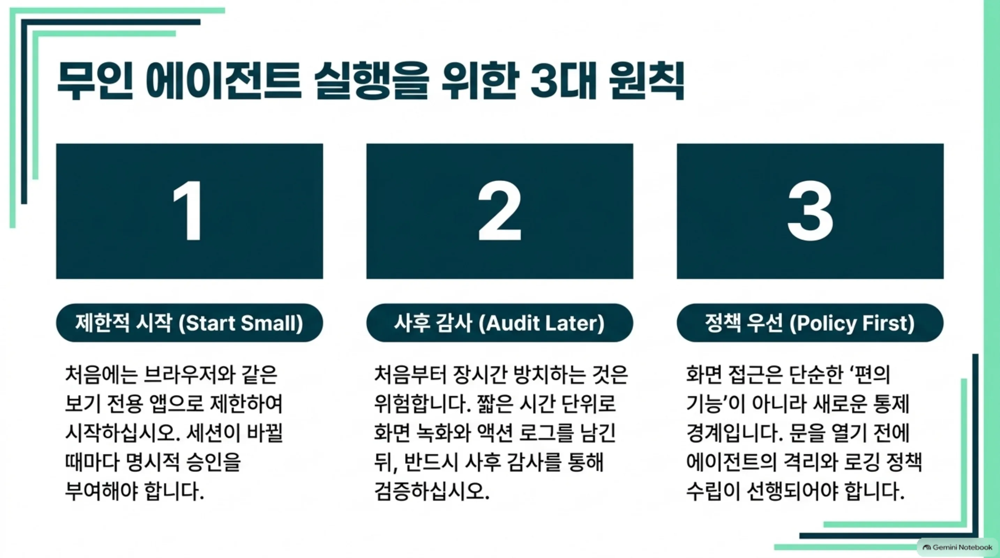

오늘 글은 자기 컴퓨터의 마우스와 키보드를 AI 에이전트에 맡겨 보고 싶은 개발자, 그리고 무인 장시간 실행을 설계하는 에이전트 운영자에게 씁니다. 결론부터 말합니다. 클로드 코드의 컴퓨터 유즈는 장난감이 아니라 실제로 써야 할 기능이지만, 바이럴 된 'GTA 6 8시간 무인 플레이'는 기능의 문서화된 제약과 전부 들어맞지 않는 주장입니다. 무인 실행을 맡기기 전에 화면이라는 새로운 안전 경계를 이해할 필요가 있습니다. 이 글은 바이럴 실험, 공식 기능 문서, 두 소스로 확인한 사실 위에서 에이전트 운영의 시사점을 정리합니다.

## 쉽게 말하면

이 기능을 사무실 PC 한 대에 비유해 봅니다. 신입 사원 첫 출근일, 그 사람이 앉을 자리에 모니터와 마우스, 키보드가 놓여 있다고 상상하세요. 컴퓨터 유즈는 정확히 그 자리입니다. 다만 건물 전체를 한 번에 넘겨 주지 않습니다. 신입 사원은 일할 방마다 문을 열라는 인가를 받고(앱별 승인), 일하는 동안 다른 방의 블라인드는 내려져 있습니다(다른 앱 숨김). 모니터에 보이는 것은 내 눈앞의 화면과 똑같습니다(스크린샷)고, 전기는 언제든 내가 뽑을 수 있습니다(Esc). 8시간 GTA 6 실험은, 내가 출장을 간 동안 그 신입 사원이 사무실 PC를 몇 시간이나 혼자 굴릴 수 있는가가 아니라, 굴린 결과를 영상으로 확인한 이야기입니다.

이 비유를 글 끝까지 씁니다.

## 어떤 주장이 돌았나

출처는 X 사용자 @starmexxx의 2026년 11월 18일(UTC) 20:15 게시글입니다. 내용은 다음과 같습니다. 출근길 아침에 화면 접근을 줬고, 스토리를 죽지 않고 끝까지 해달라고 했더니 퇴근했을 때 미션 4개를 끝내고 있었다는 것. 스스로 돈 버는 방법을 찾아 반복 실행 중이었다는 것. 제어를 배우는 데 15분이 걸렸고, 2시간이 지나면 본인이 운전할 때보다 더 매끄럽게 몰았고, 5시간쯤 되면 메인 스토리가 더 높은 스탯을 요구한다고 판단해 사이드 미션을 먼저 찍었다는 것. 작성자는 코드를 한 줄도, 스크립트를 하나도 만들지 않았고 한 문장만 줬다고 말합니다. 사용한 프롬프트는 답글에 있다고 합니다만, 답글까지 검증하지는 않았습니다.

게시글은 11월 19일 오전 기준 좋아요 6,928개, 리트윗 411개, 조회수 약 119만회를 기록하고 있었고, 같은 주제의 유튜브 영상(SSxGzFQpEdw)이 첨부돼 있었습니다. 댓글에서는 GTA 6도, 클로드 구독도 사야 하는 비용 구석에서 농담이 오갔고, 이 주장을 따로 검증하는 별도의 영상(rjEFyWfmqLg)도 올라왔습니다.

> 원 게시글의 8시간 플레이 영상. 작성자가 아침에 화면 접근을 주고 떠난 뒤 촬영된 모습입니다.



## 화면을 읽는 에이전트, 컴퓨터 유즈는 무엇인가

컴퓨터 유즈는 클로드 코드 CLI에 내장된 MCP 서버 `computer-use`입니다. 기본은 꺼져 있고, 인터랙티브 세션에서 `/mcp` 메뉴에서 활성화하면 프로젝트 단위로 유지됩니다. 앤트로픽은 이 기능의 위치를 분명히 합니다. 에이전트가 앱과 대화하는 수단은 여러 개이고, 컴퓨터 유즈는 가장 넓고 가장 느린 수단입니다. 순서대로 MCP 서버, 셸 명령, 브라우저 도구, 그리고 마지막으로 화면. 화면 제어는 다른 수단이 못 닿는 대상, 즉 네이티브 앱이나 시뮬레이터, CLI나 API가 없는 도구에만 쓰는 것입니다.

요구 조건도 문서에 다 있습니다. macOS 전용이고, 리서치 프리뷰이며, Pro, Max, Ultra 플랜에서 쓸 수 있고, Bedrock 같은 서드파티 경로는 통하지 않습니다. 인터랙티브 세션에서만 동작해 `-p` 같은 비대화형 호출에서는 쓸 수 없습니다.

활성화 뒤에는 권한 흐름이 따라옵니다. macOS 접근성(클릭·타이핑·스크롤)과 화면 녹화(화면 확인) 두 권한을 부여받은 뒤, 세션마다 일할 앱을 승인해야 합니다. 이때 문이 넓은 앱에는 센티널 경고가 붙습니다. 터미널은 셸 접근과 동급, 파인더는 모든 파일 읽기·쓰기, 시스템 설정은 시스템 변경. 앱마다 제어 단계도 다릅니다. 브라우저와 트레이딩 플랫폼은 보기 전용, 터미널과 IDE는 클릭 전용, 나머지는 완전 제어.

운영상 눈여겨볼 설계가 세 가지 있습니다. 첫째, 에이전트가 일하는 동안 다른 앱은 숨겨지고 터미널은 스크린샷에서 제외됩니다. 즉 에이전트는 자기 출력을 화면에서 보지 못합니다. 둘째, 스크린샷은 자동 다운스케일됩니다. 16인치 맥북 프로의 네이티브 해상도 3456×2234는 약 1372×887로 줄어 전송됩니다. 셋째, 한 대의 컴퓨터는 한 세션이 잠급니다. 에이전트가 락을 쥔 동안 다른 세션은 화면을 못 쓰고, 락은 세션이 끝날 때 풀립니다.

## 문서와 안 맞는 지점, 8시간 무인 플레이

여기서 비유를 다시 꺼냅니다. 신입 사원을 출장 중인 8시간 동안 혼자 두는 것. 가능할까, 불가능할까. 문서를 대면 안 맞는 지점이 네 가지 있습니다.

첫째, 인터랙티브 세션 요건입니다. 공식 문서상 컴퓨터 유즈는 대화형 세션에서만 동작합니다. 8시간을 '떠 있는 대화'로 채웠다면 가능한 이야기지만, 비대화형 자동화처럼 돌렸다면 문서 범위 밖입니다. 작성자가 어떤 경로로 8시간을 채웠는지는 게시글에 없습니다. [추정] Windows에서 동작하는 커뮤니티의 컴퓨터 유즈 MCP 프로젝트나, 인터랙티브 세션을 방치한 둘 중 하나일 가능성이 큽니다.

둘째, macOS 전용입니다. CLI 경로에서는 macOS뿐입니다. 8시간을 굴린 기계의 운영체제는 게시글과 영상에서 명확하지 않습니다.

셋째, 플랜과 인증 경로입니다. 개인 구독(Pro, Max, Ultra)과 claude.ai 인증이 전제입니다. 기업 경유(Bedrock 등)에서는 이 기능이 안 열립니다. 8시간 실험은 결국 개인의 구독이 인프라인 이야기라는 뜻입니다.

넷째, 앱 승인은 세션 단위입니다. 세션마다 앱을 승인하는 구조인데, 승인 목록을 어떻게 유지했는지, 그 사이에 새로운 앱 요청이 없었는지 공개 자료에 없습니다.

게시글이 '코드를 한 줄도 안 썼다'고 한 것은 이 기능의 의도와 맞습니다. 컴퓨터 유즈가 설계된 이유가 바로 CLI와 API가 없는 화면 세계를, 문장으로만 지시해 쓰게 하기 위해서이니까요. 하지만 '무인 8시간'이라는 부분까지가 기능의 문서화된 범위 안에는 들어 있지 않습니다. 이 실험은 결과를 영상으로 확인한 주장이고, 재현 요소를 담은 레시피는 아닙니다. 그래서 이 글에서 8시간 플레이의 성공 여부를 입증하거나 뒤집으려는 것은 아닙니다. 중요한 질문은 '무엇이 필요하면 안전한가'입니다.

## 영상은 무엇을 증명하고 무엇을 남기는가

바이럴 된 에이전트 실험은 대부분 영상 하나로 나옵니다. 8시간 GTA 6도 예외가 아닙니다. 영상이 증명하는 것과 남기는 것을 구분하는 눈이 필요합니다.

연속 세션이 실제로 돌았는지는 영상으로 확인하기 어렵습니다. 잘린 클립은 편집의 산물이고, 타임스탬프나 세션 로그가 함께 공개되지 않는 한 '한 세션이 8시간을 채웠는가'는 검증되지 않습니다. 작성자가 답글에 프롬프트를 두겠다고 했지만, 프롬프트의 길이와 개수는 '한 문장'이라는 주장과 맞물려서 봐야 할 증거입니다. 한 문장이 아니라 여러 차례 지시를 보냈다면, 그것은 무인 실험이 아니라 장기간의 원격 조종에 가깝습니다.

모델이 '스스로' 판단했는지도 같은 맥락입니다. 사이드 미션을 먼저 한다고 한 서술은, 모델이 목표 함수를 스스로 다시 정했을 때에만 의미 있습니다. 하지만 화면을 보고 다음 액션을 고르는 구조에서, '스스로'와 '다음 프레임에서 우연히 그 버튼을 눌렀다'를 영상이 구분해 주지는 않습니다. 판단의 순간을 담은 스크린샷과, 그 사이의 액션 로그가 함께 공개되어야 '스스로'라는 말이 성립합니다.

결국 영상은 '에이전트가 화면을 보고 게임을 돌리는 모습'은 보여 주지만, '몇 시간 동안, 어떤 지시로, 얼마나 스스로였는가'까지는 보여 주지 않습니다. 이 차이를 읽는 것이 바이럴 에이전트 주장을 대하는 기본 태도입니다. 이 실험의 진짜 가치는 8시간이라는 숫자가 아니라, 화면이라는 통로를 에이전트의 손으로 쓰는 모습이 대중에게 보였다는 데 있습니다.

## 안전 경계는 화면에서 갈라진다

클로드 코드의 Bash 도구는 샌드박스 안에서 도는데, 컴퓨터 유즈는 실제 데스크톱에서 승인한 앱에 접근합니다. 문서 스스로도 이 둘의 신뢰 경계가 다르다고 경고합니다. 샌드박스는 파일시스템과 네트워크를 가두지만, 화면은 가둘 수 없습니다. 화면에 보이는 것은 모두 입력이 되기 때문입니다.

이게 왜 중요한지는 게임 8시간이라는 맥락에서 뚜렷합니다. 신입 사원 비유로 말하면, 내가 없는 동안 모니터에 붙은 스티커 메모 한 장이 회사 안팎의 모든 정보와 동급으로 읽힌다는 것입니다.

8시간 게임 화면에 실제로 놓이는 입력을 나열해 보면 더 선명해집니다. 게임 내 텍스트와 하단 HUD, 미션 목표 문구, NPC 대화창. 여기에 겹치는 것은 게임 밖 요소입니다. 다른 플레이어의 채팅, 광고나 팝업, 운영체제 알림, 심지어 화면 구석의 스티커 메모. 이 모든 것이 모델에게는 같은 채널, 즉 스크린샷을 통해서만 들어옵니다.

샌드박스와 달리 화면은 '이것만 읽어라'라는 경계가 없습니다. 읽는 것이 곧 입력이 되기 때문에, 8시간 동안 사람이 눈을 떼고 있다면 이 입력 통로를 막아 주는 것은 모델 자신의 검사뿐입니다. 문서는 각 액션에서 화면에 보이는 콘텐츠에서 오는 프롬프트 인젝션을 검사하고 경고한다고 합니다. 하지만 검사하는 쪽도 화면을 보고 있는 쪽도 결국 모델입니다. 인간이 바로 옆에 있을 때는 이 설계가 작동합니다. Esc를 누를 사람이 있으니까요.

8시간을 혼자 두면 이야기는 달라집니다. 세션 락 덕분에 다른 세션은 이 컴퓨터를 못 쓰게 됩니다. 즉 무인 8시간은 그 기계 전체의 독점입니다. 블라인드, 센티널 경고, 터미널 제외, Esc. 이 안전 장치들은 전부 '사람이 기계 앞에 있는' 것을 전제로 합니다. 사람이 자리를 뜨면 제어가 전후 사후로 옮겨갑니다. 녹화된 영상과, 사후에 읽을 로그. 무인 실행의 안전 장치는 '막는 장치'가 아니라 '뒤집어 볼 장치'여야 한다는 뜻입니다.

## 이 실험이 다키클라우드에서 만나는 지점

Paxis는 다키클라우드의 Agent-Native Cloud로, 스킬과 도구, 정책, 감사 로그를 일급 리소스로 다룹니다. 컴퓨터 유즈는 그중 '도구' 계층에서 에이전트의 손과 실제 환경의 경계가 가장 두꺼운 곳입니다. 이 실험이 드러내는 약점, 즉 사람이 없는 동안에는 안전 장치가 작동하지 않는다는 것은, Paxis가 에이전트를 격리 샌드박스에 두고 모든 동작을 정책 게이트와 감사 로그로 통과시키는 이유와 정확히 같은 방향입니다. 화면 접근을 주는 순간, 그 화면은 새로운 정책 대상이 되고, 그 위에서 일어난 모든 액션은 감사 로그로 남을 수 있어야 합니다.

경제의 구석도 놓치지 않아야 합니다. 댓글에서 웃음거리가 된 비용 문제, GTA 6를 사고 클로드도 사야 한다는 농담의 뒤에는 실질이 있습니다. 무인 8시간은 실험으로는 비싼 시간입니다. Paxis에서 장시간 에이전트 세션은 예산 관리와 비용 인식 라우팅의 관리 대상입니다. 몇 시간 동안, 얼마를 써서, 어느 모델을 경유할 것인가. 8시간 실험이 보여주기는 한 문장으로 8시간을 굴릴 수 있다는 것인데, 운영자의 질문에 답해 주지는 않습니다.

마지막으로 도구 우선순위 설계(MCP, 셸, 브라우저, 그리고 마지막으로 화면)는 에이전트 운영에 그대로 이식되는 패턴입니다. 좁은 인터페이스를 먼저 쓰고, 화면은 다른 수단이 다 못 닿을 때만 열람하는 것. 이 순서를 지킬 때 화면이라는 넓은 경계를 열 필요가 줄어듭니다.

## 끝으로

다시 시작점으로 돌아갑니다. 에이전트가 마우스를 잡는 순간, '어떻게 볼 것인가'가 기능이 됩니다. 8시간 GTA 6 실험은 그 앞에 놓는 리허설입니다. 써 본 사람에게 한 가지만 말해 줍니다. 출장을 떠나기 전에, 사무실 PC를 혼자 두는 신입 사원에게 문을 몇 개 열어 주었는지, 블라인드는 내렸는지, 전기를 뽑을 방법은 남겼는지, 돌아와서 무엇을 뒤집어 볼 것인지를 먼저 적어 두세요.

1. 처음에는 보기 전용 앱(브라우저)으로 시작하고, 세션마다 승인을 명시적으로 줍니다.
2. 무인 실행은 처음부터 하지 않고, 짧은 시간으로 녹화를 남긴 뒤 사후 감사로 확인합니다.
3. 화면 접근은 편의가 아니라 새로운 안전 경계로 다룹니다. 정책과 로그를 먼저 세우고, 그다음에 문을 엽니다.

에이전트가 내 데스크톱을 잡는 날은 먼 미래가 아닙니다. 오늘도 어디선가 8시간짜리 실험이 영상으로 올라오고 있습니다. 그 영상이 '가능했다'를 보여주는 것인지는 각자의 검증 몫이고, '무엇을 지켜야 하는지'를 보여주는 것은 이 글의 몫입니다.

## 참고 자료

- 원 게시글: [@starmexxx, 2026-11-18](https://x.com/starmexxx/status/2123148028487868838)
- 8시간 플레이 영상: [Claude Code just played GTA 6 for 8 hours while i was at work](https://www.youtube.com/watch?v=SSxGzFQpEdw)
- 주장 검증 영상: [Did Claude Code really play GTA 6 for eight hours?](https://www.youtube.com/watch?v=rjEFyWfmqLg)
- 클로드 코드 컴퓨터 유즈 공식 문서: [Let Claude use your computer from the CLI](https://code.claude.com/docs/en/computer-use)
- Windows용 커뮤니티 컴퓨터 유즈 MCP: [sshh12/windows-computer-use-mcp](https://github.com/sshh12/windows-computer-use-mcp)
