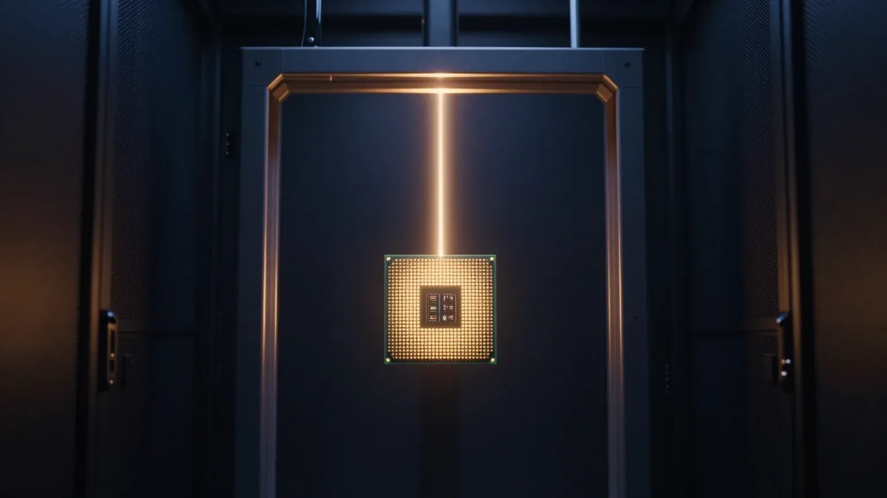
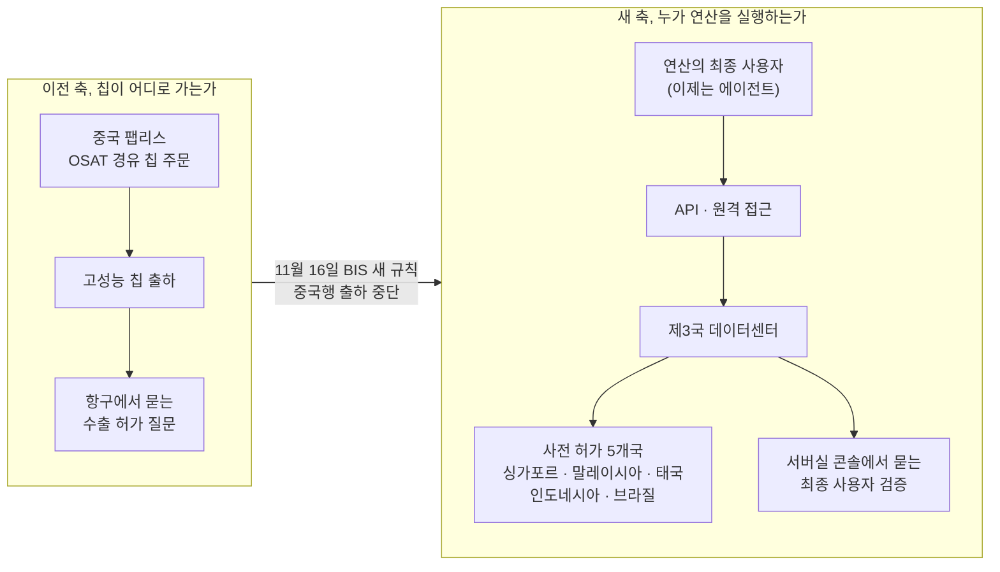

*글의 핵심 개념을 형상화했습니다.*

## 서버실에 갑자기 생긴 질문

11월 16일, 미국 시각. 미국 상무부 산업안보국(BIS)이 새로운 수출 규칙을 내렸다. 재무부와 국가안보보좌관실(NSC) 지시로 나온 잠정 최종규칙(IFR)은 중국 기업이 제3국 데이터센터를 거쳐 첨단 AI 반도체에 원격으로 접근하는 것을 금지한다. 한 줄로 요약하면, 통제가 칩의 최종 목적지에서 연산 자원의 최종 사용자로까지 확장된 것이다. 규제 당국의 시선이 물건의 이동 경로에서, 그 물건을 실제로 쓰는 쪽으로 이동했다.

금지 대상이 칩이라는 물건이 아니라 원격으로 접근하는 행위라는 점이 중요하다. 즉, 타인 소유 데이터센터에서 연산을 빌려 쓰는 지점까지 손이 닿는다는 뜻이다. 데이터센터 운영자에게 이는 전례 없는 질문이다. 계약서에는 구매자 이름이 쓰여 있지만 이제는 전력을 최종적으로 누르는 회사의 이름까지 확인해야 한다. 동시에 미국 정부는 싱가포르, 말레이시아, 태국, 인도네시아, 브라질 등 5개국으로의 수출에 사전 허가를 요구했다. 연산 시장에는 여권 시대가 열렸다고 볼 수 있을 것이다.

## 끊긴 우회로

규칙이 나오기 전까지 우회로가 하나 있었다. 중국 팹리스가 독립 패키징과 테스트(OSAT) 업체를 경유해 고성능 칩을 주문하고, 해당 설계가 수출통제 대상이 아님을 확인받으면 미국 정부 직접 승인 없이 출하할 수 있었던 것이다. 삼성전자와 TSMC는 16일 새 규정의 후속 조치로 중국 고객사에 수출 심사 전까지 특정 프로세서 출하 중단을 통보했다. 이 통로가 원천적으로 끊긴 것이다.

중단 범위는 예상보다 넓다. 비AI 스마트폰 용도 칩에 적용되던 기존 예외 조항까지 폐지되어, 샤오미와 오포, 비보에 쓰이는 첨단 칩으로도 확대되었다. 바이두의 쿤룬과 바이트댄스가 직격이다. 업계는 스마트폰용 칩은 추후 허가가 승인될 가능성이 크지만 심사 기간 동안 완제품 생산 일정에 상당한 차질이 빚어질 것으로 보인다.

더 눈여겨볼 것은 시점이다. 미국 정부는 칩이 움직이는 길을 먼저 끊고 이제 연산이 실행되는 지점으로 손길을 옮겼다. 규제 축이 '제품'에서 '서비스'로 이동했다는 뜻인데, 이는 연산을 빌려주는 데이터센터와 클라우드가 검증의 대상이 된다는 것을 의미한다. 과거에는 항구에서 물었던 수출 허가 질문이, 이제는 서버실의 콘솔 화면에서 묻히고 있다.

한 장의 지도로 다시 말하면, 칩을 따라가던 통제가 이제 연산의 최종 사용자를 따라가는 것입니다. 항구의 수출 허가 질문, 5개국의 사전 허가, 서버실 콘솔의 최종 사용자 검증이 같은 축 위에 놓이는 구조입니다.

한국에는 이 구도가 이중적 의미로 다가온다. 중국행 고성능 칩 공급이 막히면서 SMIC의 생산능력 한계와 메모리 가격 급등이 겹쳐 수급난은 심화되고, 반대로 중국 외 지역의 GPU와 AI 칩에 대한 수요는 올라가는 구조이다. 파운드리와 소버린 클라우드라는 두 역할을 동시에 가진 한국은 '수출통제와 무관한 대체 공급과 실행 환경'으로 포지셔닝될 기회가 열렸다. 다만 삼성 파운드리 사업의 중국 관련 매출 불확실성과 글로벌 공급망 리스크 역시 함께 관리해야 할 과제로 남는다.

## 규제될수록 변동되는 것

문이 닫히는 쪽이 있는 곳에서는 방이 새로 지어지고 있다. 네이버는 북미 AI 추론 기업과 20MW 규모 AI 팩토리의 첫 공급 계약을 체결했다. 4~5년간 총 2조원 규모로, 내년 상반기 개시가 예정되어 있으며 2028년까지 200MW 확보가 목표이다. 한국은 5개국 사전 허가 목록에 없지만 국내 데이터센터와 파운드리가 고객사의 최종 모회사와 연산 목적을 확인하는 공급망 관리 체계를 강화하라는 요구를 받을 수 있다는 분석이 나온다.

이 베팅에는 비용이 뒤따른다. 네이버의 3분기는 매출 3조 4,724억원, 영업이익 4,513억원으로 전망치를 하회했고 영업이익률은 18.2%에서 13.0%로 내려앉았다. 인프라비가 전년 대비 29.1%, 마케팅비가 32.3% 늘며 매출 증가율을 웃돈 결과이다. 증권가의 공통 분석은 '투자 효과가 비용보다 먼저 반영되는 구간'이라는 것인데, 20MW 공급 계약은 그 인프라 비용을 매출로 되돌리는 첫 걸음으로 읽힌다.

미국 쪽에서는 데이터센터 건설의 병목이 칩과 설비 부족에서 법률과 규제로 이동했고 빠르면 2027년 하반기에야 실마리가 풀릴 것으로 전망된다. 유휴 발전설비 활용과 추론용 데이터센터의 MW급 분산 건설 대안이 부상하고, 배터리 저장장치(BESS)가 전력 완충의 핵심으로 꼽힌다. 그 한가운데에서 AMD는 19일 장중 최대 11% 급락 후 8% 안팎으로 마감을 기록했는데, 원인은 '순환금융' 논란이다. GPU 투자를 누가 돈으로 돌리느냐의 질문이 이제 주가 변수로 올라온 것이다.

알리바바는 가장 공격적인 카드를 꺼낸다. 2027년까지 모든 AI 모델 훈련을 자체 T-헤드 칩으로 전환한다는 발표와 함께, 2분기 AI 클라우드 매출은 전년 대비 53% 증가한 610억 위안을 기록했다. 자체 칩, 클라우드, 모델을 수직으로 잇는 풀스택 전략이 재무 성과로 입증되는 모습이다. 씨티의 알리시아 얍 애널리스트는 이 어닝 서프라이즈를, 알리바바의 AI 전략이 파라미터 경쟁에서 기업 고객 ROI 극대화와 심층 통합형 에이전트 워크플로우 중심으로 진화하고 있다는 신호로 읽는다. 연산의 원천이 나뉘면, '누가, 어디에서, 어떤 전력을 쓰는가'의 질문은 더 커질 수밖에 없다.

## 돈은 계속 들어온다

한편 자본시장은 다른 종류의 베팅을 하고 있다. 오픈AI 출신이 설립한 앤트로픽이 19일 현지 시각 나스닥에 상장하며 전략적 투자자 사모 배정을 포함해 총 1,073억 달러를 조달했다. AI 모델 개발사로는 최초의 상장 기록이기도 하다. 지난 6월 스페이스X가 세운 IPO 최대 기록을 깨는 규모이다. 상장 첫날 주당 111.5달러로 거래를 시작해 공모가 83달러보다 17% 높은 가격에 마쳤고 장중 시가총액은 2조 달러를 넘었다. 시장조사기관 CFRA의 애널리스트는 이 상장을 지난 20년간 가장 중요한 IPO로 평가했다.

이 기록적 상장이 남기는 질문은 돈의 규모가 아니라, 그 돈이 갚아야 할 몫이다. 프런티어 모델의 학습과 추론에 필요한 막대한 GPU 인프라 비용을 매출로 감당할 수 있느냐. AI 거품론은 이 상장을 통해 본격적인 시험대에 오릅니다. 자본시장은 연산을 확보하기 위해 돈을 쏟아붓고 규제 당국은 그 연산의 사용자를 가리는 일종의 게임이 동시에 진행되고 있는 것입니다.

상장이 성공적으로 안착하면 국내 시장에도 파도가 옵니다. 글로벌 AI 투자 신뢰가 확립되면 국내 데이터센터와 GPU 프로젝트의 후속 투자, 차입 여건이 개선되어 인프라 투자 사이클이 빨라질 수 있습니다. 클로드 같은 프런티어 모델의 기업용 이용이 확대되면 모델 서빙과 추론 인프라 수요, 토큰 소비량이 함께 커지고 이는 GPUaaS와 추론 최적화 솔루션 수요로 직결됩니다. AI 기업 밸류에이션의 기준점 자체가 올라간다는 점은, 국내 소버린 AI와 GPU 클라우드 사업의 투자 매력을 한 단계 높이는 효과이기도 합니다.

## 전력을 실행하는 사용자는 이름이 없다

그런데 이 게임의 판이 한 번 더 기울어집니다. '연산의 사용자'는 더 이상 사람이나 회사를 가리키지 않기 시작했습니다. 에이전트를 가리킵니다.

누스 리서치의 에이전트 허메스는 마이크로소프트 팀즈와 애저에 네이티브로 통합 발표되었습니다. 일일 처리량은 약 2조 토큰, OpenRouter 공개 오픈 에이전트 선두를 지키고 있으며 GitHub 스타는 26만 4,700개에 이르렀습니다. 그런데 기업용 배포는 팀즈 스토어가 아니라 고객 테넌트 내 비공개 커스텀 블루프린트 방식입니다. 공식 저장소 기준으로는 과도기에 머무르는 형태라고 할 수 있습니다. 애저 컨테이너 앱 샌드박스가 격리된 마이크로VM으로 1초 내 기동하고 유휴 시 컴퓨트를 해제하는 방식으로 운영되는 점은, 에이전트 실행 환경이 앱이 아니라 일급 리소스로 표준화되고 있다는 방증입니다. 허메스의 '콜렉티브 위즈덤'은 개인이 반복 업무를 성공적으로 처리한 절차를 스킬로 자동 축적해 조직 단위의 재사용 지식으로 쌓는 구조입니다. 정부가 추진하는 6G 네트워크 운영 체계 역시 각 영역의 자율운영 AI 에이전트와, 그 다수를 관리하는 도메인 오케스트레이터가 스티어링 휠을 잡는 구조입니다. 과기정통부는 2028년에서 2032년까지 5년간 6G 완전자율 네트워크 핵심기술 연구개발에 총 8,000억원을 투입하는 한편, 개별 영역의 자율운영 레벨5와 종단 간 통합 운영 레벨4.5 달성을 목표로 삼고 있습니다. 메가존은 소버린 원화 스테이블코인의 대표 활용처로 'AI 에이전트가 이용자를 대신해 결제한다'는 시나리오를 제시했습니다.

국내에서는 에이전트 경제가 이미 비용 숫자로 나타나고 있습니다. LG유플러스는 자체 AI 모델과 통용 모델의 비교 검증에서 코딩 과제 운영비를 약 90% 줄였고, 모델 라우팅만으로도 일반 질의 처리 비용 25% 이상, 코딩 에이전트 비용 30% 이상 절감이라는 내부 테스트 결과를 냈습니다. 토큰 최적화 논문 2편은 뉴립스 2026 워크숍에 채택되었습니다. 정부도 같은 방향으로 보고 있습니다. 2027년 AI와 ICT R&D 예산은 합산 시 사상 처음 2조원을 돌파하며, 정부가 제시한 '2027 AI·ICT 10대 이슈'에는 풀스택 소버린 AI와 토큰 효율성 극대화가 함께 이름을 올렸습니다. 주권과 연산 비용이 국가 전략 수준으로 끌어올려진 것입니다.

상황이 이렇습니다. 규제 당국은 전력에 대해 처음으로 '누가'를 묻기 시작했고 전력을 실행하는 존재는 이미 이름 하나로 지울 수 없는 것이 되었습니다. 네트워크에는 운전수가 생기고 결제 화면에는 대행자가 생기고 서버실의 최종 사용자는 계약과 테넌트와 API 뒤에 앉아 있습니다.

## 연산에 주민등록을 줍니다

그러면 다음 2년간 기업 AI 플랫폼이 답해야 할 질문은 하나입니다. 누가, 어떤 권한으로, 어느 기계 위에서, 무엇을 실행했고 얼마를 소비했는지를 기록으로 보여줄 수 있느냐입니다.

Paxis는 ThakiCloud의 Agent-Native Cloud로서, 이 질문을 사후 로그가 아니라 일급 리소스로 다룹니다. Skills, Tools, Policies, Audit Logs가 실행 전에 등록되고 관리됩니다. 에이전트가 스스로 처리할 범위는 자율도 L0에서 L3까지 단계별로 정해지고 정책 게이트가 그 선을 넘는 순간 제동하며 모든 처리 이력은 감사 로그에 남습니다. 어떤 모델이나 스킬을 실행하든 격리된 샌드박스 안에서만 돌아서 실행 환경은 언제나 봉인된 상태입니다. 폐쇄망과 데이터 주권을 요구하면 플랫폼 자체가 소버린 온프레미스 K8s 환경으로 동행합니다.

연산의 원천이 나뉘는 지금은, 모델 선택도 과업 단위로 벌어집니다. 최근 공개된 수능 대시보드에서 오픈AI와 구글 모델이 450점 만점으로 공동 1위를 기록한 가운데, 국내 최상위 K-엑사원 2.5는 414.7점으로 35.3점 차에서 추격했습니다. 과업의 난이도에 따라 모델의 적정 가격이 달라지는 현실에서, 작업별 모델 선택을 맡는 CostRouter와 MCP 커넥터, 스킬 마켓은 에이전트가 '어디의 전력을, 얼마에, 어떤 권한으로' 쓸지를 설계하는 장치로 전환됩니다.

16일의 규칙은 '칩이 어디로 가는가'라는 질문을 '누가 연산을 실행하는가'로 바꿨습니다. 그리고 그 질문에 답할 존재, 에이전트는 이미 팀의 대화창과 네트워크, 그리고 곧 결제 화면에서 일하고 있습니다. 다음 인프라 경쟁은 전력이 더 비싸거나 더 싸다는 것에서 가려지지 않습니다. 전력이 어떤 여권으로 실행되는가에서 가려질 것입니다.

## 참고 자료

이 글은 아래 뉴스를 종합해 작성했습니다.

- 글로벌이코노믹, [알리바바, 美 첨단 칩 규제 정면 돌파… "자체 칩 'T-헤드'로 차세대 AI ..."](https://www.g-enews.com/view.php?ud=2026112007531812270c8c1c064d_1)
- EBN, ["삼성전자·TSMC, 미 수출통제 강화에 중국행 첨단 칩 출하 중단"](https://www.ebn.co.kr/news/articleView.html?idxno=1732409)
- 글로벌이코노믹, [AMD도 ‘순환금융’ 논란…엔비디아 반사이익에 제동](https://www.g-enews.com/view.php?ud=202611200747065579a1f309431_1)
- 인더뉴스, [[인더컴퍼니] 네이버, 본업 둔화에 낮아진 눈높이…AI 팩토리가 반전 이...](https://www.inthenews.co.kr/news/article.html?no=94759)
- 연합인포맥스, ["美 데이터센터 건설 지연…'유휴 전력설비·BESS' 대안 부상"](https://news.einfomax.co.kr/news/articleView.html?idxno=4445649)
- 이데일리, [“AI도 수능 봤다”…오픈AI·구글 450점 만점, 한국 AI 성적은?](https://www.edaily.co.kr/News/Read?newsId=01361206645647688&mediaCodeNo=257)
- 토큰포스트, [허메스 에이전트, 팀즈·애저 연결…팀즈 스토어 아닌 비공개 배포](https://www.tokenpost.kr/news/ai/441146)
- 이코노미톡뉴스, [LG유플러스, AI 성능·비용 동시 잡는다… 코딩 운영비 90% 절감](http://www.economytalk.kr/news/articleView.html?idxno=425416)
- 디지털데일리, [통신망도 '자율주행' 시대…정부, 6G NW AI 에이전트 개발 추진](https://www.ddaily.co.kr/page/view/2026112002301345469)
- 바이라인네트워크, [메가존, 소버린 원화 스테이블코인의 핵심은 ‘정산’](https://byline.network/?p=9004111222628526)
- 정보통신신문, [AI·ICT 성장 흐름 바뀐다…내년 실전적 R&D 추진](https://www.koit.co.kr/news/articleView.html?idxno=209984)
- SBS Biz, [[부자들의 투자노트] CFRA "앤트로픽 IPO, 역대 가장 중요"](https://biz.sbs.co.kr/article_hub/20000347724?division=NAVER)

