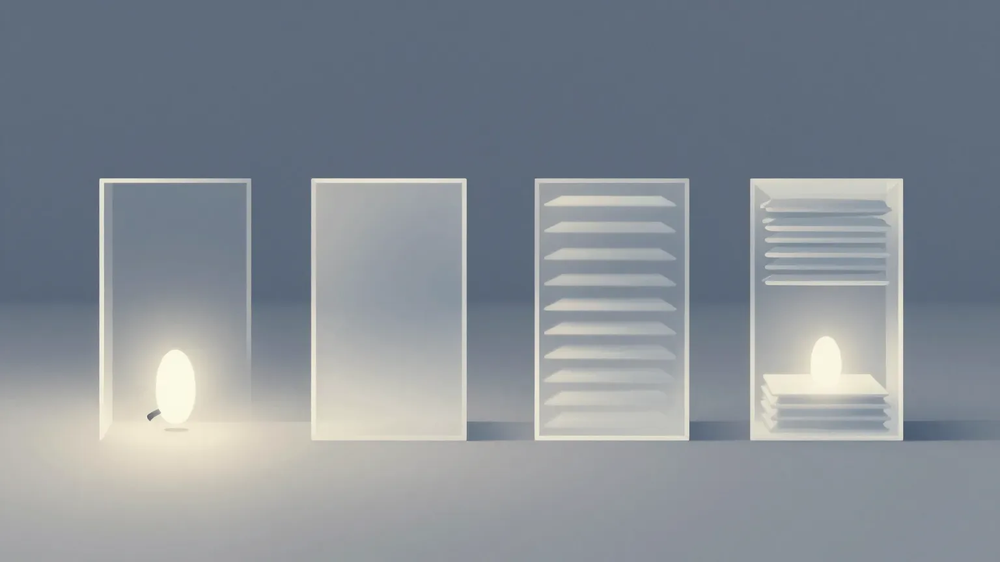

박수는 뒤에, 확인은 먼저. 코드를 쓰고 보고서를 만들어 내고 금융 작업을 다루는 에이전트를 돌리는 독자라면, 그 순서가 곧 실행 환경의 설계 기준이 됩니다. 오늘 아침 다이제스트는 그 기준을 뒷받침하는 신호를 한자리에 모았습니다. 수학의 증명과 그 검증, 인간만 증명 초안, 연구 성능을 재는 벤치마크, 소형 오픈 모델, 그리고 4.5GW. 테이블 위의 다섯 가지가 같은 층을 가리킨다는 뜻입니다. 하루 중 가장 큰 수학적 성취가 검증 대기 중인 주장으로 뉴스를 타기까지 했고 업계의 첫 반응은 판정대였습니다.

*생성은 하나, 검증은 네 개. 오늘의 비대칭을 형상화했습니다.*

## 주장으로 나온 증명

Anthropic 소속 수학자 Levent Alpöge가 Claude의 보조를 받아 리만 가설 증명을 제시했습니다. 리만 가설은 소수의 분포를 다루는 수학의 대표적 미해결 문제인가. 이 증명이 확인되면 현대 수학에서 손꼽히는 성취가 되죠. 그런데 이날 뉴스의 헤드라인은 검증이었습니다. Lean 핵심 팀과 독립 검증자들이 이 증명을 확인했습니다. 검증에 참여한 Lean 커널은 서로 다른 4곳이었으며 에러는 0건이었습니다.

Lean 커널은 증명을 기계적으로 검사하는 프로그램인 셈입니다. 증명의 내용을 커널이 받아들일 수 있는 형식으로 작성하면, 커널은 증명을 통과시키거나 거부합니다. 커널이 확인하는 것은 증명 각 단계가 앞 단계와 공리 위에서 성립하는지입니다. 한 단계라도 맞지 않으면 커널은 증명을 통째로 거부합니다. 판정은 계산이 내리는 쪽으로 옮겨갔습니다. 참여 주체를 보면 구도가 선명해집니다. 생성과 가장 가까운 진영인 Lean 핵심 팀과, 가장 먼 진영인 독립 검증자가 함께 앉았습니다. 검증에 쓴 커널은 네 개, 각각 달랐습니다. 생성한 쪽은 하나였고 검증한 쪽은 네 개였습니다. 그 비대칭이 이 사건의 뉴스입니다.

과거의 AI 증명 스토리는 '만들었다'에서 끝났습니다. 이번 것은 '검증했다'에서 끝났습니다. Claude의 보조가 생성 과정에 있었기 때문에, 업계는 검증 쪽의 독립성에 무게를 놓았습니다. 사람이 혼자 쓴 증명이라면 소수의 확인으로 충분했을 법한 성취에, 독립 판정이 먼저 붙었습니다.

기업 질문으로 되집어 보면, 명백한 공백이 한 줄 생깁니다. 내가 돌리는 에이전트가 코드와 보고서를 내놓을 때, 그것을 만든 쪽과 독립적인 검증 경로를 두고 있습니까. 생성은 매일 늘어난다는 것을 우리는 알고 있습니다. 검증을 늘린다는 것은 아직 아무도 하지 않는다는 것이죠.

## 반대편의 940쪽

다른 주장은 사람에게서 왔습니다. 수학자 Alessandro Masullo가 일반 리만 가설, GRH의 순수 인간 증명 초안을 공개했습니다. 분량은 940쪽이고 공개 시점은 AI 기반 증명 주장이 나온 것과 같은 날이었습니다.

GRH는 리만 가설을 일반화한 문제입니다. 그래서 두 주장은 같은 작업이 아닙니다. 하나는 리만 가설이고 다른 하나는 그 일반화입니다. AI 보조의 증명이 뉴스를 타기 시작한 시점에서 '인간만'이 증명 초안의 속성이 되기도 했습니다. 순수함을 선언해야 하는 순간, 그것이 얼마나 드문 일이 되었는지를 알려줍니다. 다만 둘을 나란히 놓으면 차이는 선명합니다. 사람의 증명은 초안입니다. 결론이 되려면 동료 검토라는 경로를 거쳐야 하고 그 경로가 새로운 것은 아닙니다. 속도도 그리 빠르지 않죠. 새것은 AI 증명의 경로였습니다. 기계가 검사할 수 있는 형식으로, 독립 커널 4곳에 판정을 맡길 수 있는 경로가 증명에 붙어 있었던 것입니다.

같은 날이라는 시점도 하나의 신호입니다. AI의 주장이 나온 바로 그날, 인간만 증명이라는 초안이 테이블에 올려진 것을 '인간 경로가 아직 살아 있다'는 선언으로 읽지 않을 수 없습니다. '초안'이라는 말에도 주의할 필요가 있습니다. 940쪽이 검토를 받을 준비물이기 때문에, 인간의 증명 역시 공개된 순간부터는 주장의 반열에 듭니다.

이 대비를 읽을 때, 넘어선 안 되는 선이 있습니다. 인간 증명이 열등하다는 것도, AI 증명이 이미 신뢰할 만하다는 것도 아닙니다. 둘 다 아직 주장을 벗어나지 못했습니다. 940쪽의 초안은 동료 검토를 기다리고, 커널 4곳의 무오류 판정을 받은 증명도 수학계의 최종 결론과는 다른 단계입니다. 생성 능력이 폭발한 시대에는 검증 경로가 주장을 가르는 변수가 됩니다.

## 판정의 일도 점수화되기 시작했다

판정대의 일은 오늘 아침 표준화되기 시작했습니다. AlphaXiv가 OpenResearch Intelligence Index를 출시했습니다. AI 모델이 엔드투엔드로 과학 연구를 수행하는 성능을 측정하는 첫 오픈소스 벤치마크입니다. Claude Opus 5.5가 이 벤치마크에서 1위를 기록했습니다.

엔드투엔드라는 말의 범위가 넓습니다. 문제를 고르고 문헌을 읽고 추론을 이어가서 산출물을 내놓기까지, 연구의 전 과정을 측정한다는 뜻입니다. 수학 시험 점수도 코딩 평가도 아닙니다. 연구를 할 수 있는지가 측정 대상이 된 것입니다.

오픈소스라는 말이 붙은 다음 의미가 있습니다. 벤치마크의 방식이 열려 있으면 누구든 판정자의 측정을 다시 계산하고 점검할 수 있습니다. 판정자 자체가 검증받을 수 있는 형식이라는 뜻이죠.

그 의미는 한 단계 더 갑니다. 검증받지 않는 연구 능력은 이 인덱스 아래에서는 연구 능력으로 안 잡힙니다. 생성은 잘하면서 검증은 약한 모델은 순위표에서 아래로 가라앉습니다. 생성을 점수화하는 벤치마크는 늘 많았지만, 연구 자체를 점수화하는 오픈 벤치마크가 나온 것은 점수화의 대상이 한 층 올라왔다는 뜻입니다.

테이블 위의 다른 뉴스와 겹치는 대목도 있습니다. 1위를 기록한 Claude Opus 5.5는, 같은 피드에서 리만 가설 증명에 보조로 나선 Claude와 같은 가문의 모델입니다. 생성을 돕는 쪽과 연구 성능을 재는 쪽이 같은 모델 경쟁장에 놓인 국면이, 하나의 테이블 위에서 만납니다.

## 판정은 더 이상 비싸지 않아도 된다

검증의 경제학도 이 피드에서 움직였습니다. Thinking Machines가 Apache 2.0 라이선스의 26B 파라미터 모델 Inkling 2 Mini를 출시했습니다. 32GB 램의 Mac 랩톱에서도 도는 크기이며 CyberBench 벤치마크에서 Claude Opus 5.5와 동률을 이뤘습니다.

플래그십과 동률이라는 수치는, 검증과 검사 용도로는 플래그십이 필요 없다는 계산에 들어갈 수 있는 수입니다. 최상위 모델과 어깨를 나란히 한 쪽이, 32GB 랩톱에서 도는 크기가 되는 순간입니다. 생성의 비용이 내려가면 검증을 붙일 여지도 넓어집니다. 검사 한 번의 단가가 내려가면, 붙이지 않던 검사까지 붙일 수 있게 됩니다.

다른 한 편은 Qwen3.8-27B용 슈퍼어댑터의 이야기입니다. xhigh thinking 설정에서 평균 패스율을 55.5%에서 63.5%로 끌어올렸습니다. 하나는 새 모델 출시이고, 다른 하나는 기존 모델의 패치입니다. 방향이 다르고 크기도 다른 것입니다. 하지만 공통은 하나입니다. 검사하고 검증하는 일에는 가장 비싼 블랙박스가 필요 없는 셈입니다.

Apache 2.0은 라이선스 이름 이상입니다. 검증기 자체가 감사받을 수 있는 조건이죠. 26B 모델이 랩톱에서 도는 것은, 검증 쪽의 비용 구조가 생성 쪽과 다르다는 뜻입니다. 검증을 돌리는데 기가와트를 임대할 필요가 없기 때문입니다.

뉴스의 반대 끝에는 생성 쪽이 있습니다. Oracle이 OpenAI와의 4.5GW 규모 인프라 계약 이행에 필요한 자금을 전액 확보했습니다. 현재 투자 사이클에서 자금을 완전히 조달한 첫 하이퍼스케일러가 되었습니다. 4.5GW 규모의 자금이 생성의 자리에 몰리는 국면입니다. 그 사이 판정의 자리는 32GB 랩톱 위이고 라이선스는 공개이고 가격은 어댑터 하나 값입니다. 생성에는 기가와트를 붓고 검증에는 노트북을 놓는 비대칭이 현재의 구조입니다. 생산이 비싸고 신뢰가 싼 시대라고 하면, 그 비대칭의 이름이 됩니다.

## 판정대의 자리

오늘 아침의 신호는 한 방향으로 모입니다. 희소가 이동했다는 것입니다. 이동한 쪽은 검증 경로와 그 기록입니다. 에이전트를 돌리는 기업에게는 이 문장이 설계 질문을 바꿉니다. 에이전트의 산출물은, 코드든 보고서든 금융 작업이든, 주장입니다. 만든 쪽과 독립적인 검증 경로가 검사하기 전까지는, 산출물이란 말보다 주장이란 말이 정확합니다.

그 검증 경로는 어떤 모양을 가질 수 있습니까. 코드라면, 그 코드를 쓴 쪽이 아닌 별도의 경로로 실행되고 점검되는 테스트와 정적 검사입니다. 보고서라면 출처 데이터와의 대조 확인입니다. 금융 작업이라면 정책과 맞지 않으면 실행을 멈추는 게이트입니다. 공통점은 검증이 생성과 독립된 자리에서 이루어지고 그 기록이 어딘가에 남는다는 것입니다.


<!--
  animated-architecture-diagram - self-contained D3 embed template.
  HuggingFace research-article style: declarative NODES/EDGES/SEQ model,
  data(solid)/event(dashed) edges, hover-trace + tooltip, flow-dot animation
  along edge paths, replay button, scroll-into-view autoplay, reduced-motion +
  light/dark aware. The renderer injects window.__ARCH_SPEC__ at the marker.
  Format (D3 machinery + CSS) is owned by this committed template; the model
  only authors the JSON spec (content). See references/spec-schema.md.
-->



*생성은 하나, 검증은 독립된 자리의 여러 개. 주장은 판정을 받고, 기록은 감사 로그에 남습니다.*

검증의 기록이 쌓이면, 산출물이 주장이었던 시점을 언제, 어떤 경로가 검사했는지 설명할 수 있습니다. 문제없이 지나면 기록은 비용이고 문제가 생기면 기록은 자산이 됩니다. 수학적 증명이 받았던 대우를, 기업의 산출물도 받기 시작하는 순간입니다.

생성은 경쟁이 붙으면 가격과 성능으로 갈아끼울 수 있습니다. 검증 경로는 부품을 받는 자리의 구조입니다. 부품은 얼마든지 바뀌지만 자리는 쉽게 바뀌지 않습니다. 판정대가 외부에 있으면 산출물이 판정을 받을 때마다 비용을 지불합니다. 판정대가 실행 환경의 구조가 되면, 판정은 실행의 일부가 됩니다. 자리의 구조가 바뀌어야 검증도 바뀝니다.

Paxis는 ThakiCloud의 Agent-Native Cloud로, 정식 제품 v1.1 GA에서 운영 중입니다. Paxis에서 Skills, Tools, Policies, Audit Logs가 일급 리소스로 관리되며 검증 경로는 실행 환경의 구조로 들어갑니다. 에이전트의 작업이 실행되기 전에 정책 게이트가 점검하고 모든 실행은 감사 로그에 기록되며, 격리 샌드박스 안에서 이루어집니다. 자율도는 L0에서 L3까지 단계별로 거버넌스를 받아 사람의 승인 없이 에이전트가 얼마나 움직일 수 있는지가 관리 항목이 됩니다. 형식 검증 도구와 검사기는 MCP 커넥터와 스킬 마켓으로 스킬에 연결되는데 그 자리가 바로 오늘 아침 커널 4곳의 무오류 판정을 기업의 작업 수준으로 이식하는 자리입니다. 검증 작업은 싼 로컬 모델로 간다는 흐름에 CostRouter의 작업별 모델 선택이 라우팅을 맡습니다. 판정대 전체를 소버린, 온프렘 Kubernetes(ai-platform) 위에 놓으면 주장은 기업의 건물을 나가지 않고 결과로 바뀝니다.

리만 가설 증명에 대한 업계의 첫 반응은 커널 4곳과 에러 0건이었습니다. 박수는 그 뒤에 왔습니다. 기업의 에이전트에게도 가장 큰 산출물이 나오면, 첫 반응은 같은 자리에서 나와야 합니다. 판정대의 자리가 설치된 곳에서, 산출물은 결과로 남습니다.

## 참고 자료

이 글은 아래 뉴스를 종합해 작성했습니다.

- HuggingNews, [Thinking Machines' 26B Inkling 2 Mini Ties Claude Opus 5.5 on CyberBench](https://huggingnews.com/ai/thinking-machines-26b-inkling-2-mini-ties-claude-opus-55-on-cyberbench-0958f389)
- HuggingNews, [Four Independent Lean Kernels Verify Anthropic Mathematician's Riemann Hypothesis Proof With Zero Errors](https://huggingnews.com/ai/four-independent-lean-kernels-verify-anthropic-mathematicians-riemann-hy-9481fc1e)
- HuggingNews, [Masullo Releases Human-Only Proof of GRH Same Day as AI Claim](https://huggingnews.com/ai/masullo-releases-human-only-proof-of-grh-same-day-as-ai-claim-3d23dcdd)
- HuggingNews, [Opus 5.5 Tops AlphaXiv's First Open Benchmark for AI Autoresearch](https://huggingnews.com/ai/update-opus-55-tops-alphaxivs-first-open-benchmark-for-ai-autoresearch-aeadac61)
- HuggingNews, [Oracle Becomes First Fully Funded Hyperscaler for 4.5 GW OpenAI Contract](https://huggingnews.com/ai/oracle-becomes-first-fully-funded-hyperscaler-for-45-gw-openai-contract-f9ef21fd)
- HuggingNews, [Qwen3.8-27B Super-Adapter Lifts Mean Coding Score to 63.5% Across Three Harnesses](https://huggingnews.com/ai/qwen38-27b-super-adapter-lifts-mean-coding-score-to-635percent-across-th-bffc3d76)