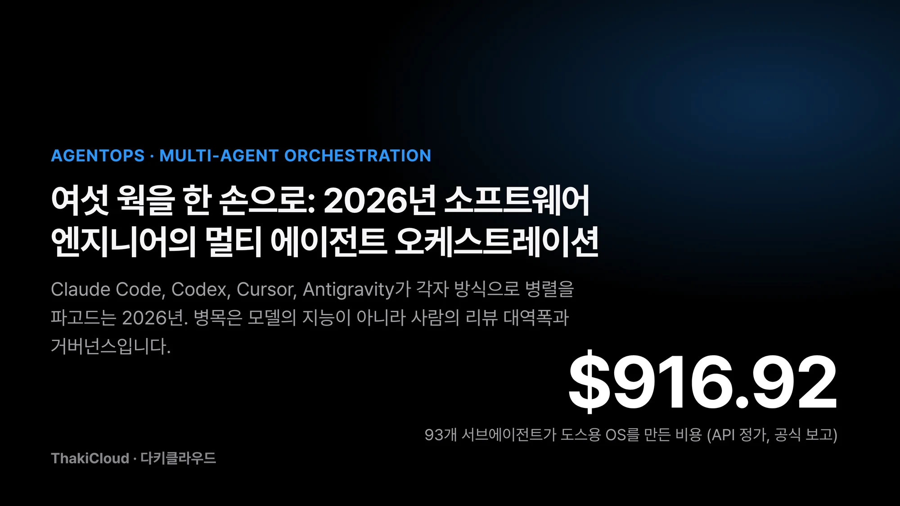
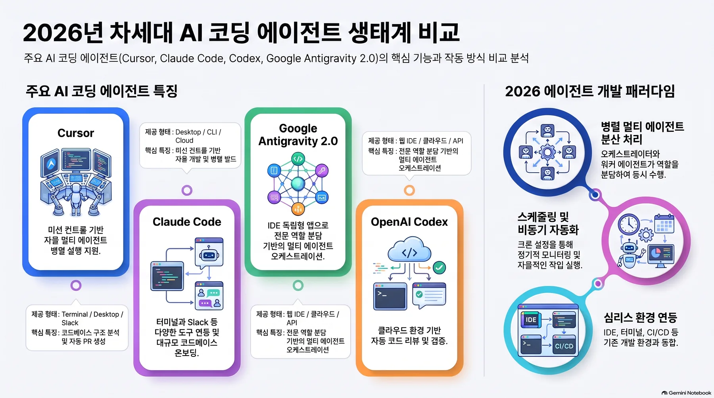
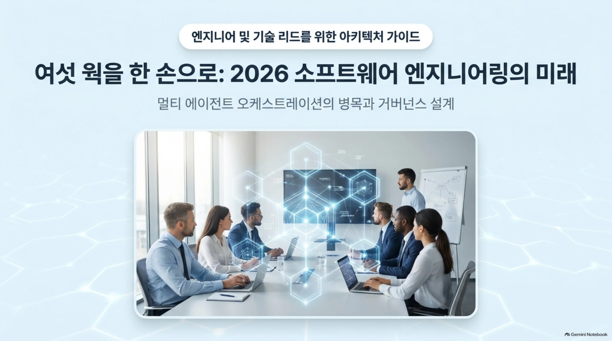
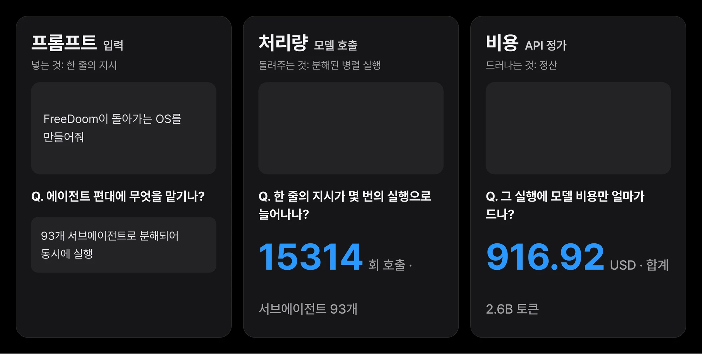
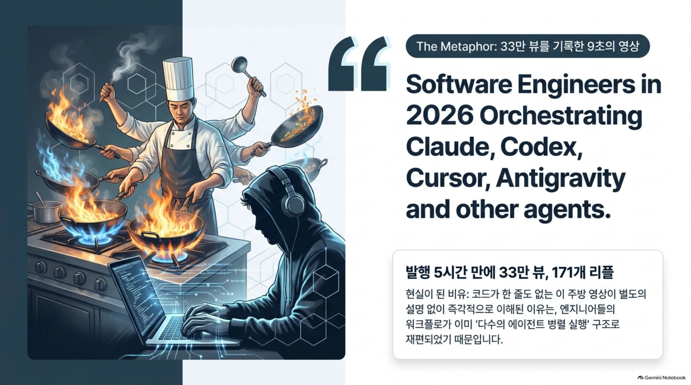
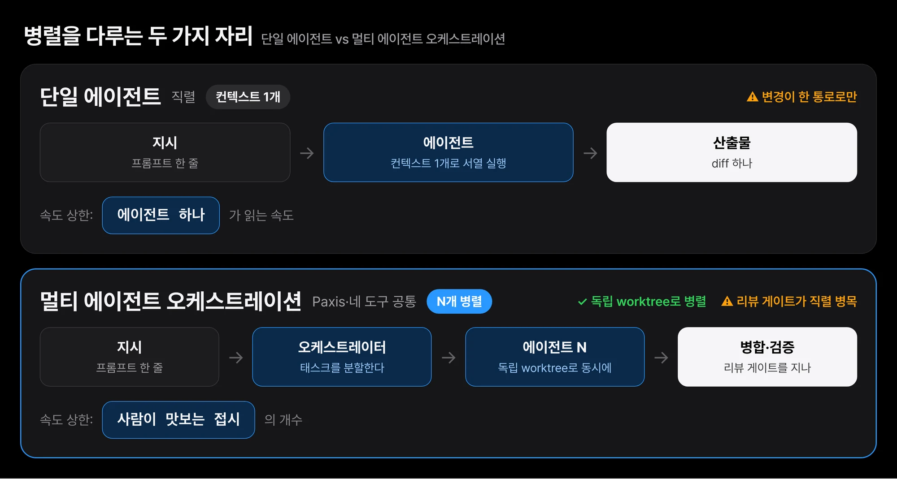
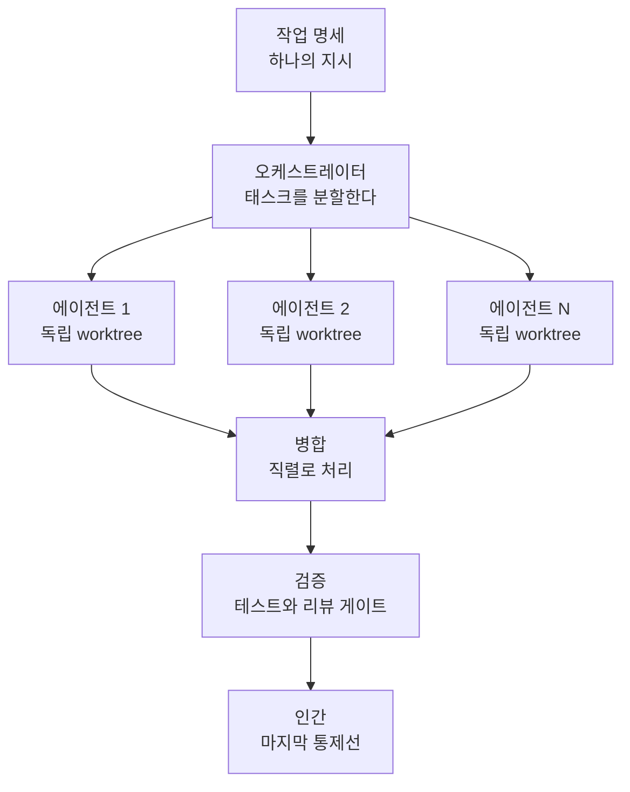
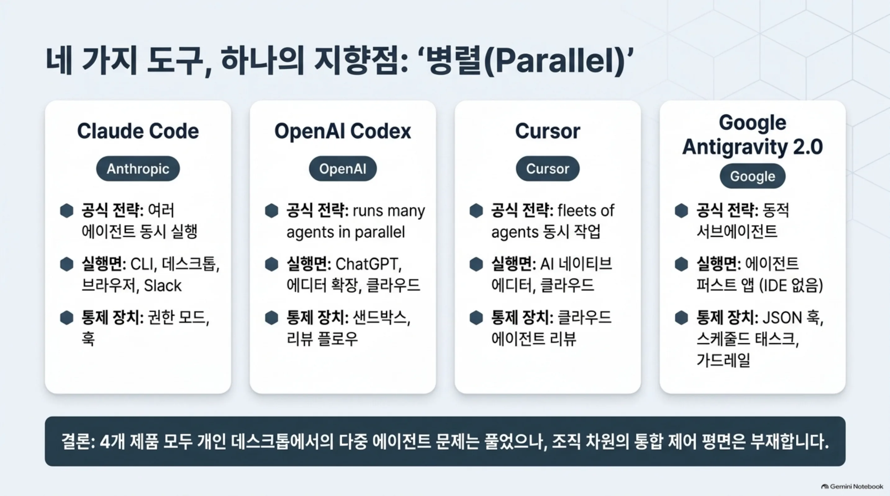
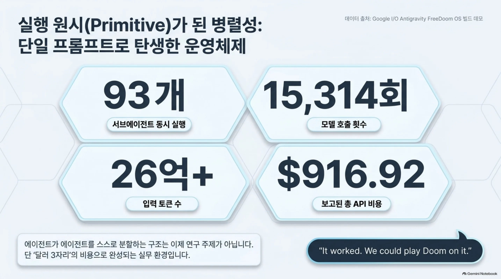
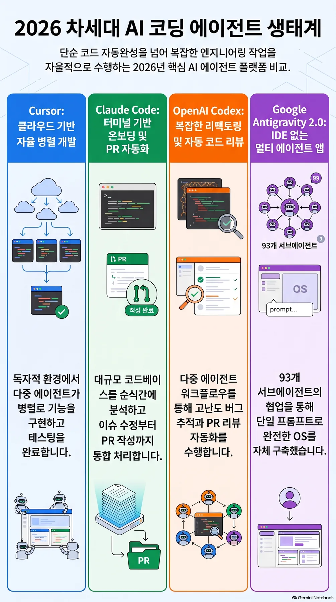

오늘 아침, 셰프 한 명이 여섯 개의 웍을 동시에 다루는 9초짜리 영상이 X를 달아올렸습니다. 자막은 "Software Engineers in 2026 Orchestrating Claude, Codex, Cursor, Antigravity and other agents"이었습니다. 발행 5시간 만에 33만 뷰, 리플 171개. 코드가 한 줄도 없는 영상이 이렇게까지 간 이유는, 댓글을 단 사람들이 셰프의 자리가 아닌 자기 자리에 접속했기 때문입니다.

이 글은 여러 코딩 에이전트를 동시에 돌리기 시작했거나, 지금 시작할지 결정해야 하는 엔지니어와 기술 리드에게 씁니다. 먼저 결론부터 말합니다. 멀티 에이전트 오케스트레이션의 병목은 모델의 지능이 아니라, 사람의 리뷰 대역폭과 거버넌스입니다.

이 주장은 추상이 아닙니다. Google이 지난 5월 I/O에서 공개한 Antigravity 데모는 단일 프롬프트로 93개 서브에이전트를 달아 FreeDoom이 돌아가는 운영체제를 완성했고, 공식적으로 보고한 비용은 API 정가 $916.92였습니다. 이 글은 네 개 도구가 병렬을 각각 어떻게 파고드는지부터 시작해, 그 데모가 증명하는 것과 증명하지 않는 것이 무엇인지, 그리고 병목이 된 현장이 어떻게 설계되는지까지 순서로 다룹니다.

*셰프의 여섯 웍처럼, 엔지니어의 여섯 에이전트를 한 손으로 다루는 2026년. 병목은 사람의 리뷰 대역폭과 거버넌스에 있습니다.*

## 한 9초짜리 영상이 33만 뷰를 가져간 이유

영상의 주인공은 스트라이프 셔츠를 입은 셰프 한 명입니다. 그는 가스 화덕 여섯 개에 올려진 웍에 초롱초록한 강낭콩을 넣고 한 웍을 저으며 다음 웍으로 손을 옮깁니다. 기름을 붓고 간을 보고 재료를 날립니다. 여섯 웍이 동시에 불 위에 있는데도 화면에서 긴장은 보이지 않습니다. 영상은 9초이고 수치는 없습니다.

그런데 자막이 붙자 이 장면은 즉시 다른 것으로 읽혔습니다. "2026년의 소프트웨어 엔지니어는 Claude, Codex, Cursor, Antigravity를 오케스트레이션한다"는 한 줄이 셰프의 손동작에 겹쳐진 겁니다. 네 개 이름이 모두 지금 실제로 존재하는 코딩 에이전트 제품이기 때문에, 이 비유는 곧 기술 설명이 됩니다.

여기서 주목할 것은, 비유가 설명 없이 읽힌다는 사실입니다. 2년 전엔 "엔지니어가 에이전트 여러 개를 동시에 돌린다"고 하면 추가 설명이 필요했습니다. 지금은 9초짜리 주방 영상이 그 상태를 더 정확히 압축합니다. 워크플로가 이미 그 모양으로 변했다는 뜻입니다.

<!-- nlm-visual -->

*NotebookLM이 소스를 종합해 생성한 인포그래픽입니다.*

## 네 개 도구가 "병렬"을 각자 방식으로 파고들었다

트윗 자막에 이름이 오른 네 개 제품을 각자의 공식 사이트에서 확인했습니다. 공통점은 명확합니다. 2026년형 제품 페이지가 "병렬"이라는 단어를 직접 쓰고 있다는 겁니다.

Claude Code는 Anthropic의 코딩 에이전트로, 명령줄, 데스크톱, 에디터, 브라우저, 휴대폰, Slack까지 실행면이 넓습니다. 공식 페이지는 여러 Claude 에이전트를 한 번에 돌리는 것을 전제로 하고 있습니다. OpenAI Codex는 ChatGPT 안, 에디터 확장, CLI, 그리고 Codex 클라우드라는 네 갈래로 제공되고 페이지에는 "runs many agents in parallel"이라는 문장이 그대로 적혀 있습니다.

Cursor는 AI 네이티브 에디터에서 출발해 클라우드 에이전트를 얹은 제품입니다. 공식 사이트는 "fleets of agents that work in parallel"을 쓰고 한 번의 지시에 에이전트 편대를 보내는 그림을 전면에 내세웁니다. Antigravity는 Google의 에이전트 퍼스트 개발 플랫폼으로, 2025년 11월에 첫 공개된 뒤 2026년 5월 I/O에서 2.0으로 다시 나왔습니다. 2.0은 IDE를 뺀 에이전트 매니저 형태이고 비동기 태스크 관리, 동적 서브에이전트, JSON 훅, 스케줄드 태스크를 새로 얹었습니다.

네 제품의 병렬 전략은 겉보기엔 비슷해 보여도, 손이 닿는 자리가 다릅니다. 표 하나에 정리했습니다.

| | Claude Code | OpenAI Codex | Cursor | Google Antigravity |
|---|---|---|---|---|
| 공식 문구가 말하는 병렬 | 여러 Claude 에이전트 동시 실행 | "runs many agents in parallel" | "fleets of agents" 동시 작업 | 동적 서브에이전트 (2.0) |
| 주 실행면 | CLI·데스크톱·에디터·브라우저·Slack | ChatGPT·에디터 확장·CLI·클라우드 | AI 네이티브 에디터·클라우드 에이전트 | 에이전트 퍼스트 앱 (IDE 없음) |
| 통제 장치 | 권한 모드·훅 | 클라우드 샌드박스·리뷰 플로우 | 클라우드 에이전트 리뷰 | JSON 훅·스케줄드 태스크·가드레일 |

(각 제품 공식 사이트 기준, 2026년 11월 23일 확인.)

여기서 한 가지 경계를 긋겠습니다. 네 제품 모두 "개발자 한 명이 자기 데스크톱에서 에이전트 N개를 돌린다"는 문제를 푼 도구입니다. 조직이 에이전트 N개를 돌리고 그 모든 행동을 감사하려면, 이 표에는 없는 자리가 하나 더 필요합니다. 이 자리는 뒤에 Paxis 절에서 다시 만납니다.

## 93개 서브에이전트가 도스가 돌아가는 운영체제를 만들었다

병렬이 실행 원시(primitive)가 됐다는 증거로는, Antigravity 팀의 운영체제 빌드가 가장 구체적입니다. Google은 공식 블로그에 "단일 프롬프트"로 FreeDoom이 돌아가는 기능성 OS를 만들어 공개했습니다. 보고된 수치는 이렇습니다.

서브에이전트 93개, 모델 호출 15,314회, 입력 토큰 3억 3,900만 개 이상. 전체 합계는 26억 토큰을 넘었습니다. 모델은 Gemini 3.5 Flash였고 API 정가로 따진 비용은 $916.92였습니다. 그리고 결론 문장은 짧습니다. "It worked. We could play Doom on it." 도스가 그 위에서 돌았다는 겁니다. 같은 방식으로 만들었다는 AlphaZero의 플레이 가능 버전, 사진 편집 스위트, 실시간 메시징 앱, 멀티유저 협업 플랫폼 목록도 함께 공개됐습니다.

*Google Antigravity 공식 블로그의 OS 빌드 보고서에서 인용한 수치입니다. 도스가 돌아가는 OS를 "단일 프롬프트" 하나로 만들어낸 실행의 입출력입니다.*

이 데모가 증명하는 것은 명확합니다. 에이전트가 에이전트를 나누고 나눠진 에이전트가 동시에 일하는 구조가 연구 주제에서 제품 원시로 이동했다는 겁니다. 비용도 함께 내려앉았습니다. 공식 보고로는 "달러 3자리"입니다.

하지만 이 데모가 증명하지 않는 것이 더 큽니다. 26억 토큰의 변경을 사람이 리뷰했다는 문장은 보고서에 없습니다. "도스가 돌아간다"는 것은 "이 OS가 안전하고, 유지보수 가능하고, 다음 주에도 돌아간다"는 뜻이 아닙니다. 데모에서 검증 비용은 보고서 밖으로 밀려나 있습니다. $916.92에는 모델 비용만 들어 있고 리뷰 비용은 안 들어 있습니다. 이 구분이 이 글의 남은 절반을 가릅니다.

## 웍이 여섯 개가 되면 셰프의 손이 병목이 된다

여기서 다시 주방으로 돌아갑니다. 셰프가 여섯 웍을 동시에 다룰 수 있는 조건이 무엇이었을까요. 첫째, 각 웍의 재료가 독립적이었다. 강낭콩을 볶는 웍과 다른 웍이 같은 국물을 쓰지 않았습니다. 둘째, 맛보기는 여전히 셰프 한 명이 했습니다. 셋째, 모든 웍은 셰프의 손이 닿는 반경 안에 있었습니다.

코딩 에이전트의 병렬 실행도 이 셋이 조건입니다. 그런데 세 가지가 전부 인간 쪽에 비용을 남깁니다.

첫째, 컨텍스트 균열입니다. 각 에이전트는 자기 worktree의 컨텍스트만 봅니다. A 에이전트가 바꾼 인터페이스를 B 에이전트가 모르면, 병합 순간 충돌이 나거나, 충돌 없이도 서로의 가정을 깨뜨립니다. 웍이 늘면 "같은 국물"을 쓰는 레시피가 늘고 균열은 조합수만큼 커집니다.

둘째, 병합은 여전히 직렬입니다. 에이전트는 병렬로 일해도, git merge는 한 번에 하나씩 처리합니다. 여섯 에이전트의 변경을 하나의 코드로 모으는 순간은 병렬의 이익이 검증되는 순간이자, 실패가 드러나는 순간이기도 합니다.

셋째, 리뷰 대역폭입니다. 셰프가 여섯 접시를 동시에 맛볼 수 없듯, 엔지니어도 여섯 에이전트의 산출물을 동시에 읽지 못합니다. 인간이 마지막 통제선이라면, 병렬의 속도는 사람의 읽는 속도에 의해 상한이 정해집니다.

넷째, 비용 통제가 선행되어야 합니다. 26억 토큰은 데모 한 번의 양입니다. 데모에는 예산이 없어도 됩니다. 매일 도는 워크플로에는 있어야 하고 없으면 $916.92가 월 단위 숫자로 복제됩니다.

*왼쪽 레인은 단일 에이전트의 직렬 경로, 오른쪽 레인은 멀티 에이전트 오케스트레이션입니다. 병렬의 이익은 병합과 검증 단계에서 정산됩니다.*

도표가 말하는 바는 하나입니다. 병렬의 이익은 에이전트가 일하는 동안 나지 않고, 병합과 검증에서 정산됩니다. 그래서 오케스트레이션의 설계 단위는 "에이전트 몇 개"가 아니라 "리뷰 게이트 몇 개"로 세어야 합니다.

## Paxis는 "이 자리가 비어 있다"는 전제를 안 씁니다

이 지점에서 ThakiCloud의 관점을 넣겠습니다. 네 개 도구가 푼 문제는 "개발자 한 명이 자기 자리에서 에이전트 N개를 돌리는 것"입니다. 그다음 문제는 "조직이 에이전트 N개를 돌리고, 모든 행동을 감사하고, 비용을 정산하는 것"입니다. 이 자리가 비어 있다는 전제로 설계된 제품은 아직 없습니다.

Paxis는 ThakiCloud의 Agent-Native Cloud로, 이 자리를 일급 리소스로 취급하는 제어 평면입니다. 셰프의 주방에 다시 번역해 보면 이렇습니다.

태스크 분할은 Paxis의 DAG 멀티에이전트가 합니다. 프롬프트 한 줄에 맡기는 게 아니라, 코드 소유의 실행 계획으로 분할되고, 각 단계의 산출물이 다음 단계의 입력이 됩니다. 셰프가 여섯 웍에 재료를 나누며 넣듯, 오케스트레이터가 에이전트마다 컨텍스트를 나누며 줍니다.

스테이션은 격리 샌드박스입니다. 각 에이전트는 다른 에이전트의 file system을 건드릴 수 없고, 여기는 worktree 격리를 넘어 실행 환경 자체의 격리입니다. 웍이 각각 다른 화덕 위에 있는 이유가 그것과 같습니다.

레시피북은 Skill Harness입니다. Paxis는 960개 이상의 스킬을 BM25로 골라 실행면에 올립니다. 셰프가 새로 웍을 하나 더 늘릴 때 레시피를 처음부터 쓰지 않듯, 에이전트가 새로운 태스크를 받을 때 필요한 스킬을 골라 씁니다.

보건검사권은 정책 게이트와 감사로그가 잡습니다. 모든 행위, 어떤 에이전트가 어떤 도구로 어떤 파일에 무슨 일을 했는지가 게이트를 지나야 하고, 지나면 기록됩니다. 셰프가 맛본 적 없는 접시가 나갈 수 없는 것처럼, 정책 게이트를 지나지 않은 행동이 조직에 도달하지 못합니다.

ai-platform 렌즈에서도 한 줄입니다. 멀티 에이전트 실행은 결국 GPU 비용입니다. 에이전트 N개가 모델 호출 M회를 할 때, 그 호출이 큐를 지나고, 정산되고, 예산을 넘지 않는지는 ai-platform의 Kueue 큐와 비용 계층이 담당합니다. 주방이 넓어질수록 가스 계량기가 정밀해져야 하는 것과 같은 이유입니다.

## 쓰기 전에 알아둘 네 가지

비유가 좋은 것은, 비유가 끊어지는 지점을 가르쳐 주기 때문입니다. 네 가지씩 정리합니다.

하나, 결합된 태스크는 병렬의 대상이 아닙니다. 파일과 기능의 경계가 모호한 코베이스에서 에이전트를 여섯 개 나누면, 여섯 개의 변경이 같은 국물을 쓰게 됩니다. 병렬의 전제는 재료의 독립성이고, 이게 없으면 병합 비용만 선불입니다.

둘, 리뷰 게이트는 옵션이 아닙니다. Antigravity 데모는 "돌았다"가 "바르게 돌았다"를 증명하지 않는다는 것을 보여주었습니다. 에이전트 산출물이 병렬로 나오면, 리뷰는 직렬로 들어오고, 그 직렬이 전체 속도를 결정합니다. 리뷰 대역폭을 늘리지 않는 조직은 웍만 늘리는 조직입니다.

셋, 비용 측정은 전제입니다. $916.92는 데모 한 번의 숫자입니다. 매일 도는 워크플로에서는 이 숫자에 "매일"이 붙습니다. 예산 캡과 토큰 정산이 없으면, 병렬의 이익은 인보이스에서 증발합니다.

넷, 셰프는 여전히 한 명입니다. 여섯 웍을 다루는 것도 셰프이고, 여섯 접시를 맛보는 것도 셰프입니다. 멀티 에이전트는 엔지니어의 손을 여섯 개로 늘려 주지 않습니다. 한 손이 더 멀리 닿게 해 주는 것입니다. 닿는 범위가 넓어질수록, 마지막 맛보기가 더 깊어질 수밖에 없습니다.

## 끝으로

9초짜리 주방 영상은 비유였습니다. 하지만 비유가 설명 없이 읽힌다는 것은, 현장이 이미 그 모양이라는 뜻입니다. 네 개 도구가 병렬을 각자 방식으로 파고들고, Google은 93개 서브에이전트로 OS를 만드는 데모를 공개했고, 이제 질문은 "돌릴 것인가"에서 "어떻게 거스르고 정산할 것인가"로 이동했습니다.

오늘 할 수 있는 첫 실험은 작습니다. 에이전트 둘, worktree 둘, 리뷰 게이트 하나. 이 셋이 돌아가는 자리에서, 병목이 어디에 앉는지 직접 확인해 보세요. 셰프가 여섯 웍을 한 손으로 다루는 장면의 진짜 교훈은, 웍의 수가 아니라 맛본 횟수에서 나옵니다.

멀티 에이전트 오케스트레이션의 한계는 모델의 지능이 아니라, 사람의 리뷰 대역폭과 거버넌스입니다. 주방이 넓어질수록, 가스 계량기와 보건검사권이 더 정밀해져야 하는 것이 이 영역의 법칙입니다.

---

**출처**

- [Jaydeep (@_jaydeepkarale) 트윗, 2026-11-23](https://x.com/_jaydeepkarale/status/2124717898203849052) (원 영상 9초, 셰프 여섯 웍)
- [Google Antigravity: Our agents built an OS](https://antigravity.google/blog/google-antigravity-built-an-os) (93 서브에이전트, $916.92)
- [Google Antigravity 2.0, 2026-05-19](https://antigravity.google/blog/introducing-google-antigravity-2) (동적 서브에이전트, JSON 훅)
- [Anthropic Claude Code](https://claude.com/product/claude-code)
- [OpenAI Codex](https://openai.com/codex/) ("runs many agents in parallel")
- [Cursor](https://cursor.com) ("fleets of agents that work in parallel")

<!-- nlm-visual -->

*NotebookLM이 소스를 종합해 생성한 인포그래픽입니다.*
