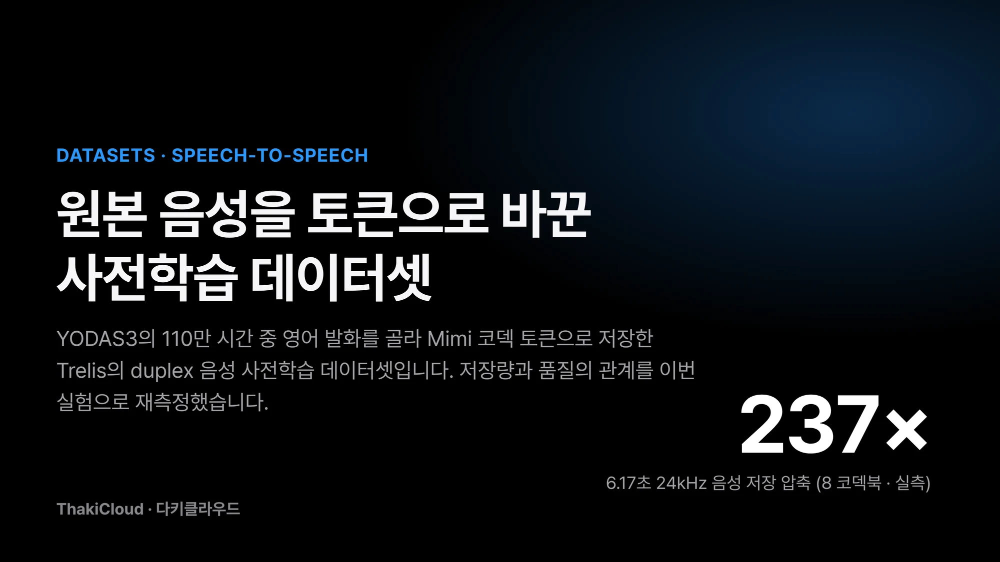
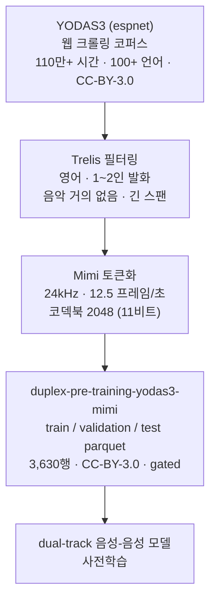
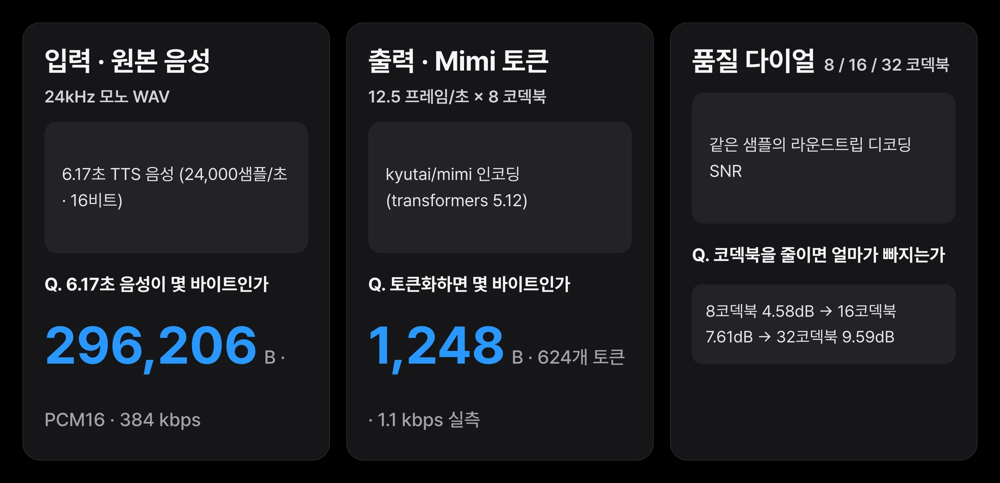
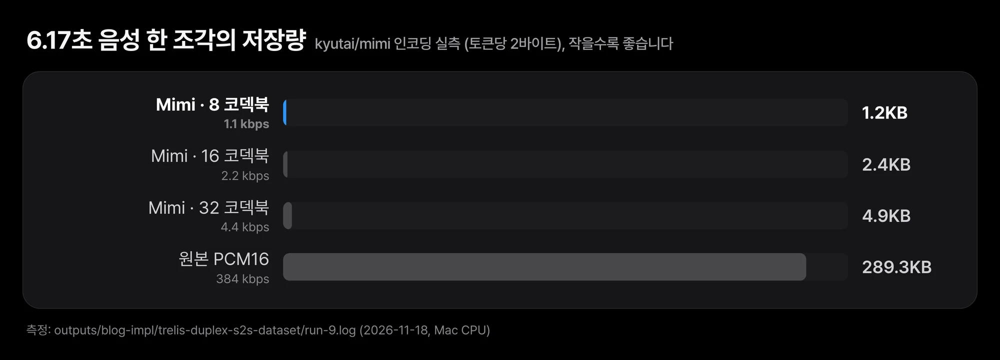

*원본 음성을 토큰으로 바꾼 사전학습 데이터셋. 핵심 수치는 6.17초 24kHz 음성 저장 압축 237배(8 코덱북, 실측)입니다.*

음성 에이전트나 음성-음성(speech-to-speech, S2S) 모델을 다루는 사람이면 언젠가 데이터 저장 방식의 결정을 마주하게 됩니다. 대화 로그를 원본 음성으로 두느냐, 코덱 토큰으로 바꾸느냐. 이 결정은 저장비뿐 아니라 학습 파이프라인 전체의 I/O 구조를 바꿉니다.

이 결정이 지금 중요해진 이유는, 대화 양쪽이 동시에 말하는 duplex 음성이 연구 데모를 넘어 제품으로 이동하면서 남길 대화 데이터의 양이 함께 커지고 있기 때문입니다.

최근 그 결정의 기준이 될 공개 데이터셋이 하나 나왔습니다. 음성 어노테이션과 음성 분리 서비스를 하는 회사 Trelis가 2026년 11월 18일, 음성-음성 사전학습용 데이터셋 `Trelis/duplex-pre-training-yodas3-mimi`를 Hugging Face에 올렸습니다. 이 회사가 계획한 S2S 데이터셋·모델 시리즈의 첫 번째입니다.

이 데이터셋의 가장 큰 특징은 원본 음성이 아니라 Mimi 코덱 토큰을 배송한다는 것입니다. 카드 설명대로 "컴팩트하게" 만들었다고 주장하는 만큼, 그 주장을 이번 실험으로 직접 재측정했습니다. 6.17초 분량의 24kHz 음성 샘플 하나를 Mimi로 인코딩한 결과, 8 코덱북 구성에서 원본 289KB가 1.2KB가 됐습니다. 237배 압축입니다. 이 글에서는 이 데이터셋이 무엇인지, 토큰화 주장이 어디까지 성립하는지, 그리고 사용하기 전에 알아둘 네 가지를 다룹니다.

## 음성 회사의 첫발: 원본 없이 토큰만 실어보내는 데이터셋

Trelis는 데이터셋 카드에서 음성 분리(speech separation)와 음성 어노테이션 서비스 연락처를 함께 남겼습니다. 즉, 이 데이터셋은 연구기관의 학술적 공개가 아니라 서비스 회사가 자기 파이프라인에서 쓰려는 데이터를 먼저 내놓은 사례입니다. 트윗 발표 문구도 "시리즈의 첫 번째"라고 적혀 있습니다.

데이터셋 카드를 읽을 수 있는 공개 정보만 정리하면 다음 표와 같습니다.

| 항목 | 값 (공개 페이지 실측) |
|---|---|
| 이름 | `Trelis/duplex-pre-training-yodas3-mimi` |
| 용도 | dual-track(두 트랙) 음성-음성 모델 사전학습 |
| 내용 | 영어, 1~2인 발화, 음악 거의·전무, 긴 스팬 |
| 출처 | YODAS3(영어)에서 shard·member로 참조 |
| 형식 | 원본 음성이 아닌 오디오 토큰 (Mimi) |
| 파일 | train / validation / test parquet |
| 규모 | 3,630행 (뷰어 메타데이터, 행 단위 미확인) |
| 라이선스 | CC-BY-3.0 |
| 접근 | gated (access 승인 필요) |
| 공개·업데이트 | 2026-11-13 생성, 2026-11-18 업데이트 |

"shard와 member로 참조한다"는 표현이 중요합니다. 데이터셋이 원본 오디오를 실어 나르는 게 아니라, 소스 코퍼스 안의 위치를 가리키는 인덱스 역할을 한다는 뜻입니다. 실제로 YODAS3 스키마에는 shard 필드가 존재하고, Trelis 데이터셋은 그 좌표로 원본을 가리킵니다. 원본이 필요한 사람은 좌표로 돌아가면 되고, 학습만 필요하면 토큰 그대로 써도 되는 구조입니다.

## YODAS3: 110만 시간에서 영어 발화만 추리는 필터

YODAS3는 espnet이 운영하는 웹 크롤링 오디오 코퍼스입니다. 공식 카드에 따르면 110만 시간 이상, 100개 언어 이상, CC-BY-3.0 라이선스이며, v1·v2와 다른 영상 집합을 크롤링해 중복을 피했다고 명시합니다. 자동 음성 인식, 음성 합성, 오디오 표현 학습 등 멀티모달 작업에 쓰입니다.

Trelis는 이 중 영어만 추렸습니다. 그리고 추린 기준이 데이터셋 카드에 적혀 있습니다. 긴 스팬(long spans)의 발화, 1인 또는 2인, 음악이 거의 없거나 전혀 없는 구간입니다. 사전학습 데이터로 쓸 때 이 세 조건이 왜 중요한지 보면, "duplex"라는 이름의 의도가 보입니다.



사전학습 단계에는 정밀한 발화 라벨보다 "두 사람의 대화가 길게 이어지는 자연스러운 음성 흐름"이 더 귀합니다. 음악이 없는 조건은 배경이 말소리만으로 가득한 구간, 즉 S2S 모델이 배워야 하는 신호와 간섭이 가장 명확한 구간을 고른 뜻으로 읽힙니다. YODAS3가 weakly labeled(라벨이 희박한) 코퍼스인 것과 대조하면, Trelis의 필터링은 라벨 품질이 아니라 신호 품질을 선별한 작업입니다.

"duplex"와 "dual-track"이라는 표현도 여기서 짚어 볼 가치가 있습니다. 카드가 "dual-track speech-to-speech models"를 목적지로 적는다는 것은, 한 대화의 양쪽(발화자 1, 발화자 2)을 따로 트랙으로 정리해 둔다는 뜻으로 읽힙니다. README가 gated라 트랙의 정밀한 정의는 확인할 수 없는 부분이지만, 1~2인 발화라는 필터 조건과 이름이 같은 방향을 가리킵니다. 풀듀플렉스 음성 모델은 한쪽이 말하는 동안 다른 쪽도 동시에 말하는, 교차와 겹침이 있는 대화를 모델링해야 하는데, 양쪽 트랙을 분리해 두면 "누가 언제 말했는지"를 명시적으로 배울 수 있습니다.

라이선스도 그대로 이어집니다. 소스 YODAS3가 CC-BY-3.0이고, Trelis 데이터셋도 CC-BY-3.0입니다. 출처 표기 조건을 지키면 학습에 쓸 수 있고, 파생물을 배포할 수 있는 구조입니다.

## Mimi 토큰: 32단 품질 다이얼이 숨어 있는 코덱

Mimi는 Kyutai가 개발한 신경 오디오 코덱입니다. 24kHz 음성을 1초에 12.5프레임, 프레임당 32개 코덱북으로 분해해 토큰을 만듭니다. 코덱북이란 음성의 특징을 이산 숫자(2048개 중 하나, 11비트)로 대표하는 표를 뜻합니다. 32개 중 첫 번째는 의미를 담는 semantic 토큰이고, 나머지는 음색·억양을 담는 acoustic 토큰입니다. Kyutai 공식 페이지에 따르면 처음부터 Moshi(풀듀플렉스 음성 어시스턴트)용으로 만들어졌고, 현재 Sesame CSM, VoXtream, LFM2-Audio 등도 이 코덱 토큰화를 쓰고 있습니다.

Mimi 모델 카드에는 "1.1 kbps"라는 비트레이트가 적혀 있습니다. 이번 실험에서 그 수치가 무엇을 의미하는지 확인할 수 있었습니다. 체크포인트를 열어보니 코덱북 레이어가 32개(semantic 1 + acoustic 31)였고, 첫 N개만 쓰도록 잘라 디코딩하면 비트레이트가 1.1 kbps, 2.2 kbps, 4.4 kbps로 나뉘었습니다. 모델 카드의 1.1 kbps는 첫 8개 코덱북 구성의 수치입니다.

```
8 코덱북   → 1.112 kbps  (모델 카드 주장과 일치)
16 코덱북  → 2.225 kbps
32 코덱북  → 4.449 kbps
```

다이얼이 이렇게 되는 구조는 RVQ(residual vector quantization, 잔차 벡터 양자화)라는 기법 때문입니다. 첫 코덱북이 음성의 큰 그림을 담고, 두 번째 코덱북이 첫 번째로 표현하지 못해 남은 잔차를 메우며, 이렇게 32단계까지 쌓입니다. 그래서 앞의 N개만 잘라도 디코딩이 가능하고, 잘라내는 개수에 따라 품질이 단계별로 떨어집니다.

즉, Mimi는 단일 비트레이트의 코덱이 아니라 32단 품질 다이얼입니다. 저장량이 급하면 8단으로 줄이고, 품질이 급하면 32단으로 올리는 식입니다. Trelis 데이터셋이 "Mimi 토큰"을 실어 나른다는 말에는 이 다이얼의 어느 단을 고른다는 선택지가 함께 들어 있습니다. 어느 단인지가 공개 정보에는 없어, 이번 실험에서 8·16·32단을 모두 재측정한 것입니다.


*6.17초 24kHz 음성 한 조각의 저장 형식. 왼쪽이 원본, 가운데가 Mimi 8코덱북 토큰, 오른쪽이 코덱북 수를 줄였을 때의 라운드트립 SNR입니다. 모두 이번 실험 실측 값입니다.*


*kyutai/mimi 인코딩 실측(토큰당 2바이트). 막대가 작아 보이는 것이 237배 압축의 진짜 모습입니다.*

## 6.17초 음성 하나를 실측한 결과

실험은 이렇게 했습니다. Hugging Face의 `kyutai/mimi` 체크포인트를 받아 transformers 5.12의 `MimiModel`로 불러오고, 우리 TTS 벤치마크의 6.17초 24kHz 모노 음성 샘플 하나를 인코딩한 뒤, 코덱북을 8·16·32개로 잘라 디코딩했습니다. Mac CPU에서 인코딩 0.11초, 풀 디코딩 0.093초였습니다.

| 구성 | 토큰 수 | 저장량 | 비트레이트 | 라운드트립 SNR |
|---|---|---|---|---|
| 원본 PCM16 | · | 296,206 B | 384 kbps | 기준 |
| Mimi · 8 코덱북 | 624 | 1,248 B | 1.112 kbps | 4.58 dB |
| Mimi · 16 코덱북 | 1,248 | 2,496 B | 2.225 kbps | 7.61 dB |
| Mimi · 32 코덱북 | 2,496 | 4,992 B | 4.449 kbps | 9.59 dB |

세 수치를 짚어 보겠습니다.

첫째, 압축비. 8 코덱북에서 원본 대비 237.3배, 16에서 118.7배, 32에서 59.3배입니다. 비트팩(11비트씩 밀어 넣는) 저장으로는 8코덱북이 858B까지 줄어듭니다.

둘째, 품질. SNR은 코덱북이 두 배씩 늘 때마다 3dB 안팎으로 오릅니다. 8단에서 4.58dB, 32단에서 9.59dB입니다. 다만 SNR은 주관적 품질과 같은 지표가 아닙니다. 이번 샘플은 TTS 합성 음성 하나였고, 디코딩 출력의 스케일이 입력 대비 0.93~0.96배로 약간 작게 나와 SNR이 저평가됐을 여지도 있습니다. "Mimi가 이 dB만큼의 품질"이라 단정하지 말고, 저장량 측정은 이번 실측, 품질 측정은 청취가 필요하다고 읽습니다.

셋째, 모델 카드의 주장. "1.1 kbps"는 32단이 아니라 8단 구성의 수치임이 확인됐습니다. 데이터셋 카드에서 Mimi 토큰이라고만 적힌 경우, 어느 단을 실은 것인지 확인해야 하는 이유가 여기 있습니다.

한 가지 한계를 먼저 적어 둡니다. 샘플로 쓴 6.17초 음성은 TTS 합성음입니다. 실인간 발화의 스펙트럼 분포와 다를 수 있고, 그 차이는 SNR 수치에 그대로 반영됩니다. 다만 코덱의 압축 구조(프레임률, 코덱북 수, 토큰당 비트 수)는 내용과 무관하므로, 저장량과 비트레이트 측정은 이 샘플 하나로 유효합니다.

## 1시간 대화의 저장 경제학

측정값을 1시간(3600초)으로 외삽하면, 원본 PCM16이 172.8MB인 대에 Mimi 8코덱북은 711KB입니다. 같은 대화 한 편이 240배가량 차이나는 저장량이 됩니다.

이 차이는 사전학습 데이터셋에서 특히 큽니다. S2S 모델이 배울 대화 데이터는 수백 시간에서 수만 시간 스케일로 불어나고, 그 데이터가 S3나 데이터레이크에 쌓이고, GPU로 이동하고, 배치로 읽히는 모든 단계마다 같은 배율이 반복됩니다. 원본으로 둘 때는 매 단계가 384 kbps이고, 8단 토큰으로 둘 때는 1.1 kbps입니다.

저장뿐 아니라 전송도 같은 배율입니다. 클러스터 내부에서 노드와 노드 사이를 오가는 원본 172.8MB는 체감상 크게 부담이 되지 않을 수 있습니다. 하지만 데이터셋을 여러 환경으로 복제하거나, 워크스페이스 밖으로 내보내는 시나리오에는 240배가 그대로 반영됩니다. 수만 시간 규모의 코퍼스를 한 번이라도 이동시키는 작업이라면, 원본으로 옮기느냐 토큰으로 옮기느냐가 비용표의 다른 줄이 됩니다.

또 다른 이점은 학습 파이프라인과의 정렬입니다. 토큰화된 음성 데이터는 텍스트 토큰과 같은 이산 시퀀스로 취급돼, 기존 LLM 사전학습 인프라(토크나이저, 패딩, 배치)를 그대로 재사용할 수 있는 구조에 가깝습니다. Trelis가 "사전학습용"이라고 적어둔 이유와 맞물립니다.

## 사용하기 전에 알아둘 네 가지

**1. gated입니다.** raw README에 접근하려면 Hugging Face에서 access 승인을 받아야 합니다. 공개 카드의 설명은 "It carries rich…"에서 끊겨 있고, 그 뒤에 어떤 메타데이터가 실리는지는 승인 전에는 볼 수 없습니다. 승인을 받으면 확인할 일정이 이미 정해져 있습니다. 스키마(필드 정의), 트랙 구조(dual-track이 실제로 어떤 컬럼으로 놓여 있는지), Mimi 구성(코덱북 몇 단을 실었는지), 그리고 샘플 구간 하나입니다. 이 글의 모든 수치는 공개 페이지와 자체 실측뿐입니다.

**2. 영어 전용입니다.** YODAS3가 100개 언어를 아우르지만 Trelis는 영어만 추렸습니다. 한국어 duplex 음성 연구를 위해 이 데이터셋을 곧바로 쓸 수는 없습니다. 다만 필터링 방식(긴 스팬, 1~2인, 무음)은 다른 언어에 그대로 이식할 수 있는 레시피로 읽힙니다.

**3. 코덱에 묶입니다.** 데이터가 Mimi 토큰으로만 실려 있으면, 디코딩하려면 Mimi가 필요하고, 다른 코덱으로 재인코딩할 수 없습니다. 토큰은 원본이 아니라 원본의 표현입니다. Trelis가 다음 시리즈에서 다른 코덱을 쓸 가능성도 열어 둬야 하는 이유입니다.

**4. 필터는 라벨이 아닙니다.** "음악이 거의 없다"는 선별 조건이지, 발화 라벨이 정밀하다는 보장은 아닙니다. 소스 YODAS3가 weakly labeled인 만큼, Trelis 데이터셋도 그 한계를 상속합니다. 사전학습에는 충분한 수준이지만, 정밀한 downstream 평가용으로는 별도 검증이 필요합니다.

## 음성 에이전트의 저장 경제학에서 어디에 들어가는가

다키클라우드는 두 쪽에서 이 문제를 마주합니다. Paxis(에이전트 플랫폼)에서 음성 에이전트가 대화할 때, 대화 로그를 원본 음성으로 남기면 1시간에 172.8MB가 쌓입니다. 로그는 검색·리플레이·평가의 대상이 되는 일급 데이터인데, 원본으로 두면 저장과 I/O 비용이 대화 길이만큼만 커지는 게 아니라 파이프라인 전체에 배수로 전가됩니다. Mimi 8단 토큰으로 남기면 같은 로그가 711KB입니다.

리플레이와 평가도 같은 이야기입니다. 음성 에이전트의 대화 로그는 회귀 평가와 감사의 원료인데, 원본 음성을 남기면 사례 하나를 다시 듣거나 다시 채점할 때마다 172.8MB의 이동을 반복합니다. 토큰 시퀀스로 남기면 로그는 샘플링·배치·동시 저장까지 가능한 객체가 되어, 텍스트 기반 LLM 평가 데이터 옆에 자연스럽게 들어갑니다.

ai-platform(학습 인프라) 쪽에서도 마찬가지입니다. 고객이 자기 대화 데이터로 S2S 모델을 사전학습하려면, 데이터가 어떤 형식으로 쌓여 있는가가 파이프라인의 시작점입니다. Trelis가 공개한 형태는 "코퍼스 + 필터 + 코덱 토큰"이라는 세 단계를 데이터셋 하나로 압축한 사례입니다. 같은 레시피를 자기 데이터에 쓴다면, 원본을 저장하되 토큰 인덱스를 함께 만들어 두는 것이 저장과 학습의 균형을 맞추는 현실적인 설계로 읽힙니다.

## 끝으로

음성 데이터의 저장 방식이 "원본 대 토큰"의 이분법이 아니라, 코덱북 수를 고르는 32단의 다이얼이라는 것이 이번 실험에서 확인한 가장 큰 점입니다. Trelis의 첫 데이터셋은 그 다이얼의 존재를 공개 데이터셋으로 보여 준 사례입니다.

오늘 바로 할 수 있는 첫 실험은 하나입니다. 자기 손에 있는 24kHz 음성 샘플 하나를 `kyutai/mimi`로 인코딩해, 8·16·32 코덱북의 저장량과 SNR을 재보는 것입니다. 이번 실험 스크립트는 `outputs/blog-impl/trelis-duplex-s2s-dataset/mimi_token_measure.py`에 두고 있습니다. 코덱북을 잘라 디코딩하는 한 줄이 핵심입니다.

원본 데이터셋과 소스 코퍼스, 그리고 Mimi는 아래에서 직접 확인해 볼 수 있습니다.

- 데이터셋: [Trelis/duplex-pre-training-yodas3-mimi](https://huggingface.co/datasets/Trelis/duplex-pre-training-yodas3-mimi) (gated)
- 소스 코퍼스: [espnet/yodas3](https://huggingface.co/datasets/espnet/yodas3)
- Mimi 체크포인트: [kyutai/mimi](https://huggingface.co/kyutai/mimi) · [Kyutai 코덱 설명](https://kyutai.org/codec-explainer/)
- 발표: TrelisResearch X 포스트(2026-11-18) · [타임라인 RT](https://x.com/hjguyhan/status/2122894104720031996)

출처: Trelis 데이터셋 공개 페이지(2026-11-18 접근), espnet YODAS3 공식 카드, Kyutai Mimi 모델 카드·공식 코덱 설명, 자체 실측(run-9.log, 2026-11-18).
